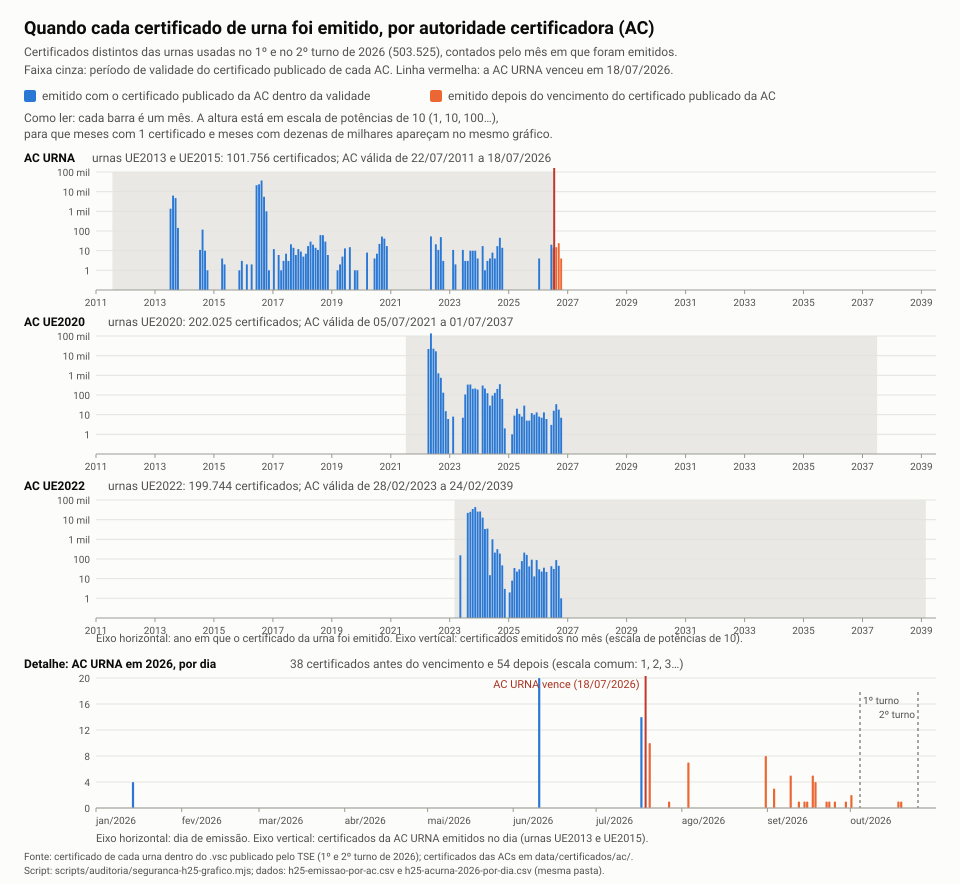

# 07. H25: os certificados das urnas e a AC URNA vencida

Perfil `engenheiro-seguranca-urna`, hipótese H25 ([hipoteses.md](../../hipoteses.md)), pedida pelo André em 30/10/2026: "o certificado da AC URNA venceu em 18/07/2026, antes dos dois turnos; não dá para comprovar quem emitiu os certificados; um sistema alterado poderia assinar dados com chave aceita; a totalização parece não conferir a validade".

Este documento testa os **certificados e a cadeia de confiança**. Os **votos** das urnas AC URNA são testados pelo estatístico, em outro documento.

Universo completo dos dois turnos: 499.207 diretórios oficiais no 2º turno e 499.207 no 1º, todos lidos, **0 erro de leitura**. São 503.525 certificados de urna distintos. **Ainda não revisado pelo cético.**

> **Termos.** Um *certificado* é um documento eletrônico que diz "esta chave pública pertence à urna X". Pense num RG: quem confere confia porque o RG foi emitido por um órgão. Aqui o órgão é a *autoridade certificadora* (AC). A *assinatura digital* da AC no certificado funciona como um carimbo que só ela consegue fazer: o carimbo depende de uma *chave privada*, um número secreto que só a AC tem. A *validade* do certificado é a data impressa no RG ("válido até"). A *cadeia* é a fila de quem confia em quem: urna ← AC URNA ← AC RAIZ UE.

## Resposta curta

1. **Fato, achado novo: a AC URNA continuou emitindo certificados de urna depois de vencer.** São 54 certificados com início de validade entre 20/07/2026 e 19/10/2026, de 23 urnas UE2013 e 31 UE2015. Todos foram assinados pela chave do certificado publicado da AC URNA, o que venceu em 18/07/2026: 54 de 54 conferem. Essas urnas votaram em 53 seções no 2º turno e em 45 no 1º. Duas receberam o certificado entre os turnos, em 18/10 e 19/10.
2. **Fato: esses 54 seguem o mesmo padrão das emissões normais, sem quebra na data do vencimento.**
   - O número de série continua a sequência: o último antes do vencimento é `34ae3a` (17/07) e o primeiro depois é `34aea5` (20/07).
   - Os 54 apontam, no campo que identifica a AC emissora, para o **mesmo** certificado de AC vencido ("AC RAIZ UE, série 03").
   - Vencem em 31/12/2037 23:00 UTC, o mesmo teto que as três ACs usam desde 2024.
   - O número da urna no certificado é o do pacote e o do BU, dentro da faixa do modelo.
   - Não há rastro de AC nova nem de outro emissor.
3. **Fato: nenhum certificado de urna repetido, trocado ou fora da validade da própria urna.**
   - 0 chave pública repetida entre certificados.
   - 0 número de série repetido na mesma AC.
   - 0 urna com dois certificados.
   - 0 certificado de urna vencido ou ainda não válido na data dos turnos.
   - Todos os 101.756 certificados AC URNA têm a assinatura da AC conferida aqui, nos dois turnos.
4. **Fato: os bytes zero a mais são só preenchimento de um campo de tamanho fixo.**
   - O campo tem 946 bytes. A assinatura da AC muda de tamanho de um certificado para outro (136 a 139 bytes), e o que falta é completado com zeros.
   - A proporção observada é a que a matemática da assinatura prevê: 56,27% / 37,42% / 6,26% / 0,051% (sobra 0/1/2/3 no 2º turno), contra 56,25% / 37,35% / 6,35% / 0,049% esperados.
   - Todos abrem como certificado X.509 e têm a assinatura da AC conferida.
5. **O que dá para afirmar** (item 5):
   - (a) A validade vencida não permite forjar nada: sem a chave privada, nenhum certificado novo confere (demonstração A).
   - (b) Um software alterado dentro de uma urna legítima assina com a chave verdadeira, e isso não aparece nos arquivos.
   - (c) Se a totalização confere a validade **não é testável** nos arquivos públicos. Mas os dados limitam as respostas possíveis: nenhum verificador padrão aceitaria os 54 certificados emitidos depois do vencimento usando o certificado publicado da AC URNA. A pergunta exata ao TSE está no fim.

Gráfico: [datas de emissão por AC](graficos/h25-emissao-por-ac.svg). Dados: [h25-emissao-por-ac.csv](graficos/h25-emissao-por-ac.csv) e [h25-acurna-2026-por-dia.csv](graficos/h25-acurna-2026-por-dia.csv).

## O ataque, visto pelo atacante

| Variante | O que o atacante precisa ter | Rastro esperado nos arquivos públicos | Procurado? | Resultado |
|---|---|---|---|---|
| A. Forjar um certificado de urna aproveitando que a AC venceu | Nada além dos arquivos públicos | Certificado que não confere com a chave da AC | Sim, todos (itens 1 e 5a) | 0. A data não entra na conta da assinatura |
| B. Emitir certificado para uma "urna" falsa com a chave da AC URNA | A chave privada da AC URNA (dentro do TSE) | Nome fora das faixas de urna, número de série fora da sequência, emissão perto da eleição, chave repetida, nome ≠ nº da urna no pacote e no BU | Sim (itens 1 e 2) | Nenhum nome fora da faixa, série contínua, 0 chave repetida. **Mas há 54 emissões depois do vencimento**, 2 delas entre os turnos |
| C. Software alterado numa urna legítima | Acesso à carga ou à urna e assinatura CEPESC (doc 04) | Nenhum no certificado. A urna assina com a chave verdadeira | Não se aplica | Fora do alcance (item 5b) |
| D. AC "renovada" sem registro, ou AC paralela | Acesso à AC RAIZ UE | Certificado de urna apontando para outra AC ou outro certificado de AC, emissor com outro nome | Sim (AKI e emissor, item 1) | 0. Todos apontam para o certificado publicado |
| E. Totalização que não confere a validade | Nenhum. É uma falha de processo | Não fica nos arquivos públicos | Não testável | Pergunta ao TSE (item 5c) |

## Método

- `seguranca-h25-certificados.mjs` lê o `.vsc` de cada diretório oficial, sem varrer `data/raw`. O caminho vem da linha da extração de integridade: 2º turno de `integridade/2t/<uf>.jsonl` e 1º turno de `integridade/1t-identificadores/<uf>.jsonl`.
- Do campo `[1]` do bloco de assinatura da urna (o certificado), o script grava:
  - formato (DER ou PEM), tamanho do campo, tamanho do DER, bytes que sobram e se são zeros;
  - número de série, emissor, sujeito, validade, algoritmos;
  - SHA-256 da chave pública e do certificado;
  - SKI e AKI (*identificador da chave da AC*: diz qual chave e, nas urnas AC URNA, qual certificado de AC emitiu este), keyUsage e basicConstraints.
- Também confere se o DER cortado abre como X.509 e se a assinatura da AC sobre o certificado confere:
  - AC URNA (ECDSA P-521): todos os diretórios dos dois turnos.
  - AC UE2020 e AC UE2022 (Ed521, conta lenta, cerca de 20 ms cada): só os 2.519 certificados do 1º turno que não estão no 2º. Os do 2º turno já foram conferidos por `integridade-lacres.mjs` (doc 02 da integridade, 0 falha).
- `seguranca-h25-analise.mjs` junta os dois turnos e conta por AC, por modelo, por sobra e por repetição.
- `seguranca-h25-acs.mjs` descreve as 3 ACs. `seguranca-h25-demonstracao.mjs` faz as demonstrações do item 5. `seguranca-h25-grafico.mjs` gera o gráfico.

## 1. Certificados de urna por AC

| | AC URNA | AC UE2020 | AC UE2022 |
|---|---|---|---|
| Modelos | UE2013, UE2015 | UE2020 | UE2022 |
| Diretórios 2º turno | 99.957 (UE2015 87.502, UE2013 12.455) | 200.504 | 198.746 |
| Diretórios 1º turno | 99.985 (UE2015 88.064, UE2013 11.921) | 200.463 | 198.759 |
| Certificados distintos (os dois turnos) | 101.756 | 202.025 | 199.744 |
| Algoritmo (assinatura da AC / chave da urna) | ECDSA-SHA512 / P-521 | Ed521 / Ed521 | Ed521 / Ed521 |
| AKI (chave da AC) igual ao SKI da AC publicada | 100% | 100% | 100% |
| AKI aponta para o certificado da AC | "AC RAIZ UE, série 03" em 100% | (não traz série) | (não traz série) |
| Emissão mais antiga / mais recente | 30/07/2013 / 19/10/2026 | 01/04/2022 / 22/10/2026 | 19/05/2023 / 02/10/2026 |
| Vencimento mais cedo / mais tarde | 08/04/2027 / 15/01/2038 | 09/12/2035 / 15/01/2038 | 25/01/2037 / 15/01/2038 |
| Validade da AC publicada | 22/07/2011 a **18/07/2026** | 05/07/2021 a 01/07/2037 | 28/02/2023 a 24/02/2039 |
| Emitidos antes de a AC existir | 0 | 0 | 0 |
| **Emitidos depois do vencimento da AC** | **54** (2º t: 53 diretórios; 1º t: 45) | 0 | 0 |
| Certificado de urna que vence depois da AC | **100%** (2º t: 99.957; 1º t: 99.985) | 2º t: 2.248; 1º t: 2.242 | 0 |
| Vencido na data do turno (04/10 ou 25/10) | 0 | 0 | 0 |
| Ainda não válido na data do turno | 0 | 0 | 0 |
| Assinatura da AC sobre o certificado | conferida aqui: 99.957 + 99.985, 0 falha | 2º t pelo doc 02 (0 falha); 1.521 só do 1º t conferidos aqui, 0 falha | 2º t pelo doc 02 (0 falha); 998 só do 1º t conferidos aqui, 0 falha |

**Datas de emissão** (certificados distintos, pelo ano de início da validade):

| Ano | AC URNA | AC UE2020 | AC UE2022 |
|---|---|---|---|
| 2013 | 12.529 | | |
| 2014 / 2015 | 140 / 10 | | |
| 2016 | 88.127 | | |
| 2017 a 2020 | 94 / 261 / 38 / 151 | | |
| 2022 | 137 | 198.866 | |
| 2023 | 64 | 1.407 | 151.217 |
| 2024 | 113 | 1.517 | 47.425 |
| 2025 | 0 | 123 | 783 |
| 2026 | 92 (38 até 17/07; **54 de 20/07 em diante**) | 112 | 319 |

A tabela por mês está em `graficos/h25-emissao-por-ac.csv`.



**Como ler:** cada painel é uma AC. As barras são os certificados emitidos em cada mês, em escala de potências de 10. A faixa cinza é a validade do certificado publicado da AC. A linha vermelha marca 18/07/2026. As barras laranja são certificados emitidos pela AC URNA depois dessa data. O último painel mostra só 2026, dia a dia, em escala comum.

### Os 54 certificados emitidos pela AC URNA depois do vencimento

- **Fato.** Início da validade entre 20/07/2026 18:25 UTC e 19/10/2026 18:04 UTC, em 18 dias diferentes:
  - 20/07: 10;
  - 03/08: 7;
  - 31/08: 8;
  - os outros 29 espalhados até 19/10.
  - Todos vencem em 31/12/2037 23:00 UTC.
- **Fato.** Os 54 conferem com a chave do certificado publicado da AC URNA.
  - Todos têm AKI = `cd:aa:f4:b2…` (a chave dessa AC) e apontam para o certificado "AC RAIZ UE, série 03", que é exatamente o arquivo `acurna.der` publicado.
  - Não há nenhum certificado de urna que aponte para outro certificado da AC URNA.
- **Fato.** A sequência não quebra no vencimento:
  - Em 2026 a AC URNA emitiu 92 certificados presentes nas urnas, 38 até 17/07 e 54 depois.
  - Os números de série crescem com a data, sem nenhuma inversão (0 em 92). O mesmo vale para a AC UE2020 (0 em 112) e a AC UE2022 (0 em 319).
  - As três ACs têm contadores separados.
- **Fato.** O teto de vencimento 31/12/2037 23:00 UTC não é exclusivo desses 54. Desde 2024 ele aparece em certificados das três ACs:
  - AC URNA: 88 em 2024 e 92 em 2026;
  - AC UE2020: 846 em 2024, 123 em 2025 e 112 em 2026;
  - AC UE2022: 1.766 em 2024, 783 em 2025 e 319 em 2026.
- **Fato.** Urnas e seções:
  - 23 UE2013 e 31 UE2015;
  - 44 votaram nos dois turnos, 9 só no 2º e 1 só no 1º;
  - o número de cada urna está dentro da faixa do seu modelo (UE2013: 1.679.245 a 1.682.962, dentro de 1.650.102 a 1.699.999; UE2015: 1.842.388 a 1.848.317, dentro de 1.750.202 a 1.850.053);
  - nenhuma dessas urnas aparece com outro certificado.
- **Fato. Emitidos entre os turnos:**
  - `ueao01847509` (UE2015), em 18/10, foi a urna de seção (tipo 1) de **SP 71072/0004/0114** no 2º turno. No 1º turno essa seção usou outra urna, `ueao01807314`.
  - `ueao01682541` (UE2013), em 19/10, foi a urna reserva (tipo 4) de **SP 62634/0214/0003** no 2º turno. No 1º turno, `ueao01805493`.
- A lista completa, com seção, turno e tipo de urna, está em `data/parsed/auditoria/seguranca-h25/casos.json` → `acUrnaEmitidosAposVencimento`.
- **Hipótese (a mais simples):** é a recertificação de rotina de urnas antigas que passaram por manutenção ou troca de placa. O sistema de emissão do TSE seguiu usando a chave da AC URNA, e o certificado de AC configurado nele era o mesmo vencido (série 03).
  - O padrão igual ao das outras ACs e a série contínua apontam para o mesmo sistema emissor, não para um emissor paralelo.
  - **Não está provado:** só o registro de emissão do TSE (atas, log do equipamento que guarda a chave) prova quem emitiu e por quê.
- **Por que isso importa (Fato sobre a regra, Hipótese sobre a intenção).** Na prática padrão de certificação (RFC 5280, "modelo casca"), um certificado só vale enquanto toda a cadeia vale.
  - Uma AC vencida não deveria emitir.
  - Mesmo no "modelo de cadeia", que confere a AC na data em que o certificado foi emitido, esses 54 não passam: a AC já estava vencida quando os emitiu.
  - Ou seja, com o certificado publicado da AC URNA **nenhum** modelo usual de conferência aceita esses 54 certificados.

### Certificados de urna que vivem mais que a AC

- **Fato.** 100% dos certificados da AC URNA vencem depois dela: o mais cedo vence em 08/04/2027, a AC em 18/07/2026. Desde 2013 a AC URNA emitia certificados de 5.000 dias (13,7 anos), mais longos que o resto de vida dela.
- Na AC UE2020, 2.248 diretórios do 2º turno têm certificado que vence depois de 01/07/2037. São os emitidos de 2024 em diante, com teto em 31/12/2037 ou 15/01/2038.
- **Hipótese:** o TSE projetou a cadeia sabendo que a AC venceria antes das urnas. Para as UE2013/UE2015 funcionarem em 2026, o verificador do TSE precisa ignorar a validade da AC ou usar um certificado de AC renovado. É o ponto da pergunta 5c.

## 2. Repetições e coerência

| Teste (2 turnos, 503.525 certificados distintos) | Resultado |
|---|---|
| Mesma chave pública em certificados diferentes | 0 |
| Mesma chave com nomes de urna diferentes | 0 |
| Mesmo número de série, mesma AC, certificados diferentes | 0 |
| Mesmo nome de urna com dois certificados (inclusive entre turnos) | 0 |
| Emissor com mais de um nome (DN) por AC | 0 (1 DN por AC) |
| Mesmo certificado em mais de uma seção no mesmo turno | 2º t: 3. Dois computadores do Sistema de Apuração no exterior (20 e 9 seções) e 1 urna da seção + RED (ES 57932/0009/0085 e /0112). 1º t: 1 (um computador do Sistema de Apuração, 29 seções) |
| Nome do certificado ≠ nº da urna no `.vsc` ou no BU | 2º t: 3. 1º t: 14. Todos são Recuperador de Dados (RED): o pacote é assinado pela urna que recuperou (doc 04 da integridade; no 1º turno, 14 de 14 em `1t-identificadores/casos-especiais.json`) |

## 3. As 3 ACs publicadas

`node scripts/auditoria/seguranca-h25-acs.mjs` → `data/parsed/auditoria/seguranca-h25/acs.json`.

| Arquivo | Titular | Emissor (raiz) | Série | Validade | Algoritmo | SKI | SHA-256 do arquivo |
|---|---|---|---|---|---|---|---|
| `acurna.der` | AC URNA | AC RAIZ UE (AKI `86:68:83:7b…`, série 01 da raiz) | 03 | 22/07/2011 a 18/07/2026 | ECDSA P-521, SHA-512 | `cd:aa:f4:b2…` | `dc20a4c3…2731d` |
| `acue2020.der` | AC UE2020 | AC URNA v2 (AKI `d0:25:66:c4…`) | 05 | 05/07/2021 a 01/07/2037 | Ed521 | `bc:b3:54:5d…` | `77f31bef…0376` |
| `acue2022.der` | AC UE2022 | AC URNA v2 (AKI `d0:25:66:c4…`) | 08 | 28/02/2023 a 24/02/2039 | Ed521 | `bb:7c:51:7f…` | `6ae65790…a293` |

- **Fato (origem, `data/certificados/README.md`).** Os três arquivos foram extraídos em 29/10/2026 do pacote oficial do TSE `formato-arquivos-bu-rdv-ass-digital-v2.zip` (arquivos de 25/09/2024). A cópia veio do espelho `github.com/doccaz/urnas-br`, SHA-256 do zip `1e423054…a235`. Os SHA-256 batem com os publicados pelo projeto DataUrnas-BR. Entraram no repositório no commit `47fa7e0` (29/10/2026).
- **Fato.** Nenhuma chave repetida entre as 3 ACs. A AC URNA v2 tem chave diferente da AC URNA: os AKI das AC UE2020/UE2022 (`d0:25…`) ≠ SKI da AC URNA (`cd:aa…`). Não é a AC URNA renovada.
- **Fato.** As raízes (AC RAIZ UE, AC RAIZ UE v2) e a AC URNA v2 não estão publicadas no pacote. A conferência sobe só até a AC intermediária.
- **Pendente: a AC URNA tem versão renovada pública com a mesma chave?**
  - Em 30/10/2026, às 03:05, foram tentados `lcr.acurna.tse.jus.br/acurna.crl`, `lcr.acraizue.tse.jus.br/acraizue.crl`, `lcr.acurnav2.tse.jus.br/acurnav2.crl` e `dpc.acurna.tse.jus.br/DPC-PC-ACURNA.PDF`. Todos deram HTTP 403, como já acontece com `dpc.acue2020`.
  - Falta baixar pelo navegador a lista de certificados revogados (LCR) e a política (DPC) da AC URNA e da AC RAIZ UE, e procurar um certificado da AC URNA com SKI `cd:aa:f4:b2…` e série ≠ 03.
- **Fato que limita a explicação "renovada com a mesma chave":** os 101.756 certificados AC URNA, inclusive os 54 emitidos de agosto a outubro de 2026, apontam no AKI para o certificado **série 03**.
  - Um certificado renovado teria outra série.
  - No laboratório (demonstração C3), o OpenSSL não aceita um certificado renovado de AC, com a mesma chave e série nova, como emissor de um certificado cujo AKI aponta para a série antiga.
  - O controle C3b, com AKI sem série, passa. Isso isola a causa: é a série.
  - A renovação só "salvaria" essas urnas num verificador que ignore a série do AKI.

## 4. Bytes zero a mais no certificado (UE2013/UE2015)

| Tamanho DER / campo | Sobra | 2º turno | 1º turno | Assinatura da AC (bytes) | X.509 abre | Assinatura confere | `src/lacres.js` hoje |
|---|---|---|---|---|---|---|---|
| 946/946 | 0 | 56.246 | 56.283 | 139 | 100% | 100% | lê |
| 945/946 | 1 × `00` | 37.406 | 37.389 | 138 | 100% | 100% | falha de leitura |
| 944/946 | 2 × `00` | 6.254 | 6.262 | 137 | 100% | 100% | **lê sem avisar** |
| 943/946 | 3 × `00` | 51 | 51 | 136 | 100% | 100% | falha de leitura |

- **Fato.** A sobra é sempre zero, e o tamanho do DER é sempre 946 menos a sobra.
  - A sobra corresponde, um a um, ao tamanho da assinatura da AC dentro do certificado: 139 bytes → sobra 0, 138 → 1, 137 → 2, 136 → 3.
  - O resto do DER está íntegro. Abre como X.509, e a assinatura da AC sobre o conteúdo confere em 100%. Se um único byte do conteúdo estivesse errado, a assinatura não conferiria (demonstração A2).
- **Fato (matemática).** A assinatura ECDSA P-521 é feita de dois números, r e s. Em DER, cada um ocupa:
  - 66 bytes com probabilidade 3/4;
  - 65 bytes com probabilidade 1/4 − 1/1024;
  - 64 bytes com probabilidade de cerca de 1/1024.
  - Daí a proporção esperada de sobra 0/1/2/3: 56,25% / 37,35% / 6,35% / 0,049%.
  - Observado no 2º turno: 56,27% / 37,42% / 6,26% / 0,051%. No 1º: 56,29% / 37,39% / 6,26% / 0,051%.
  - O campo foi dimensionado para a assinatura mais longa e completado com zeros. É formato, não adulteração.
- **Os 37.457 (sobra 1 ou 3) no 2º turno:**
  - por modelo: UE2015 32.811, UE2013 4.646;
  - por ano de emissão: 2016 32.561, 2013 4.491, outros anos 405;
  - em 23 UFs mais o exterior (AC, AP, RO e RR não têm UE2013/UE2015; TO tem 2).
  - Proporção igual em todo lugar, porque depende só do sorteio da assinatura. A tabela por UF está em `resumo.json` → `porTurno.2t.sobra`.
- **Os 6.254 com 2 bytes (2º turno; 6.262 no 1º):** UE2015 5.430, UE2013 824. O leitor `der()` de `src/lacres.js` lê os dois zeros como um nó vazio (tag 0, comprimento 0) e segue sem aviso. Não é falha de segurança: a assinatura é conferida sobre o TBS correto e confere.
- **Fato (PEM, UE2020/UE2022):** em 399.250 diretórios do 2º turno e 399.222 do 1º, o base64 decodifica exatamente no tamanho do DER, e depois da linha `END` só há uma quebra de linha (`0a`).
- **Recomendação** (já no doc 02 da integridade e no parecer 24): `lerCertificado` deve cortar no fim do primeiro elemento DER, aceitar a sobra só se for de zeros e registrar o tamanho. `seguranca-h25-lib.mjs` → `certificadoDoVsc` faz isso.

## 5. O que dá e o que não dá para afirmar

### (a) A validade vencida não permite, por si, forjar uma assinatura

`node scripts/auditoria/seguranca-h25-demonstracao.mjs` → `demonstracao.json`. Usa um certificado real: `ueao01673639`, AC URNA, TO 73440/0029/0487.

| Teste | Resultado |
|---|---|
| A1. Assinatura original × chave da AC URNA publicada | confere |
| A2. Mudar 1 byte da data de vencimento (2027 → 2037) | **não confere** |
| A3. Certificado alterado e assinado com uma chave nova (quem não tem a chave da AC) | **não confere** com a chave da AC URNA (confere só com a chave do falsificador) |
| A4. A conta da assinatura recebe data? | não: `verify(algoritmo, dados, chave pública, assinatura)` |
| B1. OpenSSL, na data do 2º turno | recusa: "error 10 … certificate has expired" (na AC URNA) |
| B2. OpenSSL, em 01/07/2026 | aceita |
| B3. OpenSSL, hoje, com a conferência de data desligada | aceita |

**Em linguagem simples:** a data de validade é uma regra que quem confere decide aplicar. Ela não protege a assinatura. A assinatura é protegida pela chave privada. Com a AC vencida, quem não tem a chave continua sem conseguir fazer um certificado que confira (A3). Quem tem a chave continua conseguindo, vencida ou não. É o que mostram os 54 do item 1. O vencimento só muda uma coisa: um verificador que confere a data recusa tudo (B1); um que não confere aceita tudo (B3).

### (b) Software alterado dentro de uma urna legítima

**Fato (limite, doc 06 da integridade, R5).** A urna assina com a chave dela o que o software dela produziu. Se o software estiver alterado, o BU sai com assinatura válida, certificado válido e cadeia íntegra. Nada nos certificados, nas assinaturas ou na validade distingue esse caso. O rastro possível está no log e nas versões (docs 02, 04 e 06 deste perfil) e nos votos (estatístico). Este documento não tem como ver isso.

### (c) A totalização confere a validade? Não testável nos arquivos públicos

O que os dados permitem dizer:
- **Fato.** As 99.957 seções do 2º turno com urna AC URNA aparecem como totalizadas.
- **Fato.** Com o certificado publicado da AC URNA:
  - nenhum verificador padrão aceita, em 25/10/2026, os 99.957 diretórios (a AC venceu);
  - nenhum modelo usual aceita os 54 certificados emitidos depois do vencimento (a AC já estava vencida na emissão).
- **Hipótese, uma destas (não dá para escolher pelos arquivos):**
  1. o sistema do TSE não confere a validade da AC, ou não confere a cadeia;
  2. o TSE usa um certificado renovado da AC URNA, não publicado, e um verificador que ignora a série no AKI;
  3. a conferência de certificado é feita em outro ponto, ou não é feita, e a totalização confia no canal de transmissão.

**Pergunta ao TSE (LAI ou entidade fiscalizadora), exata:**

1. "Ao receber cada boletim de urna das eleições de 2026 (pleitos 3220 e 3221), o sistema de totalização, ou o receptor que o precede, verifica a assinatura digital do BU e a cadeia de certificação do certificado da urna até a AC RAIZ UE ou AC RAIZ UE v2? Em caso positivo, qual programa e biblioteca fazem essa verificação, e ela confere a data de validade do certificado da urna e de cada AC da cadeia? Em que data de referência (data da verificação, da emissão do BU ou nenhuma)?"
2. "Qual certificado da AC URNA estava cadastrado como confiável nesse sistema em 04/10/2026 e em 25/10/2026? Solicito o arquivo do certificado (DER), número de série, período de validade e SHA-256. Se houve renovação do certificado da AC URNA depois de 22/07/2011, solicito o certificado renovado, a data e a ata da cerimônia de emissão."
3. "A AC URNA emitiu certificados de urna depois de 18/07/2026? Solicito a relação de todos os certificados emitidos pela AC URNA em 2026 (número de série, urna, data e motivo), com o registro de cada emissão. Exemplos observados nos arquivos públicos: séries `34aea5` (20/07/2026) a `34b256` (19/10/2026)."
4. "Solicito a lista de certificados revogados (LCR) vigente da AC URNA e da AC RAIZ UE, a Declaração de Práticas de Certificação da AC URNA e os certificados da AC RAIZ UE, AC RAIZ UE v2 e AC URNA v2."
5. "Onde fica guardada a chave privada da AC URNA, quem tem acesso a ela, e há registro de uso dessa chave entre 18/07/2026 e 25/10/2026?"

## Fato, Hipótese, Recomendação, Pendente

- **Fato:**
  - 54 certificados de urna emitidos pela AC URNA depois do vencimento (20/07 a 19/10/2026), assinados pela chave publicada e apontando para o certificado vencido (série 03);
  - 53 seções no 2º turno, 45 no 1º;
  - 100% dos certificados AC URNA vencem depois da AC;
  - 0 repetição de chave, série ou nome;
  - 0 certificado de urna vencido na data dos turnos;
  - bytes a mais só de zeros, explicados pelo tamanho da assinatura.
- **Hipótese:**
  - os 54 são recertificação de rotina, feita pelo mesmo sistema emissor;
  - o verificador do TSE não confere a validade da AC, ou usa um certificado de AC não publicado.
- **Recomendação:**
  - (1) enviar as perguntas do item 5c;
  - (2) o estatístico deve testar à parte os votos das 53 seções do 2º turno e das 45 do 1º com certificado tardio (lista em `casos.json`). Em especial SP 71072/0004/0114 e SP 62634/0214/0003, cujas urnas foram certificadas entre os turnos;
  - (3) corrigir `lerCertificado` como no item 4;
  - (4) no relatório, não chamar de "renovada com a mesma chave" o que o dado não mostra.
- **Pendente:**
  - certificado renovado da AC URNA, LCR e DPC (403 a acesso automatizado, baixar pelo navegador);
  - certificados das raízes;
  - conferência Ed521 completa e independente dos certificados AC UE2020/UE2022 do 2º turno. Hoje vem de `integridade-lacres.mjs`; aqui só os 2.519 exclusivos do 1º turno.

## Reproduzir

```
node scripts/auditoria/seguranca-h25-certificados.mjs --turno 2
node scripts/auditoria/seguranca-h25-certificados.mjs --turno 1 --ed521-exceto 2
node scripts/auditoria/seguranca-h25-analise.mjs
node scripts/auditoria/seguranca-h25-acs.mjs
node scripts/auditoria/seguranca-h25-demonstracao.mjs
node scripts/auditoria/seguranca-h25-grafico.mjs
```

Saídas:
- `data/parsed/auditoria/seguranca-h25/`: `{1t,2t}-certs.jsonl`, uma linha por diretório; `resumo.json`; `casos.json`; `acs.json`; `demonstracao.json`; `lab/` (chaves e certificados de teste gerados na hora, nada do TSE).
- `docs/analysis/engenheiro-seguranca-urna/graficos/h25-*`.
- Cerca de 4 a 7 minutos por turno, num processo. O OpenSSL usado é o 3.5.7 do Git for Windows (`OPENSSL=` muda o caminho).
