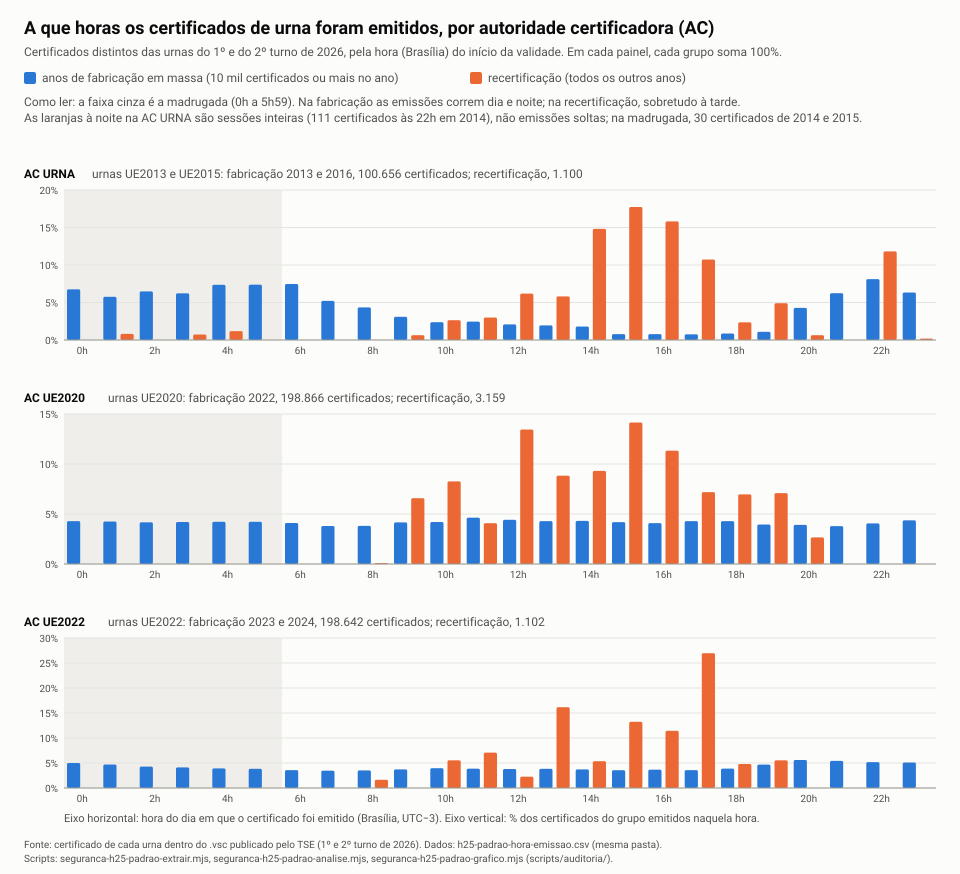

# 08. H25: há certificado de urna fora do padrão de produção?

Perfil `engenheiro-seguranca-urna`, hipótese H25 ([hipoteses.md](../../hipoteses.md)). Teste pedido pelo André em 30/10/2026: "emitir um certificado com a AC não seria complicado; até os desenvolvedores devem ter um para testes; se a totalização libera qualquer certificado assinado pela AC, certificados de desenvolvimento também poderiam assinar".

Continua o [doc 07](07-h25-certificados.md) e o [parecer 33 do cético](../cetico-revisor/33-h25-certificado-ac-urna.md). Universo completo: 998.414 diretórios oficiais (499.207 por turno), 0 erro de leitura, 503.525 certificados de urna distintos. **Ainda não revisado pelo cético.**

> **Termos.** O *certificado* é o "RG" da urna: diz "esta chave pública é da urna X" e leva o carimbo (assinatura) de uma *autoridade certificadora* (AC). Um certificado de produção sai de uma linha de montagem: todos têm os mesmos campos, na mesma ordem, com os mesmos textos. Só mudam o número da urna, o número de série, as datas, a chave e o carimbo. Um certificado de teste, feito à mão por um desenvolvedor, costuma ter alguma diferença: um nome como "teste", um campo a mais, uma validade redonda, uma extensão que a linha de montagem não põe. É esse rastro que este documento procura.

## Resposta curta

1. **Fato: nenhum certificado fora do padrão de produção foi encontrado nos 503.525.**
   - Em cada AC, depois de mascarar só o que muda de urna para urna, **todos os certificados têm exatamente o mesmo "molde"**: 1 molde na AC URNA (101.756), 1 na AC UE2020 (202.025), 1 na AC UE2022 (199.744).
   - O molde inclui todos os campos: versão, algoritmos, emissor e sujeito atributo por atributo (com o tipo de texto), tipo de data, tamanho da chave, as 6 extensões (ordem, criticidade e valor), o método do identificador da chave.
   - Nenhum nome com "teste", "homolog", "dev", "lab", "demo", "treina", "simul" ou "piloto". Nenhuma extensão a mais ou a menos. Nenhum OU, O, C ou e-mail diferente.
2. **Fato: o número da urna é sempre de urna de verdade, preparada para a eleição.**
   - 100% dos nomes são `UEAO`/`ueao` + 8 dígitos, iguais ao número da urna no `.vsc`.
   - Faixas por modelo sem nenhuma sobreposição, e sem número isolado: o maior vão até o vizinho mais próximo é 31 (UE2013).
   - Em 998.414 de 998.414 diretórios, o número do certificado está no log da própria seção e o log tem a carga com o **mesmo código de carga do BU**.
   - 0 certificado com data de início depois da carga da urna. A menor folga é de 6,6 horas (MG 53716/0269/0215, item 3.4).
3. **Fato: série e datas seguem o processo de emissão, sem certificado "enfiado".**
   - A AC URNA e a AC UE2022 têm um só contador, crescente com a data.
   - A AC UE2020 teve 3 linhas de emissão em paralelo em maio e junho de 2022, a fabricação. Cada linha tem seu bloco de números e cresce com a data.
   - 0 certificado cuja data contradiz a dos vizinhos de série.
   - A validade segue duas regras só: 5.000 dias, ou o teto 31/12/2037 23:00. A regra mudou nas três ACs ao mesmo tempo, entre 08/05 e 03/06/2024. Nenhum certificado foge disso.
4. **Fato: 6 emissões isoladas em horário incomum. Nenhuma difere em campo algum.**
   - "Isolada" quer dizer que nenhum outro certificado de nenhuma AC, entre as urnas que votaram, foi emitido 60 minutos antes ou depois.
   - Quatro são de 2014 a 2016, época da fabricação, quando a emissão rodava dia e noite.
   - Duas são do fim de semana entre os turnos: sábado 17/10/2026 (AC UE2020) e domingo 18/10/2026 (AC URNA).
   - Os 6 pacotes foram contados: o BU de presidente é igual ao resultado oficial por seção, 0 divergência.
5. **Fato novo: 6 urnas foram certificadas entre os turnos, não 2.** O doc 07 listou as 2 da AC URNA. Há também 4 da AC UE2020, todas em MG, de 08/10 a 22/10/2026.
   - Cada uma substituiu, no 2º turno, a urna que a seção usou no 1º.
   - Têm o mesmo molde e os 6 BUs batem com o resultado oficial.
6. **Fato: os 54 emitidos pela AC URNA depois do vencimento não diferem dos anteriores em nada além da data.**
   - Mesmo molde dos 101.702 anteriores.
   - Mesma regra de validade dos emitidos de junho de 2024 em diante.
   - Mesmo horário de expediente.
7. **Limite (vale para tudo acima):** um certificado de teste emitido pela AC de produção, pelo mesmo sistema e com os mesmos campos, é **indistinguível** de um de produção. O teste exclui o certificado "feito à mão" ou por outro sistema. Não exclui o uso indevido do próprio sistema emissor. Isso só o registro do TSE responde (perguntas no fim).

Gráfico: [hora de emissão por AC](graficos/h25-padrao-hora-emissao.svg). Dados: [h25-padrao-hora-emissao.csv](graficos/h25-padrao-hora-emissao.csv).

## O ataque, visto pelo atacante

| Variante | O que o atacante precisa ter | Rastro esperado | Procurado? | Resultado |
|---|---|---|---|---|
| A. Certificado de desenvolvimento, feito com ferramenta comum (OpenSSL etc.) e a chave da AC | Chave privada da AC (cópia, ou acesso ao equipamento que a guarda) | Campos fora do molde: ordem dos atributos, tipo de texto (UTF8 × Printable), extensões padrão da ferramenta, validade redonda, SKI calculado de outro jeito, série aleatória longa | Sim, campo a campo (item 1) | 0. Um molde por AC |
| B. Certificado de teste com nome de teste ou de urna fictícia | Idem | CN fora do padrão, número fora da faixa do modelo, urna que nunca aparece numa carga | Sim (item 2) | 0 |
| C. Certificado de teste emitido pelo sistema de produção, com nome de urna real | Operar o sistema emissor do TSE | Série fora da sequência, emissão isolada ou fora de hora, urna que só aparece numa seção sem carga, certificado mais novo que a carga | Sim (item 3) | Série 0 fora de sequência. 0 certificado mais novo que a carga. 6 emissões isoladas em horário incomum, todas de urnas reais, com carga no log e voto contado (item 3.3) |
| D. Igual a C, mas copiando tudo do processo | Operar o sistema emissor e escolher uma urna real | Nenhum nos certificados | Não se aplica | **Limite.** Indistinguível. Só o registro da AC (log do equipamento da chave) e a lista de urnas esperadas por seção mostram isso |
| E. Totalização que aceita qualquer certificado da AC, sem lista de urnas esperadas | Nenhum: é falha de processo | Não fica nos arquivos públicos | Não testável | Pergunta LAI (c) |

## Método

| Script | O que faz | Saída (`data/parsed/auditoria/seguranca-h25/`) |
|---|---|---|
| `seguranca-h25-padrao-extrair.mjs --turno N` | Relê o certificado de cada diretório oficial (caminho montado pela linha da integridade; `data/raw` não é varrido) e descreve o certificado **inteiro**: todos os atributos de emissor e sujeito (OID, tipo, valor, ordem), todas as extensões (OID, crítica, valor em ASN.1), versão, algoritmos com parâmetros, tipo de data, chave, SKI (como foi calculado), tamanho da assinatura. Gera o **molde**: o certificado com a série, as datas, os dígitos do nome, a chave, o SKI e a assinatura mascarados. Junta, da linha da integridade, a carga do BU e **todos** os logs do pacote (inclusive o aninhado) | `<t>t-padrao-certs.jsonl` (um por certificado), `<t>t-padrao-dirs.jsonl` (um por diretório) |
| `seguranca-h25-padrao-analise.mjs` | Itens 1 a 4 sobre a união dos dois turnos | `padrao-resumo.json`, `padrao-candidatos.json`, `graficos/h25-padrao-hora-emissao.csv` |
| `seguranca-h25-padrao-votos.mjs` | Para cada candidato e cada urna certificada entre os turnos: BU × resultado oficial por seção (presidente), número a número, na cópia de leitura `eleicao2026-20261029T105000` | `padrao-votos.json` |
| `seguranca-h25-padrao-grafico.mjs` | Gráfico da hora de emissão | `graficos/h25-padrao-hora-emissao.svg` |

Cerca de 6 minutos por turno na extração (os dois turnos em paralelo) e 2 minutos na análise.

## 1. Nome e campos do certificado

**Fato.** Todas as variações de cada campo, por AC, em certificados distintos (os dois turnos):

| Campo | AC URNA (101.756) | AC UE2020 (202.025) | AC UE2022 (199.744) |
|---|---|---|---|
| Versão | 3: 100% | 3: 100% | 3: 100% |
| Algoritmo da assinatura (dentro e fora do TBS) | ecdsa-with-SHA512 (1.2.840.10045.4.3.4): 100% | Ed521 (1.3.6.1.4.1.44588.2.1): 100% | Ed521: 100% |
| Emissor (DN inteiro, na ordem) | CN=AC URNA, ST=DF, C=BR, email=acurna@tse.jus.br, O=TSE, OU=STI, L=Brasilia (todos Printable, e-mail IA5): 100% | CN=AC UE2020, ST=DF, C=BR, email=acue2020@tse.jus.br, O=TSE, OU=STI, L=Brasilia (UTF8; C Printable; e-mail IA5): 100% | o mesmo, com AC UE2022 e acue2022@: 100% |
| Sujeito (atributos, na ordem) | CN, ST, C, O (Printable): 100% | CN, C, O (UTF8; C Printable): 100% | CN, C, O: 100% |
| CN | `ueao` + 8 dígitos (minúsculo): 100% | `UEAO` + 8 dígitos: 100% | `UEAO` + 8 dígitos: 100% |
| ST / C / O do sujeito | DF / BR / TSE: 100% | — / BR / TSE: 100% | — / BR / TSE: 100% |
| OU, serialNumber, outros atributos no sujeito | nenhum: 100% | nenhum: 100% | nenhum: 100% |
| Nome com teste/homolog/dev/lab/demo/treina/simul/piloto | 0 | 0 | 0 |
| Tipo das datas | UTCTime/UTCTime: 100% | 100% | 100% |
| Chave | EC P-521 (secp521r1), 133 bytes: 100% | Ed521, 66 bytes: 100% | Ed521, 66 bytes: 100% |
| issuerUniqueID / subjectUniqueID | nenhum: 100% | nenhum: 100% | nenhum: 100% |
| Extensões (ordem) | basicConstraints, AKI, SKI, keyUsage, CRL DP, policies: 100% | basicConstraints, keyUsage, SKI, AKI, CRL DP, policies: 100% | igual à UE2020: 100% |
| basicConstraints | vazia (não é AC), não crítica: 100% | idem: 100% | idem: 100% |
| keyUsage | `04b0` (assinatura digital, cifra de chave, cifra de dados), não crítica: 100% | idem: 100% | idem: 100% |
| AKI | chave `cd:aa:f4:b2…` + emissor "AC RAIZ UE" + série 03: 100% | chave `bc:b3:54:5d…`: 100% | chave `bb:7c:51:7f…`: 100% |
| SKI | SHA-1 da chave (RFC 5280, método 1), 20 bytes: 100% | idem: 100% | idem: 100% |
| CRL DP | `http://lcr.acurna.tse.jus.br/acurna.crl`: 100% | `…acue2020.crl`: 100% | `…acue2022.crl`: 100% |
| policies | OID `0.0.0.0` + `http://dpc.acurna.tse.jus.br/DPC-PC-ACURNA.PDF`: 100% | OID `0.0.0.0` + DPC da AC UE2020: 100% | OID `0.0.0.0` + DPC da AC UE2022: 100% |
| extendedKeyUsage, SAN, AIA, nsComment, outras | ausentes: 100% | ausentes: 100% | ausentes: 100% |
| **Molde** | **1** (101.756) | **1** (202.025) | **1** (199.744) |

Campos que variam por natureza (não entram no molde) e estão dentro do esperado:

- **Tamanho do número de série.**
  - AC UE2020: 1 byte em 7 certificados, 2 bytes em 4.663, 3 bytes em 197.355.
  - AC UE2022: 7 / 4.853 / 194.884.
  - AC URNA: 3 bytes em 100%.
  - Os de 1 byte são simplesmente os primeiros números do contador (item 3.5). Na primeira extração, o tamanho da série estava dentro do molde e "criou" 2 moldes raros de 7 certificados por AC. Conferido: é só o número pequeno. O molde final mascara o tamanho.
- **Tamanho da assinatura** (só AC URNA, ECDSA):
  - 136 a 139 bytes, como no doc 07.
  - Tamanhos de r/s em bytes: 66/66 57.235; 65/66 19.083; 66/65 19.018; 65/65 6.220; 64 em r ou s 199; 66/63 1.
  - A conta prevê que cada número tenha 64 bytes com chance de 1/1.024. Dá 99,4 por lado; o observado é 100 em r e 99 em s.
  - A chance de 63 bytes é de 1 em 262 mil por lado. Dá 0,78 esperado nos dois lados; o observado é 1.
  - As assinaturas Ed521 têm sempre 132 bytes.
- **Segundo "00" no início da validade:** 1,6% em cada AC, que é 1/60. Nenhuma AC usa horas redondas.

Duas observações sobre o padrão, que valem para **todos** os certificados (não são achado de anomalia):

- **Fato.** O OID da política de certificação é `0.0.0.0` nas três ACs. É um valor de preenchimento, não uma política registrada. Não distingue produção de teste.
- **Fato.** O keyUsage inclui "cifra de chave" e "cifra de dados" numa chave que só assina. Mostra que o molde vem de uma configuração única do TSE, e não de uma ferramenta padrão.

## 2. Número da urna

| Teste (998.414 diretórios, 503.525 certificados) | Resultado |
|---|---|
| CN no padrão `UEAO`/`ueao` + 8 dígitos | 503.525 de 503.525 |
| Número do certificado = número da urna no `.vsc` | 998.414 de 998.414 |
| AC × modelo do `.vsc` × modelo do log | AC URNA ↔ UE2013/UE2015, AC UE2020 ↔ UE2020, AC UE2022 ↔ UE2022: 100%; modelo do `.vsc` = modelo do log: 100% |
| Faixas observadas por modelo | UE2013 1.650.102 a 1.699.999 (12.965 urnas); UE2015 1.750.202 a 1.850.053 (88.791); UE2020 2.000.009 a 2.248.576 (202.025); UE2022 2.250.001 a 2.474.677 (199.744) |
| Número de um modelo dentro da faixa de outro | 0 (6 pares de modelos) |
| Número isolado (mais de 1.000 do vizinho mais próximo do mesmo modelo) | 0. Maior vão: 31 (UE2013), 24 (UE2020), 9 (UE2022), 5 (UE2015) |
| Número da urna presente no log da própria seção (todos os logs do pacote) | 998.414 de 998.414, inclusive 60 do Sistema de Apuração, 8.745 reservas e 2 de tipo 6 |
| Log da seção com a carga, com o mesmo código de carga do BU | 998.414 de 998.414 |
| Número que não aparece em nenhum log com carga, nos dois turnos | 0 |
| Início da validade do certificado antes da carga do BU | 998.414 de 998.414; menor folga: 6,6 h (item 3.4) |

- **Fato (método).** Na primeira versão, o teste olhava só o log principal e acusou 23 diretórios sem a carga.
  - 6 eram RED: o pacote é assinado pela urna recuperadora.
  - 3 eram logs girados: o principal começa no dia da eleição, e a carga está no log aninhado.
  - Com todos os logs do pacote, os 23 fecham. O RED fecha porque o log aninhado traz a carga da urna original.
- A data da primeira linha do log não serve de teste: depende do relógio da urna. Há 1.617 diretórios com a primeira data depois do dia do turno (relógio errado; doc 04 deste perfil). Fica fora do teste do certificado.

## 3. Série e emissão

### 3.1 Linhas de emissão

| | AC URNA | AC UE2020 | AC UE2022 |
|---|---|---|---|
| Menor e maior série | `26db8d` a `34b256` | `51` a `151107` | `44` a `14d499` |
| Sequências crescentes necessárias para cobrir todos (série crescendo com a data) | **1** | **3** | **1** |
| Certificado com data fora da ordem dos vizinhos de série, com os vizinhos em ordem entre si ("enfiado") | 0 | 0 | 0 |
| Passo da série entre emissões a até 60 s | 1 a 20 e mais, decrescendo | 6 (59.844), 12 (6.823), 18 (441) | 6 (179.113), 12 (17.343) |

- **Fato.** A AC UE2020 teve três linhas em paralelo:
  - linha 1: série `51` a `151107`, de 01/04/2022 a 22/10/2026, 112.801 certificados;
  - linha 2: série `031310` a `11d4be`, de 04/05 a 19/06/2022, 57.642 certificados;
  - linha 3: série `03c6d4` a `0dff64`, de 05/05 a 13/05/2022, 31.582 certificados.
  - Exemplo, 10/05/2022 entre 22:55 e 22:59 UTC: as séries `0612xx`, `0c8bxx` e `0cc8xx` se alternam a cada 4 a 5 segundos, cada uma com sua faixa de urnas (02165xxx, 02085xxx, 0204xxxx).
  - É a fabricação em três linhas. Contada contra o maior número já emitido, a série "inverte" 89.224 vezes. Contada por linha, 0.
- **Hipótese.** Nas ACs UE2020 e UE2022, o passo de 6 indica que cada urna recebe 6 números de série por emissão. Só um deles, o certificado "UEAO" que assina o pacote, aparece nos arquivos públicos. Os outros 5 por urna, e todos os números de urnas que não votaram em 2026, são invisíveis aqui (Limites).

### 3.2 Hora, dia e sessões

| | AC URNA | AC UE2020 | AC UE2022 |
|---|---|---|---|
| Anos de fabricação (10 mil ou mais no ano) | 2013, 2016 (100.656) | 2022 (198.866) | 2023, 2024 (198.642) |
| Na fabricação: madrugada (0h a 5h59, Brasília) | 40.231 (40%) | 50.391 (25%) | 51.391 (26%) |
| Recertificação (outros anos) | 1.100 | 3.159 | 1.102 |
| Na recertificação: madrugada | 30 (21 de 2014 e 9 de 2015) | 0 | 0 |
| Na recertificação: sábado ou domingo | 42 | 103 | 0 |
| Sessões (intervalo de até 60 min na mesma AC) | 278 | 174 | 181 |
| Sozinho no dia na própria AC | 50 | 21 | 11 |
| Isolado (nenhum certificado de **nenhuma** AC a 60 min ou menos) | 33 | 8 | 4 |
| Isolado **e** em madrugada, fim de semana ou feriado | 5 | 1 | 0 |



**Como ler:** cada painel é uma AC. As barras azuis são os anos de fabricação, as laranjas a recertificação dos outros anos. Cada grupo soma 100%. A faixa cinza é a madrugada. Na fabricação a emissão roda dia e noite. Na recertificação ela se concentra à tarde. Um certificado de teste emitido à parte apareceria como barra laranja solta em hora estranha. As laranjas da noite na AC URNA são sessões inteiras (111 certificados às 22h de um dia de 2014), não emissões soltas.

- Muitas emissões "sozinhas no dia" numa AC estão na sessão de outra AC. Exemplo: o tardio `ueao01682105` (sábado, 12/09/2026, 14:59:14) e `UEAO02013546` da AC UE2020 (14:59:35) saíram a 21 segundos um do outro. Por isso o critério "isolado" olha as três ACs juntas.

### 3.3 Os 6 candidatos (isolados em horário incomum)

Nenhum difere em campo algum (molde da AC, 100%). Todos são de urna real, com carga no log e voto contado.

| Certificado (série) | AC | Emitido (Brasília) | Por que entrou | Seção e turno | Tipo | Votos de presidente (BU = oficial) |
|---|---|---|---|---|---|---|
| `ueao01671155` (`2a6e34`) | AC URNA | sáb 04/10/2014 23:36 | isolado, fim de semana; vizinho mais próximo a 7,8 dias | PR 74411/0071/0003, 1º e 2º | seção | 254 / 265; 0 divergência |
| `ueao01781129` (`2ebe8b`) | AC URNA | ter 19/07/2016 02:19 | isolado, madrugada; vizinho a 106 min | SP 68772/0094/0098, 1º e 2º | seção | 178 / 188; 0 |
| `ueao01848268` (`344c4d`) | AC URNA | sex 21/10/2016 03:12 | isolado, madrugada | MS 91073/0016/0088, 1º e 2º | seção | 162 / 172; 0 |
| `ueao01847973` (`345411`) | AC URNA | sáb 05/11/2016 02:32 | isolado, madrugada e fim de semana | SP 67075/0072/0016, 1º e 2º | seção | 187 / 194; 0 |
| `UEAO02015548` (`1510d1`) | AC UE2020 | sáb 17/10/2026 17:53 | isolado, fim de semana, entre os turnos | MG 45551/0120/0100, 2º | seção | 284; 0 |
| `ueao01847509` (`34b24a`) | AC URNA | dom 18/10/2026 14:55 | isolado, fim de semana, entre os turnos, depois do vencimento da AC | SP 71072/0004/0114, 2º | seção | 268; 0 |

- **Fato.** Os quatro de 2014 a 2016 são do tempo da fabricação, quando a AC URNA emitia 40% de madrugada.
  - "Isolado" aqui quer dizer só que nenhuma outra urna **que votou em 2026** foi certificada perto. Urnas daquela sessão que saíram de uso não estão nos arquivos.
  - Votaram nos dois turnos, na mesma seção.
- **Fato.** SP 67075/0072/0016 tem 1 "falha" de lacre no 2º turno. É o `DER: comprimento ausente` de `src/lacres.js` diante de 1 byte zero de preenchimento (sobra 1, doc 07, item 4). Não é defeito do certificado.
- **Fato.** Os dois de 17/10 e 18/10/2026 saíram com 21 horas de diferença, num fim de semana a uma semana do 2º turno.
  - Os dois substituíram a urna do 1º turno na seção.
  - MG 45551/0120/0100: no 1º turno, urna 2067377; no 2º, 2015548, carga em 21/10 11:35.
  - SP 71072/0004/0114: no 1º turno, 1807314; no 2º, 1847509, carga em 24/10 14:20.
- **Hipótese (a mais simples):** mutirão de manutenção para repor urnas antes do 2º turno. O padrão é o mesmo dos outros 52 tardios e dos 4 da UE2020 entre os turnos (item 3.4). Só o registro da AC prova.

### 3.4 Urnas certificadas entre os turnos (05/10 a 24/10/2026)

| Certificado | AC | Emitido (Brasília) | Seção (2º turno) | Urna do 1º turno nessa seção | Carga no 2º turno | Votos de presidente (BU = oficial) |
|---|---|---|---|---|---|---|
| `UEAO02014666` | AC UE2020 | qui 08/10 09:20 | MG 40339/0009/0177 | 2036758 | 17/10 11:20 | 242; 0 divergência |
| `UEAO02103893` | AC UE2020 | qua 14/10 13:54 | MG 47031/0148/0078 | 2098552 | 16/10 15:24 | 193; 0 |
| `UEAO02015548` | AC UE2020 | sáb 17/10 17:53 | MG 45551/0120/0100 | 2067377 | 21/10 11:35 | 284; 0 |
| `ueao01847509` | AC URNA | dom 18/10 14:55 | SP 71072/0004/0114 | 1807314 | 24/10 14:20 | 268; 0 |
| `ueao01682541` | AC URNA | seg 19/10 15:04 | SP 62634/0214/0003 (reserva) | 1805493 | 21/10 13:23 | 300; 0 |
| `UEAO02015461` | AC UE2020 | qui 22/10 09:55 | MG 53716/0269/0215 | 2079190 | 22/10 16:34 | 158; 0 |

- **Fato.** As 6 aparecem em `integridade/entre-turnos-casos.jsonl` como troca de urna entre os turnos.
- **Fato.** MG 53716/0269/0215 tem a menor folga entre o certificado e a carga: 6,6 horas.
  - O pacote do 2º turno traz, aninhado, o log da urna do 1º turno (02079190), até 21/10 16:48, com outro código de carga. Depois vem o log da 2015461, a partir de 22/10 16:33, com a carga do BU.
  - A leitura é: a 2079190 foi carregada para o 2º turno em 21/10, saiu de uso, e a 2015461 foi recertificada na manhã seguinte e carregada à tarde.
  - É o mesmo mecanismo de log aninhado das trocas do doc 06 deste perfil.
- **Fato.** Todas as 99 emissões a partir de 01/09/2026 (28 AC URNA, 25 AC UE2020, 46 AC UE2022) estão em `padrao-resumo.json` → `pertoDaEleicao`, com as seções.

### 3.5 Validade e primeiros números

- **Fato. Duas regras de validade, 0 exceção, mudança simultânea nas três ACs:**

| Regra | AC URNA | AC UE2020 | AC UE2022 |
|---|---|---|---|
| 5.000 dias exatos, até 08/05/2024 | 101.576 | 200.944 | 196.876 |
| (destes, 5.000 dias passariam de 31/12/2037: 23/04 a 08/05/2024) | 6 | 140 | 341 |
| Teto 31/12/2037 23:00, de 03/06/2024 em diante | 180 | 1.081 | 2.868 |
| Outra validade | 0 | 0 | 0 |

- **Fato. Os primeiros números de cada AC são de urnas reais.**
  - AC UE2020: séries `51` a `5c` (7 certificados), emitidas em 01/04/2022 entre 22:12 e 22:13 UTC, 1 a cada 4 a 12 segundos. São as urnas 2031178 a 2033976, que votaram em RS, RO e ES nos dois turnos.
  - AC UE2022: série `44` = urna 2250001, a primeira da faixa, em 19/05/2023 12:29 UTC, seguida de 2250003, 2250004…. Votou em RS nos dois turnos.
  - AC URNA: série `26db8d` = urna 1650993, em 30/07/2013. Os números menores não aparecem em urnas de 2026.
  - Os números antes dos primeiros observados (80 na AC UE2020, 67 na AC UE2022) não estão nos arquivos. Podem ser certificados de teste, de instalação da AC ou de urnas que não votaram. **Não dá para saber** (Limites).

## 4. Os 54 tardios, de novo

| | 54 depois do vencimento (20/07 a 19/10/2026) | AC URNA de 01/2024 até o vencimento (151) | AC URNA, todos (101.756) |
|---|---|---|---|
| Molde | o mesmo (`c21c5a2fa09c`): 54 | o mesmo: 151 | o mesmo: 101.756 |
| Série | 3 bytes, na sequência única da AC | idem | idem |
| Validade | teto 31/12/2037 23:00: 54 | teto: 126; 5.000 dias: 25 (antes de 08/05/2024) | regra do item 3.5 |
| Assinatura r/s | 66/66: 30; 65/66: 11; 66/65: 10; 65/65: 2; 66/64: 1 | 66/66: 77; 65/66: 36; 66/65: 26; 65/65: 12 | item 1 |
| Hora (Brasília) | 10h a 18h | 9h a 20h | dia e noite (fabricação) |
| Dia | seg 28, qui 10, qua 6, sex 5, ter 3, sáb 1, dom 1 | seg 43, qua 58, sex 27, ter 10, qui 7, dom 6 | — |

- **Fato.** Os 54 não diferem dos anteriores em nenhum campo além das datas.
  - A validade com teto é a regra de todos os emitidos desde 03/06/2024.
  - O AKI aponta para a AC série 03, como em 100% dos AC URNA.
- **Fato.** O sábado é 12/09/2026 (`ueao01682105`), na mesma sessão de um certificado da AC UE2020, 21 segundos depois. O domingo é 18/10/2026 (`ueao01847509`, item 3.3).
- Com isso, o rastro "certificado de outro sistema" não aparece nos tardios. O que eles mostram (doc 07) é que **o sistema de produção** seguiu usando a chave da AC URNA depois do vencimento.

## Limites

- **Certificado de teste emitido pela AC de produção, pelo mesmo sistema e com os mesmos campos, é indistinguível de um de produção.** Se tiver o nome de uma urna real e entrar no lugar dela, só a lista de urnas esperadas por seção e o registro da AC mostram a troca.
- Só aparece aqui o certificado "UEAO" das urnas cujo pacote foi publicado. Não aparecem:
  - os outros números de série de cada emissão (passo 6 nas ACs UE2020 e UE2022);
  - os certificados de urnas que não votaram;
  - os números antes do primeiro observado;
  - qualquer certificado que tenha assinado um pacote depois substituído e não publicado.
- A data de início da validade é a do relógio do sistema emissor. Não há marca de tempo independente.
- A conferência da cadeia na totalização e a existência de uma lista de urnas esperadas por seção não estão nos arquivos públicos.
- Um software alterado dentro de uma urna legítima assina com o certificado verdadeiro (doc 07, item 5b). Nada neste teste vê isso.

## Perguntas para LAI

**(a) Custódia da chave da AC URNA.** "Em relação à chave privada da autoridade certificadora AC URNA (certificado série 03, identificador de chave `cd:aa:f4:b2:97:01:b3:f0:de:b2:b5:42:58:59:4a:6d:34:ad:a4:8a`, válido de 22/07/2011 a 18/07/2026), solicito:
1. o tipo de equipamento em que está guardada (módulo de segurança criptográfico, HSM), com fabricante, modelo e certificação (FIPS 140 ou homologação ICP-Brasil), e se a chave pode ser exportada ou copiada;
2. os perfis e o número de pessoas com acesso para ativar a chave, e o esquema de controle (por exemplo, m de n cartões);
3. as atas da cerimônia de geração da chave e de toda cerimônia ou ativação entre 18/07/2026 e 25/10/2026;
4. o registro de auditoria do equipamento ou do sistema de emissão com cada uso da chave entre 18/07/2026 e 25/10/2026 (data, hora, operador, número de série emitido e urna), incluindo as séries `34aea5` a `34b256`;
5. as mesmas informações (itens 1 a 4) para as chaves da AC UE2020 e da AC UE2022 no período de 05/10/2026 a 25/10/2026."

**(b) AC de teste e certificados de teste.** "Solicito informar:
1. se o TSE mantém autoridades certificadoras de teste, desenvolvimento ou homologação separadas das AC de produção (AC RAIZ UE, AC RAIZ UE v2, AC URNA, AC URNA v2, AC UE2020, AC UE2022), com chaves distintas; em caso positivo, solicito os certificados dessas AC de teste;
2. se alguma AC de produção emitiu, em qualquer data, certificado para urna ou equipamento de teste, desenvolvimento, homologação, treinamento, Teste Público de Segurança ou qualquer finalidade que não seja urna de produção; em caso positivo, a relação (número de série, sujeito, data, finalidade, situação de revogação);
3. quantos certificados cada urna recebe a cada emissão e com que finalidade. Nos arquivos públicos, os números de série das AC UE2020 e AC UE2022 avançam de 6 em 6;
4. a lista de certificados revogados (LCR) vigente de cada AC de produção."

**(c) Lista de urnas esperadas na totalização.** "Solicito informar se o sistema que recebe e totaliza os boletins de urna dos pleitos 3220 e 3221 (1º e 2º turno de 2026) confere cada boletim contra uma relação prévia de urnas autorizadas para a seção: tabela de correspondência urna × seção × código de carga, [a confirmar o nome oficial do arquivo]. Solicito também:
1. se um boletim assinado por certificado válido da AC, mas de urna que não consta da relação da seção, é aceito, rejeitado ou encaminhado para análise, e qual programa faz essa conferência;
2. a relação de correspondências esperadas e efetivadas usada em cada turno, com número da urna, número de série do certificado, seção, código e data da carga;
3. o registro de boletins rejeitados ou retidos por falha de assinatura, de certificado ou de correspondência, nos dois turnos."

## Fato, Hipótese, Recomendação, Pendente

- **Fato:**
  - nenhum certificado fora do padrão de produção nos 503.525: 1 molde por AC;
  - número de urna real em 100%, presente no log com a carga do BU em 998.414 de 998.414 diretórios;
  - 0 certificado mais novo que a carga;
  - 0 série fora de sequência;
  - duas regras de validade, mudança simultânea nas três ACs em maio e junho de 2024;
  - 6 emissões isoladas em horário incomum, de urnas reais, sem diferença de campo, voto contado;
  - 6 urnas certificadas entre os turnos (4 AC UE2020 em MG, 2 AC URNA em SP), todas substituindo a urna do 1º turno, voto contado;
  - os 54 tardios iguais aos anteriores em tudo, menos a data.
- **Hipótese:**
  - as emissões entre os turnos, inclusive as do fim de semana de 17 e 18/10, são manutenção para repor urnas;
  - o passo 6 da série nas ACs UE2020/UE2022 é de 6 certificados por urna.
- **Recomendação:**
  - (1) enviar as perguntas LAI (a), (b) e (c);
  - (2) baixar o arquivo de correspondências efetivadas dos dados abertos do TSE (doc 02 de fontes) e cruzar urna × seção × carga com os certificados. É a única lista externa ao pacote assinado;
  - (3) o estatístico pode incluir as 4 urnas AC UE2020 entre os turnos no mesmo teste das 2 AC URNA (parecer 33, item c).
- **Pendente:**
  - correspondências esperadas e efetivadas (precisa de rede);
  - LCR e DPC das ACs (403 a acesso automatizado, doc 07);
  - resposta às perguntas LAI.

## Reproduzir

```
node scripts/auditoria/seguranca-h25-padrao-extrair.mjs --turno 2
node scripts/auditoria/seguranca-h25-padrao-extrair.mjs --turno 1
node --max-old-space-size=6000 scripts/auditoria/seguranca-h25-padrao-analise.mjs
node scripts/auditoria/seguranca-h25-padrao-votos.mjs
node scripts/auditoria/seguranca-h25-padrao-grafico.mjs
```

Saídas em `data/parsed/auditoria/seguranca-h25/`:
- `{1t,2t}-padrao-certs.jsonl`
- `{1t,2t}-padrao-dirs.jsonl`
- `padrao-resumo.json`, com as chaves `variacoes`, `moldes`, `emissao`, `item2`, `isolados`, `pertoDaEleicao`, `regraValidade`, `primeiros` e `item4`
- `padrao-candidatos.json`
- `padrao-votos.json`

E em `docs/analysis/engenheiro-seguranca-urna/graficos/`: `h25-padrao-hora-emissao.{csv,svg}`.
