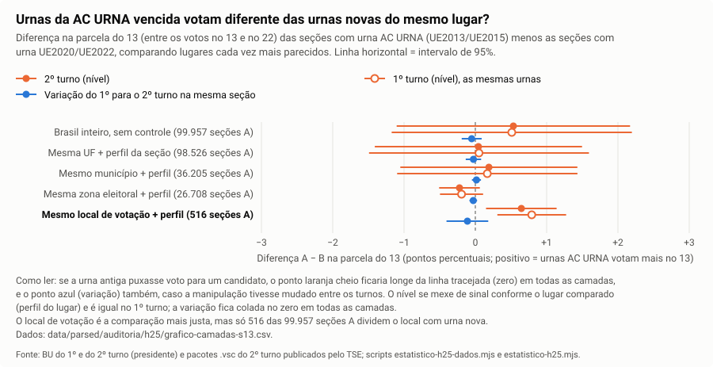
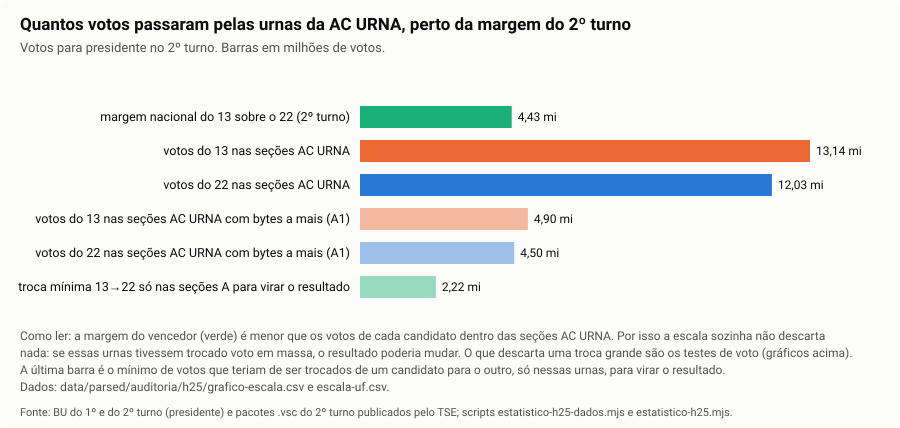
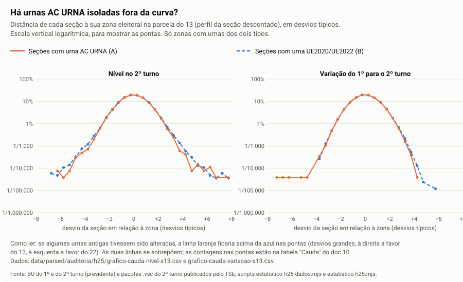
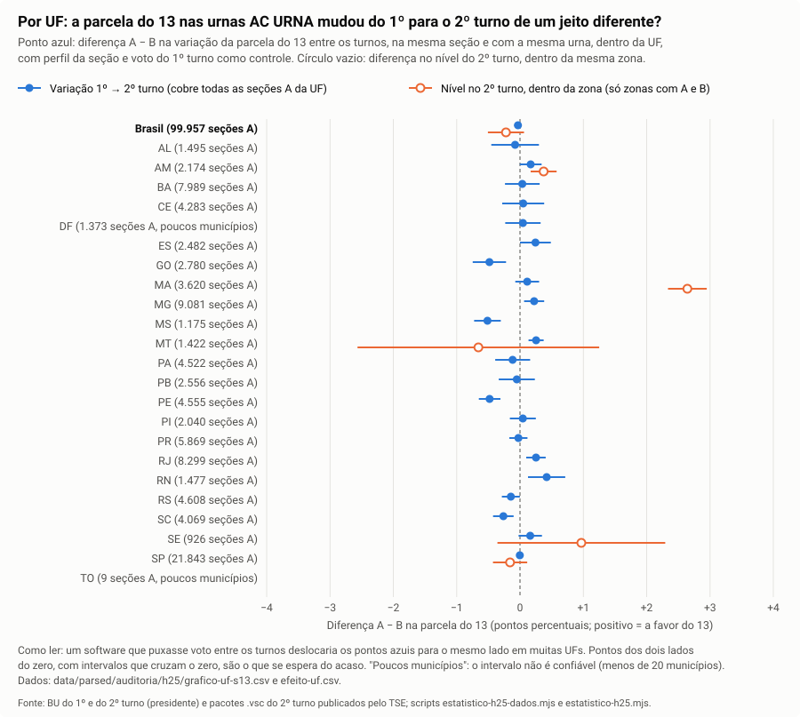

# 10. H25: urnas assinadas pela AC URNA vencida × voto

Estatístico eleitoral, 30/10/2026. Pedido do André: "as urnas UE2013/UE2015, assinadas pelo certificado da AC URNA vencido em 18/07/2026 (antes dos dois turnos), podem ter rodado sistema alterado; vamos analisar se as urnas com esse problema têm voto majoritário para um dos candidatos em padrão". Hipótese H25 de [hipoteses.md](../../hipoteses.md). Rótulos: **Fato** (sai de script do repo sobre arquivo público), **Hipótese**, **Recomendação**, **Pendente**.

## Resposta curta

- **Fato:** as urnas assinadas pela AC URNA (99.957 seções no 2º turno, 20,3% dos votos no 13 e no 22) **não** mostram padrão de voto a favor de nenhum candidato.
  - Nenhum dos 12 testes pré-registrados passa a correção para comparações múltiplas.
  - O sinal muda de lado conforme o lugar comparado: −0,22 ponto na parcela do 13 dentro da zona, +0,65 dentro do local de votação, +0,04 dentro da UF.
  - No 1º turno, as mesmas urnas mostram a mesma diferença do 2º. Isso é perfil do lugar, e não algo que mudou entre os turnos.
- **Fato:** do 1º para o 2º turno, a parcela do 13 mudou igual nas urnas AC URNA e nas urnas novas: −0,03 ponto, intervalo de 95% de −0,09 a +0,02. Em votos, o intervalo vai de 21.514 a menos a 5.591 a mais para o 13, num total de 24,3 milhões de votos nessas urnas.
- **Fato:** o subgrupo com certificado com bytes zero a mais (A1, 37.457 seções) vota igual ao resto do grupo A no mesmo local: −0,02 ponto (intervalo de −0,07 a +0,03).
- **Fato (escala):** para virar o resultado só com essas urnas, seria preciso trocar 2.215.096 votos de um candidato para o outro, 8,8% dos votos no 13 e no 22 dessas urnas.
  - Isso daria uma diferença de 8,8 pontos na parcela do 13 em relação às urnas novas.
  - As comparações de nível excluem diferença maior que 1,5 ponto em todas as camadas (UF, município, zona, local), nos dois turnos.
  - A escala sozinha não descarta nada: o 13 tem 13,1 milhões de votos nessas urnas, e a margem é de 4,4 milhões.
- **Fato (achado lateral):** nas urnas AC URNA, o comparecimento subiu do 1º para o 2º turno 0,33 ponto a mais que nas urnas novas da mesma UF (z = 5,7). Isso dá de 67 a 136 mil eleitores (intervalo de 95%).
  - Esses eleitores votaram como os demais: a parcela do 13 não se mexeu.
  - O efeito é maior nas seções grandes (+0,63 contra +0,15 nas pequenas) e na urna mais velha (UE2013 +0,53; UE2015 +0,30).
  - **Hipótese benigna:** urna antiga mais lenta, numa votação mais longa no 1º turno, com fila e desistência.
- **Limite (não testável aqui):** um software alterado que agisse igual em **todas** as urnas, antigas e novas, não aparece em nenhuma comparação entre grupos de urnas. Também não aparece um software alterado que mexesse em menos votos que o poder abaixo. A validade do certificado da AC URNA na totalização continua sendo risco R3 (doc 06 da integridade), fora do alcance da estatística.

## Pré-registro (gravado em 30/10/2026, antes de rodar qualquer teste de votos)

Esta seção foi escrita depois de extrair só a autoridade certificadora de cada pacote (`estatistico-h25-dados.mjs`) e antes de olhar qualquer voto por grupo.

**Grupos (2º turno, universo completo).**
- **A:** seção cujo pacote foi assinado por urna com certificado emitido pela AC URNA (modelos UE2013 e UE2015). Fonte: `data/parsed/auditoria/integridade/2t/<uf>.jsonl`; para os 37.457 diretórios em que o leitor parou, o emissor vem de `reverificacao.jsonl`.
- **A1 (subgrupo):** seção A cujo certificado tem bytes zero a mais.
- **B:** seção com urna UE2020 (AC UE2020) ou UE2022 (AC UE2022).
- A AC URNA venceu antes do 1º turno. Para o teste de variação, A só vale quando a **mesma urna** (nº interno do BU) votou nos dois turnos.

**Desfechos (presidente, em pontos percentuais).**
- s13 = 100 × votos do 13 / (13 + 22);
- comparecimento = 100 × comparecimento / aptos;
- bn = 100 × (brancos + nulos) / comparecimento.

**Modelo principal (testes 1 e 2).** Mínimos quadrados ponderados com efeito fixo de **local de votação** (UF + município + zona + nº do local), controles de perfil da seção (parcela com 60 anos ou mais, parcela de 16 a 24 anos, parcela com escolaridade baixa, parcela com biometria cadastrada, log dos aptos), peso = denominador do desfecho no 2º turno, erro-padrão agrupado por município (DF: por zona). Só entram locais que têm seções A e B; os outros não informam o efeito.
- Teste 1 (nível): y = desfecho no 2º turno.
- Teste 2 (variação): y = desfecho no 2º turno − desfecho no 1º turno, só seções com a mesma urna nos dois turnos, mesmo local e aptos que mudam no máximo 10.
- Teste 3 (A1 × resto de A): só seções A, indicador A1, controle do modelo (UE2013), efeito fixo de local, nível e variação.
- Sensibilidade (não muda a decisão): sem controles; efeito fixo de zona com e sem controles; sem ponderação; e a diferença bruta, sem efeito fixo, para medir quanto do desvio é perfil.

**Família confirmatória e limiar.** Brasil: 3 desfechos × 4 testes (nível A × B, variação A × B, nível A1, variação A1) = **12 testes**. Bonferroni bilateral a 5%: |z| ≥ 2,87. Por UF e por modelo: **exploratório**, com Bonferroni e Benjamini-Hochberg sobre todos os testes por UF.

**O que sustentaria H25.** Efeito na parcela do 13 (para qualquer lado) que passe na correção no teste 1 ou no teste 2, **e** que, multiplicado pelos votos 13 + 22 das seções A, desloque votos da ordem de metade da margem nacional ou mais (o único tamanho que muda o vencedor). Também contaria um excesso de seções A extremas (resíduo dentro do local) em relação às B, que um efeito médio pequeno esconderia.

**O que rejeitaria H25 no tamanho que o teste enxerga.** Efeitos com intervalo em torno de zero e menores que o poder, sem UF que passe na correção, sem cauda extra.

**Limites declarados antes.** O teste de nível confunde manipulação com perfil do lugar (as urnas antigas não são sorteadas: H07 e H14). O teste de variação não vê manipulação igual nos dois turnos. Nenhum dos dois vê um software alterado que aja igual em **todas** as urnas (A e B) ou que imite o perfil do lugar.

## Desvios do pré-registro (declarados)

- **Camadas mais largas (exploratório, depois de ver o teste principal).** Depois de rodar, apareceu que só **516 das 99.957 seções A (0,5%)** dividem o local de votação com urnas novas (123 locais, 47 municípios). O TSE distribui os modelos por zona e por município inteiros.
  - Por isso, acrescentei o mesmo modelo com efeito fixo de zona, de município e de UF (cobrem 26,7%, 36,3% e 98,7% das seções A).
  - Acrescentei também uma "variação ampla": efeito fixo de UF, perfil e voto do 1º turno como controles.
  - Tudo isso é **exploratório**. A decisão continua sendo a da família de 12 testes.
- **Permutação dentro do local.** Os 123 locais mistos ficam em 47 municípios: poucos para confiar no erro agrupado. A permutação sorteia de novo quais seções do local são A (2.000 sorteios). Ela é a inferência de referência no nível do local.
- **Decomposição do comparecimento** (`estatistico-h25-comparecimento.mjs`), depois de ver o efeito no comparecimento. Exploratório.

## Dados e universo (Fato)

- **Grupos:** saem da verificação de lacres do 2º turno (`estatistico-h25-dados.mjs`).
  - 499.207 seções com pacote. Emissor lido em 499.207: AC URNA 99.957 (UE2015 87.502; UE2013 12.455), AC UE2020 200.504, AC UE2022 198.746.
  - A1: 37.457 seções, todas da AC URNA. O emissor delas vem da reverificação, em que as 37.457 passam com 0 falha.
  - O modelo do BU bate com o modelo do `.vsc` em 499.207 de 499.207.
  - Emissor e modelo são a mesma coisa: AC URNA = UE2013/UE2015.
- **Votos:** BU de presidente nos dois turnos (`pares-banco.csv`, cópia de leitura `eleicao2026-20261029T105000.sqlite`). A soma confere com o resultado oficial nos dois turnos:
  - 2º turno: 13 = 64.256.232; 22 = 59.826.041.
  - 1º turno: 13 = 53.879.538; 22 = 56.104.503.
- **Perfil da seção** (perfil do eleitorado do TSE, `carregarIdade`): faltam 389 seções, 121 delas do grupo A, entre elas as 9 do TO. Essas seções saem dos testes com controle.
- **Teste 2 (variação):** 494.204 seções. Saem 4.432 com outra urna no 2º turno e 162 com aptos que mudam mais de 10. Nenhuma mudou de local. Grupo A: 97.946.
- **Exterior** (1.310 seções, todas AC URNA): não tem urna nova para comparar e sai dos testes. Entra só na escala.

**Onde ficam as urnas A (Fato).** É o que limita qualquer comparação "no mesmo lugar".

| Camada | Grupos com A e B | Seções A nesses grupos | % das A | Municípios |
|---|---|---|---|---|
| Local de votação | 123 | 516 | 0,5% | 47 |
| Zona eleitoral | 415 | 26.708 | 26,7% | 655 |
| Município | 269 | 36.205 | 36,3% | 287 |
| UF | 22 | 98.526 | 98,7% | 5.345 |

As zonas que só têm urna A são 438, com 73.202 seções A. Os municípios que só têm urna A são 1.213, com 63.685 seções A.

## Família confirmatória (12 testes; Bonferroni |z| ≥ 2,87)

Efeito de A (ou de A1) em pontos percentuais, com efeito fixo de local e perfil da seção. Valor-q de Benjamini-Hochberg (BH).

| Teste | Parcela do 13 | Comparecimento | Brancos + nulos |
|---|---|---|---|
| 1. Nível 2º turno, A × B | +0,65 (EP 0,25; z 2,55; q 0,13) | −0,24 (z −0,63) | +0,05 (z 0,82) |
| 2. Variação 1º → 2º, A × B | −0,11 (EP 0,15; z −0,75) | −0,04 (z −0,35) | +0,01 (z 0,08) |
| 3. Nível, A1 × resto de A | −0,02 (EP 0,02; z −0,93) | −0,04 (z −1,41) | +0,01 (z 1,41) |
| 3. Variação, A1 × resto de A | −0,03 (EP 0,02; z −1,70) | −0,02 (z −1,37) | +0,02 (z 2,09; q 0,22) |

**Fato:** nenhum dos 12 passa Bonferroni, e nenhum tem q < 0,05. O pré-registro diz que isso **não sustenta H25**.

## Teste 1: nível no 2º turno

| Comparação (parcela do 13, A − B) | 2º turno | 1º turno (mesmas urnas) | Seções A |
|---|---|---|---|
| Brasil, sem controle | +0,53 (IC −1,10 a +2,17) | +0,51 | 99.957 |
| Mesma UF + perfil | +0,04 (IC −1,41 a +1,50) | +0,05 | 98.526 |
| Mesmo município + perfil | +0,19 (IC −1,05 a +1,43) | +0,17 | 36.205 |
| Mesma zona + perfil | −0,22 (IC −0,51 a +0,06) | −0,19 | 26.708 |
| Mesma zona, sem perfil | −0,83 (z −4,2) | — | 26.708 |
| **Mesmo local + perfil (principal)** | **+0,65 (IC +0,15 a +1,14)** | +0,79 | 516 |
| Mesmo local, permutação (só locais mistos) | +0,49; p = 0,044 | +0,62; p = 0,023 | 516 |

- **Fato:** a diferença muda de sinal conforme o lugar comparado. Em todas as camadas, ela é praticamente a mesma no 1º e no 2º turno.
  - É o que se espera de **perfil do lugar**: as urnas antigas ficam em lugares que já votavam um pouco diferente.
  - Uma manipulação igual nos dois turnos também daria isso, mas teria de aparecer com o mesmo sinal em todas as camadas, e não aparece.
- **Fato:** no local, +0,65 ponto equivale a 825 votos passados do 22 para o 13 nas 516 seções (intervalo de 192 a 1.458). Não passa Bonferroni (permutação p = 0,044 contra o limiar de 0,0042).
  - Vem quase todo de SP: 474 seções, +0,35, p = 0,16.
  - AM e MT têm 3 locais cada e saem com sinais opostos (+1,10 e −2,20; p 0,57 e 0,16).
- **Perfil dentro do local (Fato):** A e B do mesmo local não diferem em idade, escolaridade nem tamanho. A maior diferença é biometria cadastrada: +1,5 ponto nas A (EP 0,9).
- **Por modelo:** UE2013 +0,78 e UE2015 +0,63 no local. O mesmo padrão aparece no 1º turno.

Gráfico: [h25-camadas-s13.svg](graficos/h25-camadas-s13.svg).



## Teste 2: variação 1º → 2º turno na mesma seção, com a mesma urna

A AC URNA venceu antes do 1º turno, e a urna é a mesma nos dois turnos. Então este teste só pega uma manipulação que **mudou entre os turnos**. Uma manipulação igual nos dois turnos se cancela aqui; ela fica para o teste 1, que se confunde com perfil.

| Comparação (A − B) | Parcela do 13 | Comparecimento | Brancos + nulos |
|---|---|---|---|
| Mesmo local + perfil (principal) | −0,11 (IC −0,40 a +0,18) | −0,04 | +0,01 |
| Mesmo local, permutação | −0,09; p = 0,54 | −0,08; p = 0,54 | 0,00; p = 0,99 |
| Mesma zona + perfil | −0,03 (IC −0,08 a +0,02) | **+0,15 (z 4,9)** | **+0,13 (z 5,1)** |
| Mesmo município + perfil | +0,02 (IC −0,05 a +0,08) | **+0,13 (z 5,3)** | +0,08 (z 3,4) |
| Mesma UF + perfil | −0,03 (IC −0,13 a +0,08) | **+0,35 (z 4,9)** | +0,04 |
| **Variação ampla** (UF + perfil + voto do 1º turno; 96.678 seções A) | **−0,03 (IC −0,09 a +0,02)** | **+0,33 (z 5,7)** | +0,03 (z 1,9) |
| Variação ampla, efeito fixo de zona | −0,03 (IC −0,07 a +0,01) | +0,15 (z 3,9) | +0,01 |
| Só classe "controle" da H14 (sem contingência ou reserva em nenhum turno), zona | −0,03 | +0,15 (z 4,6) | +0,13 (z 5,1) |

- **Fato:** a parcela do 13 mudou entre os turnos igual nas urnas A e B em todas as camadas. Em votos, na variação ampla, o intervalo de 95% vai de 21.514 votos a menos a 5.591 a mais para o 13 nas seções A.
- **Fato (achado lateral):** o comparecimento subiu mais nas seções A. Decomposição (`comparecimento.json`, efeito fixo de UF):
  - por biometria: +0,19 ponto;
  - sem biometria (sem biometria cadastrada + ano de nascimento): +0,14 ponto;
  - nível do 1º turno: −0,14 (z −0,9); nível do 2º turno: +0,21 (z 1,5). As seções A ficaram um pouco abaixo no 1º turno e um pouco acima no 2º.
  - Por tamanho: seções pequenas (até 298 aptos) +0,15; médias +0,09; grandes (mais de 348) **+0,63 (z 8,0)**.
  - Por modelo: UE2013 +0,53; UE2015 +0,30.
- **O voto não muda (Fato, conta):** os 67 a 136 mil eleitores a mais votaram como os demais. Se todos tivessem votado num só candidato, a parcela do 13 mudaria cerca de ±0,13 a ±0,27 ponto. A variação observada fica entre −0,09 e +0,02.
- **Hipótese benigna:** fila no 1º turno.
  - O 1º turno tinha mais cargos, e cada voto levava mais tempo.
  - A urna antiga é mais lenta e falha mais na leitura da digital (H07: +3 a +4 pontos de liberação manual). Isso gera fila e desistência, e a fila pesa mais nas seções grandes.
  - O padrão por tamanho e por idade da urna combina com isso. Não está provado.
- **Hipótese a não descartar:** parte do ganho vem de eleitores sem biometria (+0,14 ponto). É a brecha humana da H05. Como esses eleitores não mudaram a parcela do 13, não favorecem nenhum candidato, mas o rastro deve ser cruzado com a H05 (Pendente).

## Teste 3: certificado com bytes a mais (A1) × resto de A

- **Fato:** a sobra de bytes zero depende só do tamanho da assinatura ECDSA do certificado (doc 02 da integridade). É praticamente um sorteio por urna, e por isso este é um experimento natural.
  - Há 12.274 locais com seções A1 e outras A.
  - A1 por modelo: UE2015 32.778 de 87.431; UE2013 4.630 de 12.405. O modelo entra como controle.
- **Fato:** A1 × resto de A no mesmo local:
  - nível do 13: −0,02 (IC −0,07 a +0,03);
  - variação do 13: −0,03 (IC −0,06 a +0,004);
  - comparecimento: −0,04 e −0,02;
  - brancos + nulos: +0,01 e +0,02 (z 2,09, q 0,22).
- Contra as urnas novas do mesmo local, A1 e o resto de A dão o mesmo número (+0,63 e +0,65). O certificado com bytes a mais não marca nenhum grupo de voto.
- **Poder:** enxergaria 0,07 ponto (6.452 votos nas 37.408 seções A1).

## Teste 4: escala (Fato aritmético)

| Item (2º turno, presidente) | Votos |
|---|---|
| Margem do 13 sobre o 22, Brasil | 4.430.191 |
| 13 nas seções AC URNA (99.957) | 13.140.473 |
| 22 nas seções AC URNA | 12.026.599 |
| Parcela dos votos 13 + 22 nessas seções | 20,3% |
| Margem se todo voto do 13 nessas seções fosse do 22 | −21.850.755 (vira) |
| Margem se todo voto do 22 nessas seções fosse do 13 | +28.483.389 |
| Margem sem essas seções | +3.316.317 (não vira) |
| Troca mínima, só nessas seções, para virar | **2.215.096 votos (8,8% dos votos 13 + 22 delas; 16,9% dos votos do 13 nelas)** |
| A1: 13 / 22 | 4.904.023 / 4.503.737 |
| 1º turno nessas seções: 13 / 22 | 10.949.016 / 11.215.137 |

- **Fato:** no pior caso (todo voto de um lado vindo do outro), o resultado nacional mudaria, e o resultado da UF mudaria em 11 das 28 UFs: AL, AM, DF, ES, MG, PA, PR, RJ, RS, SP e exterior (`escala-uf.csv`). A escala sozinha **não** descarta H25.
- **Fato (escala × teste):** uma troca de 8,8 pontos (o mínimo para virar) apareceria como diferença de 8,8 pontos entre A e B. Pelos intervalos do teste 1, a maior diferença compatível com os dados é de 1,5 ponto (UF + perfil) e de 1,1 ponto (local), nos dois turnos. Na variação ampla entre turnos, é de 0,09 ponto.
- **Hipótese não excluída:** uma troca grande só passaria pelos testes se:
  - imitasse exatamente o perfil de cada lugar;
  - ou fosse igual nas urnas antigas e nas novas;
  - ou se concentrasse nas zonas e municípios só com urna A, deixando lá uma diferença de lugar de cerca de 9 pontos que por acaso compensasse a troca. A camada de UF exclui isso dentro de ±1,5 ponto.



## Teste 5: poder (menor desvio na parcela do 13 que o teste acha com 80% de chance, bilateral 5%)

| Teste | Seções A | Desvio mínimo (p.p.) | Em votos (22 → 13) | Votos por seção |
|---|---|---|---|---|
| Nível, local (principal; Bonferroni 12: 0,94) | 516 | 0,71 | 905 | 1,8 |
| Nível, zona | 26.708 | 0,41 | 27.592 | 1,0 |
| Nível, município | 36.205 | 1,78 | 169.371 | 4,7 |
| Nível, UF | 98.526 | 2,08 | 514.788 | 5,2 |
| Variação, local (principal; Bonferroni 12: 0,55) | 483 | 0,42 | 503 | 1,0 |
| Variação, zona | 26.229 | 0,08 | 5.069 | 0,19 |
| **Variação ampla, UF** | 96.678 | **0,08** | **19.342** | 0,20 |
| Variação ampla, zona | 96.678 | 0,055 | 13.280 | 0,14 |
| A1 × resto de A, nível | 37.408 | 0,07 | 6.452 | 0,17 |

Por UF, a variação ampla enxerga de 0,07 ponto (SP, 3.806 votos) a 0,54 ponto (AL, 1.919 votos). Tabela em `resultado.json` → `teste5.porUf`.

- **Leitura:** uma manipulação que **mudou entre os turnos** nas urnas A e moveu mais de ~20 mil votos no país seria achada. Uma manipulação **igual nos dois turnos** só seria achada acima de 0,7 ponto no local (516 seções) ou de 2 pontos na UF: de 0,5 a 5 votos por seção.

## Cauda: urnas A isoladas fora da curva (exploratório)

Resíduo da parcela do 13 de cada seção em relação à sua zona (perfil descontado), em desvios típicos das B. Só zonas com A e B: 26.708 seções A e 85.106 B.

| | Nível, ≥ +3 | Nível, ≤ −3 | Nível, \|z\| ≥ 5 | Variação, ≥ +4 | Variação, ≤ −4 |
|---|---|---|---|---|---|
| A, por mil seções | 3,9 | 3,7 | 0,60 (16 seções) | 0,04 (1) | 0,19 (5) |
| B, por mil seções | 5,7 | 5,4 | 0,76 (65 seções) | 0,17 (14) | 0 (0) |

- **Fato:** as urnas A têm **menos** seções extremas que as B no nível (z = −3,5 nos dois lados). Os 16 casos de |z| ≥ 5 vão para os dois lados: 11 a favor do 13, 5 a favor do 22.
- **Fato:** na variação, 4 das 5 seções A com z ≤ −4 ficam no mesmo local de SP (71072, zona 0002, local 1546). As 7 seções desse local (todas UE2015, mesma urna nos dois turnos, classe "controle") foram de 68,0% para 80,7% de comparecimento, e os votos novos foram para o 22: +398, contra +142 do 13.
  - Na mesma zona, locais só com urna nova fazem o mesmo: local 1090, de 71,1% para 79,0%, +1.206 votos para o 22 e +611 para o 13; local 1325, +663 para o 22 e +466 para o 13.
  - **Hipótese:** é um fenômeno do lugar (mobilização ou algum problema no 1º turno), não do tipo de urna. O movimento vai contra o vencedor do 2º turno.
- **Fato:** as 20 seções A extremas (|z| ≥ 5, nível e variação) foram conferidas no BU bruto dos dois turnos (`estatistico-h25-bruto.mjs`), com **0 divergências** em aptos, comparecimento, 13, 22, demais e brancos + nulos.
  - As que o leitor consegue ler têm 22 conferências e 0 falha, com emissor AC URNA.
  - As A1 param no leitor (`DER: comprimento ausente`). É a falha conhecida do doc 02, e elas passam na reverificação.



## Por UF (exploratório; 23 UFs, 96 testes, Bonferroni |z| ≥ 3,47)

Variação ampla da parcela do 13 por UF (cobre todas as seções A da UF), em pontos:

- **Fato:** 11 UFs positivas e 10 negativas (2 sem estimativa).
- Passam Bonferroni:
  - GO −0,48 (z −3,6), MS −0,51 (z −4,8) e PE −0,48 (z −5,5), a favor do 22;
  - MT +0,25 (z 4,2), a favor do 13.
- **Leitura:** os desvios vão para os dois lados, e a soma nacional dá −0,03. Não há direção comum. Dentro da UF, o efeito fixo não separa regiões. As urnas antigas ficam em regiões específicas de cada UF, e a virada entre turnos varia por região. Um desvio de 0,5 ponto numa UF é da ordem de mil a dois mil votos.
- Nível dentro da zona por UF: MA +2,64 e SE +0,97 ficam com poucos municípios nas zonas mistas (menos de 20) e não são confiáveis. SP −0,16 (IC −0,43 a +0,11).
- Comparecimento: sobe mais nas seções A em PR, RJ, SE, MT e SP (passam Bonferroni) e cai em GO. É o mesmo achado lateral do teste 2.



## O que estes testes não enxergam

1. **Software alterado igual em todas as urnas** (antigas e novas). Toda comparação entre grupos de urnas dá zero por construção. Isso só se testa com o conteúdo, não com o voto: o hash do software e a autoverificação (H04, doc 07 da integridade), a coerência BU × RDV × log e a votação paralela.
2. **Manipulação que imita o perfil do lugar** (por exemplo, empurrar cada urna A na direção em que o lugar já vota) e que é igual nos dois turnos. O teste 1 só a vê acima do poder (0,7 ponto no local, 2 pontos na UF). O teste 2 não a vê.
3. **Manipulação que mexe no BU e no RDV juntos**, de forma coerente: não deixa rastro aritmético.
4. **Manipulação pequena:** abaixo de ~20 mil votos no país se mudou entre os turnos, e abaixo de 0,5 a 5 votos por seção se é igual nos dois turnos.
5. **Se a totalização confere a validade do certificado da AC URNA.** Não sai dos arquivos públicos (risco R3).

## Fato, Hipótese, Recomendação, Pendente

- **Fato:** nenhum dos 12 testes pré-registrados (nível e variação, A × B e A1 × A, três desfechos) passa a correção.
- **Fato:** as urnas AC URNA não votam diferente das urnas novas de forma consistente:
  - o nível muda de sinal conforme o lugar (−0,22 a +0,65) e se repete no 1º turno;
  - a variação entre turnos é −0,03 ponto (IC −0,09 a +0,02; −21.514 a +5.591 votos).
- **Fato:** o certificado com bytes a mais (A1) não marca grupo de voto: −0,02 ponto, poder de 0,07.
- **Fato:** virar o resultado só com as urnas A exigiria 2.215.096 votos trocados (8,8 pontos). Isso está muito acima de qualquer diferença compatível com os dados (máximo de 1,5 ponto no nível e 0,09 na variação ampla).
- **Fato:** o comparecimento subiu 0,33 ponto a mais nas seções A do 1º para o 2º turno (67 a 136 mil eleitores), sem mudar o voto. O efeito é maior nas seções grandes e na UE2013.
- **Hipótese (benigna, não provada):** fila no 1º turno com urna antiga mais lenta.
- **Hipótese (não rejeitada):** os limites 1 a 5 da seção anterior.
- **Recomendação:** pedir ao TSE o certificado vigente da AC URNA (ou o documento de renovação com a mesma chave) e o critério de alocação dos modelos por zona e município.
- **Recomendação:** medir o tempo por eleitor por modelo nos logs (do "habilitado" ao "voto computado") nos dois turnos, para testar a hipótese da fila.
- **Pendente:** confirmar o emissor do 1º turno no universo completo. A verificação de lacres do 1º turno tem 436.753 diretórios lidos; aqui, o grupo do 1º turno sai da mesma urna (nº interno do BU) nos dois turnos.
- **Pendente:** cruzar com a H05 o comparecimento a mais sem biometria nas seções A.
- **Pendente:** a outra metade da H25 (datas, emissor, série e chave dos certificados das urnas) é do engenheiro de segurança. Este documento cobre só o voto.

**Testes feitos:** 12 confirmatórios; cerca de 200 exploratórios:
- 18 permutações;
- 48 de camadas;
- 6 de variação ampla;
- 96 por UF;
- 10 de cauda;
- 15 de decomposição do comparecimento;
- os por modelo.

Nenhum exploratório é tratado como prova.

## Gráficos (premissa do relatório)

| Arquivo | O que mostra | Dados |
|---|---|---|
| [h25-camadas-s13.svg](graficos/h25-camadas-s13.svg) | Diferença A − B na parcela do 13 por camada, nos dois turnos e na variação | `data/parsed/auditoria/h25/grafico-camadas-s13.csv` |
| [h25-uf-s13.svg](graficos/h25-uf-s13.svg) | Por UF: variação 1º → 2º e nível dentro da zona | `grafico-uf-s13.csv`, `efeito-uf.csv` |
| [h25-cauda-s13.svg](graficos/h25-cauda-s13.svg) | Distribuição das seções fora da curva, A × B, escala logarítmica | `grafico-cauda-nivel-s13.csv`, `grafico-cauda-variacao-s13.csv` |
| [h25-escala.svg](graficos/h25-escala.svg) | Votos nas urnas AC URNA perto da margem | `grafico-escala.csv`, `escala-uf.csv` |

## Como reproduzir

```
node scripts/auditoria/estatistico-h25-dados.mjs                                        # emissor por seção (15 s)
node --max-old-space-size=8192 scripts/auditoria/estatistico-h25.mjs                    # testes 1 a 5, camadas, UF, cauda (~8 min)
node --max-old-space-size=8192 scripts/auditoria/estatistico-h25-comparecimento.mjs     # decomposição do comparecimento
node scripts/auditoria/estatistico-h25-graficos.mjs                                     # SVGs
node scripts/auditoria/estatistico-h25-bruto.mjs --n 20                                 # conferência no BU bruto
```

Entradas: `data/parsed/auditoria/integridade/2t/` (lacres), `data/parsed/auditoria/estatistico-eleitoral/pares-banco.csv`, `data/parsed/auditoria/forense/perfil/`, `data/parsed/auditoria/reservas-1t2t/secoes.csv` (classe da troca de urna) e `dados.json` (conferência com o oficial). Saídas: `data/parsed/auditoria/h25/`.
