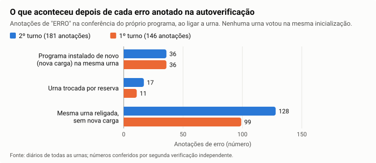

# 1. Integridade e estrutura dos arquivos

## A pergunta

Os arquivos que o TSE publica na internet são exatamente os que a urna gerou no fim da votação, sem nenhuma alteração no caminho?

## Resposta curta

**Fato (2º turno, país inteiro e exterior, revisado pelo cético no [parecer 24](../analysis/cetico-revisor/24-integridade-h04-h11.md)): sim.** Os pacotes das 499.207 seções com urna foram conferidos um a um. Em nenhum o arquivo mudou depois de assinado, e todos foram assinados por uma urna com "carteira de identidade" digital (certificado) emitida por uma das três autoridades do TSE para urnas. Resultado: **499.207 pacotes, 0 falha**. Mudar um único voto, ou um único sinal de um lacre, é detectado (seção "Prova de que o teste funciona").

**Pendente (1º turno):** a conferência dos lacres (assinaturas digitais) do 1º turno ainda não foi feita. Por isso não há número aqui. As impressões digitais dos arquivos do 1º turno já foram refeitas em todas as seções ([tópico 0](00-coleta-completa.md)).

**Fato (2º turno, parecer 24):** ao ligar, a urna confere as assinaturas do próprio programa e anota o resultado no diário. Em 162 seções a urna anotou que uma dessas conferências falhou. Em nenhum desses casos a urna recebeu voto sem antes ser desligada e ligada de novo (seção "O que a urna anota sobre o próprio programa").

A explicação passo a passo usa uma seção de Vila Velha (ES), zona 55, seção 372, 2º turno de 25/10/2026, examinada em detalhe.

Há limites, explicados adiante. Os principais:

- um dos dois lacres usa um método secreto do governo e não pode ser conferido por ninguém de fora;
- a "carteira de identidade" da urna foi conferida até a autoridade intermediária do TSE, não até a autoridade raiz, e o certificado público de uma dessas autoridades (a das urnas mais antigas) venceu antes da eleição;
- o lacre prova que o arquivo não mudou depois de assinado; não prova que o programa dentro da urna fez a coisa certa antes de assinar.

## O que a urna entrega no fim do dia

Quando a votação termina, a urna grava um conjunto de arquivos. O TSE publica estes para qualquer pessoa baixar:

| Arquivo | O que é, em palavras simples | Tamanho nesta seção |
|---|---|---|
| Boletim de Urna (`-bu.dat`) | O placar da urna: votos de cada candidato, brancos, nulos, quantos eleitores podiam votar e quantos votaram, horário de abertura e de encerramento | 1.527 bytes (menos que uma página de texto) |
| Registro Digital do Voto (`-rdv.dat`) | A lista de todos os votos, um por um, **em ordem embaralhada**. Não tem nome nem identificação de eleitor. Serve para recontar os votos de forma independente | 5.015 bytes |
| Diário da urna (`-log.jez`) | Um arquivo compactado (como um .zip) com o diário de bordo da urna: cada evento com data e hora, desde a preparação da urna semanas antes até o encerramento | 177.719 bytes compactado, 962.771 bytes aberto, 9.916 linhas |
| Pacote de lacres (`-vota.vsc`) | A "nota fiscal" dos arquivos: lista os arquivos que a urna gerou, o tamanho de cada um, a impressão digital de cada um e o lacre de cada um | 62.605 bytes |

Os arquivos de boletim, registro de votos e lacres não são texto comum: estão num formato padronizado de computador (chamado ASN.1), parecido com um formulário de campos fixos. O TSE publica o "molde" desse formulário (a especificação), e com ele cada campo pode ser lido: município, zona, seção, número de cada candidato, quantidade de votos.

### O pacote de lacres por dentro

O pacote de lacres tem **duas listas** com os mesmos arquivos:

1. Uma lista lacrada pelo **software de votação do TSE**, com um método de cálculo do governo (chamado CEPESC) que não é público.
2. Outra lista lacrada pela **própria urna**, com um método público, acompanhada da "carteira de identidade" digital da urna (o certificado).

A urna gerou **11 arquivos**, e o pacote lista os 11. O portal publica 4 deles: o boletim, o registro dos votos, o diário e o boletim impresso (`-imgbu.dat`, que vem no arquivo compactado por estado). Os outros 7 aparecem no pacote apenas com nome, tamanho, impressão digital e lacre. Entre eles estão as imagens das digitais dos eleitores e mesários, que são dados pessoais e por isso não são divulgadas.

## Como funciona a conferência

Pense numa encomenda pelo correio:

1. **A etiqueta da caixa** (o portal): o portal informa um código para cada seção. Esse código é a impressão digital do pacote de lacres. Se o pacote baixado gerar o mesmo código, ele chegou intacto.
2. **A nota fiscal dentro da caixa** (o pacote de lacres): o pacote informa a impressão digital de cada arquivo. Se cada arquivo baixado gerar a mesma impressão digital, nenhum foi trocado ou alterado.
3. **O carimbo de quem enviou** (as assinaturas): cada item da nota fiscal tem um lacre que só a urna consegue produzir, porque depende de uma chave secreta guardada dentro dela. Qualquer pessoa consegue *conferir* o lacre usando a parte pública dessa chave, que vem na carteira de identidade da urna.
4. **A carteira de identidade da urna** (o certificado): a carteira foi assinada por uma autoridade do TSE. Conferir essa assinatura mostra que a urna é uma urna oficial, e não um computador qualquer fingindo ser urna.

Há ainda um **lacre dentro do próprio boletim**. Cada linha de votos do boletim (por exemplo, "candidato 22, 161 votos") tem sua impressão digital, que é calculada a partir da linha anterior, como elos de uma corrente. O último elo é lacrado pela urna. Se alguém mudar uma linha, todos os elos dali para frente mudam e deixam de bater com o lacre.

Os degraus 1 e 2 mostram que **nada mudou entre a nota fiscal e o arquivo baixado**. Os degraus 3 e 4 mostram que **a nota fiscal foi assinada por uma urna cuja carteira de identidade foi emitida pela autoridade do TSE** (conferida até a autoridade intermediária, com certificados vindos de cópia pública do pacote do TSE; limites 2 e 3).

## Exemplo: o que foi conferido numa seção, passo a passo

| Degrau | Conferência | Resultado | Rótulo |
|---|---|---|---|
| 1 | Impressão digital do pacote de lacres = código informado pelo portal | Igual | **Fato** |
| 2 | Tamanho e impressão digital do Boletim de Urna, do Registro Digital do Voto, do boletim impresso (`-imgbu.dat`) e do diário = valores na nota fiscal | Iguais nas duas listas | **Fato** |
| 2 | Impressão digital de cada lista = valor anotado no cabeçalho dela | Igual nas duas listas | **Fato** |
| 3 | Lacre da urna em cada um dos 11 arquivos da lista (inclusive os 7 não publicados) | 11 de 11 válidos | **Fato** |
| 3 | Lacre da urna na lista inteira | Válido | **Fato** |
| 3 | Corrente de elos do boletim: as 8 linhas de votos (4 de Presidente, 4 de Governador) foram recalculadas uma a uma | Todas iguais às gravadas | **Fato** |
| 3 | Lacre da urna no último elo de cada eleição (Presidente e Governador) | 2 de 2 válidos | **Fato** |
| 4 | A carteira de identidade é da mesma urna que aparece no boletim e no diário (urna nº 2199150) | Mesma urna | **Fato** |
| 4 | A carteira de identidade foi assinada pela autoridade do TSE para urnas modelo 2020 ("AC UE2020") | Assinatura válida | **Fato** |
| 4 | A carteira estava dentro da validade no dia da eleição | Válida de 2022 a 2036 | **Fato** |
| — | Lacre do software do TSE (método CEPESC) | Não verificável | **Limite** |

O programa `src/lacres.js` faz 25 dessas conferências nesta seção (2 da carteira de identidade, 2 da lista da urna, 4 impressões digitais de arquivo, 11 lacres de arquivo e 6 da corrente do boletim), todas com resultado positivo, refeitas em 29/10/2026 nos dois turnos; a mesma contagem, 25 de 25, vale para a seção 364 da mesma zona, citada no tópico 4. As outras linhas da tabela (código do portal, tamanhos, lista do software e número da urna no boletim e no diário) são conferidas à parte, por `src/conferencia.js` e `scripts/auditoria/t15-integridade.mjs`, também com resultado positivo.

## O que foi conferido no país inteiro (2º turno)

**Fato (revisado no [parecer 24](../analysis/cetico-revisor/24-integridade-h04-h11.md), item 1, "sustentada").** As mesmas conferências da seção de exemplo foram feitas em todos os pacotes do 2º turno, do Brasil e do exterior, por `scripts/auditoria/integridade-lacres.mjs`, que usa o mesmo verificador de `src/lacres.js`. O revisor cético recontou o resultado com um programa próprio, a partir das linhas de saída de cada pacote.

| O que foi conferido | Resultado |
|---|---|
| Seções com pacote | 499.207 (outras 41 seções do exterior não foram instaladas e não têm arquivo) |
| Seções com mais de um pacote | 0 |
| Pacotes com alguma falha: etiqueta ≠ pacote, arquivo ≠ impressão digital anotada, arquivo fora da lista lacrada, lacre da urna inválido, corrente do boletim quebrada ou carteira não assinada pela autoridade do TSE | **0** |
| Pacotes com boletim publicado sem a conferência da corrente do boletim | 0 |
| Pacotes com algum arquivo publicado sem a conferência da impressão digital | 0 |
| Carteiras de urna fora da validade em 25/10/2026 | 0 (a mais antiga começa em 30/07/2013; os vencimentos vão de 08/04/2027 a 15/01/2038) |

Quem assinou, por autoridade e modelo de urna:

| Autoridade do TSE que emitiu a carteira | Modelo da urna | Método do lacre | Pacotes |
|---|---|---|---:|
| AC UE2020 | 2020 | Ed521 | 200.504 |
| AC UE2022 | 2022 | Ed521 | 198.746 |
| AC URNA | 2015 | ECDSA | 87.502 |
| AC URNA | 2013 | ECDSA | 12.455 |
| **Total** | | | **499.207** |

- **ECDSA** é outro método público de assinatura digital, usado pelas urnas mais antigas (2013 e 2015). Com isso, os dois métodos de lacre da urna foram conferidos no país inteiro.
- Nenhuma carteira de urna foi emitida por autoridade fora dessas três.
- No Acre, 1.040 seções foram baixadas também por um segundo caminho. Essas cópias extras são idênticas, byte a byte, ao pacote oficial.


**Como ler:** cada barra é um modelo de urna, e o comprimento é o número de seções cujo pacote foi conferido. O texto ao lado dá o número exato e quantos pacotes falharam: nenhum, em nenhum modelo. As urnas novas (2020 e 2022) são a maior parte; as antigas (2013 e 2015) usam o outro método de lacre, e também foram todas conferidas.

Por UF, 2º turno (o exterior aparece numa linha própria; os 29 pacotes do Sistema de Apuração, onde se vota em cédula de papel, estão nele):

| UF | Pacotes | Urnas 2020 e 2022 (Ed521) | Urnas 2013 e 2015 (ECDSA) | Com falha |
|---|---:|---:|---:|---:|
| AC | 2.270 | 2.270 | 0 | 0 |
| AL | 7.101 | 5.606 | 1.495 | 0 |
| AM | 8.157 | 5.983 | 2.174 | 0 |
| AP | 1.914 | 1.914 | 0 | 0 |
| BA | 35.476 | 27.487 | 7.989 | 0 |
| CE | 23.765 | 19.482 | 4.283 | 0 |
| DF | 6.969 | 5.596 | 1.373 | 0 |
| ES | 9.844 | 7.362 | 2.482 | 0 |
| GO | 15.686 | 12.906 | 2.780 | 0 |
| MA | 18.093 | 14.473 | 3.620 | 0 |
| MG | 52.062 | 42.981 | 9.081 | 0 |
| MS | 7.106 | 5.931 | 1.175 | 0 |
| MT | 8.287 | 6.865 | 1.422 | 0 |
| PA | 20.827 | 16.305 | 4.522 | 0 |
| PB | 10.712 | 8.156 | 2.556 | 0 |
| PE | 21.418 | 16.863 | 4.555 | 0 |
| PI | 10.225 | 8.185 | 2.040 | 0 |
| PR | 27.142 | 21.273 | 5.869 | 0 |
| RJ | 37.675 | 29.376 | 8.299 | 0 |
| RN | 8.115 | 6.638 | 1.477 | 0 |
| RO | 4.698 | 4.698 | 0 | 0 |
| RR | 1.519 | 1.519 | 0 | 0 |
| RS | 27.547 | 22.939 | 4.608 | 0 |
| SC | 17.326 | 13.257 | 4.069 | 0 |
| SE | 5.923 | 4.997 | 926 | 0 |
| SP | 103.656 | 81.813 | 21.843 | 0 |
| TO | 4.384 | 4.375 | 9 | 0 |
| exterior | 1.310 | 0 | 1.310 | 0 |
| **Total** | **499.207** | **399.250** | **99.957** | **0** |

A tabela por UF vem da varredura (`integridade-resumo.mjs`, `resumo.json` → `teste1.porUf`); o total e a separação por modelo foram recontados pelo revisor. Dados: [graficos/dados/lacres-por-uf-2t.csv](graficos/dados/lacres-por-uf-2t.csv) e [lacres-por-modelo-2t.csv](graficos/dados/lacres-por-modelo-2t.csv).

### Urnas antigas: carteira gravada com zeros a mais

**Fato (parecer 24, itens 2 e 3).** Em 37.457 pacotes de urnas antigas (modelos 2013 e 2015), o programa da auditoria parava antes de conferir: a carteira da urna vem gravada num espaço de tamanho fixo, completado com zeros no fim, e o leitor não esperava esses zeros. Em palavras simples: em parte das urnas antigas, o certificado vem gravado num espaço fixo completado com zeros. O programa da auditoria precisou ignorar esses zeros para ler o certificado. Depois disso, todas passaram na conferência.

- O que sobra depois da carteira é só zero, nos 37.457.
- O corte muda só a forma de ler. A lista assinada e as assinaturas foram usadas byte a byte, sem alteração, e os 37.457 passaram por todas as conferências da tabela acima. Nenhum pacote oficial ficou sem conferência.
- A sobra acompanha a carteira da urna, não o pacote: a mesma urna mostra a mesma sobra nos dois turnos (parecer 24, item 2).
- A seção do CE (zona 55, seção 160), deixada pendente no [tópico 9](09-padroes-estatisticos.md), é um desses pacotes, e passa depois do corte.
- **Hipótese:** a urna grava a carteira num espaço de tamanho fixo. O tamanho da assinatura da carteira varia um pouco de urna para urna, e o que falta é completado com zeros.
- Há também carteiras com **2** zeros a mais, que o leitor aceita sem avisar. A assinatura delas é conferida normalmente, e o teste de adulteração abaixo passou numa delas. Não é falha de segurança. Mas o programa deveria registrar essa sobra, e a correção está recomendada no parecer 24. A quantidade desses casos não entra aqui, porque o programa não a registra hoje.

## Prova de que o teste funciona (contraprova)

- **Fato (seção de exemplo).** Foi feita uma cópia do boletim com **um único voto a mais** (candidato 13 a Presidente passou de 96 para 97). O teste acusou três problemas: a impressão digital do arquivo deixou de bater com a nota fiscal, os elos da corrente de Presidente deixaram de bater e o último elo deixou de bater com o lacre. Também foi testado um lacre com um único sinal trocado: foi rejeitado. Esses testes ficam gravados junto com o programa e rodam sempre que ele é alterado (`node --test test/lacres.test.js test/ed521.test.js`: 14 de 14 passam, refeito pelo revisor no parecer 24).
- **Fato (parecer 24, item 1).** O revisor alterou de propósito **um único bit** (a menor unidade de informação de um arquivo) em pacotes de cada tipo: urna 2020 e urna 2022 (método Ed521), urna 2015 e urna 2013 (método ECDSA) e um dos pacotes com zeros a mais na carteira. Em todos os cinco, o programa rejeitou a adulteração:
  - lacre da lista alterado: 1 falha acusada;
  - carteira de identidade alterada: 1 falha acusada (a assinatura da autoridade deixa de conferir);
  - lacre do boletim alterado: 2 falhas acusadas.

  Portanto o "0 falha" do país não vem de um verificador que aprova qualquer coisa, em nenhum dos dois métodos de lacre.
- **Conferência de confirmação.** O revisor sorteou pacotes do país e os conferiu de novo, um a um, com o programa público `node src/lacres.js`. O resultado foi o mesmo da varredura em todos eles.

## O que a urna anota sobre o próprio programa (autoverificação)

Cada vez que é ligada (cada **inicialização**), a urna confere as assinaturas dos seus próprios programas e dos arquivos da seção, em etapas, antes de abrir a votação. O resultado de cada etapa vai para o diário: "SUCESSO" ou "ERRO". Isso se chama **autoverificação**. É o único rastro público de que o programa que rodou é o programa lacrado.

**Limite:** quem anota é o próprio programa que está sendo conferido. O diário, por sua vez, é um dos arquivos lacrados pela urna, e esse lacre foi conferido no país inteiro (seção acima).

Fonte: [integridade-nacional/07](../analysis/integridade-nacional/07-autoverificacao-no-log.md), revisado no [parecer 24](../analysis/cetico-revisor/24-integridade-h04-h11.md), itens 10 a 13. Foram lidos os diários de todas as 499.207 seções do 2º turno, inclusive os diários guardados dentro do pacote (de uma urna substituída ou de uma preparação anterior da mesma urna): 512.173 diários, nenhum ilegível. O diário acumula tudo desde a preparação. Por isso, o diário do 2º turno também mostra o que aconteceu antes do 1º turno, se a urna não foi preparada de novo.

**Fato (2º turno):**

- As 499.207 urnas do 2º turno registram a mesma versão de programa, 10.23.0.0, no boletim e em todo o diário.
- Em **162 seções**, a urna anotou "ERRO" em alguma etapa dessa conferência: 181 anotações, entre 18/09 e 25/10/2026. 41 dessas anotações são da véspera ou do dia de uma das votações.
- **Em nenhum desses casos a urna recebeu voto na mesma inicialização.** O revisor abriu o diário original de cada uma das 181 anotações e contou, entre o erro e o desligamento seguinte: 0 "urna pronta para receber votos" e 0 "voto computado".
- Em 134 dessas seções, a mesma urna recebeu votos depois, numa nova inicialização, sem que o programa tivesse sido instalado de novo. Contando cada seção, urna e dia uma só vez: **31.892 votos em 127 seções no dia do 2º turno** e **24.422 votos em 103 seções no dia do 1º turno**. Esses votos estão nos boletins dessas seções, que passaram na conferência de assinaturas acima.
- Quando o erro é num programa interno da urna, a mensagem anotada manda desligar a urna e instalar o programa de novo. O diário mostra que, nesses casos, a urna foi desligada, ligada de novo, passou na mesma etapa e votou normalmente, sem nova instalação.
- **842 seções** do 2º turno têm no diário ao menos uma mensagem de erro sobre assinatura ou integridade. Dessas, 162 são as que têm a falha registrada numa etapa da conferência do programa (acima). As demais são mensagens de outros tipos, por exemplo falha de leitura de um cartão de memória, ou cartão de resultado com assinatura que não confere, quando a urna pede outro cartão. Os dois números saem de `scripts/auditoria/cetico-integridade-casos.mjs`.
- Em 26 urnas que trocaram o cartão de votação (o cartão de memória onde a urna grava os votos) no próprio dia, a conferência daquela inicialização não incluiu o arquivo da seção no cartão novo (parecer 24, item 13).

**Fato (1º turno, varredura própria dos pacotes do 1º turno):** 146 anotações de "ERRO" em 128 seções, 22 delas na véspera ou no dia (03 e 04/10). Em nenhuma a urna recebeu voto na mesma inicialização. Depois do erro, 103 seções votaram em nova inicialização: 24.422 votos em 04/10, o mesmo número medido pelos pacotes do 2º turno. As duas varreduras conferem entre si.

**O que não se pode afirmar:**

- **Hipótese benigna, não testável com os arquivos públicos:** um erro passageiro de leitura da memória da urna.
- Os arquivos públicos não distinguem uma falha de leitura de um arquivo que foi trocado e depois voltou ao original.
- Depois do erro, o único controle é a conferência seguinte, feita pelo mesmo programa.
- Isso não é prova de fraude: os boletins dessas seções estão assinados e conferidos.

**O que aconteceu depois de cada erro (Fato, [integridade-nacional/07](../analysis/integridade-nacional/07-autoverificacao-no-log.md), sustentado no parecer 24, item 10):**



**Como ler:** cada grupo é um desfecho depois da anotação de erro; a barra azul conta as anotações nos diários do 2º turno, e a laranja, nos do 1º. A barra mais longa é a de "mesma urna religada, sem nova carga": na maior parte dos casos, a urna foi apenas desligada e ligada de novo. As duas cores **não se somam**. O diário do 2º turno guarda também o que aconteceu antes do 1º turno, então muitas anotações aparecem nas duas contagens. Por exemplo, as 36 novas cargas são as mesmas nos dois turnos, todas na preparação, de 20 a 30/09.

| Depois do erro | 2º turno | 1º turno |
|---|---:|---:|
| Programa instalado de novo (nova carga) na mesma urna | 36 | 36 |
| Urna trocada por reserva | 17 | 11 |
| Mesma urna religada, sem nova carga | 128 | 99 |
| **Total de anotações de erro** | **181** (162 seções) | **146** (128 seções) |

Anotações de erro por UF (nenhuma no AC, no TO e no exterior):

| UF | 2º turno | 1º turno |
|---|---:|---:|
| AL | 2 | 2 |
| AM | 1 | 1 |
| AP | 1 | 1 |
| BA | 11 | 7 |
| CE | 9 | 9 |
| DF | 1 | 1 |
| ES | 4 | 4 |
| GO | 8 | 8 |
| MA | 5 | 4 |
| MG | 15 | 9 |
| MS | 6 | 6 |
| MT | 4 | 3 |
| PA | 11 | 8 |
| PB | 2 | 2 |
| PE | 8 | 5 |
| PI | 3 | 3 |
| PR | 12 | 7 |
| RJ | 20 | 18 |
| RN | 4 | 4 |
| RO | 1 | 1 |
| RR | 1 | 1 |
| RS | 22 | 17 |
| SC | 4 | 3 |
| SE | 2 | 2 |
| SP | 24 | 20 |
| **Total** | **181** | **146** |

Casos concretos, com o diário original (`integridade-nacional/07`): SP 71072/0353/0853, erro num programa interno às 07:35:08 de 04/10, mesma etapa com SUCESSO às 07:39:15 e urna pronta às 08:00:02; SP 71072/0246/0151, erro às 10:25:46 de 24/10 e SUCESSO às 10:29:21. A lista completa, um evento por linha, está em `data/parsed/auditoria/integridade/2t/autoverificacao-depois.json` → `casos`. Dados dos gráficos: [graficos/dados/autoverificacao-destino.csv](graficos/dados/autoverificacao-destino.csv) e [autoverificacao-por-uf.csv](graficos/dados/autoverificacao-por-uf.csv).

**Pendente:**

- O significado dos códigos de erro anotados (a pedir ao TSE).
- A contagem de todas as inicializações de votação e das etapas de cada uma. Ela depende de uma varredura feita por um só programa e fica sem número até ser refeita por um segundo (parecer 24, item 13).

**Prova de que o teste funciona.** A leitura acha as falhas quando elas existem: são as 181 anotações acima. O teste "nenhum voto na mesma inicialização" também é capaz de acusar: na primeira versão, ele apontou 2 casos (BA 33138/0163/0417 e SP 63096/0038/0169). No diário original, havia um religamento entre o erro e a "urna pronta", que a primeira versão não reconhecia. Corrigido o programa, o resultado foi 0.

## 1º turno

**Pendente.** A conferência das assinaturas do 1º turno não foi feita: a leitura dos pacotes do 1º turno foi feita sem os lacres, e a conferência completa está em andamento. Nenhum número entra aqui até ela terminar e passar pela revisão cética.

- **Fato (parecer 24, item 4).** No pacote do 1º turno da seção MG 50075/0047/0041 (apuração mista, com o Sistema de Apuração), o boletim impresso (`imgbu.dat`) foi publicado sem estar na lista lacrada. **Pendente:** conferir se o conteúdo dele bate com o boletim assinado.
- **Limite do 1º turno:** o TSE não publica, para o 1º turno, o arquivo que indica qual pacote foi totalizado em cada seção. O pacote é identificado pela etiqueta (impressão digital do pacote de lacres), e isso não prova, sozinho, que o pacote no disco é o que o TSE totalizou.

## Como a conferência foi feita, e como repetir

- O método é o mesmo dos programas de exemplo que o próprio TSE publica junto com a especificação dos arquivos (pacote "Formato dos arquivos de BU, RDV e assinatura digital").
- As impressões digitais usam os cálculos padrão chamados SHA-256 e SHA-512, usados no mundo todo.
- Os lacres das urnas novas (2020 e 2022) usam um método chamado **Ed521**, uma variante de um padrão internacional de assinatura digital, adotada também pela ICP-Brasil (a infraestrutura oficial de certificados digitais do país). As ferramentas mais comuns (como o OpenSSL) ainda não trazem esse método, então ele foi programado para esta perícia e testado com exemplos de resultado conhecido, publicados pelos autores da biblioteca que o próprio TSE usa. Um desses exemplos é o certificado raiz da ICP-Brasil. Os lacres das urnas antigas (2013 e 2015) usam o método ECDSA, que é padrão e está nas ferramentas comuns.
- Qualquer pessoa pode repetir numa seção: `node src/lacres.js <pasta da seção>`. O programa e os testes estão no repositório.
- Cada verificação feita para este relatório está registrada no [livro de evidências](evidencias/README.md): o comando, o programa exato usado e a impressão digital do resultado. A lista de todos os arquivos analisados, com a impressão digital de cada um, está em `evidencias/indice/`.

País inteiro, 2º turno (a primeira linha leva horas):

```
node scripts/auditoria/integridade-lacres.mjs --turno 2 --procs 10 --refazer     # confere todos os pacotes
node scripts/auditoria/integridade-reverificar.mjs --turno 2 --cli 20            # os 37.457 com zeros a mais na carteira
node scripts/auditoria/integridade-resumo.mjs --turno 2                          # totais

# revisão cética (parecer 24)
node scripts/auditoria/cetico-integridade-recontagem.mjs --turno 2               # recontagem independente
node scripts/auditoria/cetico-integridade-controle.mjs                           # 1 bit alterado em cada tipo de pacote
node --test test/lacres.test.js test/ed521.test.js                               # testes do verificador

# autoverificação do programa
node scripts/auditoria/integridade-autoverificacao.mjs --turno 2 --procs 8
node scripts/auditoria/integridade-autoverificacao-depois.mjs --turno 2
node scripts/auditoria/integridade-autoverificacao.mjs --turno 1 --procs 8
node scripts/auditoria/integridade-autoverificacao-depois.mjs --turno 1 --dir data/parsed/auditoria/integridade/1t-identificadores
node scripts/auditoria/cetico-integridade-boot-do-erro.mjs --turno 2             # nenhum voto na inicialização do erro
node scripts/auditoria/cetico-integridade-boot-do-erro.mjs --turno 1
node scripts/auditoria/cetico-integridade-casos.mjs                              # 162 e 842 seções

# tabelas e gráficos deste tópico (só leem as saídas acima e conferem as somas)
node scripts/auditoria/grafico-integridade-dados.mjs                             # CSVs em docs/pericia/graficos/dados/
node scripts/auditoria/grafico-integridade.mjs                                   # SVGs em docs/pericia/graficos/
```

Saídas em `data/parsed/auditoria/integridade/2t/` e `data/parsed/auditoria/cetico/`. Método detalhado em [integridade-nacional/01](../analysis/integridade-nacional/01-metodo.md) e [02](../analysis/integridade-nacional/02-lacres-h04-2turno.md).

Fonte dos arquivos: `resultados.tse.jus.br`, baixados em 29/10/2026, com registro de cada download (endereço, data, tamanho e impressão digital). Detalhes técnicos em [../06-leitura-bu-rdv-log.md](../06-leitura-bu-rdv-log.md).

## Limites desta conferência

1. **O lacre do software do TSE não pode ser conferido por terceiros.** Ele usa um método de cálculo do governo (CEPESC) que não é publicado. O próprio TSE informa isso na especificação. A impressão digital dessa lista confere; o lacre em si, não há como checar de fora. O lacre da urna, que é público, foi conferido.
2. **A carteira de identidade foi conferida até a autoridade intermediária.** As carteiras das urnas são assinadas pela "AC UE2020", pela "AC UE2022" ou pela "AC URNA", e essas assinaturas foram conferidas. Essas autoridades, por sua vez, são assinadas por outras autoridades do TSE, até uma autoridade raiz. Os certificados de cima não estão disponíveis para download automático no site do TSE. Os certificados usados (das autoridades intermediárias) vieram do pacote oficial de exemplos do TSE.
3. **O certificado público da AC URNA venceu antes da eleição.** Ele é o que confere as carteiras das urnas 2013 e 2015 (99.957 pacotes do 2º turno) e vale até 18/07/2026 ([integridade-nacional/02](../analysis/integridade-nacional/02-lacres-h04-2turno.md)). **Hipótese, não testável nos arquivos públicos:** ele foi renovado com a mesma chave. Até o TSE publicar o certificado vigente, isso fica como risco.
4. **O pacote oficial foi obtido de uma cópia pública**, porque o site do TSE bloqueia download automático. A cópia tem a mesma impressão digital registrada de forma independente por outro projeto de auditoria. Falta baixar o pacote direto do site do TSE, pelo navegador, e comparar.
5. **O lacre prova quem assinou, não quem a autoridade certificou.** A conferência prova que o arquivo foi assinado por quem tem uma chave certificada por essas três autoridades. Não prova que elas só certificaram urnas verdadeiras.
6. **Lacre não prova que o voto registrado é o voto que o eleitor quis dar.** O lacre prova que o arquivo não mudou depois que a urna o gerou e que foi gerado por uma urna oficial. O que acontece *dentro* da urna antes disso é assunto de outros tópicos deste relatório. A autoverificação (acima) é anotada pelo próprio programa.
7. **Boletim regravado por outra urna.** Em 3 seções do 2º turno, o boletim foi regravado no cartório por outra urna (Recuperador de Dados). Ali a assinatura é da urna que regravou, não da que recebeu os votos ([tópico 2](02-coerencia-entre-arquivos.md)).

## Alcance

| Conjunto | Seções conferidas | Resultado |
|---|---|---|
| ES · Vila Velha · zona 55 · seções 364 e 372, nos dois turnos | 2 | 25 de 25 conferências positivas em cada seção e turno |
| AC · todas as seções com urna | 2.270 (3.310 cópias de pacotes, porque 1.040 seções foram baixadas por dois caminhos) | Todas as conferências positivas, em todas as cópias |
| **Brasil e exterior · 2º turno · todas as seções com urna** | **499.207** | **0 falha** (revisado no parecer 24) |
| Brasil e exterior · 1º turno | — | **Pendente** |

## Próximos passos

- [x] Rodar a conferência dos lacres em todas as seções do país, 2º turno (parecer 24).
- [x] Conferir urnas de modelo antigo (2013/2015), que usam o método ECDSA: 99.957 pacotes do 2º turno, 0 falha.
- [ ] **Pendente.** Conferência dos lacres do 1º turno no país inteiro (em andamento), com revisão cética.
- [ ] **Pendente.** Conferir se o boletim impresso de MG 50075/0047/0041 (1º turno), publicado fora da lista lacrada, bate com o boletim assinado.
- [ ] **Pendente.** Corrigir o leitor para registrar a sobra de zeros de todas as carteiras.
- [ ] **Pendente.** Refazer a contagem de inicializações de votação e de etapas com um segundo programa.
- [ ] **Pendente.** Pedir ao TSE o certificado vigente da AC URNA e o significado dos códigos de erro da autoverificação.
- [ ] Baixar pelo navegador o pacote oficial e os certificados das autoridades do TSE e comparar com as cópias usadas.
- [ ] Comparar o pacote consolidado por estado que o TSE publica com os arquivos baixados seção por seção.
