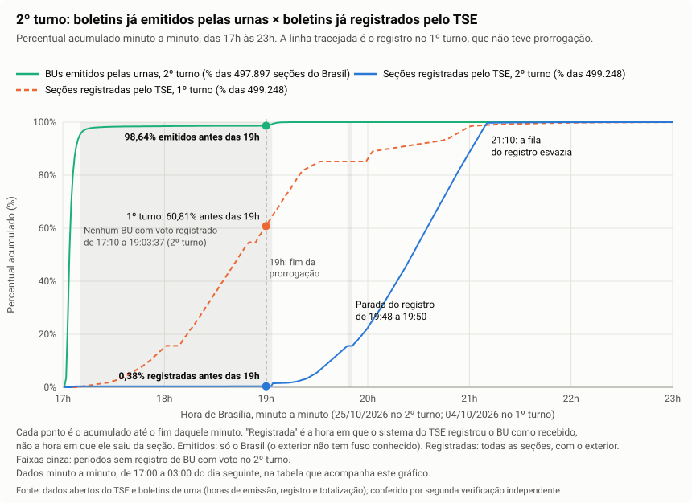
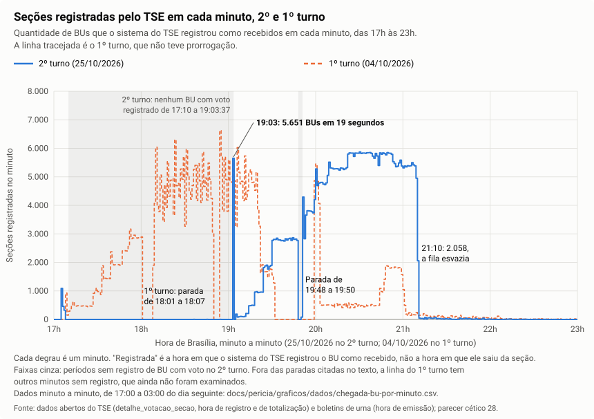

# 3. Linha do tempo da urna

## A pergunta

O que a urna fez desde a preparação até o encerramento, e em que horário? Houve votos fora do horário permitido ou votos em ritmo impossível para uma pessoa?

## Situação da verificação

Os achados deste tópico ainda não têm parecer do revisor cético (`docs/analysis/cetico-revisor/`). Por isso, em 29/10/2026, cada número deste texto foi **recalculado de forma independente**, sobre o universo completo, por um script próprio (`scripts/auditoria/verifica-pericia-linha-do-tempo.mjs`). Ele lê os boletins e os perfis dos diários no banco (cópia de leitura) e os perfis completos do 1º turno, e não usa as saídas dos scripts do auditor de linha do tempo. Os casos citados como exemplo foram conferidos no diário original (`scripts/auditoria/verifica-pericia-linha-do-tempo-bruto.mjs`). Só ficou no texto o número que bateu. Os números que não puderam ser refeitos foram retirados e aparecem como **"Pendente: em verificação"**.

**Item 12 (a apuração na noite do 2º turno), atualizado em 30/10/2026:** este item tem parecer do revisor cético ([parecer 28](../analysis/cetico-revisor/28-chegada-dos-bus.md), sustentado com ressalvas; o revisor refez as contas do autor e chegou aos mesmos arquivos, byte a byte). O texto usa só a "afirmação revisada" do parecer. Os números foram contados de novo, seção a seção, por `scripts/auditoria/grafico-chegada-bu-dados.mjs`, que confere minuto a minuto a recontagem com a conta do autor (0 diferença) e com os arquivos do parecer.

## Resposta curta

Tudo abaixo vale para o **2º turno (25/10/2026)**, salvo quando o texto diz "1º turno". Os testes de horário (abertura, encerramento e votos depois das 17h) cobrem as 497.896 seções do Brasil. As 1.310 seções do exterior ficam fora, porque falta o fuso de cada país (ver "Limites").

| Pergunta | O que se encontrou | Rótulo |
|---|---|---|
| Alguma urna abriu ou recebeu voto antes das 8h de Brasília? | Nenhuma | **Fato** |
| Alguma urna encerrou antes das 17h de Brasília? | Nenhuma. A urna tem uma trava que impede o encerramento antes das 17h | **Fato** |
| Houve voto depois das 17h de Brasília? | Sim: 34.330 votos (0,027% do total) em 29.854 seções. A urna **não tem trava** para isso: quem decide até quando entra eleitor é o mesário | **Fato** |
| Houve seções que ficaram abertas até 19h? | Sim: 6.352 seções encerraram às 19h ou depois. A própria urna não exigia isso | **Fato** |
| Os votos depois das 17h mudaram o resultado? | Não. Mesmo se fossem todos de um lado só, seriam 0,8% da diferença entre os dois candidatos | **Fato** |
| Houve voto em ritmo impossível para uma pessoa? | Não. Fora 3 seções com erro de leitura desta auditoria, o menor intervalo entre dois votos seguidos é de 16 segundos | **Fato** |
| O mesário seguiu as regras de horário? | Não se pode afirmar. Há seções em que o mesário declarou à urna que "todas as pessoas presentes já votaram" e depois disso ainda houve voto. Quantas são: **Pendente: em verificação** | **Fato** (o registro existe); a contagem e o motivo são **Pendentes** |
| Às 19h os boletins já existiam, mas o TSE os liberou aos poucos? (item 12) | Às 19h, 98,64% dos boletins do Brasil já tinham sido emitidos pelas urnas, e o TSE tinha registrado como recebidos 1.909 (0,38% das seções). De 17:10 a 19:03:37 o TSE não registrou nenhum boletim com voto; depois, registrou em lotes e com vazão limitada até 21:09. Onde os boletins esperaram, e se a ordem de liberação dependeu do voto das seções: **Pendente** | **Fato** (horários e contagens); **Pendente** (onde esperaram e a ordem) |

O resultado mostra **o que a urna registrou e quando**. Não mostra **quem** estava diante da urna, nem se a entrada de eleitores depois das 17h foi autorizada (ver "O que este resultado prova e o que não prova").

## Termos usados neste tópico

| Termo | Em palavras simples |
|---|---|
| **Diário da urna (log)** | Já explicado no glossário do [README](README.md). Aqui importa que cada linha tem data e hora com precisão de 1 segundo |
| **Hora de Brasília / hora local** | A urna anota a hora **local** do município. A votação vai das 8h às 17h **de Brasília** no país inteiro. Para comparar urnas de lugares diferentes, todos os horários foram convertidos para Brasília |
| **Fuso** | A diferença de horas entre o município e Brasília (por exemplo, o Acre está 2 horas atrás) |
| **Carga da urna** | A preparação da urna antes da eleição, quando o programa e a lista de eleitores são gravados nela |
| **Urna pronta** | A mensagem do diário que marca o momento em que a urna passa a aceitar votos |
| **Habilitação do eleitor** | O momento em que a urna libera o eleitor para votar, por digital ou, sem digital, pelo número do título e o ano de nascimento digitados pelo mesário |
| **Religamento** | A urna foi desligada (pela chave ou por falta de energia) e ligada de novo durante a votação |
| **Contingência** | Já explicado no glossário do [README](README.md): urna reserva que substitui a original |
| **Mediana** | O valor do meio: metade das seções fica abaixo, metade acima |
| **p99** | O valor abaixo do qual ficam 99% das seções. Mostra até onde vão quase todos os casos, deixando de fora só os extremos |
| **Ponto percentual (p.p.)** | A diferença entre duas porcentagens. De 52% para 51% é uma queda de 1 ponto percentual |
| **Correlação** | Um número de −1 a +1 que diz se duas coisas sobem e descem juntas. Perto de 0 quer dizer que não há relação em linha reta entre elas; não exclui uma relação de outro formato |
| **Comparação dentro da mesma zona** | Comparar seções vizinhas, da mesma zona eleitoral, para que diferenças de região, renda ou preferência política não se misturem ao efeito medido |
| **Emissão do boletim** | O momento em que a urna, depois de encerrada a votação, imprime e grava o boletim (BU) da seção. Fica gravado no próprio boletim |
| **Registro como recebido** | A hora em que o sistema do TSE anotou que recebeu o boletim de uma seção. Não é a hora em que o boletim saiu da seção: é como o carimbo de "protocolado" num balcão, que marca quando o atendente registrou o papel, e não quando a pessoa chegou na fila |
| **Totalização** | A soma dos boletins feita pelo TSE para formar o resultado. Cada boletim tem a hora em que entrou nessa soma |
| **Lote** | Um grupo de boletins registrados juntos, no mesmo segundo ou em poucos segundos, em vez de um a um |
| **Vazão** | Quantos boletins o sistema registrou por minuto. "Vazão limitada" quer dizer que o número por minuto ficou preso num teto, como a água que sai de um cano estreito |

## Como foi feito

1. **Universo.** O 2º turno tem 499.207 seções com boletim. Dessas, 497.896 entram nos testes de horário. Ficam de fora as 1.310 seções do exterior, porque o repositório não tem a tabela do fuso de cada país e não é possível converter o horário delas para Brasília. Fica de fora também 1 seção (SP 64777/0395/0298): o arquivo do diário existe, mas o programa de leitura não o leu. **Fato.**
2. **Fuso de cada município.** Como todas as urnas abrem às 8h de Brasília, a hora local em que a maioria das urnas do município abriu mostra o fuso dele. Exemplo: no Acre, todas as 2.270 seções ficaram prontas às 6h locais, logo o Acre está 2 horas atrás de Brasília. O fuso tirado da abertura no boletim e o tirado da "urna pronta" no diário coincidem em todos os municípios.
3. **Linha do tempo.** Para cada urna, foram usados os horários de carga, abertura, encerramento e emissão gravados no boletim, e os horários de "urna pronta", de cada voto e de início do encerramento gravados no diário.
4. **Ritmo.** Foi medido o tempo entre dois votos seguidos e entre a habilitação do eleitor e o voto, em todas as seções.
5. **Votos tardios.** Foram contados os votos depois das 17h, das 18h e das 19h de Brasília, em todas as seções.
6. **Efeito no resultado.** Foram comparadas seções da mesma zona com e sem voto tardio, e locais de votação que foram até 19h com locais vizinhos que fecharam às 17h.
7. **Casos extremos** foram conferidos no diário original, linha por linha. Esses casos servem só para confirmar o que já foi medido no total, não para gerar números.

Ponto de partida do teste (o que se espera se nada estiver fora do normal): a urna é preparada antes do 1º turno, abre às 8h, fica ligada até as 17h, recebe votos só de quem estava na fila às 17h, encerra e emite o boletim em poucos minutos. Desvios vêm de falha de equipamento ou de energia e deixam marca no diário.

Princípio usado (princípio 8 de [../01-premissas.md](../01-premissas.md)): uma regra cumprida por pessoas, como "o mesário só deixa votar quem estava na fila às 17h", **não conta como controle**. Só conta o que a urna trava sozinha e registra. Onde o controle depende só de pessoas, isso aparece como **risco**, e os dados são examinados para ver se a brecha foi usada.

## O que foi encontrado

### 1. Fuso horário

- **Fato.** Fuso de −2 h: todo o Acre (22 municípios, 2.270 seções) e 11 municípios do Amazonas (556 seções): Guajará, Atalaia do Norte, Benjamin Constant, Eirunepé, Envira, Ipixuna, Jutaí, São Paulo de Olivença, Amaturá, Itamarati e Tabatinga. Fuso de −1 h: os demais municípios do AM e todos os de MS, MT, RO e RR. Fuso de +1 h: Fernando de Noronha (10 seções). Fuso 0: todos os municípios das demais UFs.
- **Hipótese.** A lista dos 11 municípios do AM com −2 h confere com a lei federal dos fusos (Lei 12.876/2013). A lista acima saiu do relógio das urnas, e a conferência com a lei não foi feita.
- Consequência prática: quem converter o horário pela UF inteira erra em 1 hora as 556 seções desses municípios do AM e as 10 de Noronha.

### 2. Preparação (carga)

- **Fato.** 496.962 urnas foram carregadas entre 15/09 e 04/10, na preparação do 1º turno. 2.245 foram carregadas entre 09/10 e 25/10 (em 1.970 delas o boletim saiu da urna da própria seção; em 275, de urna de reserva).
- **Fato.** 5 urnas foram carregadas no próprio dia da eleição, entre 31 e 47 minutos antes de ficarem prontas para votar (hora local): MS 90514/0008/0486 (carga 6h55, pronta 7h26), MS 91650/0051/0044 (7h36 e 8h13), PR 74918/0056/0037 (9h20 e 10h02), PR 75833/0043/0397 (10h04 e 10h51) e SP 61816/0016/0436 (7h58 e 8h32). (Formato: UF, município/zona/seção.)
- **Hipótese.** Foram urnas trocadas antes da abertura.
- **Fato** ([parecer 24](../analysis/cetico-revisor/24-integridade-h04-h11.md)). Os pacotes dessas 5 seções estão entre os 499.207 pacotes do 2º turno conferidos um a um, com 0 falha de lacre ([tópico 1](01-integridade-e-estrutura-dos-arquivos.md)). Nas 5, o diário registra com sucesso a conferência das assinaturas da carga ([tópico 2](02-coerencia-entre-arquivos.md)).

### 3. Abertura

- **Fato.** Nenhuma urna ficou pronta antes das 8h de Brasília e nenhuma recebeu voto antes das 8h. Metade das urnas ficou pronta até 08:00:01, e 99% até 08:05:46.
- **Fato.** 927 seções ficaram prontas às 8h15 ou depois; 88 às 9h ou depois; 18 às 10h ou depois. A que abriu mais tarde, MG 46477/0134/0295, só foi ligada às 13h00 e ficou pronta às 13h08, com 9 votos de 25 eleitores aptos (conferido no diário original).
- **Fato.** Em 5 seções o boletim diz que a votação abriu às 08:00:01, mas o diário só mostra a urna pronta de 14 a 42 minutos depois: CE 15296/0011/0258, PE 23370/0035/0045, PE 23515/0054/0003, RJ 60011/0191/0045 e SP 71072/0420/0322. Em PE 23370/0035/0045, o diário original registra bateria crítica às 7h17; a linha seguinte só aparece às 8h06, dizendo que a urna foi ligada às 8h04, e a urna fica pronta às 8h42.
- **Hipótese.** A urna entrou em votação às 08:00:01, perdeu energia e o fim do diário daquele trecho se perdeu; ou o boletim tira o horário de abertura de outra fonte. **Pendente.**

### 4. Urna religada durante a votação

- **Fato.** 13.385 seções (2,7% das 499.207) tiveram a urna religada pelo menos uma vez durante a votação.
- **Pendente: em verificação.** O total de religamentos, quantos foram pela chave e quantos por queda de energia, os erros que vieram antes e o tempo em que a urna ficou parada. Esses números dependem de reler os diários um a um e ainda não foram refeitos de forma independente.
- **Fato (conferido no diário original nas 20 seções).** Volta Redonda (RJ 59250), zona 0090: as 20 seções da zona que encerraram depois das 19h tiveram a urna desligada pela chave entre 17h00 e 17h05, sem encerrar a votação. O último voto dessas seções foi antes das 17h (o mais tarde, às 16h59min30s). Em 5 delas o diário registra também um religamento logo depois das 17h, sem voto. Todas só voltaram a ser ligadas entre 19h09 e 19h42, e então encerraram, entre 19h13 e 19h47. Nesse religamento final, 3 estavam na bateria interna e 17 na rede elétrica.
- **Hipótese.** Em Volta Redonda houve falta de energia no local ou erro de procedimento. Nesse intervalo as urnas ficaram desligadas e sem boletim, e a garantia de que nada mudou depende das assinaturas digitais (tópico 1).
- **Fato** ([parecer 24](../analysis/cetico-revisor/24-integridade-h04-h11.md)). Os pacotes dessas 20 seções estão entre os 499.207 pacotes do 2º turno conferidos um a um, com 0 falha de lacre ([tópico 1](01-integridade-e-estrutura-dos-arquivos.md)): o boletim, o registro dos votos e o diário não mudaram depois de assinados pela urna. A assinatura não mostra o que aconteceu com a urna enquanto ficou desligada. **Pendente:** pedir ao TRE-RJ a ata da zona 0090.

### 5. Ritmo dos votos: houve sequência impossível? (hipótese H08)

Para votar, cada eleitor passa por um ciclo: o mesário digita o título, a urna habilita o eleitor e o eleitor confirma cada cargo. Isso leva um tempo mínimo físico. Um voto sem esse ciclo, ou rápido demais, indicaria voto inserido sem eleitor.

- **Fato.** Em 499.177 seções com voto no diário, apareceram 339 intervalos menores que 15 segundos entre dois votos. **Todos estão em 3 seções**, todas com três diários no mesmo pacote: BA 39870/0133/0184, ES 57932/0009/0085 e MG 40690/0016/0264. Nessas 3 seções o diário lido conta **mais** votos que o boletim (+185, +304 e +46). O boletim não é afetado.
- **Fato (conferido no diário original).** A causa é o programa de leitura desta auditoria (`lerLogs`, em `src/perfil-secoes.js`), não a urna:
  - em BA 39870/0133/0184 e MG 40690/0016/0264, o diário da urna original aparece inteiro em dois arquivos do pacote, linha por linha idêntica (185 e 46 votos), e a leitura somou as duas cópias;
  - em ES 57932/0009/0085, o pacote traz também o diário de outra seção, a 0112 da mesma zona (304 votos, o mesmo número do boletim da 0112). Ele veio junto porque a mesma urna de contingência foi usada nas duas seções. A leitura misturou os votos das duas urnas.
- **Fato.** Sem essas 3 seções, o **menor intervalo entre dois votos é de 16 segundos** (3 seções), seguido de 17 segundos (4 seções). Das 7, 3 são do exterior. Exemplo conferido no diário original, RS 88390/0162/0403: título digitado às 10:30:38, eleitor habilitado pela digital às 10:30:45, voto às 10:30:51; próximo título às 10:30:57, habilitação às 10:31:03, voto às 10:31:07.
- **Fato.** Da habilitação até o voto, nas seções com 1 cargo (só presidente): mínimo de 2 segundos, em 2.656 seções.
- **Pendente: em verificação.** O tempo mínimo do ciclo com 2 cargos (presidente e governador). A medida anterior cobria só 4 UFs e não foi refeita para as 6 UFs com 2º turno para governador (AC, AM, DF, ES, RN e TO, pelos boletins no banco; tópico 9 e `scripts/auditoria/verifica-pericia-coerencia-topicos.mjs`).
- Conclusão do item: **Fato.** Não há sequência fisicamente impossível de votos no 2º turno. Os únicos intervalos abaixo de 16 segundos vinham de erro de leitura desta auditoria. **Pendente:** contar, em todas as seções, se existe algum voto sem habilitação de eleitor antes dele.
- **Risco (princípio 8).** O tempo do ciclo não mostra **quem** digitou. Um ciclo curto com liberação pelo ano de nascimento também pode ser feito pelo próprio mesário. Exemplo conferido no diário original: em PE 24570/0147/0393, às 8h17, três eleitores seguidos foram liberados pelo ano de nascimento, com votos às 8h17min19s, 8h17min43s e 8h17min59s. Esse risco é examinado pelo padrão de liberação sem digital (tópico 4), não pelo intervalo.

### 6. Votos depois das 17h de Brasília (hipótese H06)

- **Fato.** A urna **não deixa encerrar antes das 17h de Brasília**: ao tentar, o diário registra "Encerramento só pode ser solicitado após as 17:00:00 horas" (exemplo conferido: AL 27081/0053/0162, às 9h45). Nenhum boletim tem encerramento antes das 17h; o mais cedo foi 17:00:09.
- **Fato.** A urna **não tem trava para voto depois das 17h**: aceita voto até o mesário encerrar. A regra de que só vota quem chegou à fila até as 17h depende só de pessoas.
- **Fato.** Nenhum voto no diário tem horário depois do encerramento gravado no boletim.

| | Votos | Seções |
|---|---|---|
| Total de votos no diário | 127.854.844 | 497.896 |
| Depois das 17h | 34.330 (0,027%) | 29.854 (6,0%) |
| Depois das 18h | 1.993 | 1.667 |
| Depois das 19h | 11 | 11 |

**Fato.** O boletim dessas seções soma 127.854.363 eleitores. A diferença de 481 vem das 9 seções do item 10 em que o diário lido não bate com o boletim; nenhuma delas tem voto depois das 17h, então as três linhas de baixo não são afetadas.

- **Fato.** Por UF, os votos depois das 17h vão de 0,010% (SC) a 0,056% (RO) do total. Depois das 18h, concentram-se em RJ (883), SP (641), BA (287), PE (113) e PB (41).
- **Fato.** Nas seções com voto tardio, o último voto veio, na mediana, 1,25 minuto depois das 17h. Em 99% delas, até 102 minutos depois. O mais tarde, 126 minutos depois.
- **Fato.** Comparação com o 1º turno (04/10), sem prorrogação, contada da mesma forma em todas as 497.897 seções do Brasil: 3.723.360 votos depois das 17h e 778.979 depois das 18h, contra 34.330 e 1.993 no 2º turno. Em 7 seções, o diário lido do 1º turno tem mais votos que o boletim, por causa de linhas repetidas pela leitura. Conferido no diário original: sem as repetições, essas 7 seções têm os mesmos 186 votos depois das 17h e 118 depois das 18h. Nenhuma repetição é de depois das 17h, e os totais acima não mudam.
- **Hipótese.** O 1º turno tinha mais cargos, o que alonga a fila.

### 7. Seções abertas até 19h

- **Fato.** 6.352 seções encerraram às 19h de Brasília ou depois (6.257 entre 19h00 e 19h09). Outras 1.260 encerraram entre 17h30 e 18h59. As 6.352 estão em 147 municípios, sobretudo Rio de Janeiro (1.978 seções), São Paulo (1.481), Salvador (730), Petrópolis (285), João Pessoa (265), Itaboraí (237) e Recife (220). Em 313 locais de votação, todas as seções foram até 19h; em 818 locais, só parte delas.
- **Fato (exemplo conferido no diário original).** **A urna não exigiu as 19h.** Em BA 38490/0002/0047, o mesário mandou encerrar às 17h11, respondeu "SIM" à pergunta "Todas as pessoas presentes já votaram?", cancelou o encerramento às 17h11min59s e só encerrou às 19h04. **Pendente: em verificação** quantas seções fizeram o mesmo. Em 16 seções o boletim registra o encerramento exatamente às 19:00:00.
- **Fato.** Nessas 6.352 seções houve 4.492 votos depois das 17h, 1.860 depois das 18h e 11 depois das 19h. 3.339 delas não tiveram nenhum voto registrado depois das 17h.
- **Fato.** No 1º turno, em todas as UFs, não aparece esse degrau. Os encerramentos tardios diminuem aos poucos, como fila: 2.863 seções encerraram entre 18h50 e 18h59, 2.162 entre 19h00 e 19h09 e 1.595 entre 19h10 e 19h19, e alguns seguem até depois das 22h. No 2º turno foram 390, 6.257 e 72 nesses mesmos intervalos.
- **Fato.** A cópia guardada no repositório da decisão do STF na Reclamação 101.673/BA (PDF em `data/raw/stf/`, documento intitulado "Minuta_ Decisão Liminar") determina a prorrogação "até as 19h, horário de Brasília, do encerramento do recebimento dos votos em todas as seções de todo o Brasil, cabendo ao TSE dar cumprimento" (`docs/hipoteses.md`, H06; o mesmo texto está nos tópicos 8 e 10).
- **Pendente.** A versão assinada da decisão no portal do STF e o ato do TSE ou dos TREs que a aplicou. O diário mostra só o que aconteceu: as urnas ficaram abertas porque quem as operava decidiu assim. A existência do ato não muda esse registro.

### 8. Sinais de eleitores que chegaram depois das 17h (risco humano)

Quem estava na fila às 17h é atendido em sequência. Se a urna fica parada por muito tempo e depois volta a receber votos, isso pode ser sinal de eleitor que chegou depois das 17h. Mas a pausa também pode vir de defeito ou troca da urna. Em Ipixuna-AM, no 1º turno (item 11), houve 29 minutos e 54 segundos sem voto durante a troca da urna, já depois das 17h de Brasília.

| Grupo (hora em que o boletim encerrou, Brasília) | Seções no grupo | Seções com voto depois das 17h | Votos depois das 17h | Votos depois das 18h |
|---|---|---|---|---|
| até 17h29 | 490.284 | 26.454 | 29.191 | 0 |
| 17h30 a 18h59 | 1.260 | 387 | 647 | 133 |
| 19h ou depois | 6.352 | 3.013 | 4.492 | 1.860 |

**Fato.**

- **Pendente: em verificação.** Quantos votos vieram depois de a urna ficar parada 10 ou 30 minutos, e como esses votos foram liberados (digital, ano de nascimento ou liberação manual). Esses números dependem de reler os diários segundo a segundo e ainda não foram refeitos de forma independente.
- **Fato (exemplos conferidos no diário original).** Há seções em que o mesário respondeu "SIM" a "Todas as pessoas presentes já votaram?" e ainda houve voto depois. Em AL 28614/0021/0410, a resposta "SIM" veio às 17h00min20s, o encerramento foi abortado às 17h01min01s, um eleitor foi identificado às 17h01min17s, liberado pela digital, e votou às 17h01min37s; o mesário respondeu "SIM" de novo e encerrou às 17h02. Em BA 36854/0180/0147, o último voto antes das 17h foi às 16h30, e o eleitor seguinte foi atendido às 18h25. **Pendente: em verificação** em quantas seções houve voto depois do "SIM".
- **Hipótese.** Parte dos votos depois de pausas longas é de eleitores que chegaram depois das 17h. Os 1.860 votos depois das 18h nas seções que foram até 19h são o caso mais forte. Sem o ato oficial, não se sabe se eram permitidos. O número de eleitores que chegaram depois das 17h não foi medido.
- **Risco aberto (princípio 8).** Depois das 17h, quem decide se um eleitor ainda pode votar é só o mesário. O diário mostra atendimentos que começaram depois de a urna ficar parada por quase duas horas e declarações de "todos votaram" seguidas de novo voto. Isso **não prova fraude**: mostra que o controle de horário depende de pessoas e que, em parte das seções, a declaração delas não confere com o registro.

### 9. Os votos tardios favoreceram algum lado?

Não é possível saber em quem cada eleitor tardio votou: o registro dos votos é embaralhado para proteger o sigilo. Dá para comparar seções.

- **Fato.** Comparando, dentro da mesma zona, seções com e sem voto depois das 17h: as seções com voto tardio têm, em média, +0,26 ponto percentual a mais para o candidato 13 (contando só os votos em 13 e 22), em 3.880 zonas. Sem separar por zona, a diferença parecia de 2,35 pontos (53,98% contra 51,63%); quase toda ela some quando se comparam seções vizinhas.
- **Fato.** Correlação, dentro da zona, entre a parcela de votos tardios da seção e o percentual do 13: +0,013, em 497.830 seções. Isto é, praticamente nenhuma relação.
- **Fato.** Locais que foram até 19h, comparados com locais que encerraram às 17h na mesma zona: −0,47 ponto percentual para o 13, em 83 zonas. Por UF: RJ −0,03; SP −0,39; BA −1,25; PE −0,32; PB −2,97.
- **Fato.** Descontando o que cada seção já mostrava no 1º turno (com o 1º turno completo, todas as UFs), a diferença entre os locais que foram até 19h e os vizinhos fica em 0,00 ponto percentual, nas mesmas 83 zonas.
- **Fato.** Escala: a diferença nacional para presidente é de 4.430.191 votos (13: 64.256.232; 22: 59.826.041, soma dos boletins, tópico 5). Todos os votos depois das 17h somam 34.330. Mesmo que fossem todos de um lado, seriam 0,8% dessa diferença.
- Conclusão do item: **Fato.** A hipótese H06, de que a extensão do horário favoreceu um lado a ponto de mudar o resultado, não se sustenta: as diferenças entre seções são pequenas e mudam de sinal conforme a comparação, a dos locais que foram até 19h desaparece quando se desconta o 1º turno, e o volume é pequeno demais para mudar o resultado nacional.

### 10. Encerramento e emissão do boletim

- **Fato.** Nenhum boletim tem data de encerramento fora de 25/10. Os 29 boletins de urnas de contingência do exterior não têm data de encerramento.
- **Fato.** Tempo entre o encerramento e a emissão do boletim, pelos horários do próprio boletim: menos de 5 minutos em 493.502 seções; de 5 a menos de 15 minutos em 4.434; de 15 a menos de 60 minutos em 874; de 1 hora a menos de 2 horas em 358; 2 horas ou mais em 10 (e 29 sem horário de encerramento, as do exterior citadas acima). O maior foi 2h44min45s (RJ 59250/0090/0232, Volta Redonda). Exemplo conferido no diário original, AC 01082/0004/0440: o encerramento foi confirmado às 17h02 de Brasília, os mesários foram registrados logo depois, e a finalização só começou às 19h00, sem nenhum voto no intervalo.
- **Fato.** 5 seções do Brasil têm boletim, mas o diário lido não tem o início do encerramento no dia: ES 57932/0009/0112, MG 46256/0131/0046, RS 89630/0072/0054, SC 83593/0008/0143 e SP 61654/0014/0250. A ES 57932/0009/0112 é a seção cujo diário apareceu também no pacote da 0085 (item 5); o boletim dela saiu de uma urna de contingência usada só para encerrar.
- **Hipótese.** Nessas 5, o boletim foi gerado depois de religar a urna ou trocar por outra, e o diário dessa parte ficou em outra mídia. **Pendente.**
- **Fato.** Em 5.712 seções o boletim saiu de urna de reserva que substituiu a da seção (e em mais 2, de urna de reserva usada só para encerrar), e 11.748 pacotes têm mais de um diário. Em 9 de 499.206 seções com diário lido, a contagem de votos do diário difere da do boletim: as 3 do erro de leitura (item 5) e 6 com menos votos no diário que no boletim (BA 34711/0021/0178: −1; BA 35653/0173/0235: −13; MA 08893/0047/0609: −36; PB 21750/0002/0254: −1; PI 11533/0003/0216: −1; RS 89060/0017/0191: −2). As 6 estão explicadas no [tópico 2](02-coerencia-entre-arquivos.md) ("As 10 seções em que o diário não bateu de primeira"). Em BA 34711/0021/0178, PB 21750/0002/0254 e PI 11533/0003/0216, o voto que falta foi confirmado e a urna reiniciou antes de registrar "computado". Em RS 89060/0017/0191, um dos 2 é desse tipo e o outro tem o atendimento só pela metade no diário: a urna caiu no meio do voto ([tópico 2](02-coerencia-entre-arquivos.md), parecer cético 25). Em BA 35653/0173/0235 e MA 08893/0047/0609, os 13 e os 36 votos não têm rastro porque o diário da urna que os recebeu não está no pacote. Somados ao do RS, são os 50 votos do [parecer 08](../analysis/cetico-revisor/08-votos-sem-log-contingencia.md).

### 11. Um caso examinado nos dois turnos: AM, Ipixuna, zona 0045, seção 0063

A seção, numa aldeia indígena, foi examinada a pedido de outro auditor porque o boletim mostra o 22 caindo de 61 para 2 votos entre os turnos, o 13 subindo de 135 para 167 e o comparecimento caindo de 227 para 197. Ipixuna está 2 horas atrás de Brasília: 17h de Brasília são 15h locais. Horários abaixo em hora local, conferidos no diário original.

- **Fato.** **1º turno:** a urna abriu às 6h48 (48 minutos atrasada) e funcionou o dia inteiro sem rede elétrica, na bateria. Às 16h06 o diário registra bateria interna crítica. O último voto na urna original foi às 16h26; a urna de contingência foi preparada entre 16h46 e 16h48 e ficou pronta às 16h53. 175 votos foram na urna original e 52 na reserva.
- **Fato.** **1º turno: 81 dos 227 votos (35,7%) vieram depois das 17h de Brasília.** O último voto foi às 18h53 locais (20h53 de Brasília). Os votos tardios não foram diminuindo com o passar das horas, como numa fila que acaba (por hora local: 15h: 22; 16h: 9, hora da troca de urna; 17h: 25; 18h: 25). Foi a última seção de Ipixuna a fechar no 1º turno.
- **Fato.** **2º turno:** a urna da seção foi a mesma que serviu de reserva no 1º turno, e não houve troca. Abriu às 6h00 locais (8h de Brasília), foi desligada pela chave às 12h51, religada às 13h23, e encerrou às 15h02 locais (17h02 de Brasília). Nenhum voto depois das 17h de Brasília; 193 dos 197 votos vieram antes das 11h locais.
- **Fato.** Sem digital (boletim): 55 dos 227 eleitores do 1º turno (24,2%). **Pendente: em verificação** a parcela sem digital entre os votos tardios do 1º turno, a distribuição por hora no 2º turno e de quem é a digital nas liberações manuais.
- **Fato.** Nenhum intervalo impossível nos dois turnos (mínimo de 73 segundos no 1º e de 40 segundos no 2º).
- **Hipótese.** O atraso na abertura e a troca da urna (29 minutos e 54 segundos sem voto, das 16h26min22s às 16h56min16s locais) não explicam 3h54 de votação depois das 17h de Brasília no 1º turno. **Pendente:** a autorização do juiz eleitoral, se houver, na ata da seção ou da zona.
- **O que o caso não mostra:** a queda do 22 não pode ser ligada ao horário, porque o registro dos votos não diz em quem cada eleitor votou. O diário mostra só que, no 1º turno, 81 dos 227 votos (35,7%) vieram depois das 17h de Brasília e, no 2º, a votação praticamente terminou às 11h locais.

### 12. A apuração na noite do 2º turno: os boletins chegaram ao TSE e foram liberados aos poucos? (hipótese H06)

**A pergunta.** Um auditor levantou esta hipótese, com estas palavras: "Às 19h, quando a divulgação foi liberada, mais de 90% dos BUs já tinham sido enviados ao TSE, mas foram liberados ao público de forma controlada, com variações e quedas impossíveis numa apuração aleatória."

**Fonte e revisão.** O estudo é do estatístico eleitoral ([linha do tempo 06](../analysis/linha-do-tempo/06-chegada-dos-bus-e-divulgacao.md)). O revisor cético refez as contas e chegou aos mesmos arquivos, byte a byte ([parecer 28](../analysis/cetico-revisor/28-chegada-dos-bus.md), sustentado com ressalvas). Aqui entra só a "afirmação revisada" do parecer. Os números foram contados de novo, seção a seção, por `scripts/auditoria/grafico-chegada-bu-dados.mjs` (ver "Como repetir").

**Cada boletim tem três horários.** Dois estão nos dados abertos do TSE (arquivo `detalhe_votacao_secao`, em hora de Brasília), e um, no próprio boletim:

| Horário | O que é | De onde vem |
|---|---|---|
| Emissão | Quando a urna imprimiu e gravou o boletim, no fim da votação | Boletim da urna. O relógio da urna está na hora local e foi convertido para Brasília (item 1) |
| Registro como recebido | Quando o sistema do TSE anotou que recebeu o boletim | Dados abertos, campo `DT_RECEBIMENTO_BU_HOR_TSE` |
| Totalização | Quando o boletim entrou na soma do resultado | Dados abertos, campo `DT_PRIM_TOT_PARCIAL_HOR_TSE` |

Nenhum arquivo público tem a hora em que o boletim saiu da seção ou do ponto de transmissão. Por isso este item compara a emissão com o registro, e não com o envio.

**Universo (Fato).** As 499.248 seções do 2º turno, todas com hora de registro e de totalização. A hora de emissão existe nas 497.897 seções do Brasil. As 1.351 do exterior ficam fora só das contas de emissão, porque falta o fuso de cada país (como nos itens 1 a 11).

**Resposta, parte por parte:**

| Parte da hipótese | O que os arquivos mostram | Rótulo |
|---|---|---|
| "Às 19h, mais de 90% dos BUs já existiam" | Sim. Antes das 19h, 98,64% dos boletins do Brasil já tinham sido emitidos pelas urnas (491.127 de 497.897) | **Fato** |
| "...já tinham sido enviados ao TSE" | Não dá para confirmar nem negar. Antes das 19h, o TSE tinha registrado como recebidos 1.909 boletins (0,38% das 499.248 seções). Havia boletins prontos esperando antes do registro: às 19:03:37, 5.651 foram registrados em 19 segundos. Onde eles esperaram, os arquivos públicos não dizem | **Fato** (números); **Pendente** (onde esperaram) |
| "...liberados de forma controlada" | No ritmo, sim. De 17:10 a 19:03:37 o TSE não registrou nenhum boletim com voto. Depois, registrou em lotes, com vazão limitada, que subiu em degraus e ficou no teto até 21:09, com uma parada de 19:48 a 19:50. Se a ordem de liberação dependeu do voto das seções: **Pendente** | **Fato** (ritmo); **Pendente** (ordem × voto) |
| "...variações e quedas impossíveis numa apuração aleatória" | **Pendente, sem número.** O teste que compara a curva real com ordens sorteadas é estatístico e fica na análise ([linha do tempo 06](../analysis/linha-do-tempo/06-chegada-dos-bus-e-divulgacao.md) e parecer 28) | **Pendente** |

**O que foi encontrado:**

- **Fato. O registro começou no mesmo segundo em 15 UFs.** O primeiro boletim registrado pelo TSE é das 17:05:10 em AC, AM, AP, BA, CE, DF, GO, MA, MG, MT, PA, PR, RO, RR e SC. Entre elas estão o Acre, 2 horas atrás de Brasília, e AM, MT, RO e RR, 1 hora atrás. Boletins de lugares tão diferentes não saem das seções no mesmo segundo. Isso mostra duas coisas: o campo usa um relógio único, o de Brasília; e ele marca o registro no sistema do TSE, não a saída da seção.
- **Fato. Até as 17:10, o TSE registrou e somou 1.870 seções** (do Brasil e do exterior). Todo boletim com voto registrado antes das 19h está entre elas.
- **Fato. De 17:10 a 19:03:37, o TSE não registrou nenhum boletim com voto.** Os 39 registros desse período são de seções do exterior que não foram instaladas e não têm voto, e entraram na soma às 19:02:54.
- **Fato. Às 19:03:37 o registro voltou com um lote:** 5.651 boletins, todos com voto, registrados de 19:03:37 a 19:03:56 (19 segundos).
- **Fato. Depois, o registro seguiu em lotes e com vazão limitada.** O número de boletins por minuto subiu em degraus e ficou preso num teto até 21:09, isto é, sempre havia boletim esperando registro. De 19:48 a 19:49 o TSE não registrou nenhum boletim, e de 19:48 a 19:50 não somou nenhum. Às 21:10 foram 2.058 registros, e a fila acabou. Exemplo de lote: de 19:30:00 a 19:39:59, em 292 dos 600 segundos não houve nenhum registro, e num só segundo houve 190.
- **Fato. Dos 491.127 boletins emitidos antes das 19h, 490.035 (99,78%) só foram registrados depois das 19h.**
- **Fato. Depois de registrado, o boletim entrou na soma em seguida.** O tempo entre o registro e a totalização teve mediana de 24 segundos, nas 499.248 seções. Das 497.339 seções registradas a partir das 19h, nenhuma foi ultrapassada, na soma, por outra registrada mais de 5 minutos depois dela. Ou seja: a ordem em que os resultados entraram na soma é a ordem de registro.
- **Fato. No 1º turno (04/10/2026), sem prorrogação, o registro também foi feito em lotes e com degraus de vazão (17:14 a 18:01), com uma parada de 18:01 a 18:07.** Antes das 19h, o TSE já tinha registrado 60,81% das seções.
- **Fato. A ordem de liberação não muda o resultado final.** O total é a soma dos boletins, e o boletim é igual ao resultado oficial em todas as 499.205 seções com voto do 2º turno ([tópico 5](05-soma-dos-boletins.md)). Uma liberação controlada mudaria só o que se viu durante a apuração, não a contagem.

**Quanto já existia e quanto já estava registrado, hora a hora (Fato):**

| Antes de | Boletins emitidos, 2º turno (de 497.897 do Brasil) | % | Seções registradas pelo TSE, 2º turno (de 499.248) | % | Seções registradas, 1º turno (de 499.248) | % |
|---|---:|---:|---:|---:|---:|---:|
| 17:30 | 489.346 | 98,28 | 1.876 | 0,38 | 11.914 | 2,39 |
| 18:00 | 490.335 | 98,48 | 1.884 | 0,38 | 75.096 | 15,04 |
| 18:30 | 490.905 | 98,60 | 1.884 | 0,38 | 178.736 | 35,80 |
| **19:00** | **491.127** | **98,64** | **1.909** | **0,38** | **303.585** | **60,81** |
| 19:30 | 497.877 | 100,00 | 27.549 | 5,52 | 422.272 | 84,58 |
| 20:00 | 497.894 | 100,00 | 111.942 | 22,42 | 429.978 | 86,13 |
| 20:30 | 497.894 | 100,00 | 271.075 | 54,30 | 457.786 | 91,70 |
| 21:00 | 497.896 | 100,00 | 442.470 | 88,63 | 490.699 | 98,29 |
| 22:00 | 497.896 | 100,00 | 499.131 | 99,98 | 498.027 | 99,76 |
| 23:00 | 497.896 | 100,00 | 499.246 | 100,00 | 499.107 | 99,97 |

"100,00" é arredondamento: a contagem exata está na coluna ao lado. Dados: [graficos/dados/chegada-bu-por-hora.csv](graficos/dados/chegada-bu-por-hora.csv).



**Como ler:** o eixo de baixo é a hora de Brasília, das 17h às 23h; o eixo da esquerda é o percentual acumulado. A linha verde mostra quantos boletins do Brasil as urnas já tinham emitido: ela sobe quase toda até 17h30, quando as urnas encerram. A linha azul mostra quantas seções o TSE já tinha registrado no 2º turno: fica parada perto de zero até 19:03 e só então sobe, até 21h10. A distância entre a verde e a azul às 19h é o tamanho do que estava pronto e ainda não registrado. A linha laranja tracejada é o registro no 1º turno, que não teve prorrogação: ela começa a subir logo depois das 17h.



**Como ler:** cada degrau é um minuto, e a altura é quantos boletins o TSE registrou naquele minuto. No 2º turno (linha azul), depois de um começo às 17h05, a linha fica em zero até 19:03, quando aparece o lote de 5.651. Depois ela sobe em degraus, cai a zero na parada de 19:48 a 19:50, fica no teto até 21:09 e despenca às 21:10, quando a fila acaba. No 1º turno (laranja tracejada), o registro começa logo depois das 17h, também em degraus, e tem a parada de 18:01 a 18:07. Os dados minuto a minuto dos dois gráficos, das 17:00 às 03:00 do dia seguinte, estão em [graficos/dados/chegada-bu-por-minuto.csv](graficos/dados/chegada-bu-por-minuto.csv), e os marcos citados acima em [graficos/dados/chegada-bu-marcos.csv](graficos/dados/chegada-bu-marcos.csv).

**Hipótese.** A parada de 17:10 a 19:03 está ligada à prorrogação da votação até as 19h (item 7). O ato do TSE que suspendeu o registro e o horário dele não foram conferidos (**Pendente**).

**Pendente (sem número):**

- **Onde os boletins esperaram** entre 17:10 e 19:03, e **em que ordem a fila foi atendida** depois. Isso depende dos registros de transmissão e da fila de recepção do TSE (hora de chegada × hora de registro de cada boletim), que não são públicos.
- **Se a ordem de registro dependeu do voto das seções**, inclusive a ordem das UFs e de lugares inteiros (locais de votação, zonas, municípios). Os testes estatísticos estão no estudo e no parecer 28 e não entram neste relatório.
- **Se os saltos e as quedas da curva da apuração são incomuns.** Também é teste estatístico e fica fora.
- **O que o site de resultados mostrou, minuto a minuto.** O histórico dos arquivos de resultado publicados não está no repositório. Aqui, "divulgação" quer dizer a hora em que cada boletim entrou na soma.
- **Seções com um novo registro "Recebido" depois da totalização** no arquivo de acompanhamento publicado pelo TSE (`aux.json`), algumas dias depois da eleição. O revisor recomenda perguntar ao TSE por quê, e se o boletim recebido depois é o mesmo que foi somado (parecer 28, item 1).
- **Os outros minutos sem registro do 1º turno.** O gráfico mostra outros minutos em zero na linha do 1º turno, além da parada de 18:01 a 18:07. Eles não foram examinados.

**Risco (princípio 8).** A explicação benigna, uma fila de registro com capacidade limitada, deixa rastro técnico nos dois turnos (lotes, degraus e paradas). Mas a **regra de atendimento da fila** não deixa rastro público. "O TSE registrou por ordem de chegada" é suposição, não teste.

**Não se pode afirmar:** que os boletins já estavam no TSE às 19h, nem que não estavam; que a ordem de liberação foi escolhida, nem que não foi.

## Prova de que o teste funciona (contraprova)

- **O teste de ritmo acusa o que é impossível.** Ele apontou os 339 intervalos de 0 a 14 segundos. Conferidos no diário original, eram linhas repetidas ou misturadas pela leitura. Ou seja, se a urna tivesse registrado votos colados, sem ciclo de eleitor, o teste os teria apontado. **Fato.**
- **O teste de voto tardio acha voto tardio quando ele existe.** No 1º turno de Ipixuna-AM (item 11), ele encontrou 81 votos depois das 17h de Brasília, com o último às 20h53, conferidos no diário original. **Fato.**
- **O teste de "voto depois de SIM".** **Pendente: em verificação** (a conferência anterior usou uma amostra, o que o princípio 9 não permite).
- **O fuso sai do próprio dado.** Todas as 2.270 seções do Acre ficaram prontas às 6h locais e as 10 de Fernando de Noronha às 9h locais, o que bate com o fuso conhecido desses lugares. **Fato.**
- **A recontagem da apuração bate com a do autor, minuto a minuto (item 12).** O script deste relatório conta de novo, seção a seção, os boletins emitidos, registrados e somados em cada um dos 601 minutos de 17:00 às 03:00, nos dois turnos, e compara com a contagem por minuto do autor: 0 diferença. Os marcos da afirmação revisada (98,64%, 1.909, 5.651 em 19 segundos, 99,78%, mediana de 24 segundos, paradas) são conferidos um a um, também contra o arquivo do revisor. **Fato.**
- **O teste de registro acha o registro quando ele existe.** No 1º turno, sem prorrogação, a mesma conta mostra o registro começando logo depois das 17h e 60,81% das seções registradas antes das 19h. **Fato.**
- **A trava das 17h deixa rastro.** A mensagem "Encerramento só pode ser solicitado após as 17:00:00 horas" aparece no diário quando alguém tenta encerrar antes (ex.: AL 27081/0053/0162, às 9h45). **Fato.**

## O que este resultado prova e o que não prova

- **Prova:** nenhuma urna do Brasil abriu antes das 8h nem encerrou antes das 17h de Brasília (o exterior fica fora dos testes de horário); nenhum voto tem horário depois do encerramento; nenhuma sequência de votos é rápida demais para uma pessoa; os votos depois das 17h são 0,027% do total e não mostram relação consistente com o resultado das seções.
- **Não prova** que só votou depois das 17h quem estava na fila às 17h. A urna não controla isso; o mesário controla. Há seções em que a declaração do mesário de que todos já tinham votado é seguida de novo voto.
- **Não prova** quem estava diante da urna em cada voto. O tempo do ciclo é compatível com um eleitor, mas também com o mesário digitando. Essa pergunta é do tópico 4.
- **Não prova** que a extensão até 19h foi autorizada. Isso depende de um documento oficial ainda não conferido.
- **Prova (item 12):** que, às 19h, 98,64% dos boletins do Brasil já tinham sido emitidos e só 0,38% das seções estavam registradas pelo TSE; que o registro de boletins com voto parou de 17:10 a 19:03:37 e voltou em lotes, com vazão limitada; e que, depois de registrado, cada boletim entrou na soma na ordem de registro.
- **Não prova** onde os boletins esperaram, nem se a ordem em que foram liberados dependeu do voto das seções (item 12, Pendente).

## Limites

- **Exterior fora dos testes de horário.** As 1.310 seções do exterior não entram porque falta a tabela de fuso por país. No relógio local, o exterior teve 417 votos depois das 17h, em 252 seções. **Fato.**
- **Erro de leitura em 3 seções.** O programa desta auditoria junta no mesmo diário cópias repetidas da urna original (2 seções) e o diário de outra seção que veio no mesmo pacote (1 seção). Afeta 3 seções no 2º turno e não afeta o boletim. **Pendente:** correção em `src/perfil-secoes.js` e nova leitura de todos os diários.
- **Ciclos com 2 cargos.** Não medidos no universo completo (item 5).
- **Contagens de votos tardios.** Uma contagem da coordenação (`scripts/h06-votos-apos-17h.mjs`) dá 34.066 votos depois das 17h e 1.960 depois das 18h no 2º turno. A diferença para 34.330 está explicada: aquela conta usa só seções cujo boletim saiu da urna da própria seção e inclui o exterior pelo relógio local. Sem o exterior, ela dá 33.668; os 662 votos que faltam para 34.330 estão em seções cujo boletim saiu de urna de reserva. **Fato.**
- **Sigilo do voto.** Não dá para saber em quem votou o eleitor tardio, só comparar seções.
- **Hora de envio do boletim (item 12).** Os arquivos públicos têm a hora de emissão, de registro e de totalização, mas não a hora em que o boletim saiu da seção ou do ponto de transmissão. **Fato.**
- **Relógio de urnas de MT no 1º turno.** O revisor do item 12 achou sinais de que, no 1º turno, o relógio das urnas de três municípios de MT (90069, 90905 e 90921) estava na hora de Brasília, e não na local ([parecer 28](../analysis/cetico-revisor/28-chegada-dos-bus.md), item 7). **Fato (corrigido em 30/10/2026):** em 81 seções do 1º turno o operador digitou a hora de Brasília ao preparar a urna, e o relógio dela ficou 1 hora adiantado (MT 90069, 90905 e 90921, zona 0053; AM 02615/0005, seções 0119 e 0120; RS 88994/0131/0008). As contas dos itens 6 e 7 já usam a hora certa dessas seções ([linha do tempo 07](../analysis/linha-do-tempo/07-fuso-mt-1turno.md)). Nelas, a trava de abertura da urna usou o relógio adiantado, e 3 votos foram dados antes das 8h de Brasília. A trava é um controle técnico, mas a hora que ela usa é digitada por uma pessoa.

## Como repetir

```
node scripts/auditoria/verifica-pericia-linha-do-tempo.mjs       # todos os números deste tópico, do universo completo
node scripts/auditoria/verifica-pericia-linha-do-tempo-bruto.mjs --turno 2 --secao uf/municipio/zona/secao [--filtro re] [--de hh:mm --ate hh:mm]   # confere um caso no diário original
```

Item 12 (chegada dos boletins ao TSE):

```
node --max-old-space-size=4096 scripts/auditoria/grafico-chegada-bu-dados.mjs   # reconta seção a seção, confere com o autor e o revisor, grava os CSVs
node scripts/auditoria/grafico-chegada-bu.mjs                                   # gera os dois gráficos
node scripts/auditoria/estatistico-chegada-bu-aux.mjs                           # autor: lê os aux.json
node --max-old-space-size=8192 scripts/auditoria/estatistico-chegada-bu-dados.mjs   # autor: arquivo por seção (secoes.csv)
node --max-old-space-size=8192 scripts/auditoria/estatistico-chegada-bu.mjs         # autor: contagens por minuto e resumo
node --max-old-space-size=8192 scripts/auditoria/cetico-chegada-bu.mjs --replicas 200   # revisor (parecer 28)
```

A saída fica em `data/parsed/auditoria/verifica-pericia/linha-do-tempo.json`; a do item 12, em `docs/pericia/graficos/dados/chegada-bu-*.csv`. As análises originais do auditor de linha do tempo estão em `docs/analysis/linha-do-tempo/01` a `05` e em `scripts/auditoria/tempo-*.mjs`.

## Próximos passos

- **Pendente:** revisão cética dos itens 1 a 11 deste tópico (`docs/analysis/cetico-revisor/`). O item 12 já tem (parecer 28).
- **Pendente (item 12):** pedir ao TSE os registros de transmissão e da fila de recepção (hora de chegada e hora de registro de cada boletim, e a regra de atendimento), o ato que suspendeu o registro depois da decisão do STF e o histórico dos arquivos de resultado publicados durante a apuração.
- **Pendente:** refazer, no universo completo, as medidas que dependem de reler cada diário: religamentos por causa e tempo parado, votos depois do "SIM", cancelamentos de encerramento, votos depois de pausa e forma de liberação dos votos tardios.
- **Pendente:** conferir a versão assinada da decisão judicial no portal do STF e o ato do TSE ou dos TREs que estenderam o horário até 19h, com a lista de locais, e cruzar com os 313 locais inteiros e os 818 mistos.
- **Pendente:** repetir a linha do tempo completa no 1º turno.
- **Feito** ([parecer 24](../analysis/cetico-revisor/24-integridade-h04-h11.md)): os lacres das 5 urnas carregadas no dia da eleição e das 20 de Volta Redonda conferem; estão entre os 499.207 pacotes do 2º turno, com 0 falha.
- **Pendente:** corrigir a leitura dos diários e repetir as contas.
- **Pendente:** cruzar os votos tardios sem digital com o mesário que liberou e com as rajadas de liberação (tópico 4).
- **Pendente:** tabela de fuso do exterior, para incluir as 1.310 seções.
- **Pendente:** atas da seção 0063 de Ipixuna-AM nos dois turnos e da zona 0090 de Volta Redonda-RJ.
