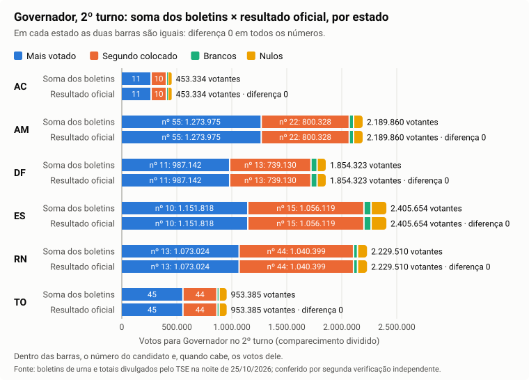
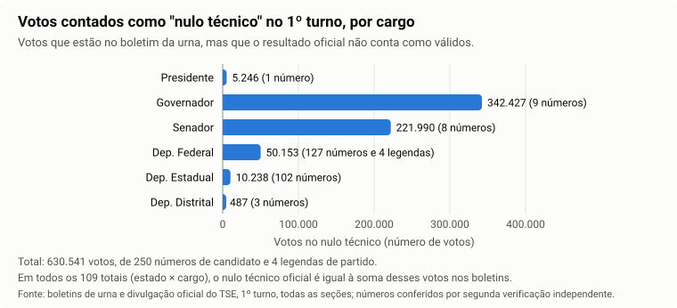
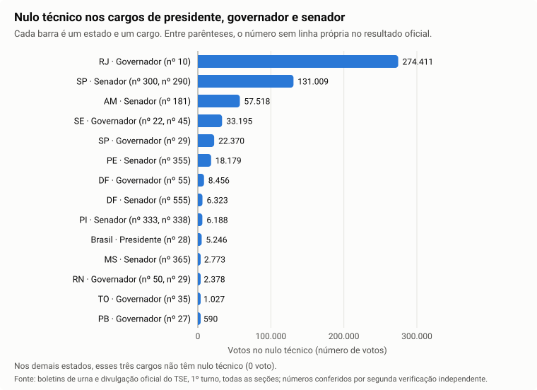
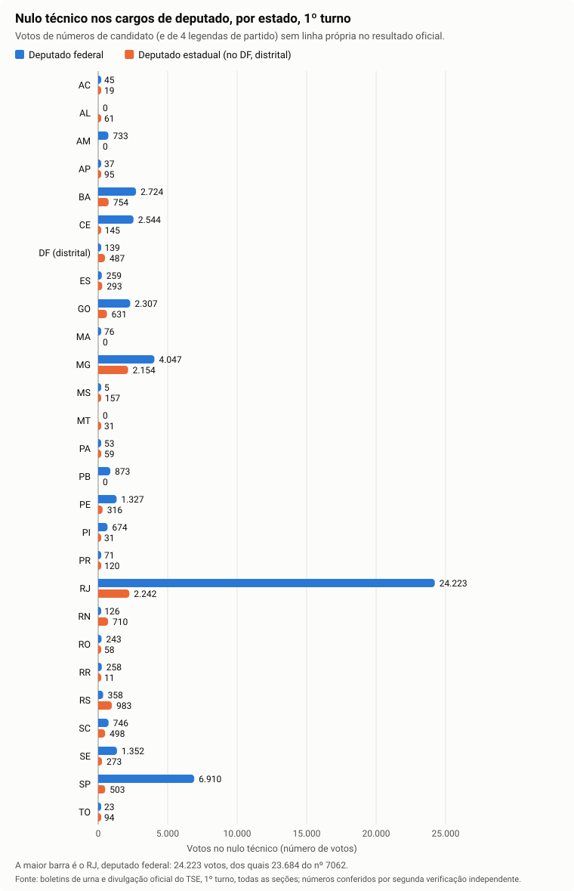
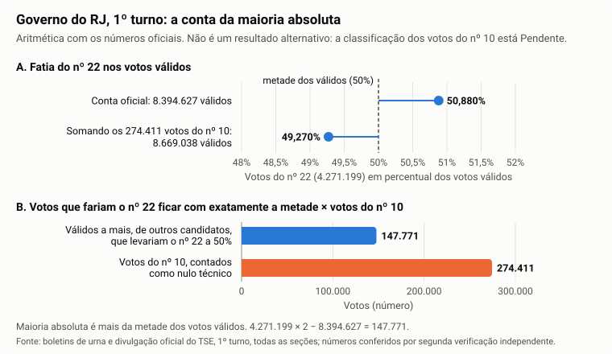

# 5. Soma dos boletins × resultado oficial

## A pergunta

Se somarmos o "placar" de cada urna (o Boletim de Urna), chegamos ao resultado que o TSE divulgou? Ou existe diferença entre o que as urnas registraram e o que foi totalizado?

## Resposta curta

**Fato (2º turno, Presidente e Governador, todos os níveis; conferido por uma segunda verificação independente, que refez as contas por outro caminho):** no 2º turno, o resultado oficial é igual à soma dos boletins de urna seção por seção, zona por zona, município por município, em cada estado e no país.

- **Seção a seção, seis números:** em cada uma das 499.207 seções que votaram para Presidente e das 39.739 que votaram para Governador (AC, AM, DF, ES, RN e TO, os 6 estados com 2º turno de Governador), os seis números do boletim (eleitores aptos, quantos votaram, votos em candidato, brancos, nulos e votos de legenda) são iguais aos do resultado oficial. São 538.946 combinações de seção e cargo, e nenhuma diferença.
- **Presidente, candidato a candidato em cada seção:** o voto de cada candidato, os brancos e os nulos são iguais em todas as 499.205 seções em que alguém votou para Presidente.
- **Governador, candidato a candidato:** o voto de cada candidato é igual em cada zona eleitoral, em cada município e em cada estado. O TSE não publica o voto de Governador por seção e candidato; por isso, na seção, Governador é conferido pelos seis números.
- **Totais da noite da eleição:** os totais divulgados (Presidente no país e Governador em cada um dos 6 estados) são iguais à soma dos boletins em eleitorado, comparecimento, abstenção, brancos, nulos e votos de cada candidato. Nenhum voto foi dado a um número que não fosse de candidato.

| Presidente, 2º turno | Soma dos boletins das urnas | Resultado oficial do TSE | Diferença |
|---|---|---|---|
| LULA (13) | 64.256.232 | 64.256.232 | 0 |
| FLAVIO BOLSONARO (22) | 59.826.041 | 59.826.041 | 0 |
| Nulos | 2.723.305 | 2.723.305 | 0 |
| Brancos | 1.430.496 | 1.430.496 | 0 |
| Seções com alguma diferença | — | — | **0 de 499.205** |

A única diferença entre as somas é de quais seções entram: 41 seções no exterior não foram instaladas. Elas estão no resultado oficial com 423 eleitores e nenhum voto, e não têm boletim (item 1).

**Fato (1º turno, todos os cargos, 28 unidades: 26 estados, DF e exterior; 499.207 seções com boletim; conferido por uma segunda verificação independente, que refez as contas com outro programa e confirmou o resultado com ressalvas):**

- **Seção a seção:** a soma dos boletins de urna é igual ao resultado oficial em aptos, comparecimento, votos nominais, brancos, nulos e votos de legenda, em todos os cargos (presidente, governador, senador, deputado federal, estadual e distrital): 0 divergência. Para presidente, também candidato a candidato: 0 divergência em 499.206 seções com voto.
- **Zona a zona, candidato a candidato:** o resultado oficial por município e zona é igual ao boletim em todos os candidatos que ele publica. Ele deixa de fora 250 números de candidato, que somam 628.629 votos no boletim.
- **Por estado e cargo (109 totais):** o resultado divulgado fecha com os boletins em todos os campos. Os 628.629 votos desses 250 números, mais 1.912 votos de legenda de 4 partidos ausentes, somam 630.541 e são exatamente o **"nulo técnico"** publicado (explicado abaixo).
- **Onde essa classificação pesa:** no governo do RJ, o eleito no 1º turno (nº 22) teve 4.271.199 de 8.394.627 votos válidos (50,880%). Os 274.411 votos do nº 10, classificados como nulo técnico, são mais que os 147.771 votos válidos a mais que tirariam essa maioria. Se esses votos deveriam ou não contar depende da exclusão do nº 10, que está **Pendente**.

**Limite:** isso mostra que os arquivos publicados pelo TSE concordam entre si. A conferência das assinaturas digitais foi feita nos dois turnos, nos 499.207 pacotes de cada um, com 0 falha de arquivo ([tópico 1](01-integridade-e-estrutura-dos-arquivos.md)): os pacotes publicados não mudaram depois de assinados. No 1º turno, o TSE não publica o arquivo que indica qual pacote foi totalizado em cada seção; por isso, ali, a assinatura não prova sozinha que o pacote conferido é o que o TSE somou (tópico 1).

**Pendente (sem número):** situação e data da decisão sobre o registro do candidato nº 10 ao governo do RJ e dos demais números excluídos; auditoria da consulta popular de PE no 1º turno e das consultas populares do 2º turno; voto por candidato e por seção nos cargos que não são presidente. Ver "Próximos passos".

## Termos usados neste tópico

| Termo | Em palavras simples |
|---|---|
| **Voto nominal** | Voto digitado no número de um candidato |
| **Voto de legenda** | Voto digitado só no número do partido, nos cargos de deputado. Conta para o partido, não para um candidato |
| **Votos válidos** | Os votos que entram na conta do resultado: nominais e de legenda que valem. Brancos e nulos ficam fora |
| **Maioria absoluta** | Mais da metade dos votos válidos. Para governador e presidente, quem passa disso no 1º turno é eleito sem 2º turno |
| **Nulo técnico** | Voto dado na urna a um número de candidato (ou de partido) que o resultado oficial não conta como válido, porque esse candidato não aparece na lista de candidatos do resultado. A urna registrou o voto no número normalmente; a totalização o põe fora dos válidos. É diferente do nulo comum, em que o eleitor digita um número que não existe na urna |
| **Anulado sub judice** | Voto dado a candidato cujo registro ainda está em discussão na Justiça no dia da totalização. Também fica fora dos válidos, mas pode voltar a valer se a Justiça decidir a favor do candidato |
| **Divulgação** | O resultado oficial que o TSE publica no seu site de resultados, com um arquivo por estado e cargo |
| **Dados abertos** | Os arquivos de resultado que o TSE publica no portal de dados abertos: por seção (o detalhamento da votação por seção e a votação por seção) e por município e zona (a votação por candidato, município e zona) |
| **Boletim impresso** | O texto do boletim que a urna imprime no fim do dia e que fica afixado na porta da seção. O TSE publica esse texto junto com o arquivo digital do boletim. Os dois saem da mesma urna, com os mesmos totais: é como a via impressa e o arquivo de um mesmo extrato bancário |
| **Seção não instalada** | Seção que existe na lista oficial, mas em que nenhuma urna foi montada no dia. Não tem boletim, e o resultado oficial a mostra com eleitores e nenhum voto |
| **Abstenção** | Eleitores aptos que não votaram. Na divulgação, o TSE a calcula só sobre as seções instaladas: eleitores das seções instaladas menos comparecimento |

## O que foi comparado

- **De um lado:** o boletim de cada urna, lido diretamente do arquivo que o TSE publica (o arquivo que a urna grava e assina). As impressões digitais desses arquivos foram refeitas em todas as seções, nos dois turnos ([tópico 0](00-coleta-completa.md)). A conferência dos lacres (assinaturas digitais) foi feita nos 499.207 pacotes de cada turno, com 0 falha de arquivo ([tópico 1](01-integridade-e-estrutura-dos-arquivos.md)).
- **Do outro, quatro produtos oficiais do TSE:**
  1. **votação por seção** (arquivo nacional de 2026, gerado em 26/10/2026 às 12:07): voto de cada candidato a presidente em cada seção. O arquivo só traz presidente;
  2. **detalhe por seção** (detalhamento da votação por seção de 2026): seis totais de cada seção e cargo (aptos, comparecimento, nominais, brancos, nulos, legenda), todos os cargos;
  3. **votação por município e zona** (votação por candidato, município e zona de 2026): voto de cada candidato em cada zona, todos os cargos;
  4. **divulgação**: os 109 arquivos de resultado por estado e cargo do 1º turno (27 UFs, isto é, 26 estados e DF, × cargos estaduais, mais presidente no país) e os 7 do 2º turno (presidente no país e governador em AC, AM, DF, ES, RN e TO), gerados na noite de 25/10/2026.
- **No 2º turno, também o boletim impresso:** a segunda verificação independente refez a comparação do 2º turno a partir do texto do boletim impresso pela urna, publicado no mesmo pacote, sem passar pela leitura do arquivo digital (ver "Prova de que o teste funciona").

Para cada seção, zona ou estado, cada número foi comparado com o do outro lado. Somar só o total do país poderia esconder erros que se compensam (um a mais aqui, um a menos ali). A comparação em cada nível não deixa isso passar.

## O que foi encontrado

### 1. 2º turno: todos os campos, Presidente e Governador, em todos os níveis

**Fato (conferido por uma segunda verificação independente).** O 2º turno tem 499.248 seções: 499.207 com boletim e 41 do exterior que não foram instaladas. Governador teve 2º turno em 6 estados: AC (2.270 seções), AM (8.157), DF (6.969), ES (9.844), RN (8.115) e TO (4.384), 39.739 seções ao todo.

**Seção a seção, os seis números de cada cargo (Fato).** Cada seção com boletim foi comparada com o detalhe por seção do TSE. Todas são iguais nos seis números:

| Cargo | Seções com boletim | Iguais ao oficial nos 6 números | Aptos | Comparecimento | Nominais | Brancos | Nulos | Legenda |
|---|---:|---:|---:|---:|---:|---:|---:|---:|
| Presidente | 499.207 | 499.207 | 158.745.079 | 128.236.074 | 124.082.273 | 1.430.496 | 2.723.305 | 0 |
| Governador | 39.739 | 39.739 | 12.478.054 | 10.086.066 | 9.404.837 | 228.427 | 452.802 | 0 |

- Nenhuma seção com boletim falta no oficial, e nenhuma seção instalada do oficial está sem boletim.
- No 2º turno não há voto de legenda: os dois cargos são de escolha de uma pessoa, e não de partido.
- O oficial de Presidente tem 423 aptos a mais (158.745.502): são os eleitores das 41 seções não instaladas (abaixo).

**Presidente, candidato a candidato em cada seção (Fato).** A votação por seção do TSE foi comparada com o boletim, número a número: 499.205 seções com voto dos dois lados, nenhuma só de um lado, 0 diferença no nº 13, no nº 22, nos brancos e nos nulos (tabela da resposta curta). As 2 seções com boletim que faltam para 499.207 são do exterior, apuradas em cédula, sem nenhum votante; no detalhe por seção elas aparecem com comparecimento 0, igual ao boletim.

**Governador, candidato a candidato por zona, município e estado (Fato).** O TSE não publica o voto de Governador por seção e candidato. A conferência foi feita na votação por candidato, município e zona: cada "par" é um lugar (uma zona, um município ou um estado) e um candidato.

| Nível | Presidente: pares iguais | Governador: pares iguais | Pares com diferença |
|---|---:|---:|---:|
| Zona eleitoral | 12.584 de 12.584 | 1.026 de 1.026 | 0 |
| Município | 11.514 de 11.514 | 938 de 938 | 0 |
| Estado | 56 de 56 | 12 de 12 | 0 |

Nenhum número de candidato com voto no boletim falta no oficial, e nenhum aparece só no oficial. Diferente do 1º turno (item 4), não há nulo técnico no 2º turno.

**Totais da noite da eleição (Fato).** Os 7 totais divulgados na noite de 25/10/2026 são iguais à soma dos boletins em eleitorado, comparecimento, abstenção, brancos, nulos e votos de cada candidato. Nenhum voto do boletim foi dado a um número fora da lista de candidatos (nulo técnico 0 nos 7).

| Total divulgado | Seções | Eleitorado | Comparecimento | Abstenção | Brancos | Nulos | Mais votado (nº: votos) | Segundo (nº: votos) |
|---|---:|---:|---:|---:|---:|---:|---|---|
| País, Presidente | 499.248 (41 não instaladas) | 158.745.502 | 128.236.074 | 30.509.005 | 1.430.496 | 2.723.305 | 13: 64.256.232 | 22: 59.826.041 |
| AC, Governador | 2.270 | 613.336 | 453.334 | 160.002 | 11.979 | 29.612 | 11: 272.635 | 10: 139.108 |
| AM, Governador | 8.157 | 2.796.187 | 2.189.860 | 606.327 | 39.610 | 75.947 | 55: 1.273.975 | 22: 800.328 |
| DF, Governador | 6.969 | 2.244.176 | 1.854.323 | 389.853 | 55.771 | 72.280 | 11: 987.142 | 13: 739.130 |
| ES, Governador | 9.844 | 2.987.603 | 2.405.654 | 581.949 | 64.871 | 132.846 | 10: 1.151.818 | 15: 1.056.119 |
| RN, Governador | 8.115 | 2.656.286 | 2.229.510 | 426.776 | 35.873 | 80.214 | 13: 1.073.024 | 44: 1.040.399 |
| TO, Governador | 4.384 | 1.180.466 | 953.385 | 227.081 | 20.323 | 61.903 | 45: 562.083 | 44: 309.076 |
| **Governador, 6 estados** | **39.739** | **12.478.054** | **10.086.066** | — | **228.427** | **452.802** | | |

**Como ler:** cada linha é um total publicado pelo TSE na noite da eleição. Cada número da linha é igual à soma dos boletins das seções daquele estado (ou do país). Nos 6 estados, todas as seções foram instaladas. Os eleitores aptos para Governador são um pouco menos que os de Presidente no mesmo estado porque o eleitor em trânsito vindo de outro estado só vota para Presidente.

**Como ler:** cada estado tem duas barras: a de cima é a soma dos boletins das urnas; a de baixo, o total oficial publicado pelo TSE. O comprimento de cada barra é o comparecimento, dividido em quatro pedaços: votos do mais votado, do segundo colocado, brancos e nulos (a cor de cada pedaço está na legenda). Dentro das barras está o número do candidato e, quando cabe, os votos dele. As duas barras de cada estado têm o mesmo tamanho e os mesmos pedaços: a diferença é 0 em todos os números, nos 6 estados. É como pôr lado a lado o extrato do banco e os recibos do caixa: se nada se perdeu no caminho, os dois batem até o último centavo.

**As 41 seções não instaladas (Fato).** São todas do exterior. Estão no resultado oficial com 423 eleitores, nenhum votante e nenhum voto, e não têm boletim no pacote publicado. É exatamente a diferença entre os aptos do oficial e os do boletim (158.745.502 − 158.745.079 = 423). A abstenção oficial é calculada só sobre as seções instaladas: 158.745.079 − 128.236.074 = 30.509.005. Isso é a regra de cálculo do TSE e não muda nenhum voto.

Caso conferido: AC, Bujari, zona 9, seção 3, com LULA 81 e FLAVIO BOLSONARO 146 no boletim, no registro dos votos e no resultado oficial.

**Pendente (sem número):** as consultas populares do 2º turno. Elas não estão no detalhe por seção, na votação por município e zona nem na divulgação de cargos, e por isso não há resultado oficial para comparar.

### 2. 1º turno: quais seções entraram

**Fato.** O 1º turno tem 499.248 seções: 499.207 com boletim e 41 sem arquivo, todas do exterior, que não foram instaladas (comparecimento 0 no resultado oficial). Em cada uma das 27 UFs (26 estados e DF), o número de seções com boletim é igual ao de seções totalizadas na divulgação; no país, a divulgação de presidente traz 499.248 seções, 499.207 totalizadas e 41 não instaladas.

Ficaram fora da comparação, com motivo:

| O que ficou fora | Quantas | Por quê |
|---|---:|---|
| Seções do exterior sem arquivo | 41 | Não instaladas: não têm boletim; o resultado oficial também mostra comparecimento 0 |
| Seção sem nenhum voto | 1 (exterior, município 29564, zona 0001, seção 0091) | Urna de contingência com comparecimento 0, nos dois lados. Por isso são 499.206 seções com voto para presidente, e não 499.207 |
| Consulta popular em PE (eleição 6261 do TSE, só no município de código 30015, zona 0004) | 10 seções, 2.445 votantes | Não é cargo: é uma consulta à população, publicada fora da divulgação de cargos. Fica sem auditoria contra referência oficial (**Pendente**) |

### 3. 1º turno: seção a seção, os seis totais de cada cargo

**Fato.** O detalhe por seção tem 2.490.836 linhas (seção × cargo). Todas as linhas com boletim são iguais ao boletim nos seis totais:

| Cargo | Seções no oficial | Iguais ao boletim nos 6 totais | Com diferença | Comparecimento | Nominais | Brancos | Nulos | Legenda |
|---|---:|---:|---:|---:|---:|---:|---:|---:|
| Presidente | 499.248 | 499.207 | 0 | 125.275.835 | 119.306.034 | 2.300.798 | 3.669.003 | 0 |
| Governador | 497.897 | 497.897 | 0 | 124.768.485 | 112.197.244 | 5.067.116 | 7.504.125 | 0 |
| Senador | 497.897 | 497.897 | 0 | 124.768.485 | 207.632.159 | 18.678.856 | 23.225.955 | 0 |
| Dep. federal | 497.897 | 497.897 | 0 | 124.768.485 | 110.670.045 | 6.445.372 | 4.214.631 | 3.438.437 |
| Dep. estadual | 490.928 | 490.928 | 0 | 122.950.564 | 104.458.295 | 6.872.914 | 4.415.140 | 7.204.215 |
| Dep. distrital | 6.969 | 6.969 | 0 | 1.817.921 | 1.628.400 | 77.934 | 39.956 | 71.631 |

- As 41 linhas de presidente sem boletim são as 41 seções não instaladas do exterior.
- Nenhuma seção com boletim falta no oficial.
- Senador tem quase o dobro de votos nominais porque, em 2026, havia duas vagas de senador em cada estado (2 eleitos em cada uma das 27 UFs), e cada eleitor votou em dois nomes.
- Os totais são iguais dos dois lados. Os valores acima são os do oficial, e a soma dos tipos de voto do boletim (nominal, legenda, branco, nulo), recontada na segunda verificação, dá os mesmos números.

**Fato.** Para presidente, o arquivo de votação por seção foi comparado candidato a candidato: 499.206 seções com voto dos dois lados, nenhuma só de um lado, e 0 divergência nos 13 candidatos, nos brancos e nos nulos. Para os outros cargos, o TSE não publica esse arquivo por seção e candidato no conjunto lido (o arquivo de 2026 traz só presidente); para eles, a seção é conferida nos seis totais e o candidato, por zona.

### 4. 1º turno: zona a zona, candidato a candidato

**Fato.** Na votação por município e zona, todos os candidatos que o oficial publica têm o mesmo voto do boletim, em todas as zonas. A única diferença é de um tipo só: **números de candidato com voto no boletim e sem nenhuma linha no oficial**. Nenhum número tem valores diferentes dos dois lados, e nenhum número aparece só no oficial.

| Cargo | Números sem linha no oficial | Votos desses números no boletim |
|---|---:|---:|
| Presidente | 1 | 5.246 |
| Governador | 9 | 342.427 |
| Senador | 8 | 221.990 |
| Dep. federal | 127 | 48.241 |
| Dep. estadual | 102 | 10.238 |
| Dep. distrital | 3 | 487 |
| **Total** | **250** | **628.629** |

**Fato (conferência independente).** A segunda verificação comparou esses 250 números com os números que faltam na divulgação (o outro produto oficial). São os mesmos 250, com os mesmos 628.629 votos. Os dois produtos do TSE omitem exatamente os mesmos números.

### 5. 1º turno: o total de cada estado e cargo, e o "nulo técnico"

**Fato.** Os 109 arquivos da divulgação (27 UFs × cargos estaduais, mais presidente no país) foram comparados com a soma dos boletins. Cada voto do boletim foi posto no destino que a própria divulgação dá ao candidato ou ao partido (válido, válido de legenda, anulado, anulado sub judice). O voto de número ou partido que não está na divulgação foi posto em "nulo técnico". Resultado: **109 de 109 totais iguais nos 11 campos**, sem nenhum voto sem destino.

| Campo da divulgação | Totais iguais | Soma dos 109 totais (boletim = oficial) |
|---|---:|---:|
| Brancos | 109/109 | 39.442.990 |
| Nulos digitados | 109/109 | 43.068.810 |
| Nominais válidos | 109/109 | 653.791.525 |
| Legenda válida | 109/109 | 10.719.351 |
| Anulados | 109/109 | 71.059 |
| Anulados sub judice | 109/109 | 1.393.984 |
| **Nulo técnico** | **109/109** | **630.541** |
| Válidos | 109/109 | 664.510.876 |
| Total de votos | 109/109 | 749.118.260 |

Aptos e comparecimento também fecham nos 109. A soma dos totais junta todos os cargos, então ela conta votos, e não eleitores: cada eleitor entra uma vez em cada cargo, e duas no senador, que tinha duas vagas.

A legenda válida da divulgação (10.719.351) não é igual à soma dos votos de legenda digitados no boletim (10.714.283, última coluna da tabela do item 3). A diferença vem do destino que a divulgação dá a cada candidato e partido: os votos nominais de alguns candidatos vão para a legenda do partido, e os votos de legenda de alguns partidos vão para anulado ou anulado sub judice. Classificando cada voto do boletim pelo destino dado na divulgação, os 109 totais fecham, como mostra a tabela acima.

**De onde vem o nulo técnico (Fato).** Em cada um dos 109 totais, o nulo técnico publicado é exatamente a soma, no boletim, dos votos dos números de candidato que faltam na divulgação mais os votos de legenda dos partidos que faltam. A conta fecha sem sobra. Há nulo técnico em 63 dos 109 totais.

| Cargo | Totais (estado × cargo) | Com nulo técnico | Nulo técnico | Votos em números de candidato | Votos de legenda | Números | Legendas |
|---|---:|---:|---:|---:|---:|---:|---:|
| Presidente (país) | 1 | 1 | 5.246 | 5.246 | 0 | 1 | 0 |
| Governador | 27 | 7 | 342.427 | 342.427 | 0 | 9 | 0 |
| Senador | 27 | 6 | 221.990 | 221.990 | 0 | 8 | 0 |
| Dep. federal | 27 | 25 | 50.153 | 48.241 | 1.912 | 127 | 4 |
| Dep. estadual | 26 | 23 | 10.238 | 10.238 | 0 | 102 | 0 |
| Dep. distrital | 1 | 1 | 487 | 487 | 0 | 3 | 0 |
| **Total** | **109** | **63** | **630.541** | **628.629** | **1.912** | **250** | **4** |

**Como ler:** cada barra é um cargo, e o comprimento é a quantidade de votos que estão no boletim da urna mas que o resultado oficial conta como nulo técnico. Entre parênteses, quantos números de candidato (e de legenda) há em cada cargo. Governador e senador concentram quase todo o total, com poucos números cada; os deputados têm muitos números, cada um com poucos votos.

**Os números de presidente, governador e senador, um a um (Fato):**

| Estado e cargo | Número | Votos no nulo técnico |
|---|---|---:|
| País, presidente | nº 28 | 5.246 |
| RJ, governador | nº 10 | 274.411 |
| SE, governador | nº 22 e nº 45 | 31.852 + 1.343 = 33.195 |
| SP, governador | nº 29 | 22.370 |
| DF, governador | nº 55 | 8.456 |
| RN, governador | nº 50 e nº 29 | 2.151 + 227 = 2.378 |
| TO, governador | nº 35 | 1.027 |
| PB, governador | nº 27 | 590 |
| SP, senador | nº 300 e nº 290 | 120.575 + 10.434 = 131.009 |
| AM, senador | nº 181 | 57.518 |
| PE, senador | nº 355 | 18.179 |
| DF, senador | nº 555 | 6.323 |
| PI, senador | nº 333 e nº 338 | 4.330 + 1.858 = 6.188 |
| MS, senador | nº 365 | 2.773 |

**Como ler:** cada barra é um estado e um cargo em que houve nulo técnico; entre parênteses, o número do candidato sem linha própria no resultado oficial. A barra do governo do RJ é a maior, com 274.411 votos de um só número. Os estados que não aparecem não têm nulo técnico nesses três cargos.

**Legendas de partido que faltam na divulgação (Fato):** todas de deputado federal. PB, partido 70: 304 votos. SE, partido 25: 309. SE, partido 77: 126. SP, partido 29: 1.173.

**Por estado, todos os cargos (Fato).** Votos no nulo técnico. O presidente tem um só total, do país: 5.246 votos (nº 28), em 499.207 seções.

| UF | Seções com boletim | Governador | Senador | Dep. federal | Dep. estadual (DF: distrital) |
|---|---:|---:|---:|---:|---:|
| AC | 2.270 | 0 | 0 | 45 | 19 |
| AL | 7.101 | 0 | 0 | 0 | 61 |
| AM | 8.157 | 0 | 57.518 | 733 | 0 |
| AP | 1.914 | 0 | 0 | 37 | 95 |
| BA | 35.476 | 0 | 0 | 2.724 | 754 |
| CE | 23.765 | 0 | 0 | 2.544 | 145 |
| DF | 6.969 | 8.456 | 6.323 | 139 | 487 |
| ES | 9.844 | 0 | 0 | 259 | 293 |
| GO | 15.686 | 0 | 0 | 2.307 | 631 |
| MA | 18.093 | 0 | 0 | 76 | 0 |
| MG | 52.062 | 0 | 0 | 4.047 | 2.154 |
| MS | 7.106 | 0 | 2.773 | 5 | 157 |
| MT | 8.287 | 0 | 0 | 0 | 31 |
| PA | 20.827 | 0 | 0 | 53 | 59 |
| PB | 10.712 | 590 | 0 | 873 | 0 |
| PE | 21.418 | 0 | 18.179 | 1.327 | 316 |
| PI | 10.225 | 0 | 6.188 | 674 | 31 |
| PR | 27.142 | 0 | 0 | 71 | 120 |
| RJ | 37.675 | 274.411 | 0 | 24.223 | 2.242 |
| RN | 8.115 | 2.378 | 0 | 126 | 710 |
| RO | 4.698 | 0 | 0 | 243 | 58 |
| RR | 1.519 | 0 | 0 | 258 | 11 |
| RS | 27.547 | 0 | 0 | 358 | 983 |
| SC | 17.326 | 0 | 0 | 746 | 498 |
| SE | 5.923 | 33.195 | 0 | 1.352 | 273 |
| SP | 103.656 | 22.370 | 131.009 | 6.910 | 503 |
| TO | 4.384 | 1.027 | 0 | 23 | 94 |
| **Total** | | **342.427** | **221.990** | **50.153** | **10.725** |

O total da última coluna soma os 10.238 votos de deputado estadual com os 487 de deputado distrital (DF). Em todas as 108 células acima e no total de presidente, o nulo técnico oficial é igual à soma dos votos que o boletim dá aos números (e legendas) ausentes da divulgação.

**Como ler:** cada estado tem duas barras: a azul é deputado federal, a laranja é deputado estadual (no DF, distrital). O comprimento é a quantidade de votos no nulo técnico. Quase todos os estados têm algumas dezenas ou centenas de votos; a barra que se destaca é a do RJ, deputado federal, em que um só número (nº 7062) tem 23.684 dos 24.223 votos.

A lista completa dos 254 itens (250 números de candidato e 4 legendas), com estado, cargo e votos no boletim, fica nos documentos de análise da auditoria, junto com um resumo por estado e cargo.

**Casos conferidos no arquivo original da urna (Fato).** Nos três casos abaixo, o voto está no arquivo do boletim gravado pela urna, a imagem do boletim impresso da mesma urna lista o candidato com o número, e a base de dados da auditoria tem o mesmo valor. Ou seja, o candidato estava na urna; o que muda é só a classificação na totalização.

| Seção (UF, município/zona/seção) | Cargo e número | Votos | Como foi conferido |
|---|---|---:|---|
| SE 31038/0003/0001 | governador, nº 22 | 4 | segunda verificação independente |
| RJ 60011/0023/0100 | deputado federal, nº 7062 | 3 | segunda verificação independente |
| SP 63053/0037/0095 | senador, nº 300 | 36 | análise original, reproduzida pela segunda verificação independente |

**Hipótese.** Pela forma como a divulgação separa os destinos, o nulo técnico corresponde a candidatura excluída (registro negado, cancelado ou renunciado) sem recurso pendente; com recurso pendente, o voto iria para "anulado sub judice". O motivo e a data de cada exclusão não estão nos arquivos públicos lidos: no arquivo de candidatos do TSE, o campo da situação da candidatura vem preenchido com "#NE" em todas as linhas, sem a informação. **Pendente.**

### 6. Onde a classificação pesa: governo do RJ e do DF

**Fato, RJ, governador.** No resultado oficial, o nº 22 teve 4.271.199 de 8.394.627 votos válidos, isto é, 50,880%, e foi eleito no 1º turno. A maioria absoluta exige mais da metade dos válidos. Se houvesse 147.771 votos válidos a mais, de outros candidatos, o nº 22 ficaria com exatamente a metade e deixaria de ter a maioria (4.271.199 × 2 − 8.394.627 = 147.771). O nº 10 tem 274.411 votos no boletim, classificados como nulo técnico, mais do que esses 147.771. A conta para aí: ela mostra que a classificação desses votos pesa sobre a maioria, e não qual teria sido o resultado. Isso depende de os votos do nº 10 deverem ou não valer, isto é, da situação e da data da decisão sobre o registro dele (**Pendente**).

**Como ler:** as duas barras começam no zero e medem votos. A azul é quantos votos válidos a mais, de outros candidatos, bastariam para o nº 22 ficar com exatamente a metade e perder a maioria (147.771). A laranja é quantos votos o nº 10 teve no boletim e que a totalização contou como nulo técnico (274.411). A laranja é maior que a azul. **É só aritmética com números oficiais.** Não diz qual deveria ter sido o resultado: isso depende de os votos do nº 10 deverem ou não valer, isto é, de o registro dele estar em ordem no dia da eleição, o que está **Pendente**.

**Fato, DF, governador.** O líder (nº 11) teve 825.530 de 1.651.394 votos válidos (49,990%), e houve 2º turno. Com o mesmo total de válidos, faltaram 168 votos para a maioria absoluta: se 168 votos válidos de outros candidatos tivessem ido para ele, teria 825.698, mais da metade. O DF também tem nulo técnico de governador: o nº 55, com 8.456 votos. Somar esses votos aos válidos só aumenta o total de válidos, e com isso o líder ficaria mais longe da maioria, não mais perto.

**Fato, o que o teste não decide.** Anulados (71.059), anulados sub judice (1.393.984) e nulo técnico (630.541) somam 2.095.584 votos que saem dos válidos pela classificação que a totalização dá ao candidato ou ao partido, e não por algo registrado na urna. Pela definição de cada campo, essa classificação depende da situação do registro da candidatura, decidida por pessoas; no nulo técnico, isso é a Hipótese do item 5, e o motivo de cada caso é **Pendente**. O teste mostra que essa classificação foi aplicada da mesma forma em todos os arquivos do TSE. Não mostra que ela estava certa, nem quando foi tomada.

## Prova de que o teste funciona (contraprova)

- **A junção é completa:** uma seção, zona ou número que existisse só no boletim, ou só no oficial, conta como divergência. Isso aparece nos dados: as 41 seções não instaladas surgem como "linha do oficial sem boletim", e os 250 números omitidos surgem como "boletim com voto, oficial sem linha". O teste enxerga o que falta de um lado.
- **O teste acusou diferenças reais de leitura e elas foram explicadas uma a uma.** Na primeira execução, o programa de comparação do 1º turno apontou três diferenças, todas erro de leitura da própria auditoria: (1) somava a consulta popular de PE à eleição estadual (a diferença de 13 aptos é exatamente a soma dos eleitores em trânsito dessas 10 seções); (2) esperava um campo de legenda que os arquivos de presidente, governador e senador não têm (nesses cargos não há voto de legenda no boletim); (3) confundia "eleito" com "vai ao 2º turno". A segunda verificação conferiu as três correções e concluiu que elas não escondem outro problema.
- **Conferência independente:** a segunda verificação refez as contas com outro programa. Tirou os votos de cada partido do boletim, e não do arquivo oficial, e comparou a lista de números omitidos dos dados abertos com a da divulgação. Os números saíram iguais aos da primeira conta.
- **Teste automático da base de dados:** no conjunto de testes automáticos do programa da auditoria, um valor oficial alterado de propósito (143 votos onde o boletim tem 144) e uma seção que só existe no oficial **são** apontados como divergência.
- **2º turno, conta feita por dois caminhos (Fato).** A comparação do 2º turno foi feita duas vezes, por caminhos diferentes: uma vez a partir do arquivo digital do boletim; outra a partir do texto do boletim impresso pela urna, que é publicado junto. É como conferir um extrato pelo arquivo do banco e depois pela via impressa. Os dois caminhos deram os mesmos números em todas as seções: a leitura que a auditoria fez dos boletins é igual ao texto impresso em todas as 499.207 seções e nos 538.946 pares de seção e cargo. Na primeira vez, o programa da segunda verificação leu errado 395 seções, e as comparações acusaram a diferença na hora; corrigida a leitura, tudo fechou.
- **2º turno, boletim alterado de propósito (Fato).** Três números de boletins do AC foram alterados na memória do computador, sem mudar nenhum arquivo: um branco a mais e um voto a mais para Presidente numa seção, um eleitor apto a mais para Governador em outra. A comparação seção a seção dos seis números acusou exatamente as 3 alterações, e a comparação candidato a candidato de Presidente acusou as 2 que a afetam.
- **Pendente.** As comparações do 2º turno por zona, por município, por estado e com os totais da noite da eleição ainda não têm uma contraprova própria, com alteração feita de propósito.

## Um caso que parecia estranho

**Fato:** algumas seções aparecem no site de resultados com a situação "Recebida", e não "Totalizada". Quantas são no país inteiro: **Pendente: em verificação** (a lista oficial com a situação de cada seção ainda está sendo baixada; ver [tópico 0](00-coleta-completa.md)).

**Fato:** como a comparação de presidente do 2º turno cobre **todas** as seções que votaram para Presidente, essas seções "Recebida" estão incluídas nela: estão no resultado oficial e os votos de Presidente são **iguais** aos do boletim da urna.

**Hipótese:** a situação "Recebida" se refere ao pacote completo de arquivos da urna (diário, registro dos votos), e não ao boletim, que já estava totalizado. Seja qual for o motivo, não há diferença nos votos de Presidente.

## O que este resultado prova e o que não prova

- **Prova:** nos dois turnos, o resultado oficial é exatamente a soma dos boletins de urna publicados, nos níveis comparados (2º turno: presidente e governador por seção nos seis números, presidente candidato a candidato por seção, governador candidato a candidato por zona, município e estado, e os 7 totais da noite da eleição; 1º turno: todos os cargos por seção nos seis totais, por zona e candidato, e por estado e cargo). Nesses níveis, nenhum voto foi somado, tirado ou trocado **entre o boletim e o resultado oficial**. A única diferença do 1º turno é de classificação (o nulo técnico), e ela fecha sem sobra em cada um dos 109 totais.
- **O resultado oficial e o boletim são documentos do mesmo TSE.** O detalhe por seção, a votação por seção, a votação por município e zona e a divulgação são calculados pelo TSE a partir dos mesmos boletins recebidos. Não são uma contagem independente dos votos. Esta conferência mostra que nenhum voto mudou entre o boletim e o resultado publicado; não mostra que a urna contou certo o que o eleitor digitou (tópicos 1 e 2) nem que cada voto é de um eleitor legítimo (tópico 4).
- **O boletim impresso não é uma fonte independente da urna.** A urna gera o arquivo digital e o texto impresso a partir dos mesmos totais. Conferir os dois mostra que a leitura feita pela auditoria é fiel ao boletim; não mostra que o boletim está certo.
- **Não alcança** uma troca de votos entre candidatos de seções diferentes da mesma zona nos cargos que não são presidente (e, no 2º turno, no governador), se ela mantivesse os seis totais de cada seção e o total de cada candidato na zona. Para isso falta o voto por candidato e por seção desses cargos (**Pendente**, ver "Próximos passos").
- **Que cada boletim publicado é o que a urna gravou** depende da conferência das assinaturas digitais. Ela foi feita nos dois turnos, nos 499.207 pacotes de cada um, com 0 falha de arquivo ([tópico 1](01-integridade-e-estrutura-dos-arquivos.md)). No 1º turno, o TSE não publica qual pacote foi totalizado em cada seção; por isso, ali, a assinatura mostra que o pacote publicado não mudou depois de assinado, mas não prova sozinha que foi esse o pacote somado pelo TSE.
- **Os campos não são testes independentes.** Na divulgação, total = válidos + brancos + nulos + nulo técnico + anulados + anulados sub judice. Se os outros campos fecham, o nulo técnico fecha por conta. O que a identidade do nulo técnico acrescenta é mostrar de onde ele vem (números e legendas ausentes, sem sobra).
- **Não prova** que a decisão de excluir cada candidato estava certa, nem quando foi tomada (ver item 6).
- **Não prova** que os votos registrados pelas urnas são todos legítimos. Se alguém votou no lugar de outra pessoa (por exemplo, com liberação sem biometria), esse voto está no boletim **e** no resultado oficial, e os dois batem. Essa possibilidade é examinada no tópico 4, "Como os eleitores foram liberados para votar".
- Se a reclassificação dos outros números mudaria alguma vaga de deputado ou de senador é uma conta feita sobre uma suposição (a de que esses votos deveriam valer) e fica fora deste relatório, nos documentos de análise da auditoria.

## Próximos passos

- **Feito:** conferência das assinaturas digitais dos boletins do 1º turno: 499.207 pacotes, 0 falha de arquivo ([tópico 1](01-integridade-e-estrutura-dos-arquivos.md)).
- **Pendente:** situação e data da decisão sobre o registro do candidato nº 10 ao governo do RJ, e dos demais números excluídos (em especial governador de SE nº 22 e de SP nº 29, senadores de SP nº 300 e nº 290, e o partido 29 sem lista de deputado federal em SP). Exige consulta pública aos processos de registro.
- **Pendente:** auditoria da consulta popular de PE (eleição 6261, 10 seções): não há arquivo de divulgação dela no repositório, e o detalhe por seção não a traz.
- **Pendente:** voto por candidato e por seção nos cargos que não são presidente. O arquivo de dados abertos lido só traz presidente; para os outros cargos, o candidato é conferido por zona.
- **Feito:** 2º turno, demais campos (aptos, comparecimento, brancos, nulos e legenda) de Presidente e Governador, seção a seção, e Governador candidato a candidato por zona, município e estado, com segunda verificação independente (item 1).
- **Pendente:** contraprova própria, com alteração feita de propósito, para as comparações do 2º turno por zona, município, estado e com os totais da noite da eleição.
- **Pendente:** consultas populares do 2º turno, sem resultado oficial publicado para comparar.
- **Pendente:** conferir se cada número omitido estava no arquivo de candidatos de todas as urnas do estado.
