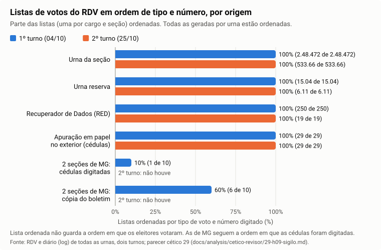
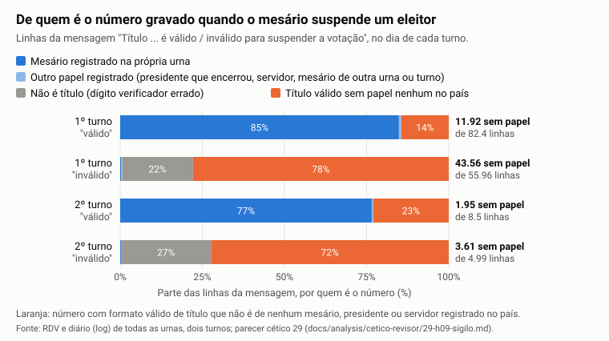

# 12. Sigilo do voto: os arquivos públicos permitem ligar um voto a um eleitor?

> **Situação:** escrito em 30/10/2026. O achado passou por uma segunda verificação independente, feita com um programa próprio, rodado nos dois turnos inteiros ao mesmo tempo. A conclusão dessa verificação: "sustentado, com ressalvas". O texto usa só as afirmações que resistiram a essa verificação. Para este tópico, os números foram conferidos mais uma vez contra os resultados dos dois programas e contra o banco de dados da auditoria. É a hipótese H09 do [quadro das hipóteses](10-quadro-das-hipoteses.md). **Atualizado em 02/11/2026** com o fechamento da hipótese só com dados públicos: um novo programa, escrito à parte, releu os diários dos dois turnos inteiros e testou, uma a uma, as explicações possíveis para o número gravado na suspensão. Com isso entram aqui a conclusão por inferência sobre de quem é esse número, as contagens das sessões em que ele aparece e como essas sessões terminaram.

## A pergunta

O voto é secreto: ninguém pode saber em quem uma pessoa votou. Para cada urna, o TSE publica três arquivos: o boletim (o placar da seção), o registro digital do voto (a lista dos votos) e o diário da urna (o log, que anota cada acontecimento com data e hora). A pergunta é: juntando esses arquivos, alguém consegue descobrir em quem uma pessoa votou, ou ligar um eleitor identificado a algum voto?

## Resposta curta

- **Fato:** o registro digital do voto (RDV) **não guarda a ordem em que os eleitores votaram**. Em todas as listas de votos geradas por urna, nos dois turnos, os votos estão em ordem de tipo e de número digitado: 539.788 de 539.788 listas no 2º turno e 2.490.766 de 2.490.766 no 1º. Não dá para dizer "o 5º eleitor votou em X".
- **Fato (exceção):** em 2 seções de Minas Gerais no 1º turno, parte dos votos foi dada em cédula de papel e digitada depois. Nessas listas a ordem é a da digitação, e a mesma posição corresponde à mesma cédula: o arquivo mostra o par de votos para deputado (federal e estadual) de cada uma das 40 cédulas e, numa das seções, o trio de votos para governador e senadores de cada uma das 20 cédulas. O voto para presidente não segue essa ordem. A cédula não tem nome.
- **Fato (limite de publicar por seção):** nenhuma seção teve só 1 votante. Mas 30 seções no 2º turno (3.100 eleitores) e 17 no 1º (1.107) votaram todas no mesmo candidato a presidente. Nelas, quem sabe quem compareceu sabe como cada um votou, inclusive o mesário que é eleitor da própria seção, se ele votou ali. Isso é consequência de publicar o resultado seção por seção, não falha da urna.
- **Fato (achado):** quando o mesário interrompe a votação de um eleitor que demora na cabine (a "suspensão"), a urna grava no diário público o número digitado para autorizar a interrupção. No dia do 1º turno, **55.483 linhas** trazem um número com formato válido de título de eleitor (**31.764 números diferentes**) que não é de nenhum mesário, presidente de mesa ou servidor registrado em qualquer urna do país, nos dois turnos. No dia do 2º turno, **5.564 linhas (3.801 números)**. Cada número aparece numa única seção (no 1º turno, um deles em 2), dentro do atendimento de um eleitor, com data e hora. Um número de título é dado pessoal, e ele está num arquivo que qualquer pessoa baixa.
- **Fato:** a mensagem de encerramento da votação também traz números de título que não são de mesário registrado em nenhuma urna do país no mesmo turno: 5.688 linhas no 1º turno e 1.750 no dia do 2º turno, fora do atendimento de eleitores. O mais provável é o presidente da mesa sem registro na urna (Hipótese).
- **Fato:** quando a urna **recusa** um desses números ("inválido"), a sessão em que isso acontece foi liberada pelo número do título em 20.082 de 20.087 sessões no 1º turno e em 1.868 de 1.868 no 2º, contra 77,97% e 74,46% no conjunto das sessões de cada turno. Os números recusados são 20.062 no 1º turno e 1.866 no 2º, cada um numa única seção do país.
- **Conclusão por inferência (a regra da urna não é pública):** o número que a urna recusa na suspensão é o título digitado para liberar o próprio eleitor que estava na cabine. O arquivo não tem um campo que diga "este é o eleitor"; a conclusão vem da estrutura do diário, e todas as outras explicações testadas foram descartadas (item 5).
- **Fato:** ao lado desse número, o diário mostra a hora, a forma de liberação e como terminou a votação daquela pessoa. Das 20.087 sessões do 1º turno, 6.664 terminaram em voto normal, 6.385 em "voto nulo por suspensão" em algum cargo e 6.920 sem nenhum voto confirmado; no 2º turno, 786, 77 e 985, das 1.868 (item 6).
- **Fato:** o diário não diz em quem a pessoa votou, salvo numa situação: numa seção em que todos votaram no mesmo candidato. Isso aconteceu **uma vez**, numa seção do AM, no 1º turno: lá, o número publicado na suspensão, somado ao boletim, mostra o voto daquela pessoa para Presidente. No 2º turno, nenhuma vez.
- **Veredito final sobre a hipótese de que os arquivos públicos permitem ligar voto a eleitor (H09): fato que pede explicação.** O diário público traz o título de quem estava na cabine quando a mesa interrompeu a votação, com hora e desfecho. Não diz em quem a pessoa votou, salvo naquele caso de seção unânime. É uma questão de sigilo e de dado pessoal, e não muda nenhuma contagem: o efeito sobre a diferença entre os candidatos é zero. Só a regra técnica da suspensão ou o caderno de votação da seção confirmariam de forma direta de quem é cada número; nenhum dos dois é público.
- **Não se pode afirmar:** que o sigilo está garantido contra qualquer método. Sete arquivos que a urna grava não são publicados, o método que encadeia as linhas do diário não é público, e a busca deste tópico só enxerga o número escrito por extenso (ver Limites).

## Termos usados neste tópico

- **Registro Digital do Voto (RDV):** a lista dos votos da urna, cargo por cargo. Cada voto tem só dois campos: o tipo (nominal, legenda, branco, nulo, nulo por suspensão e outros) e o número digitado. Não tem nome, horário nem posição de chegada. Comparação do dia a dia: é como despejar as cédulas de uma urna de lona e separá-las em montes por candidato; dá para contar cada monte, mas não para saber quem pôs cada cédula.
- **Lista ordenada:** uma lista arrumada por um critério fixo, como uma lista de nomes em ordem alfabética. Ela não diz quem chegou primeiro. Outros tópicos e o glossário chamam o RDV de "embaralhado"; a descrição exata é "ordenado por tipo e número", e o efeito para o sigilo é o mesmo: a ordem de chegada se perde.
- **Diário da urna (log):** o arquivo em que a urna anota, com data e hora, tudo o que acontece: mesário registrado, eleitor liberado, voto computado, encerramento.
- **Atendimento do eleitor (no diário):** o trecho do diário entre o momento em que o mesário digita a identificação do eleitor e o "voto computado" (ou a volta da urna à espera do próximo eleitor).
- **Suspensão:** quando o eleitor demora na cabine, a urna pergunta ao mesário se ele ainda está votando. Se não está, a urna pede um título de eleitor para autorizar a interrupção e anota no diário "Título [número] é válido (ou inválido) para suspender a votação". Os cargos que o eleitor ainda não tinha confirmado recebem um voto nulo, anotado como "Atribuído voto nulo por suspensão [cargo]".
- **Dígito verificador (DV):** os dois últimos dígitos do título de eleitor, calculados a partir dos outros, como no CPF. Serve para pegar erro de digitação: um número digitado errado quase nunca passa na conta. Aqui, "formato válido de título" quer dizer: 12 dígitos com dígito verificador correto.
- **Papel do número:** o que o próprio diário diz que aquele número é. O título do mesário aparece nas mensagens de mesário ("Mesário [número] registrado"); o do servidor do cartório, em "mídia gerada pelo usuário"; o do presidente da mesa, em "Título digitado para encerramento". Um número "sem papel" não aparece em nenhuma dessas mensagens.
- **Seção unânime:** seção em que todos os votos de um cargo foram para o mesmo candidato.
- **Sistema de Apuração (SA):** programa usado quando a votação na urna eletrônica não é possível e os votos são dados em cédula de papel. As cédulas são depois digitadas no SA. Na "apuração mista", parte dos votos está na urna e parte em cédula.

## Como foi feito

**Universo (Fato).** Os dois turnos inteiros: 499.248 seções por turno, 499.207 pacotes de arquivos, 41 seções sem arquivo publicado, 0 falha de leitura. Dois programas independentes, escritos à parte, leram todos os RDVs e todos os diários. O segundo leu os dois turnos juntos, para cruzar os números de um turno com os papéis do outro. As seções unânimes foram contadas também no banco de dados da auditoria, que guarda os votos do RDV de cada seção, por um terceiro caminho.

**Privacidade.** Nenhum programa grava número de título ou de CPF: os números ficam só na memória durante a leitura, e a saída passa por uma trava que apaga qualquer sequência de 10 a 12 dígitos com dígito verificador de título ou de CPF (ela não disparou). Este relatório não reproduz nenhum número. A base privada de CPFs que a auditoria guarda à parte não foi usada, nem nenhum outro arquivo privado.

1. **Ordem dos votos.** Para cada lista do RDV (um cargo de uma seção), o programa confere se cada voto vem antes do seguinte pela regra (tipo do voto, número digitado). Se a lista estivesse na ordem de chegada dos eleitores, ela sairia desarrumada por esse critério.
2. **Cédulas de MG.** A segunda verificação comparou, posição por posição, as listas de cargos diferentes da mesma seção, para ver se a posição 1 de deputado federal e a posição 1 de deputado estadual são a mesma cédula.
3. **Seções pequenas.** Soma dos votos do RDV por seção e cargo: quantos votaram e quantos candidatos diferentes receberam voto.
4. **Números no diário.** Em cada linha de todos os diários, o programa procura sequências de 10 a 12 dígitos dentro da mensagem e confere se têm formato de título (ou de CPF). Cada número é classificado pelo papel que o diário lhe dá naquela urna e, se não tiver papel ali, cruzado com todos os títulos de mesário do país (1.992.260 nos diários do 1º turno e 2.074.207 nos do 2º), com os servidores e com os presidentes que encerraram cada urna, nos dois turnos.

## O que foi encontrado

### O que cada arquivo publicado mostra e o que não mostra (Fato)

| Arquivo | O que mostra | O que não mostra |
|---|---|---|
| Boletim de urna | Total de votos de cada candidato na seção, comparecimento, brancos e nulos | Nada por eleitor |
| Registro digital do voto (RDV) | Cada voto, cargo por cargo, com o tipo e o número digitado (inclusive o número digitado num voto nulo), em ordem de tipo e número | A ordem em que os eleitores votaram; quais votos de cargos diferentes são do mesmo eleitor (salvo nas cédulas das 2 seções de MG, item 2) |
| Diário da urna (log) | Hora de cada atendimento, a forma de liberação (digital, título ou CPF), o título dos mesários, o "voto computado" e, na suspensão, o número digitado para suspender e o "voto nulo por suspensão [cargo]" | Em quem o eleitor votou; o número que o mesário digitou para liberar o eleitor (o diário grava só o tipo: "Título de eleitor" ou "CPF") |

### 1. O RDV não guarda a ordem de votação (Fato)

| Origem da lista | 1º turno: listas, ordenadas | 2º turno: listas, ordenadas |
|---|---:|---:|
| Urna da seção | 2.475.472, todas | 533.659, todas |
| Urna reserva | 15.044, todas | 6.110, todas |
| Recuperador de Dados (RED) | 250, todas | 19, todas |
| **Total gerado por urna** | **2.490.766, todas** | **539.788, todas** |
| Apuração em papel no exterior (cédulas digitadas no SA) | 29, todas | 29, todas |
| 2 seções de MG, apuração mista: cédulas digitadas | 10, 1 ordenada | não houve |
| 2 seções de MG, apuração mista: cópia do boletim | 10, 6 ordenadas | não houve |

Fonte: contagem da segunda verificação independente.

- Nenhuma lista trouxe tipo de voto fora da lista da especificação, nem campo além de tipo e número, nos dois turnos.
- Como cada voto tem só tipo e número, numa lista ordenada dois votos iguais são indistinguíveis: **qualquer** ordem de chegada dos eleitores gera o mesmo arquivo.
- Cada cargo é uma lista separada, ordenada à parte. Por isso o arquivo da urna não permite juntar os votos de um mesmo eleitor em cargos diferentes.

**Como ler:** cada par de barras é um tipo de origem da lista; azul é o 1º turno e laranja o 2º. Uma barra cheia (100%) quer dizer que todas as listas daquela origem estão em ordem de tipo e número, e portanto não guardam a ordem de chegada dos eleitores. Só as listas de cédula das 2 seções de MG ficam abaixo de 100%: estão na ordem em que as cédulas foram digitadas. As listas de MG copiadas do boletim (4 fora de ordem) trazem os votos agrupados por candidato, sem informação por eleitor.

### 2. A exceção: as cédulas de 2 seções de MG no 1º turno (Fato)

As seções MG 41238/0039/0168 e MG 50075/0047/0041 tiveram apuração mista no 1º turno: parte dos votos na urna e 20 cédulas de papel em cada uma, digitadas depois no Sistema de Apuração. Todas as 13 listas fora de ordem do país estão nessas 2 seções: 9 de cédula e 4 copiadas do boletim.

- **Fato:** nas listas de cédula, a ordem é a de digitação, e a mesma posição corresponde à mesma cédula nas listas de deputado. Nas 20 posições de cada seção, o deputado federal e o estadual são do mesmo partido (ou os dois são branco ou nulo) em 12 (MG 41238) e 11 (MG 50075). A segunda verificação mediu, embaralhando as posições ao acaso muitas vezes, que isso não acontece por coincidência.
- **Fato:** o arquivo mostra, para cada uma das 40 cédulas de deputado, o par de votos (federal e estadual). Em MG 50075/0047/0041, mostra também o trio de votos para governador e os dois senadores de cada uma das 20 cédulas. Em MG 41238 o teste do trio não tem poder (há poucos brancos e nulos para comparar).
- **Fato:** o voto para presidente não segue essa ordem.
- **O que isso permite:** a cédula não tem nome, e o arquivo não diz em que ordem as cédulas foram depositadas. O risco não é identificar quem votou, mas "assinar" uma cédula com uma combinação rara de votos combinada antes, e conferi-la depois no arquivo público.
- **Limite:** se a ordem de digitação reflete a ordem de votação, os arquivos públicos não dizem; só a norma de digitação das cédulas e a ata da junta diriam.

### 3. Seções pequenas e unânimes: um limite de publicar por seção (Fato)

Publicar o resultado por seção revela o voto de quem votou numa seção onde todos votaram igual, ou onde votou uma só pessoa.

- **Fato:** nenhuma seção teve só 1 votante, em nenhum cargo, nos dois turnos (pelo RDV e pelo boletim no banco).
- **Fato:** seções unânimes:

| | 1º turno: seções (eleitores) | 2º turno: seções (eleitores) |
|---|---:|---:|
| Presidente | 17 (1.107) | 30 (3.100) |
| Governador | 2 (85) | 4 (509) |
| Deputado federal | 1 (297) | não há |
| Deputado estadual, senador, deputado distrital | 0 | não há |
| Seções com algum cargo unânime | 20 | 33 (uma seção do AM, 02216/0021/0096, é unânime para Presidente e para Governador) |
| … delas, com mesário que o diário registra como eleitor da própria seção | 18 | 31 |

Por UF (seções, entre parênteses os eleitores):

| Cargo e turno | UFs |
|---|---|
| Presidente, 2º turno (30) | PA 11 (1.225); MA 4 (450); RR 4 (537); MT 3 (515); AM 1 (113); BA 1 (44); CE 1 (54); ES 1 (41); MS 1 (56); PB 1 (10); PI 1 (16); RS 1 (39) |
| Governador, 2º turno (4) | AM 4 (509) |
| Presidente, 1º turno (17) | PA 3 (93); AM 2 (248); RR 2 (377); exterior 2 (7); AP 1 (81); BA 1 (10); CE 1 (54); ES 1 (33); MA 1 (52); MG 1 (26); MT 1 (61); RS 1 (65) |
| Governador, 1º turno (2) | MG 1 (13); PI 1 (72) |
| Deputado federal, 1º turno (1) | MT 1 (297) |

Fonte: contagem da segunda verificação independente. A contagem por UF é igual no primeiro programa e no banco de dados da auditoria, e foi conferida mais uma vez para este tópico.

- **O que isso permite:** quem sabe quem compareceu a uma dessas seções (a mesa, um fiscal, os vizinhos) sabe como cada um votou naquele cargo.
- **O mesário:** o diário publica "Mesário [título] é eleitor da seção". Se esse mesário votou na seção unânime, o voto dele está, na prática, publicado junto com o título. O diário não diz se ele votou, então isso é uma possibilidade, não um fato medido.
- Não é falha do programa da urna: é consequência de publicar o resultado de cada seção.

### 4. Números de título na mensagem de suspensão (Fato)

Linhas "Título [número] é válido / inválido para suspender a votação" **no dia da eleição** de cada turno, separadas por quem é o número:

| | 1º turno: "válido" | 1º turno: "inválido" | 2º turno: "válido" | 2º turno: "inválido" |
|---|---:|---:|---:|---:|
| Linhas no dia | 82.404 | 55.959 | 8.498 | 4.990 |
| Repetidas no mesmo pacote (diário dentro de diário) | 1 | 0 | 0 | 0 |
| Não é título (dígito verificador errado; parece erro de digitação) | 0 | 12.068 | 0 | 1.364 |
| Título de mesário registrado na própria urna | 69.912 | 200 | 6.507 | 10 |
| Título que o presidente digitou para encerrar a própria urna | 457 | 5 | 18 | 0 |
| Servidor (operador) da própria urna | 2 | 0 | 0 | 0 |
| Mesário de outra urna, mesmo turno | 91 | 104 | 20 | 5 |
| Mesário só no outro turno | 14 | 21 | 0 | 0 |
| Servidor ou presidente de outra urna | 5 | 0 | 0 | 0 |
| **Título válido sem papel nenhum no país (dois turnos)** | **11.922** | **43.561** | **1.953** | **3.611** |
| Fora do atendimento de um eleitor | 0 | 0 | 0 | 0 |

Fonte: contagem da segunda verificação independente.

- **Fato:** somando "válido" e "inválido", são **55.483 linhas** no dia do 1º turno e **5.564** no dia do 2º com um número de formato válido de título que não é de nenhum mesário, presidente de mesa ou servidor registrado em nenhuma urna do país, em nenhum dos dois turnos.
- **Fato:** contando cada número uma vez só (o mesmo número pode ser digitado várias vezes no mesmo atendimento), são **31.764 números diferentes** no 1º turno e **3.801** no 2º.
- **Fato:** cada número aparece em uma única seção do país. A exceção é 1 número do 1º turno, que aparece em 2 seções. Um número de fiscal, de servidor ou de "título de serviço" que circulasse entre seções apareceria em várias.
- **Fato:** todas essas linhas estão dentro do atendimento de um eleitor, com data e hora.
- **Fato:** não é erro de leitura: o número vem da própria mensagem, conferido no arquivo original. Também não se explica por erro de digitação do título do mesário: no 1º turno, dos números sem papel na urna, só 52 de 12.032 ("válido") e 33 de 43.686 ("inválido") diferem em 2 dígitos ou menos de algum título de mesário daquela urna; os outros diferem em 3 ou mais.

**Como ler:** cada barra é uma mensagem num turno ("válido" ou "inválido") e soma 100% das linhas daquele dia. Azul: título de mesário registrado na própria urna, o uso esperado. Azul-claro: outro papel registrado (presidente que encerrou a urna, servidor, mesário de outra urna ou do outro turno). Cinza: número que nem é título (dígito verificador errado). Laranja: título válido sem papel nenhum no país. À direita, o número de linhas em laranja e o total (no 1º turno, "válido", sem a linha repetida no mesmo pacote). Na mensagem "inválido", o laranja é a maior parte; na "válido", a menor.

### 5. De quem é esse número (conclusão por inferência)

**Para o número que a urna recusa ("inválido"): pela estrutura do diário, é o título digitado para liberar o próprio eleitor que estava na cabine.** É uma conclusão por inferência: o diário não tem um campo que diga quem estava na cabine, e a regra técnica da suspensão não é pública. Ela se apoia nestes fatos, conferidos nos diários de todas as urnas dos dois turnos por um programa escrito à parte. Nas contagens abaixo, "sem papel" é o número com formato válido de título que o diário daquela urna não dá como de mesário, de presidente da mesa nem de servidor (são as 43.686 linhas "inválido" do 1º turno e as 3.616 do 2º, tabela do item 4, somando as de mesário de outra urna e do outro turno).

| Fato | 1º turno | 2º turno |
|---|---|---|
| Sessões de eleitor no dia | 136.864.328 | 139.335.304 |
| … liberadas pelo número do título (as outras, pelo CPF) | 77,97% | 74,46% |
| Sessões com um número recusado sem papel | 20.087 | 1.868 |
| … liberadas pelo número do título | **20.082 (99,98%)** | **1.868 (100%)** |
| Números recusados sem papel, contados por urna | 20.062 | 1.866 |
| … que aparecem numa única seção do país | 20.062 | 1.866 |
| Vezes em que a tentativa seguinte, na mesma sessão, é o mesmo número, recusado de novo | 22.656 | 1.682 |
| Mesários eleitores da própria seção recusados (cada um numa única sessão, sempre liberada pelo título) | 103 | 6 |
| Mesários que **não** são eleitores da seção: recusados × aceitos | 0 × 44.565 | 0 × 4.287 |

O que esses fatos descartam (cada explicação foi testada contra os dados):

1. **"A urna recusa quem é de outra seção":** descartada. Ela aceitou o título de mesários de outra seção 44.565 vezes no 1º turno e 4.287 no 2º, e nunca o recusou.
2. **"A urna recusa quem é eleitor da seção" ou "quem já votou" ou "quem ainda não votou":** descartadas. Dos 103 mesários eleitores da seção recusados no 1º turno, 17 tiveram o mesmo título aceito em outras sessões da mesma urna no dia, antes ou depois da recusa, e nunca na própria sessão da recusa.
3. **"É o título do eleitor anterior, ou do seguinte":** descartada. Se fosse, a sessão anterior (ou a seguinte) teria sido liberada pelo título quase sempre. Ela fica perto da taxa normal da mesa, e só a sessão atual chega a praticamente 100%.
4. **"É um título digitado errado":** explica muito pouco. Quase todos os números ficam longe, em vários dígitos, do título de qualquer mesário da urna, e o mesmo número é redigitado igual, como quem copia de um documento.
5. **"É um fiscal ou servidor que circula entre seções":** descartada. Cada número aparece numa só seção do país.

Sobra uma leitura compatível com tudo: **a urna recusa, para suspender, o número igual ao que foi digitado para liberar o eleitor daquela sessão.** Por isso a recusa só acontece quando a sessão foi liberada pelo título: no 1º turno, há só 5 exceções em 21.894 sessões liberadas pelo CPF com tentativa de suspensão, e no 2º, nenhuma em 2.358. E é por isso que o mesário que vota na própria seção tem o título recusado justamente na sessão em que ele vota.

**Para o número que a urna aceita ("válido") sem papel: o dono não é conhecido.** Não é de mesário, servidor nem presidente da mesa, e cada número aparece numa só seção. **Hipótese:** nas sessões liberadas pelo CPF, parte desses números aceitos pode ser o título do próprio eleitor da cabine, que a urna não recusa porque o número digitado na liberação foi outro (o CPF). O número aceito sem papel aparece, de fato, mais nas sessões liberadas pelo CPF do que nas liberadas pelo título. Quantos são do próprio eleitor é estimativa e fica fora deste relatório.

**Limite:** só a regra técnica da suspensão ou o caderno de votação da seção confirmariam, de forma direta, de quem é cada número. Nenhum dos dois é público, e a auditoria não usou a base privada para isso. **Recomendação (perguntas ao TSE):** (1) que números a urna aceita para suspender, e a recusa compara o número digitado com o identificador usado para liberar o eleitor da sessão? (2) por que o diário grava o número digitado, se bastaria gravar "aceito" ou "recusado" e o papel de quem autorizou?

### 6. O que isso permite, e o que não permite

- **Fato:** o diário público traz, para cada um desses números, a seção, a data e a hora, dentro do atendimento de um eleitor. Um número de título é dado pessoal, qualquer que seja o dono.
- **Conclusão por inferência (item 5):** o número recusado é o título de quem estava na cabine. Então o diário público liga essa pessoa à seção e ao horário em que esteve lá, ao segundo, à forma como foi liberada e a como terminou a votação dela.
- **Fato:** como terminaram as sessões com número recusado sem papel:

  | Como a sessão terminou | 1º turno | 2º turno | O que o diário revela sobre a pessoa |
  |---|---:|---:|---|
  | Votou normalmente depois da tentativa de suspensão | 6.664 | 786 | que esteve na seção, e a que horas |
  | Suspensa, com "voto nulo por suspensão" em algum cargo | 6.385 | 77 | que o voto dela nesse cargo foi um nulo dado pela urna, e em quais cargos ela confirmou voto (sem dizer em quem) |
  | Suspensa sem confirmar nenhum voto | 6.920 | 985 | que foi liberada e não votou (no 2º turno, não votou para Presidente) |
  | Outros desfechos | 118 | 20 | — |
  | **Total** | **20.087** | **1.868** | |

- **Fato:** isso não revela, em geral, voto em candidato. Os votos que a pessoa confirmou ficam nas listas ordenadas do RDV, misturados aos dos outros eleitores, e cada cargo é ordenado à parte.
- **Fato (a exceção):** numa seção unânime (item 3), saber que a pessoa votou basta para saber em quem. Entre as seções unânimes para Presidente (17 no 1º turno e 30 no 2º), a auditoria procurou sessões com número recusado na suspensão e voto gravado. Achou **uma**, numa seção do AM, no 1º turno: o eleitor teve a suspensão tentada, voltou, confirmou os votos, e o voto foi gravado. Ali, o diário público somado ao boletim mostra o voto dessa pessoa para Presidente. No 2º turno, nenhum caso. Este relatório não identifica a seção, para não expor essa pessoa.
- **Fato:** nenhuma outra mensagem do diário diz em quem se votou. A única com conteúdo de voto é "Atribuído voto nulo por suspensão [cargo]".
- **O que isso é:** um vazamento de dado pessoal ligado ao voto (presença, horário, abstenção de fato e nulo dado pela urna) de quem estava na cabine em 20.087 sessões no 1º turno e 1.868 no 2º (20.062 e 1.866 números de título diferentes), num arquivo que qualquer pessoa baixa. O caderno de votação, que guarda a presença, não é público; o diário publica parte dela. A urna não precisava gravar o número digitado.

### 7. A mensagem de encerramento também traz números fora de registro (Fato)

Ao encerrar a votação, o presidente da mesa digita o próprio título, e o diário grava "Título digitado para encerramento: [número]".

- **Fato:** 5.688 linhas no 1º turno e 1.750 no dia do 2º turno trazem um título que não é de mesário registrado em nenhuma urna do país no mesmo turno (números do primeiro programa, revisados pela segunda verificação). Estão fora do atendimento de eleitores.
- **Hipótese:** o mais provável é o presidente da mesa sem registro biométrico na urna, ou seja, um membro da mesa e não um eleitor votando. Mesmo assim, é número de pessoa publicado fora de um papel registrado.
- **Pendente:** na mesma mensagem há sequências de 11 dígitos com dígito verificador de CPF acima do que o acaso daria. Pode ser CPF digitado no lugar do título. Não conferido; fica sem número.

### 8. Fora dessas mensagens, nenhum número de título (Fato, com ressalva)

Só têm número com formato de título as mensagens de mesário (registro, digital, habilitação de eleitor), as de servidor do cartório ("mídia gerada pelo usuário"), a de encerramento e as duas de suspensão, nos dois turnos (conferido nos dois programas). Números de série de urna, de computador e de chave não passam no dígito verificador. **Ressalva:** a busca só vê números de 10 a 12 dígitos escritos por extenso (ver Limites).

## Prova de que o teste funciona (contraprova)

- **Fato (a conferência de ordem acusa desordem quando ela existe):** o mesmo teste que dá 100% nas listas da urna acusou as 13 listas fora de ordem de MG: as 9 de cédula, que estão na ordem de digitação, e as 4 copiadas do boletim.
- **Fato (teste com um voto cuja hora se conhece):** o "voto nulo por suspensão" é o único voto cuja hora o diário revela. Se o RDV seguisse a ordem de votação, a posição desse voto no RDV seria a mesma posição do eleitor no diário em todos os casos. No 1º turno, das 135.770 linhas de nulo por suspensão no dia, 84.075 podem ser comparadas (cargo de uma escolha, um só diário com votos, contagem igual): a posição coincide em 431 (0,51%). No 2º turno, 1 de 619. Isso é coincidência de posição, não ordem de votação.
- **Fato (o dígito verificador está certo):** todos os títulos de mesário do país passam na conta: 3.748.505 de 3.748.505 linhas "Mesário [título] registrado" nos diários do 1º turno e 7.542.425 de 7.542.425 nos do 2º (que trazem também o 1º turno das urnas reaproveitadas). Uma conta errada reprovaria parte deles. Dois programas escritos à parte concordam em todas as contagens comparadas.
- **Fato (o cruzamento de papéis acha quem tem papel):** na mensagem "Mesário [título] habilitou o eleitor", que não entrou na montagem da lista de mesários, o número é de mesário registrado na urna em 10.949.368 de 10.949.380 linhas (diários do 2º turno, todos os períodos). As 12 restantes são de um mesário cujo registro ficou num diário não publicado.
- **Fato (rotas independentes):** as seções unânimes deram o mesmo resultado, seção a seção e por UF, no primeiro programa e no banco de dados da auditoria. No Acre, os dois programas batem em todas as contagens comparadas.

## Limites (o que não se pode afirmar)

1. **Arquivos não publicados.** A urna grava sete arquivos que estão na lista assinada do pacote mas não são publicados: `jufa.dat`, `imgze.dat`, `hash.dat`, `mr.ver`, `wsqbio.jez`, `wsqman.jez` e `wsqmes.jez` (estes três com imagens de digitais; [tópico 10](10-quadro-das-hipoteses.md), H09). Se algum deles liga digital a horário, só o TSE vê.
2. **RDV interno.** O teste mostra que o RDV **publicado** está ordenado. O RDV dentro da urna e o da mídia de resultado não são públicos.
3. **Encadeamento do diário.** Cada linha do diário termina com um código de 16 caracteres calculado por um método não publicado. Não há como afirmar que ele não carrega nada do eleitor; também não há indício de que carregue.
4. **Números codificados.** A busca procura o número escrito por extenso, com 10 a 12 dígitos. Um número cifrado, guardado como "impressão digital" com segredo, ou digitado sem os zeros iniciais (9 dígitos ou menos) não seria visto.
5. **De quem é o número da suspensão.** A ligação número → eleitor da cabine é uma conclusão por inferência, pela estrutura do diário (item 5). Só a regra técnica da suspensão ou o caderno de votação a confirmariam de forma direta, e nenhum dos dois é público.
6. **Quem está na fila.** Saber quem estava na seção a cada hora, por observação no local, não deixa rastro em arquivo.

## Pendentes (sem número)

- **Sequências com dígito verificador de CPF na mensagem de encerramento:** não conferidas.
- **Voto nulo com número próprio:** o RDV publica o número digitado em todo voto nulo. Um eleitor pode anular com um número combinado e alguém conferir depois no arquivo da seção. O tamanho desse canal foi medido, mas ainda não passou pela segunda verificação.
- **Características do eleitor no diário** (por exemplo, áudio ativado por cadastro de deficiência visual, preso provisório, militar em serviço): só identificam alguém se combinadas com um número de título na mesma sessão. Contagem não revisada.
- **Busca do número de título em formas codificadas:** em 02/11/2026 ela foi feita em todos os pacotes dos dois turnos, procurando, em todos os arquivos publicados, dezenas de formas codificadas de cada título que o próprio diário publica por extenso (de mesários, servidores, presidentes da mesa e da suspensão). A segunda verificação independente conferiu o programa e as provas de que ele acha o que procura, mas não refez a busca. Por isso o resultado fica sem número aqui ([tópico 7](07-limites-da-pericia.md)).

## Recomendação ao TSE

Não gravar no diário o número digitado na suspensão nem no encerramento. Gravar só o resultado (aceito ou recusado) e o papel de quem autorizou. E ordenar também as listas de cédula do Sistema de Apuração.

## Próximos passos

- [x] Ordem do RDV, cédulas de MG, seções unânimes e números de título nas mensagens de suspensão e de encerramento, nos dois turnos, com segunda verificação independente (os itens abertos estão em "Pendentes").
- [x] De quem é o número da suspensão, como terminaram essas sessões e o caso de seção unânime, nos dois turnos, por um novo programa escrito à parte, com segunda verificação independente (02/11/2026). O veredito final não depende de resposta do TSE.
- [ ] **Recomendação.** Enviar ao TSE as duas perguntas do item 5 sobre a suspensão.
- [ ] **Pendente.** Refazer de forma independente a busca do título em formas codificadas.
- [ ] **Pendente.** Segunda verificação independente do canal do voto nulo com número próprio e das características do eleitor no diário.
- [ ] **Pendente.** Conferir as sequências com dígito verificador de CPF na mensagem de encerramento.
- [ ] **Recomendação.** Pedir ao TSE a norma de digitação das cédulas no Sistema de Apuração.
