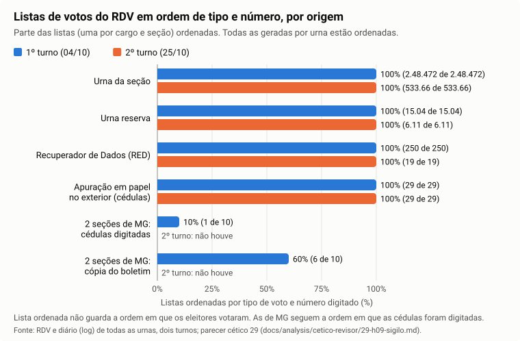
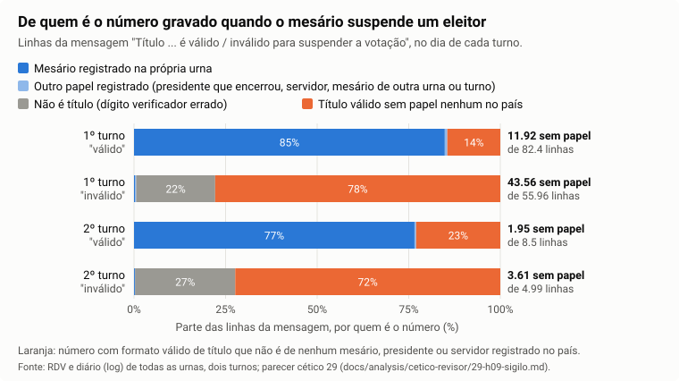

# 12. Sigilo do voto: os arquivos públicos permitem ligar um voto a um eleitor?

> **Situação:** escrito em 30/10/2026. O achado passou por uma segunda verificação independente, feita com um programa próprio, rodado nos dois turnos inteiros ao mesmo tempo. A conclusão dessa verificação: "sustentado, com ressalvas". O texto usa só as afirmações que resistiram a essa verificação. Por decisão dela, ficam fora deste relatório: a frase "o diário liga o título ao voto nulo" (depende de quem é o dono do número, que ainda é Hipótese), a contagem de sessões de eleitor que terminam em voto nulo e qualquer contagem de "eleitores identificados". Para este tópico, os números foram conferidos mais uma vez contra os resultados dos dois programas e contra o banco de dados da auditoria. É a hipótese H09 do [quadro das hipóteses](10-quadro-das-hipoteses.md).

## A pergunta

O voto é secreto: ninguém pode saber em quem uma pessoa votou. Para cada urna, o TSE publica três arquivos: o boletim (o placar da seção), o registro digital do voto (a lista dos votos) e o diário da urna (o log, que anota cada acontecimento com data e hora). A pergunta é: juntando esses arquivos, alguém consegue descobrir em quem uma pessoa votou, ou ligar um eleitor identificado a algum voto?

## Resposta curta

- **Fato:** o registro digital do voto (RDV) **não guarda a ordem em que os eleitores votaram**. Em todas as listas de votos geradas por urna, nos dois turnos, os votos estão em ordem de tipo e de número digitado: 539.788 de 539.788 listas no 2º turno e 2.490.766 de 2.490.766 no 1º. Não dá para dizer "o 5º eleitor votou em X".
- **Fato (exceção):** em 2 seções de Minas Gerais no 1º turno, parte dos votos foi dada em cédula de papel e digitada depois. Nessas listas a ordem é a da digitação, e a mesma posição corresponde à mesma cédula: o arquivo mostra o par de votos para deputado (federal e estadual) de cada uma das 40 cédulas e, numa das seções, o trio de votos para governador e senadores de cada uma das 20 cédulas. O voto para presidente não segue essa ordem. A cédula não tem nome.
- **Fato (limite de publicar por seção):** nenhuma seção teve só 1 votante. Mas 30 seções no 2º turno (3.100 eleitores) e 17 no 1º (1.107) votaram todas no mesmo candidato a presidente. Nelas, quem sabe quem compareceu sabe como cada um votou, inclusive o mesário que é eleitor da própria seção, se ele votou ali. Isso é consequência de publicar o resultado seção por seção, não falha da urna.
- **Fato (achado):** quando o mesário interrompe a votação de um eleitor que demora na cabine (a "suspensão"), a urna grava no diário público o número digitado para autorizar a interrupção. No dia do 1º turno, **55.483 linhas** trazem um número com formato válido de título de eleitor (**31.764 números diferentes**) que não é de nenhum mesário, presidente de mesa ou servidor registrado em qualquer urna do país, nos dois turnos. No dia do 2º turno, **5.564 linhas (3.801 números)**. Cada número aparece numa única seção (no 1º turno, um deles em 2), dentro do atendimento de um eleitor, com data e hora. Um número de título é dado pessoal, e ele está num arquivo que qualquer pessoa baixa.
- **Fato:** a mensagem de encerramento da votação também traz números de título que não são de mesário registrado em nenhuma urna do país no mesmo turno: 5.688 linhas no 1º turno e 1.750 no dia do 2º turno, fora do atendimento de eleitores. O mais provável é o presidente da mesa sem registro na urna (Hipótese).
- **Hipótese (forte para o número que a urna recusa):** o número gravado na suspensão é o título do próprio eleitor que estava na cabine. **Confirmar é Pendente:** exige a lista de eleitores da seção ou a regra técnica da urna, que não são públicas. A pergunta está na lista de perguntas ao TSE.
- **Hipótese (o que isso permitiria):** se o número for o do eleitor suspenso, o diário público liga aquele eleitor ao horário em que esteve na cabine e, quando a suspensão termina com "voto nulo por suspensão", ao voto nulo que a urna atribuiu nos cargos que ele não confirmou. **Não revela voto válido em candidato:** os cargos que ele confirmou antes da suspensão ficam misturados na lista ordenada do RDV.
- **Não se pode afirmar:** que o sigilo está garantido contra qualquer método. Sete arquivos que a urna grava não são publicados, o método que encadeia as linhas do diário não é público, e a busca deste tópico só enxerga o número escrito por extenso (ver Limites).

## Termos usados neste tópico

- **Registro Digital do Voto (RDV):** a lista dos votos da urna, cargo por cargo. Cada voto tem só dois campos: o tipo (nominal, legenda, branco, nulo, nulo por suspensão e outros) e o número digitado. Não tem nome, horário nem posição de chegada. Comparação do dia a dia: é como despejar as cédulas de uma urna de lona e separá-las em montes por candidato; dá para contar cada monte, mas não para saber quem pôs cada cédula.
- **Lista ordenada:** uma lista arrumada por um critério fixo, como uma lista de nomes em ordem alfabética. Ela não diz quem chegou primeiro. Outros tópicos e o glossário chamam o RDV de "embaralhado"; a descrição exata é "ordenado por tipo e número", e o efeito para o sigilo é o mesmo: a ordem de chegada se perde.
- **Diário da urna (log):** o arquivo em que a urna anota, com data e hora, tudo o que acontece: mesário registrado, eleitor liberado, voto computado, encerramento.
- **Atendimento do eleitor (no diário):** o trecho do diário entre o momento em que o mesário digita a identificação do eleitor e o "voto computado" (ou a volta da urna à espera do próximo eleitor).
- **Suspensão:** quando o eleitor demora na cabine, a urna pergunta ao mesário se ele ainda está votando. Se não está, a urna pede um título de eleitor para autorizar a interrupção e anota no diário "Título [número] é válido (ou inválido) para suspender a votação". Os cargos que o eleitor ainda não tinha confirmado recebem um voto nulo, anotado como "Atribuído voto nulo por suspensão [cargo]".
- **Dígito verificador (DV):** os dois últimos dígitos do título de eleitor, calculados a partir dos outros, como no CPF. Serve para pegar erro de digitação: um número digitado errado quase nunca passa na conta. Aqui, "formato válido de título" quer dizer: 12 dígitos com dígito verificador correto.
- **Papel do número:** o que o próprio diário diz que aquele número é. O título do mesário aparece nas mensagens de mesário ("Mesário [número] registrado"); o do servidor do cartório, em "mídia gerada pelo usuário"; o do presidente da mesa, em "Título digitado para encerramento". Um número "sem papel" não aparece em nenhuma dessas mensagens.
- **Seção unânime:** seção em que todos os votos de um cargo foram para o mesmo candidato.
- **Sistema de Apuração (SA):** programa usado quando a votação na urna eletrônica não é possível e os votos são dados em cédula de papel. As cédulas são depois digitadas no SA. Na "apuração mista", parte dos votos está na urna e parte em cédula.

## Como foi feito

**Universo (Fato).** Os dois turnos inteiros: 499.248 seções por turno, 499.207 pacotes de arquivos, 41 seções sem arquivo publicado, 0 falha de leitura. Dois programas independentes, escritos à parte, leram todos os RDVs e todos os diários. O segundo leu os dois turnos juntos, para cruzar os números de um turno com os papéis do outro. As seções unânimes foram contadas também no banco de dados da auditoria, que guarda os votos do RDV de cada seção, por um terceiro caminho.

**Privacidade.** Nenhum programa grava número de título ou de CPF: os números ficam só na memória durante a leitura, e a saída passa por uma trava que apaga qualquer sequência de 10 a 12 dígitos com dígito verificador de título ou de CPF (ela não disparou). Este relatório não reproduz nenhum número. A base privada de CPFs que a auditoria guarda à parte não foi usada, nem nenhum outro arquivo privado.

1. **Ordem dos votos.** Para cada lista do RDV (um cargo de uma seção), o programa confere se cada voto vem antes do seguinte pela regra (tipo do voto, número digitado). Se a lista estivesse na ordem de chegada dos eleitores, ela sairia desarrumada por esse critério.
2. **Cédulas de MG.** A segunda verificação comparou, posição por posição, as listas de cargos diferentes da mesma seção, para ver se a posição 1 de deputado federal e a posição 1 de deputado estadual são a mesma cédula.
3. **Seções pequenas.** Soma dos votos do RDV por seção e cargo: quantos votaram e quantos candidatos diferentes receberam voto.
4. **Números no diário.** Em cada linha de todos os diários, o programa procura sequências de 10 a 12 dígitos dentro da mensagem e confere se têm formato de título (ou de CPF). Cada número é classificado pelo papel que o diário lhe dá naquela urna e, se não tiver papel ali, cruzado com todos os títulos de mesário do país (1.992.260 nos diários do 1º turno e 2.074.207 nos do 2º), com os servidores e com os presidentes que encerraram cada urna, nos dois turnos.

## O que foi encontrado

### O que cada arquivo publicado mostra e o que não mostra (Fato)

| Arquivo | O que mostra | O que não mostra |
|---|---|---|
| Boletim de urna | Total de votos de cada candidato na seção, comparecimento, brancos e nulos | Nada por eleitor |
| Registro digital do voto (RDV) | Cada voto, cargo por cargo, com o tipo e o número digitado (inclusive o número digitado num voto nulo), em ordem de tipo e número | A ordem em que os eleitores votaram; quais votos de cargos diferentes são do mesmo eleitor (salvo nas cédulas das 2 seções de MG, item 2) |
| Diário da urna (log) | Hora de cada atendimento, a forma de liberação (digital, título ou CPF), o título dos mesários, o "voto computado" e, na suspensão, o número digitado para suspender e o "voto nulo por suspensão [cargo]" | Em quem o eleitor votou; o número que o mesário digitou para liberar o eleitor (o diário grava só o tipo: "Título de eleitor" ou "CPF") |

### 1. O RDV não guarda a ordem de votação (Fato)

| Origem da lista | 1º turno: listas, ordenadas | 2º turno: listas, ordenadas |
|---|---:|---:|
| Urna da seção | 2.475.472, todas | 533.659, todas |
| Urna reserva | 15.044, todas | 6.110, todas |
| Recuperador de Dados (RED) | 250, todas | 19, todas |
| **Total gerado por urna** | **2.490.766, todas** | **539.788, todas** |
| Apuração em papel no exterior (cédulas digitadas no SA) | 29, todas | 29, todas |
| 2 seções de MG, apuração mista: cédulas digitadas | 10, 1 ordenada | não houve |
| 2 seções de MG, apuração mista: cópia do boletim | 10, 6 ordenadas | não houve |

Fonte: contagem da segunda verificação independente.

- Nenhuma lista trouxe tipo de voto fora da lista da especificação, nem campo além de tipo e número, nos dois turnos.
- Como cada voto tem só tipo e número, numa lista ordenada dois votos iguais são indistinguíveis: **qualquer** ordem de chegada dos eleitores gera o mesmo arquivo.
- Cada cargo é uma lista separada, ordenada à parte. Por isso o arquivo da urna não permite juntar os votos de um mesmo eleitor em cargos diferentes.

**Como ler:** cada par de barras é um tipo de origem da lista; azul é o 1º turno e laranja o 2º. Uma barra cheia (100%) quer dizer que todas as listas daquela origem estão em ordem de tipo e número, e portanto não guardam a ordem de chegada dos eleitores. Só as listas de cédula das 2 seções de MG ficam abaixo de 100%: estão na ordem em que as cédulas foram digitadas. As listas de MG copiadas do boletim (4 fora de ordem) trazem os votos agrupados por candidato, sem informação por eleitor.

### 2. A exceção: as cédulas de 2 seções de MG no 1º turno (Fato)

As seções MG 41238/0039/0168 e MG 50075/0047/0041 tiveram apuração mista no 1º turno: parte dos votos na urna e 20 cédulas de papel em cada uma, digitadas depois no Sistema de Apuração. Todas as 13 listas fora de ordem do país estão nessas 2 seções: 9 de cédula e 4 copiadas do boletim.

- **Fato:** nas listas de cédula, a ordem é a de digitação, e a mesma posição corresponde à mesma cédula nas listas de deputado. Nas 20 posições de cada seção, o deputado federal e o estadual são do mesmo partido (ou os dois são branco ou nulo) em 12 (MG 41238) e 11 (MG 50075). A segunda verificação mediu, embaralhando as posições ao acaso muitas vezes, que isso não acontece por coincidência.
- **Fato:** o arquivo mostra, para cada uma das 40 cédulas de deputado, o par de votos (federal e estadual). Em MG 50075/0047/0041, mostra também o trio de votos para governador e os dois senadores de cada uma das 20 cédulas. Em MG 41238 o teste do trio não tem poder (há poucos brancos e nulos para comparar).
- **Fato:** o voto para presidente não segue essa ordem.
- **O que isso permite:** a cédula não tem nome, e o arquivo não diz em que ordem as cédulas foram depositadas. O risco não é identificar quem votou, mas "assinar" uma cédula com uma combinação rara de votos combinada antes, e conferi-la depois no arquivo público.
- **Pendente:** se a ordem de digitação reflete a ordem de votação (os arquivos não dizem).

### 3. Seções pequenas e unânimes: um limite de publicar por seção (Fato)

Publicar o resultado por seção revela o voto de quem votou numa seção onde todos votaram igual, ou onde votou uma só pessoa.

- **Fato:** nenhuma seção teve só 1 votante, em nenhum cargo, nos dois turnos (pelo RDV e pelo boletim no banco).
- **Fato:** seções unânimes:

| | 1º turno: seções (eleitores) | 2º turno: seções (eleitores) |
|---|---:|---:|
| Presidente | 17 (1.107) | 30 (3.100) |
| Governador | 2 (85) | 4 (509) |
| Deputado federal | 1 (297) | não há |
| Deputado estadual, senador, deputado distrital | 0 | não há |
| Seções com algum cargo unânime | 20 | 33 (uma seção do AM, 02216/0021/0096, é unânime para Presidente e para Governador) |
| … delas, com mesário que o diário registra como eleitor da própria seção | 18 | 31 |

Por UF (seções, entre parênteses os eleitores):

| Cargo e turno | UFs |
|---|---|
| Presidente, 2º turno (30) | PA 11 (1.225); MA 4 (450); RR 4 (537); MT 3 (515); AM 1 (113); BA 1 (44); CE 1 (54); ES 1 (41); MS 1 (56); PB 1 (10); PI 1 (16); RS 1 (39) |
| Governador, 2º turno (4) | AM 4 (509) |
| Presidente, 1º turno (17) | PA 3 (93); AM 2 (248); RR 2 (377); exterior 2 (7); AP 1 (81); BA 1 (10); CE 1 (54); ES 1 (33); MA 1 (52); MG 1 (26); MT 1 (61); RS 1 (65) |
| Governador, 1º turno (2) | MG 1 (13); PI 1 (72) |
| Deputado federal, 1º turno (1) | MT 1 (297) |

Fonte: contagem da segunda verificação independente. A contagem por UF é igual no primeiro programa e no banco de dados da auditoria, e foi conferida mais uma vez para este tópico.

- **O que isso permite:** quem sabe quem compareceu a uma dessas seções (a mesa, um fiscal, os vizinhos) sabe como cada um votou naquele cargo.
- **O mesário:** o diário publica "Mesário [título] é eleitor da seção". Se esse mesário votou na seção unânime, o voto dele está, na prática, publicado junto com o título. O diário não diz se ele votou, então isso é uma possibilidade, não um fato medido.
- Não é falha do programa da urna: é consequência de publicar o resultado de cada seção.

### 4. Números de título na mensagem de suspensão (Fato)

Linhas "Título [número] é válido / inválido para suspender a votação" **no dia da eleição** de cada turno, separadas por quem é o número:

| | 1º turno: "válido" | 1º turno: "inválido" | 2º turno: "válido" | 2º turno: "inválido" |
|---|---:|---:|---:|---:|
| Linhas no dia | 82.404 | 55.959 | 8.498 | 4.990 |
| Repetidas no mesmo pacote (diário dentro de diário) | 1 | 0 | 0 | 0 |
| Não é título (dígito verificador errado; parece erro de digitação) | 0 | 12.068 | 0 | 1.364 |
| Título de mesário registrado na própria urna | 69.912 | 200 | 6.507 | 10 |
| Título que o presidente digitou para encerrar a própria urna | 457 | 5 | 18 | 0 |
| Servidor (operador) da própria urna | 2 | 0 | 0 | 0 |
| Mesário de outra urna, mesmo turno | 91 | 104 | 20 | 5 |
| Mesário só no outro turno | 14 | 21 | 0 | 0 |
| Servidor ou presidente de outra urna | 5 | 0 | 0 | 0 |
| **Título válido sem papel nenhum no país (dois turnos)** | **11.922** | **43.561** | **1.953** | **3.611** |
| Fora do atendimento de um eleitor | 0 | 0 | 0 | 0 |

Fonte: contagem da segunda verificação independente.

- **Fato:** somando "válido" e "inválido", são **55.483 linhas** no dia do 1º turno e **5.564** no dia do 2º com um número de formato válido de título que não é de nenhum mesário, presidente de mesa ou servidor registrado em nenhuma urna do país, em nenhum dos dois turnos.
- **Fato:** contando cada número uma vez só (o mesmo número pode ser digitado várias vezes no mesmo atendimento), são **31.764 números diferentes** no 1º turno e **3.801** no 2º.
- **Fato:** cada número aparece em uma única seção do país. A exceção é 1 número do 1º turno, que aparece em 2 seções. Um número de fiscal, de servidor ou de "título de serviço" que circulasse entre seções apareceria em várias.
- **Fato:** todas essas linhas estão dentro do atendimento de um eleitor, com data e hora.
- **Fato:** não é erro de leitura: o número vem da própria mensagem, conferido no arquivo original. Também não se explica por erro de digitação do título do mesário: no 1º turno, dos números sem papel na urna, só 52 de 12.032 ("válido") e 33 de 43.686 ("inválido") diferem em 2 dígitos ou menos de algum título de mesário daquela urna; os outros diferem em 3 ou mais.

**Como ler:** cada barra é uma mensagem num turno ("válido" ou "inválido") e soma 100% das linhas daquele dia. Azul: título de mesário registrado na própria urna, o uso esperado. Azul-claro: outro papel registrado (presidente que encerrou a urna, servidor, mesário de outra urna ou do outro turno). Cinza: número que nem é título (dígito verificador errado). Laranja: título válido sem papel nenhum no país. À direita, o número de linhas em laranja e o total (no 1º turno, "válido", sem a linha repetida no mesmo pacote). Na mensagem "inválido", o laranja é a maior parte; na "válido", a menor.

### 5. De quem é esse número (Hipótese; confirmação Pendente)

**Para o número que a urna recusa ("inválido"): Hipótese forte de que é o título do próprio eleitor que estava na cabine.** A segunda verificação aponta três sinais independentes:

1. Nos atendimentos com esse número, o eleitor tinha sido liberado pelo número do título quase sempre, bem mais do que no conjunto dos atendimentos. Quando foi liberado pelo CPF, o número quase nunca aparece. Leitura: o mesário redigita o título que acabou de digitar para liberar o eleitor.
2. Depois de um "inválido" sem papel, a tentativa seguinte é com frequência **o mesmo número de novo**, outra vez recusado. Um erro de digitação mudaria a cada tentativa; um número copiado de um documento se repete.
3. **Fato:** o título de um mesário registrado só é recusado quando esse mesário é eleitor da própria seção: 197 de 200 recusas no 1º turno e 10 de 10 no 2º. Entre os títulos de mesário **aceitos**, os de mesário eleitor da seção são 25.206 de 69.912 (1º turno) e 2.167 de 6.507 (2º). O padrão é o de uma urna que recusa o título de quem está na cabine: o mesário que vota na própria seção e é suspenso. Isso explica a palavra "inválido". Mesmo assim, continua sendo inferência: o diário não diz quem estava na cabine.

**Para o número que a urna aceita ("válido") sem papel: o dono não é conhecido.** Não é de mesário, servidor nem presidente; cada número aparece numa só seção e muda a cada suspensão. Se a urna recusa o título de quem está na cabine (sinal 3), esse número **não** é o do eleitor suspenso. Pode ser de outra pessoa da fila, de um acompanhante ou de um membro da mesa sem registro. Os arquivos não dizem.

**Pendente:** confirmar de quem são os números. Os caminhos são a lista de eleitores da seção (não pública) ou a regra técnica da suspensão (não publicada). A auditoria não usou a base privada para isso. Perguntas a enviar ao TSE: (1) que títulos a urna aceita para suspender, e por que recusa o título de um mesário registrado? (2) o número gravado em "Título [número] é inválido para suspender" pode ser o do eleitor na cabine? (3) por que o diário grava o número digitado, e não só o resultado?

### 6. O que isso permite, e o que não permite

- **Fato:** o diário público traz, para cada um desses números, a seção, a data e a hora, dentro do atendimento de um eleitor. Um número de título é dado pessoal, qualquer que seja o dono.
- **Hipótese:** se o número "inválido" for o título do eleitor suspenso, o diário liga aquele eleitor ao horário em que esteve na cabine e, quando o atendimento termina com "Atribuído voto nulo por suspensão [cargo]", ao voto nulo que a urna atribuiu nos cargos que ele não tinha confirmado. Quantos atendimentos estão nessa situação: **Pendente**, sem número (essa contagem fica fora do relatório até a confirmação).
- **Fato:** isso não revela voto em candidato. Os votos que o eleitor confirmou antes da suspensão ficam nas listas ordenadas do RDV, misturados aos dos outros eleitores, e cada cargo é ordenado à parte.
- **Fato:** nenhuma outra mensagem do diário diz em quem se votou. A única com conteúdo de voto é "Atribuído voto nulo por suspensão [cargo]".

### 7. A mensagem de encerramento também traz números fora de registro (Fato)

Ao encerrar a votação, o presidente da mesa digita o próprio título, e o diário grava "Título digitado para encerramento: [número]".

- **Fato:** 5.688 linhas no 1º turno e 1.750 no dia do 2º turno trazem um título que não é de mesário registrado em nenhuma urna do país no mesmo turno (números do primeiro programa, revisados pela segunda verificação). Estão fora do atendimento de eleitores.
- **Hipótese:** o mais provável é o presidente da mesa sem registro biométrico na urna, ou seja, um membro da mesa e não um eleitor votando. Mesmo assim, é número de pessoa publicado fora de um papel registrado.
- **Pendente:** na mesma mensagem há sequências de 11 dígitos com dígito verificador de CPF acima do que o acaso daria. Pode ser CPF digitado no lugar do título. Não conferido; fica sem número.

### 8. Fora dessas mensagens, nenhum número de título (Fato, com ressalva)

Só têm número com formato de título as mensagens de mesário (registro, digital, habilitação de eleitor), as de servidor do cartório ("mídia gerada pelo usuário"), a de encerramento e as duas de suspensão, nos dois turnos (conferido nos dois programas). Números de série de urna, de computador e de chave não passam no dígito verificador. **Ressalva:** a busca só vê números de 10 a 12 dígitos escritos por extenso (ver Limites).

## Prova de que o teste funciona (contraprova)

- **Fato (a conferência de ordem acusa desordem quando ela existe):** o mesmo teste que dá 100% nas listas da urna acusou as 13 listas fora de ordem de MG: as 9 de cédula, que estão na ordem de digitação, e as 4 copiadas do boletim.
- **Fato (teste com um voto cuja hora se conhece):** o "voto nulo por suspensão" é o único voto cuja hora o diário revela. Se o RDV seguisse a ordem de votação, a posição desse voto no RDV seria a mesma posição do eleitor no diário em todos os casos. No 1º turno, das 135.770 linhas de nulo por suspensão no dia, 84.075 podem ser comparadas (cargo de uma escolha, um só diário com votos, contagem igual): a posição coincide em 431 (0,51%). No 2º turno, 1 de 619. Isso é coincidência de posição, não ordem de votação.
- **Fato (o dígito verificador está certo):** todos os títulos de mesário do país passam na conta: 3.748.505 de 3.748.505 linhas "Mesário [título] registrado" nos diários do 1º turno e 7.542.425 de 7.542.425 nos do 2º (que trazem também o 1º turno das urnas reaproveitadas). Uma conta errada reprovaria parte deles. Dois programas escritos à parte concordam em todas as contagens comparadas.
- **Fato (o cruzamento de papéis acha quem tem papel):** na mensagem "Mesário [título] habilitou o eleitor", que não entrou na montagem da lista de mesários, o número é de mesário registrado na urna em 10.949.368 de 10.949.380 linhas (diários do 2º turno, todos os períodos). As 12 restantes são de um mesário cujo registro ficou num diário não publicado.
- **Fato (rotas independentes):** as seções unânimes deram o mesmo resultado, seção a seção e por UF, no primeiro programa e no banco de dados da auditoria. No Acre, os dois programas batem em todas as contagens comparadas.

## Limites (o que não se pode afirmar)

1. **Arquivos não publicados.** A urna grava sete arquivos que estão na lista assinada do pacote mas não são publicados: `jufa.dat`, `imgze.dat`, `hash.dat`, `mr.ver`, `wsqbio.jez`, `wsqman.jez` e `wsqmes.jez` (estes três com imagens de digitais; [tópico 10](10-quadro-das-hipoteses.md), H09). Se algum deles liga digital a horário, só o TSE vê.
2. **RDV interno.** O teste mostra que o RDV **publicado** está ordenado. O RDV dentro da urna e o da mídia de resultado não são públicos.
3. **Encadeamento do diário.** Cada linha do diário termina com um código de 16 caracteres calculado por um método não publicado. Não há como afirmar que ele não carrega nada do eleitor; também não há indício de que carregue.
4. **Números codificados.** A busca procura o número escrito por extenso, com 10 a 12 dígitos. Um número cifrado, guardado como "impressão digital" com segredo, ou digitado sem os zeros iniciais (9 dígitos ou menos) não seria visto.
5. **De quem é o número da suspensão.** Sem a lista de eleitores da seção, a ligação número → eleitor suspenso é inferida pelo padrão, não conferida.
6. **Quem está na fila.** Saber quem estava na seção a cada hora, por observação no local, não deixa rastro em arquivo.

## Pendentes (sem número)

- **Dono dos números da suspensão** ("inválido" e "válido"): perguntas ao TSE (item 5).
- **Quantos atendimentos terminam em voto nulo por suspensão com um desses números:** fora do relatório até a confirmação do dono.
- **Sequências com dígito verificador de CPF na mensagem de encerramento:** não conferidas.
- **Ordem das cédulas de MG:** se a ordem de digitação reflete a ordem de votação.
- **Voto nulo com número próprio:** o RDV publica o número digitado em todo voto nulo. Um eleitor pode anular com um número combinado e alguém conferir depois no arquivo da seção. O tamanho desse canal foi medido, mas ainda não passou pela segunda verificação.
- **Características do eleitor no diário** (por exemplo, áudio ativado por cadastro de deficiência visual, preso provisório, militar em serviço): só identificam alguém se combinadas com um número de título na mesma sessão. Contagem não revisada.
- **Busca do número de título em formas codificadas:** feita só no ES, 2º turno, a pedido do próprio titular, e ainda não refeita de forma independente ([tópico 7](07-limites-da-pericia.md)).

## Recomendação ao TSE

Não gravar no diário o número digitado na suspensão nem no encerramento. Gravar só o resultado (aceito ou recusado) e o papel de quem autorizou. E ordenar também as listas de cédula do Sistema de Apuração.

## Próximos passos

- [x] Ordem do RDV, cédulas de MG, seções unânimes e números de título nas mensagens de suspensão e de encerramento, nos dois turnos, com segunda verificação independente (os itens abertos estão em "Pendentes").
- [ ] **Pendente.** Enviar ao TSE as três perguntas do item 5 sobre a suspensão.
- [ ] **Pendente.** Segunda verificação independente do canal do voto nulo com número próprio e das características do eleitor no diário.
- [ ] **Pendente.** Conferir as sequências com dígito verificador de CPF na mensagem de encerramento.
- [ ] **Pendente.** Pedir ao TSE a norma de digitação das cédulas no Sistema de Apuração.
