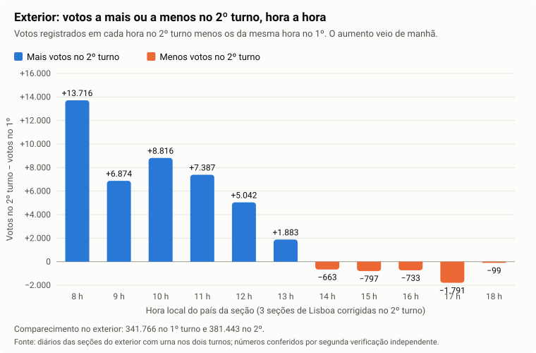
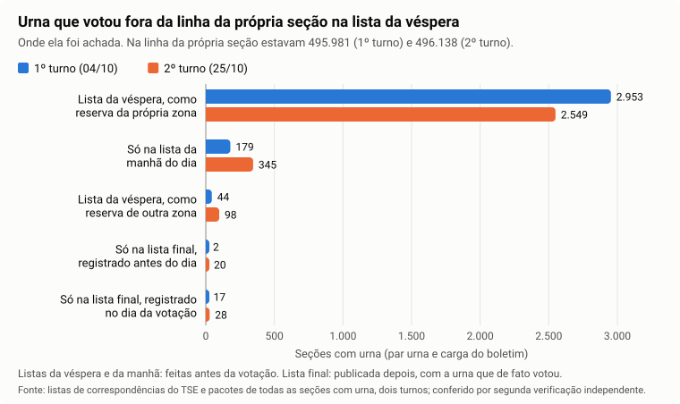

# 14. Outras formas de fraude testadas: cidade inteira, voto nulo combinado, exterior, recarga da urna, eleitores em trânsito, resultado trocado no caminho e falha da digital provocada

> **Situação:** escrito em 30/10/2026. Reúne sete hipóteses do [quadro das hipóteses](10-quadro-das-hipoteses.md): H18 (mudança igual em todas as urnas de uma cidade), H21 (voto nulo usado como "senha" de compra de voto), H22 (exterior e seções apuradas em cédula), H23 (recarga e carga da urna fora do previsto), H24 (eleitores em trânsito), H27 (resultado trocado no caminho e seções fantasmas) e, acrescentada na mesma data, H19 (falha da digital provocada para abrir a liberação à mão). As sete passaram por uma segunda verificação independente, que refez as contas com programas próprios sobre todas as seções e procurou explicações que a primeira análise não tinha considerado. Ela confirmou os números e corrigiu o alcance de cada teste: H18, H22, H23, H24 e H27 sustentadas, com ressalvas que este texto já usa; na H21, o resultado do 2º turno é um fato do teste, mas o teste não tinha como encontrar o esquema no voto para Presidente. Na H19, ela confirmou as contagens até a unidade, mostrou que a medida antes chamada "falha da digital do mesário" é, na verdade, a liberação autorizada por um dedo que não é de mesário cadastrado, contou as liberações feitas sem nenhum dedo lido e não confirmou o único resultado fora do padrão, no Sudeste. O texto usa só as afirmações que resistiram a essa verificação, e cada seção diz o que o teste não enxerga.

## A pergunta

Os outros tópicos testam as formas mais conhecidas de fraude: soma das urnas, arquivos alterados, liberação de eleitor sem digital, troca de urna. Este tópico testa sete formas mais difíceis de ver, pensadas para escapar desses testes:

1. **H18:** mudar um pouco o resultado de **todas** as urnas de uma cidade, por igual, para que nenhuma urna destoe das vizinhas.
2. **H21:** combinar com o eleitor comprado um **número sem candidato** (voto nulo) e conferir depois, nos arquivos públicos, se ele apareceu na seção.
3. **H22:** usar o **exterior**, onde ninguém vota com digital, ou as seções apuradas em **cédula de papel**, para pôr votos.
4. **H23:** **carregar a urna de novo**, ou fora do dia previsto, para pôr nela um programa ou dados diferentes.
5. **H24:** usar os **eleitores em trânsito** (quem vota fora da própria seção) para inflar seções.
6. **H27:** **trocar o resultado de uma seção no caminho** até o TSE por outro, assinado por outra urna, ou contar o resultado de uma **seção que não existe**.
7. **H19:** **provocar a falha da digital** numa seção escolhida, para que a mesa libere os eleitores à mão e, por esse caminho, ponha votos no lugar de quem não foi votar.

## Resposta curta

- **Fato (H18):** nenhuma das 5.241 cidades em que dava para medir tem urnas parecidas demais entre si, o sinal de um resultado fabricado. 19 cidades pequenas mudaram do 1º para o 2º turno mais do que o esperado, para os dois lados (4 para o 13 e 15 para o 22); a mudança além do esperado soma 5.695 votos. O teste **não enxerga** uma mudança pequena espalhada por muitas cidades, nem uma mudança igual num estado inteiro (item 1).
- **Fato (H21):** no 2º turno, nenhum número nulo concentrado e raro. **Mas o teste não tinha como encontrar esse esquema no voto para Presidente**: com dois dígitos, todo número possível é número de partido ou de candidato, ou fica a uma tecla de um deles. No 1º turno, para deputado, sobraram 19 números concentrados, com 648 ocorrências no país, quase todos a uma ou duas teclas do número de um deputado muito votado na região (item 2).
- **Fato (H22):** nas 1.351 seções do exterior, nos dois turnos, nenhuma seção teve mais votantes que eleitores; em todas as 1.281 urnas, o boletim tem os mesmos votos que o diário; nenhum voto fora do horário; o menor intervalo entre dois votos foi de 16 segundos. O comparecimento subiu de 341.766 para 381.443, e o aumento veio principalmente de manhã. No 2º turno, os 29 resultados apurados em cédula chegaram ao TSE pelo menos 160 minutos depois do fim da votação no posto (item 3).
- **Fato (H23):** em todas as 499.207 seções de cada turno, o código de carga do boletim está no diário da própria urna, no mesmo pacote. As recargas deixam rastro: 2.674 no 1º turno e 1.770 novas no 2º. Num grupo pequeno de seções, o motivo da recarga não aparece no diário; isso não é sinal de fraude (um defeito visto só pelo operador não deixa linha no diário), e as atas foram pedidas ao TSE (**Pendente**). Nas cargas feitas no próprio dia da votação, a hora digitada e o relógio da urna coincidem (item 4).
- **Fato (H24):** em todas as seções dos dois turnos, os eleitores aptos são a soma dos eleitores da seção e dos em trânsito, e o total do país foi o mesmo nos dois turnos: 158.745.079. Nas seções com 10 ou mais eleitores em trânsito, a parte dos votos liberados sem digital foi **menor** que nas outras seções do mesmo local, ao contrário do que um uso fraudulento do trânsito deixaria (item 5).
- **Fato (H27):** em todas as seções com urna dos dois turnos, o resultado foi assinado pela própria urna que ele diz ter votado, menos nas 17 seções em que os votos foram recuperados por outra urna (recuperação de dados), em que assinou uma urna de reserva registrada para a região. Nenhuma seção fantasma. Em 45 seções, o registro da urna só chegou ao TSE no dia da votação; no 2º turno, quase sempre junto com o próprio resultado (item 6).
- **Fato (H19):** a urna sempre exigiu as quatro tentativas de digital antes da liberação à mão: das 16.974.711 liberações à mão dos dois turnos, só 3 tiveram menos. Mas uma tentativa pode terminar sem dedo nenhum, e 172.318 liberações no 1º turno e 212.171 no 2º foram feitas sem que o leitor lesse dedo nenhum. E o dedo que autoriza a liberação pode ser de qualquer pessoa. Isso é **risco**, não prova. A falha da digital ficou praticamente igual nos dois turnos (7,07% e 7,16%) e não acompanhou a mudança do voto; o único resultado fora do padrão, no Sudeste, não se confirma (item 7).
- **Não se pode afirmar:** que nenhuma dessas formas de fraude foi usada em escala pequena, espalhada ou de um jeito que os arquivos públicos não registram. Cada item diz o que o teste não enxerga.

## Termos usados neste tópico

- **Virada:** a mudança, do 1º para o 2º turno, da diferença entre os votos do 13 e do 22 numa cidade ou seção, em pontos percentuais.
- **Esperado:** o resultado que se esperava de uma cidade a partir de como ela votou no 1º turno para Presidente, governador e senador. O esperado é calculado com as outras cidades do mesmo estado, sem a própria cidade. É como corrigir a nota de um aluno pela média da turma: funciona para achar o aluno que destoa, mas, se a turma inteira colar, a média sobe junto e ninguém destoa.
- **Inserção igual numa cidade:** acrescentar ou trocar a mesma pequena parte dos votos em todas as urnas de uma cidade. Como pôr a mesma pitada de sal em todos os pratos de um restaurante: nenhum prato fica com gosto diferente dos outros; só se nota comparando com o cardápio de antes.
- **Voto nulo digitado:** quando o eleitor digita um número que não é de candidato nem de partido, a urna registra o voto como nulo e guarda, na lista de votos (RDV), o número digitado.
- **Família de números (erro de digitação):** números que ficam a uma tecla de um número válido (cada dígito diferente trocado por uma tecla vizinha no teclado da urna), ou que mantêm o número do partido. São os números que as pessoas digitam por engano, como quem erra um dígito do telefone.
- **Eleição suplementar:** eleição refeita num município, por exemplo para prefeito, marcada para o mesmo dia de outra eleição.
- **Sistema de Apuração (cédula):** em seções pequenas do exterior, o voto é em cédula de papel; a mesa conta as cédulas e digita o resultado num computador, que gera o boletim.
- **Carga:** a instalação, antes da eleição, do programa e dos dados da seção na urna, feita pelo cartório eleitoral. É como instalar o sistema num computador novo. Cada carga recebe um **código de carga** único, gravado no boletim e no diário da urna.
- **Recarga:** carregar a urna de novo. O diário da carga anterior fica guardado dentro do novo, como uma pasta dentro de outra. Por isso a recarga deixa rastro, e dá para saber a ordem.
- **Eleitor em trânsito:** quem pediu para votar, naquele turno, numa seção diferente da sua: por exemplo, quem está viajando, trabalhando como mesário em outra seção ou preso provisório. Quem vem de **outro estado** só pode votar para Presidente.
- **Correspondência:** o registro "urna X, carga Y, seção Z" que o cartório manda ao TSE depois de carregar a urna. É como o registro que liga a placa de um carro ao dono.
- **Lista prévia:** a lista de correspondências esperadas que o TSE publica antes da votação (uma na véspera e outra na manhã do dia), com a urna que cada seção deveria usar e as urnas de reserva de cada zona. É como a lista de chamada da escola, feita antes da prova.
- **Lista final:** a lista de correspondências efetivadas, publicada depois da votação, com a urna que cada seção de fato usou.
- **Recuperação de dados (Recuperador de Dados, RED):** quando a urna não consegue gerar o boletim, o cartório lê o cartão de votos dela com um programa próprio e gera o boletim. Às vezes isso é feito em outra urna.
- **Teste de Integridade:** auditoria pública feita no dia da votação. Algumas urnas são sorteadas e retiradas da seção na véspera; no dia, num local público, voluntários votam em cédulas de papel, os votos são digitados nessa urna, e no fim o boletim é comparado com as cédulas. Como um cliente oculto numa loja. Os eleitores da seção sorteada votam numa urna substituta.
- **Seção fantasma:** seção que não existe de fato, mas tem resultado assinado e contado.
- **Leitor de digital:** o pequeno sensor da urna onde o eleitor põe o dedo para ser identificado pela biometria.
- **Tentativa:** cada vez que a urna pede o dedo e espera. A tentativa termina de um de dois jeitos: o leitor **lê** um dedo, que não bate com a digital do eleitor (o diário anota "Capturada a digital"), ou o **tempo acaba** sem dedo no leitor (o diário anota "Timeout de reconhecimento do dedo", isto é, tempo esgotado). Como uma senha de banco que bloqueia depois de quatro erros, mas em que deixar a tela parada até o tempo acabar também conta como erro.
- **Liberação à mão (liberação pelo mesário):** depois de quatro tentativas sem reconhecimento, a mesa digita um dado do eleitor e põe um dedo no leitor para autorizar o voto. Neste item, "falha da digital" é esse caso: o eleitor tinha digital no arquivo da urna, não foi reconhecido nas quatro tentativas e foi liberado à mão.
- **Taxa de falha:** a parte dos eleitores a quem a urna pediu a digital que acabou liberada à mão.
- **Mesário cadastrado:** o mesário que registrou a própria digital e o título na urna da seção. Quando o dedo que autoriza a liberação é de um mesário cadastrado, o diário anota que aquele mesário habilitou o eleitor.
- **Dedo sem dono:** o dedo que autoriza a liberação e não é de mesário cadastrado. A urna grava a digital desse dedo como nova ou a reconhece como uma digital já gravada no mesmo dia, sem ligar a ninguém.
- **Vizinhas:** as outras seções do mesmo prédio de votação, com o mesmo modelo de urna.

## Como foi feito

**Universo (Fato).** Todas as seções dos dois turnos, na cópia de leitura do banco de dados da auditoria de 29/10/2026, com as 28 UFs (os 27 estados e o exterior). Onde a medida depende do diário da urna, os diários foram lidos inteiros, nos pacotes originais. Nas medidas de H27, foram usadas também as listas de correspondências publicadas pelo TSE nos dados abertos, de 2022, 2024 e 2026. Nenhuma medida usa amostra.

1. **H18:** para cada cidade, a virada foi comparada com o esperado. Foram usadas as 497.897 seções do Brasil, sem o exterior. Um segundo teste procurou cidades com urnas parecidas demais entre si, nas cidades com pelo menos 10 seções de 20 votos ou mais.
2. **H21:** cada número nulo digitado, em cada cargo, nos dois turnos, foi testado: ele é raro no resto do estado ou do país e concentrado em poucas zonas? Os números de família (erro de digitação) foram separados.
3. **H22:** cada seção do exterior, nos dois turnos: comparecimento, boletim × diário, horário e intervalo dos votos, votos por hora, hora do resultado das seções em cédula.
4. **H23:** em todos os pacotes dos dois turnos, o código de carga do boletim foi procurado no diário da mesma urna; as recargas foram contadas pelos diários guardados dentro dos novos, e o motivo, pelas linhas do diário antes da recarga; as cargas no dia da votação foram conferidas contra o relógio interno da urna.
5. **H24:** as contas de eleitores aptos, em trânsito e de outro estado, seção por seção; a liberação sem digital nas seções com muitos eleitores em trânsito, comparada com as outras seções do mesmo local de votação.
6. **H27:** para cada pacote, quem assinou, e se a urna e a carga do boletim estão na lista prévia e na lista final; cada caso fora das listas foi aberto no diário original; os pacotes de recuperação de dados; as seções com resultado contra o cadastro de locais e o resultado oficial.
7. **H19:** nos diários de todas as urnas das 497.897 seções do Brasil, nos dois turnos (o exterior não usa digital): cada pedido de digital, cada tentativa e como ela terminou (dedo lido ou tempo esgotado), cada liberação à mão e quem a autorizou (mesário cadastrado ou dedo sem dono). Depois, a falha de cada seção foi comparada com a dela mesma no outro turno e com a das vizinhas, e a mudança da falha, com a mudança do voto. As seções que mais pesaram no único resultado fora do padrão foram lidas uma a uma no diário original, nos dois turnos.

## O que foi encontrado

### 1. Mudança igual em todas as urnas de uma cidade (H18)

**A suspeita.** Uma fraude esperta poderia mudar um pouco o resultado de todas as urnas de uma cidade, por igual. Assim nenhuma urna ficaria diferente das vizinhas, e os testes que comparam seções vizinhas não veriam nada.

**O que foi medido.** Cada uma das 5.570 cidades foi comparada com o esperado a partir do seu próprio 1º turno. Um segundo teste procurou o sinal de um resultado "fabricado": urnas de uma mesma cidade parecidas demais entre si. Em eleições reais, as urnas de uma cidade variam bastante, porque os bairros votam diferente.

**O resultado.**

- **Fato:** nenhuma das 5.241 cidades onde dava para medir tem urnas parecidas demais entre si. As cidades menores, sem 10 seções de 20 votos ou mais, ficaram fora dessa parte do teste.
- **Fato:** 19 cidades pequenas (de 6 a 96 seções) mudaram mais do que o esperado: 4 para o lado do 13 e 15 para o lado do 22. A mudança além do esperado soma 5.695 votos: 589 nas 4 cidades do 13 e 5.106 nas 15 do 22. Com outras escolhas de cálculo (sem os votos de governador e senador, ou sem tirar a própria cidade do cálculo do esperado), saem 21 cidades, das quais 18 e 19, respectivamente, são as mesmas.
- **Fato (conferido no arquivo original):** numa seção de uma das cidades apontadas, o boletim do 2º turno tem os mesmos votos do 13 e do 22 que a base da auditoria, com as assinaturas conferidas.
- **Hipótese (benigna):** a maioria dessas 19 cidades já tinha tido mudanças bruscas em 2018 ou 2022. São cidades de voto que muda muito de uma eleição para outra.
- **Pendente:** as 19 cidades ficam numa lista para verificação local. Os nomes não entram neste relatório enquanto essa verificação não for feita.

**O que o teste não enxerga.**

- Uma mudança pequena numa cidade isolada. O teste só marca mudanças grandes; o tamanho mínimo que ele enxerga é uma estimativa e fica fora deste relatório.
- Uma mudança pequena espalhada por muitas cidades ao mesmo tempo, ou igual num estado inteiro. Nesses casos, a régua do próprio estado se move junto. Num teste de laboratório, em que votos foram trocados de propósito nos dados de um estado inteiro, ou de muitas cidades de uma região, o teste quase não marcou cidades. Para esses casos é preciso uma régua de fora (eleições anteriores, pesquisas).
- Um resultado fabricado que imite a variação natural entre urnas: o teste de "urnas parecidas demais" só pega o resultado fixado sem variação.

### 2. Voto nulo usado como "senha" de compra de voto (H21)

**A suspeita.** A urna guarda, na lista de votos, o número que cada eleitor digitou, inclusive quando o voto é nulo. Em tese, um comprador de votos poderia combinar um número sem candidato e depois conferir, nos arquivos públicos, quantas vezes ele apareceu na seção.

**O que foi medido.** Todos os votos nulos digitados: 39.348.069 no 1º turno e 3.180.131 no 2º. Para cada número, em cada cargo: ele aparece muito num lugar só e quase nada no resto do estado ou do país? Os números de família (a uma tecla de um número válido, ou com o número de um partido) foram separados, porque milhares de pessoas os digitam por engano.

**O resultado.**

- **Fato:** no 2º turno, nenhum número nulo concentrado e raro.
- **Fato (alcance):** no voto para Presidente e para governador, que têm números de dois dígitos, **todo** número possível é número de partido ou de candidato, ou fica a uma tecla de um deles. Por isso o teste **não tinha como encontrar** esse esquema nesses cargos. O "nenhum" do 2º turno é resultado do teste, não prova de que o esquema não existiu.
- **Fato:** no 1º turno, para deputado, sobraram 19 números concentrados, com 648 ocorrências no país.
- **Hipótese (erro de digitação):** quase todos ficam a uma ou duas teclas do número de um deputado muito votado naquela região. Vários trocam o 5 pelo 6 ou pelo 8 no começo do número de um partido.
- **Pendente:** os poucos números que ficam sem essa explicação (quantos são depende de quanto voto o deputado vizinho precisa ter na região) vão para verificação local. Os números e as zonas não entram neste relatório enquanto ela não for feita.
- **Fato (o caso mais chamativo do 2º turno tem explicação nos arquivos):** em Goiatins (TO), no voto para Presidente, os nulos com 77 foram de 5 no 1º turno para 185 no 2º, e os nulos com 20, de 9 para 124: juntos, 309 dos 575 votos nulos para Presidente da cidade. No mesmo dia houve eleição suplementar para prefeito em Goiatins, e os dois candidatos eram o 77 (3.863 votos) e o 20 (3.446). É o número do prefeito digitado no campo de Presidente. Conferido no boletim e na lista de votos.

**O que o teste não enxerga.**

- O voto para Presidente e para governador (dois dígitos, item acima).
- Um esquema que use um número comum, de família.
- Um esquema com um número diferente em cada seção ou para cada cabo eleitoral: número que aparece menos de 10 vezes no estado nunca chega a ser testado. No 1º turno, estavam nesse caso 167.913 votos nulos para deputado federal e 320.253 para deputado estadual.

### 3. Exterior e seções apuradas em cédula (H22)

**A suspeita.** No exterior não há digital: o eleitor se identifica com documento, e a urna é liberada pelo mesário. Isso poderia ser usado para pôr votos de quem não foi votar, com comparecimento ou ritmo fora do normal. Em postos pequenos, o voto é em cédula de papel, contado e digitado por pessoas.

**O que foi medido.** Todas as 1.351 seções do exterior, nos dois turnos:

| | 1º turno | 2º turno |
|---|---:|---:|
| Seções com urna | 1.281 | 1.281 |
| Seções apuradas em cédula | 29 | 29 |
| Seções não instaladas | 41 | 41 |
| Eleitores aptos | 916.111 | 916.260 |
| Comparecimento | 341.766 | 381.443 |

**O resultado.**

- **Fato:** nenhuma seção teve mais votantes que eleitores aptos, nos dois turnos.
- **Fato:** em todas as 1.281 seções com urna, nos dois turnos, o número de votos do boletim é igual ao número de votos registrados no diário da urna.
- **Fato:** nenhum voto fora do horário de votação. O menor intervalo entre dois votos da mesma urna foi de 19 segundos no 1º turno e de 16 segundos no 2º; nenhum abaixo de 15 segundos.
- **Fato:** nenhuma seção votou só num dos turnos. As 29 seções em cédula são as mesmas nos dois turnos, e 23 delas já tinham sido apuradas assim em 2022.
- **Fato:** o comparecimento subiu 11,6% do 1º para o 2º turno, e o aumento veio principalmente pela manhã, não numa onda no fim do dia:

| Hora local | 8 h | 9 h | 10 h | 11 h | 12 h | 13 h | 14 h | 15 h | 16 h | 17 h | 18 h |
|---|---:|---:|---:|---:|---:|---:|---:|---:|---:|---:|---:|
| Votos no 2º turno menos votos no 1º | +13.573 | +6.878 | +8.829 | +7.360 | +5.063 | +1.891 | −652 | −783 | −721 | −1.704 | −99 |

**Como ler:** cada coluna é uma hora do dia, no horário do país da seção. O número é quantos votos a mais (ou a menos) as urnas do exterior registraram nessa hora no 2º turno, em comparação com o 1º. Os maiores aumentos estão nas primeiras horas; a partir das 14 h, o 2º turno teve menos votos que o 1º. Fonte: diários das seções com urna nos dois turnos.

**Como ler:** é a tabela acima em barras. Cada barra é uma hora do dia, no horário do país da seção. A barra azul, para cima do zero, quer dizer que o 2º turno teve mais votos que o 1º naquela hora; a laranja, para baixo, que teve menos. O número junto de cada barra é a diferença. A maior barra azul é a das 8 h; da 14 h em diante, as barras são laranja e pequenas. O aumento do comparecimento, de 341.766 para 381.443, aparece nas barras da manhã, e não numa onda no fim do dia.

- **Fato (o relógio das urnas estava na hora local):** a Europa, Israel e o Líbano saíram do horário de verão na madrugada do dia do 2º turno. Se o relógio das urnas não tivesse acompanhado a mudança, o horário em que os mesários se registraram antes da abertura, medido pelo relógio da urna, teria saltado 1 hora nesses países e não nos outros. Ele mudou o mesmo tanto nas 585 seções dos países que mudaram de horário e nas 685 dos demais, com diferença de poucos minutos entre os dois grupos. Por isso a comparação por hora é válida.
- **Fato (seções em cédula):** no 2º turno, cada um dos 29 resultados apurados em cédula foi recebido pelo TSE pelo menos 160 minutos depois do fim da votação no próprio posto, pelo relógio do servidor do TSE. No 1º turno, a base não tem a hora de recebimento desses resultados (**Pendente**).

**O que o teste não enxerga.**

- Sem digital, não dá para distinguir nos arquivos um eleitor real de alguém que votou no lugar de um eleitor ausente, se isso foi feito aos poucos e em muitos lugares.
- A contagem das cédulas depende só das pessoas que a fizeram. A hora de chegada do resultado não confere o conteúdo digitado; quem confere é a ata da junta (**Pendente**).
- "Nenhum voto antes das 8 h" não prova nada sozinho: a urna só abre às 8 h do próprio relógio. O que mostra que o relógio estava certo é o teste do horário de verão, acima.

### 4. Recarga e carga da urna fora do previsto (H23)

**A suspeita.** A urna poderia ser carregada de novo, ou carregada fora do dia previsto, longe da cerimônia oficial, para receber um programa ou dados diferentes.

**O que foi medido.** Todos os pacotes dos dois turnos (499.207 em cada um) e todos os diários dentro deles: 507.327 no 1º turno e 512.173 no 2º. Nenhum diário traz mais de uma carga.

**O resultado.**

- **Fato:** em todas as 499.207 seções de cada turno, o código de carga do boletim aparece no diário da própria urna, no mesmo pacote. Não houve exceção.
- **Fato (recargas):** 2.674 recargas no 1º turno (2.669 antes do dia da votação, 4 no dia e 1 com data digitada impossível) e 1.770 recargas novas no 2º (1.762 entre os turnos e 8 no dia 25/10). Na maior parte, o diário mostra o motivo: uma falha registrada, uma urna de reserva preparada para uma seção, ou dados de carga refeitos.
- **Fato (sem motivo escrito):** num grupo pequeno de seções, a urna que votou tinha sido recarregada, e o motivo não aparece no diário da carga anterior. Não vale como motivo uma mensagem de erro sobre a mídia de resultado que aparece em 498.698 seções na preparação do 2º turno: é uma linha de rotina, gravada a cada vez que a urna é ligada, e não diz nada sobre a urna.
  - Isso **não é sinal de fraude**. Um defeito visto só pelo operador não deixa linha no diário. O motivo fica na ata do cartório, que não é pública.
  - **Pendente:** as atas dessas seções, pedidas ao TSE.
  - Exemplo, conferido no diário original, numa seção de MG: a mesma urna foi carregada duas vezes em 24/10, às 09:29 e às 10:00, com a mesma mídia de carga, e o código do boletim é o da segunda. Às 10:00:33, o diário anota "Copiando conteúdo da pasta logs em carga sobreposta", o rastro da recarga. A carga anterior tinha passado pelo teste e pela votação simulada e sido desligada normalmente: o diário não diz por que recarregaram. Um erro do cartão de votação aparece às 10:23, depois da recarga, e por isso não pode ser o motivo dela.
- **Fato (carga no dia da votação):**
  - 1º turno: 7 boletins vieram de urna carregada no próprio dia da votação (4 urnas de seção e 3 reservas; lista no [tópico 2](02-coerencia-entre-arquivos.md)). Além deles, 3 reservas foram carregadas durante a votação de 04/10 e usadas só no 2º turno (MT 91677/0020/0419, MT 91677/0020/0669 e RS 85090/0144/0063; [tópico 11](11-urnas-reserva.md), item 7).
  - 2º turno: 5 boletins ([tópico 2](02-coerencia-entre-arquivos.md)).
  - Em todos esses casos, a hora digitada pelo operador e o relógio interno da urna ficam a menos de 1 minuto um do outro, e a carga terminou com sucesso. Estas são contagens de boletins vindos de urna carregada no dia, seja a primeira carga ou uma recarga; não são a mesma conta das recargas no dia (4 e 8), acima.
- **Fato (votos):** nas seções com recarga, e nas seções com carga fora dos dias de maior movimento da zona, o teste que compara a parcela de cada finalista com a das vizinhas não encontrou diferença. Não encontrar diferença não prova que os votos foram iguais.
- **Pendente:** o comparecimento das seções com recarga entre os turnos. A primeira conta incluía 2 seções de MG que votaram em cédula no 1º turno e por isso têm comparecimento zero no boletim desse turno; está sendo refeita sem elas.

**O que o teste não enxerga.**

- O motivo de cada recarga: é decisão de pessoas e fica na ata.
- A carga em si é feita por pessoas. O código de carga e o diário mostram que a carga existiu e quando; não mostram que o programa carregado era o oficial, se ele estava assinado com a chave verdadeira ([tópico 1](01-integridade-e-estrutura-dos-arquivos.md)).
- Uma urna carregada e não usada não deixa pacote publicado.

### 5. Eleitores em trânsito (H24)

**A suspeita.** O trânsito, ou atributos especiais do eleitor (preso, militar, servidor da Justiça Eleitoral, pessoa com deficiência visual), poderia ser usado para pôr votos em seções.

**O que foi medido.** As contas de eleitores de cada seção, nos dois turnos, e a liberação sem digital nas seções com muitos eleitores em trânsito.

**O resultado.**

- **Fato:** em todas as seções dos dois turnos, o total de eleitores aptos de cada seção é a soma dos eleitores da seção com os eleitores em trânsito.
- **Fato:** nenhuma seção teve mais votantes do que eleitores aptos.
- **Fato:** nenhuma seção teve mais eleitores de outro estado votando (eles só votam para Presidente) do que eleitores de outro estado inscritos nela. Compareceram 165.584 dos 182.612 eleitores de outro estado no 1º turno (90,68%) e 24.727 dos 26.740 no 2º (92,47%).
- **Fato:** o total de eleitores aptos do país foi o mesmo nos dois turnos: 158.745.079. O que as seções ganharam de eleitores próprios no 2º turno (11.039) é exatamente o que o trânsito perdeu.
- **Fato:** se o trânsito fosse usado para pôr votos de quem não foi votar, esses votos teriam de ser liberados sem a digital do eleitor. Nas seções com 10 ou mais eleitores em trânsito, aconteceu o contrário: a parte dos votos liberados sem digital ficou **abaixo** da das outras seções do mesmo local de votação em 3.254 dos 5.251 locais comparáveis no 1º turno e em 3.150 dos 5.113 no 2º.

**O que o teste não enxerga.**

- Os arquivos públicos não dizem, por seção, quantos eleitores são presos, militares, servidores da Justiça Eleitoral ou pessoas com deficiência visual. Essa parte da pergunta não pode ser respondida com eles.
- **Pendente:** o balanço entre os eleitores que saíram de cada seção e os que chegaram a outras. A conta depende do cadastro usado na carga das urnas, que não é público, e por isso fica sem número.
- **Pendente:** as poucas seções em que a liberação sem digital passa do que o cadastro de digitais da própria seção explica seguem para o teste de votos em bloco ([tópico 13](13-mesa-e-sessao-do-eleitor.md)).

### 6. Resultado trocado no caminho e seções fantasmas (H27)

**A suspeita.** Cada urna "assina" o resultado da sua seção. Alguém com acesso ao caminho entre a urna e o TSE poderia trocar esse resultado por outro, assinado por outra urna com carteira de identidade válida (uma urna alterada, uma reserva, ou a urna usada na recuperação de dados). Ou poderia contar o resultado de uma seção que não existe.

**O que foi medido.** Para cada pacote dos dois turnos, quem assinou e se a urna e a carga declaradas no boletim estão na lista prévia (feita antes da votação) e na lista final. Cada caso fora da lista prévia foi aberto no diário original.

**O resultado.**

- **Fato (lista final):** 499.207 pacotes em cada turno, todos na lista final, e nenhuma linha da lista final sem pacote. A urna e a carga do boletim são as da lista final em todos. Esse teste é fraco: a lista final registra a urna que o próprio boletim declara.
- **Fato (quem assinou):** em todas as seções com urna, o resultado foi assinado pela própria urna que o boletim declara, menos nas 17 recuperações de dados feitas em outra urna (abaixo), em que assinou uma urna de reserva da lista prévia.
- **Fato (lista prévia, que é independente do pacote):** na lista da véspera, o par urna e carga do boletim aparece na linha da própria seção, ou como reserva da própria zona:

| Onde o par urna e carga do boletim aparece | 1º turno | 2º turno |
|---|---:|---:|
| Lista da véspera, na linha da própria seção | 495.981 | 496.138 |
| Lista da véspera, como reserva da própria zona | 2.953 | 2.549 |
| **Subtotal: lista da véspera** | **498.934** | **498.687** |
| Só na lista da manhã do dia | 179 | 345 |
| Lista da véspera, mas como reserva de **outra** zona | 44 | 98 |
| Só na lista final, registrado antes do dia | 2 | 20 |
| Só na lista final, registrado no dia da votação | 17 | 28 |
| **Total de seções com urna** | **499.176** | **499.178** |

**Como ler:** cada linha conta as seções em que a urna que votou, com a carga que ela declara, foi achada naquele lugar das listas. As linhas somam o total de seções com urna de cada turno (sem as apuradas em cédula). A reserva de outra zona é o mesmo assunto do [tópico 11](11-urnas-reserva.md), item 6.

**Como ler:** o gráfico mostra as linhas da tabela acima, menos a primeira: as seções em que o par urna e carga do boletim não estava na linha da própria seção na lista da véspera (lá estavam 495.981 no 1º turno e 496.138 no 2º). Cada par de barras é um lugar das listas, com o 1º turno em cima e o 2º embaixo (a cor de cada turno está na legenda). As três primeiras linhas são de listas feitas antes da votação; as duas últimas são de urnas que só aparecem na lista final, publicada depois. A última linha (17 e 28) são as seções com o registro da urna só no dia, tratadas logo abaixo.

- **Fato:** a lista prévia não lista tudo. Ela traz uma urna por seção e as reservas de cada zona; uma urna preparada e registrada depois, ou registrada e não incluída, fica de fora. No 2º turno, 11 urnas que assinaram resultado não aparecem em nenhuma lista prévia dos dois turnos. Todas são a própria urna do boletim da seção; nenhuma assinou mais de uma seção nem assinou pacote que declara outra urna. Não há assinante "estranho".
- **Fato (as 45 seções com registro só no dia):** em 17 seções do 1º turno e 28 do 2º, o registro da urna só chegou ao TSE no dia da votação, depois da abertura. No 2º turno, em 25 das 28, o registro chegou junto com o próprio resultado, no mesmo segundo ou até 3 segundos antes dele. Nessas seções, a lista de chamada não serve de prova feita antes.
  - **Fato:** em todas as 45, o diário mostra que a urna que votou foi preparada **antes** do dia, abriu no início da votação e recebeu o primeiro voto em poucos minutos. Nenhuma foi trocada no meio do dia.
  - **Fato:** os votos e o comparecimento dessas seções ficaram dentro do que se vê nas outras seções do mesmo local de votação e no 1º turno da própria seção.
  - **Fato:** o registro no próprio dia da votação acontece em toda eleição cujas listas estão disponíveis, e em 2026 foi menos frequente:

| Eleição | Seções com o registro da urna recebido pelo TSE no dia da votação | … às 17 h ou depois (hora local) |
|---|---:|---:|
| 2022, 1º turno | 194 | 80 |
| 2024, 1º turno (sem o DF, que não tem eleição municipal) | 82 | 51 |
| 2026, 1º turno | 26 | 14 |
| 2026, 2º turno | 35 | 28 |

**Como ler:** a mesma contagem, feita do mesmo jeito nas três eleições, na lista final do TSE, sem as seções apuradas em cédula. Ela conta todo registro recebido no dia da votação, a qualquer hora; os 17 e 28 do texto são os que, além disso, não estavam em nenhuma lista prévia.

- **Fato (4 urnas que não estavam em nenhuma lista prévia):** BA 33774/0071/0150, BA 39144/0071/0170, PA 05355/0104/0093 e SE 31054/0002/0524. Nas 4, o diário mostra a preparação dias antes da votação (carga de seção, ou carga de reserva seguida do procedimento que a transforma em urna da seção), abertura às 08:00 e primeiro voto em até 2 minutos. A urna que a lista prévia esperava era a do 1º turno. Nas 2 seções da BA, o 13 teve 95,0% e 82,5% dos votos do 13 e do 22 no 2º turno, e 95,2% e 85,4% no 1º turno, com outra urna: o resultado não destoa do da própria seção no 1º turno.
  - **Pendente (sem explicação nos arquivos):** por que as urnas do 1º turno dessas 4 seções foram trocadas; de onde vieram as 2 urnas da BA, que não aparecem como reserva em nenhuma lista; e por que o registro de uma carga feita de 4 a 22 dias antes só chegou com o resultado.
- **Fato (5 seções de SE):** SE 31690/0012/0087, 31712/0013/0082, 31755/0005/0143, 32476/0023/0118 e 32514/0035/0057. A urna que votou no 2º turno tem no diário um dia inteiro de votação da mesma seção em 04/10, quase sem digital, que não virou resultado. O resultado oficial do 1º turno veio de outra urna, carregada em 03/10:

| Seção (SE) | 04/10, votos no diário da urna do 2º turno | … liberados pela digital | Fim da votação | 1º turno oficial (outra urna): votantes / pela digital | 2º turno: votantes / pela digital |
|---|---:|---:|---|---:|---:|
| 31690/0012/0087 | 164 | 1 | 17:02 | 169 / 157 | 183 / 168 |
| 31712/0013/0082 | 189 | 0 | 17:10 | 192 / 182 | 192 / 182 |
| 31755/0005/0143 | 180 | 2 | 17:16 | 174 / 165 | 174 / 165 |
| 32476/0023/0118 | 155 | 1 | 17:02 | 274 / 237 | 279 / 235 |
| 32514/0035/0057 | 202 | 1 | 17:05 | 262 / 246 | 263 / 246 |

  - **Hipótese:** essas urnas foram sorteadas para o Teste de Integridade do 1º turno. A urna sorteada sai da seção na véspera (daí a carga nova de 03/10 na seção), recebe no dia votos de cédulas de papel digitados sem a digital do eleitor e, no 2º turno, volta à seção. O rastro é técnico (o diário assinado). **Pendente:** a lista das seções sorteadas pelo TRE-SE, que confirmaria ou não.
  - **Fato:** em 2 delas (0082 e 0143), os votantes e os liberados pela digital são iguais nos dois turnos, mas a distribuição dos votos por hora é diferente entre os turnos (na 0143, 18 votos entre 12 h e 13 h no 1º turno e 8 no 2º), o que afasta uma cópia da votação do 1º turno.
- **Fato (2 seções do MA, 09210/0001/0124 e 0125):** a mesma urna, com a carga de 28/09, registrada na lista prévia do 1º turno, votou nos dois turnos com eleitores liberados pela digital. Em 03/10, outras urnas foram carregadas para essas seções e passaram a ser as "esperadas" do 2º turno, mas nunca votaram. O que ficou desatualizado foi a lista, não o pacote.
- **Fato (recuperação de dados):** 66 pacotes dos dois turnos foram gerados por recuperação de dados.
  - Em 49, a recuperação rodou na própria urna da seção, e o pacote leva a assinatura dela.
  - Em **17** (14 no 1º turno e 3 no 2º), ela rodou em outra urna. Nesses, a única "assinatura" dos votos recuperados é a da urna que fez a recuperação: 4.090 votos (3.271 no 1º turno e 819 no 2º). As 17 urnas que fizeram a recuperação estão na lista prévia como reservas: 16 da mesma zona e 1 de outra zona do mesmo município.
  - Isso faz parte de como o procedimento funciona: a urna original não conseguiu gerar o resultado, e a única chave disponível para lacrar o pacote é a da urna onde a recuperação roda. Não é falha desta eleição.
- **Fato (seções fantasmas):** nenhuma seção com resultado fica fora do cadastro de locais de votação ou do resultado oficial, e nenhuma teve mais votantes do que eleitores.
- **Fato (seções novas):** no 2º turno, 433 das 40.740 seções que não existiam em 2022 com o mesmo número ("seções novas") tiveram comparecimento de 95% ou mais, contra 206 das 458.438 antigas. Comparando com seções antigas do mesmo tamanho e com o mesmo perfil de eleitorado, a diferença diminui, mas não desaparece, e o tamanho dela depende do limite escolhido (90%, 95% ou 98%). As 56 seções novas com 98% ou mais foram conferidas uma a uma: ficam em comunidades rurais, indígenas e quilombolas pequenas, com cadastro todo com digital e comparecimento alto também no 1º turno. Nada nos pacotes dessas seções aponta troca. Por que há mais seções novas com comparecimento muito alto em 2026 do que havia em 2022 continua **Pendente** (ver o tópico 6).
  - **Hipótese:** seção nova tem eleitorado recente, sem eleitores que morreram ou se mudaram e continuam no cadastro, e por isso comparece mais.
  - **Pendente:** comparar com o comparecimento das mesmas seções em 2022, que não está na base.
- **Fato (código de carga):** em 494.382 seções, o código de carga do 2º turno é o mesmo do 1º, sempre com a mesma urna. O código é um número de identificação, publicado no boletim e na lista prévia; não é segredo. A barreira contra um pacote falso é a chave da urna (a assinatura), não o código.

**O que o teste não enxerga.**

- Quem tem acesso à preparação das urnas ou à transmissão pode gerar um registro de urna válido. Nas 45 seções com registro só no dia, não havia registro anterior ao resultado.
- Nas 17 recuperações feitas em outra urna, o diário da urna original só é coberto pela chave da urna que fez a recuperação.
- Um programa adulterado e assinado com a chave oficial, que gere resultado, diário e assinatura normais ([tópico 1](01-integridade-e-estrutura-dos-arquivos.md)).

### 7. Falha da digital provocada para liberar à mão (H19)

**A suspeita.** Quando a digital do eleitor não é reconhecida, a mesa pode liberar o voto à mão. Alguém poderia provocar essas falhas numa seção escolhida (com o leitor obstruído, com o dedo errado no leitor ou deixando o tempo acabar) para abrir esse caminho e pôr votos no lugar de eleitores ausentes. Se isso tivesse sido feito no 2º turno, a falha da digital dessas seções teria mudado entre os turnos, e essa mudança acompanharia a mudança do voto.

**Como a urna libera quem não passa na digital.**

- **Fato:** quando a digital do eleitor não é reconhecida, a urna pede de novo, até quatro vezes. Só depois disso a mesa pode liberar o voto: digita um dado do eleitor e põe um dedo no leitor para autorizar. Em todas as urnas do país, nos dois turnos, a urna sempre exigiu as quatro tentativas antes de liberar: das 16.974.711 liberações à mão, só 3 tiveram menos de quatro tentativas (2 no 1º turno e 1 no 2º, todas com uma tentativa só).
- **Fato (primeiro ponto fraco):** uma "tentativa" pode terminar sem dedo nenhum, quando o tempo acaba. Assim, é possível chegar à liberação à mão sem que nenhuma digital tenha sido lida. Em todo o país, 172.318 liberações do 1º turno e 212.171 do 2º foram feitas assim: nas quatro tentativas, o tempo acabou sem dedo no leitor. Isso é 2,07% e 2,46% das liberações à mão.
- **Fato (segundo ponto fraco):** o dedo que autoriza a liberação pode ser de qualquer pessoa. A urna só anota o mesário quando o dedo é de um mesário cadastrado. Quando não é, ela grava a digital sem dono, e às vezes reconhece o mesmo dedo autorizando dezenas de vezes no mesmo dia. É como uma portaria que exige que alguém assine a entrada, mas aceita a assinatura de qualquer um.
- **Risco (regra de controle, princípio 8):** a urna trava a liberação até as quatro tentativas, e essa trava funcionou. Mas ela não exige que alguma digital tenha sido lida, nem que quem autoriza seja mesário cadastrado. Nesses dois pontos, o controle depende só das pessoas da mesa. Cada liberação sem digital lida, e cada autorização por dedo sem dono, é uma porta aberta. Isso não é prova de que a porta foi usada.

| Liberações à mão, contadas no diário da urna (Brasil, sem o exterior) | 1º turno | 2º turno |
|---|---:|---:|
| Total de liberações à mão | 8.342.240 | 8.632.471 |
| … em que as quatro tentativas leram um dedo | 7.352.344 | 7.474.289 |
| … em que três tentativas leram um dedo | 483.829 | 538.587 |
| … em que duas tentativas leram um dedo | 201.326 | 240.638 |
| … em que uma tentativa leu um dedo | 132.423 | 166.786 |
| … **sem nenhum dedo lido** (quatro tempos esgotados) | **172.318** | **212.171** |
| Parte das liberações à mão sem nenhum dedo lido | 2,07% | 2,46% |
| Liberações sem nenhum dedo lido autorizadas por mesário cadastrado | 116.821 | 151.161 |
| Eleitores **reconhecidos** pela digital que tiveram ao menos uma tentativa com tempo esgotado | 674.216 de 109.650.790 (0,61%) | 813.820 de 111.970.297 (0,73%) |

**Como ler:** as cinco linhas que começam com "…" dividem o total de liberações à mão pelo número de tentativas em que o leitor de fato leu um dedo, e somam o total. A linha em negrito é a das liberações em que nenhum dedo foi lido. A última linha serve de régua: mostra o tempo esgotado entre os eleitores que acabaram reconhecidos, e não liberados à mão. Estes números são do diário da urna; o boletim dá um total de liberações à mão um pouco diferente, e a diferença está explicada no [tópico 4](04-liberacao-dos-eleitores.md), item 6.4.

- **Fato:** a subida das liberações sem nenhum dedo lido entre os turnos acompanhou a subida do tempo esgotado entre os eleitores que acabaram reconhecidos (de 0,61% para 0,73%, na última linha da tabela). Isso aponta para uma causa geral, e não para seções escolhidas. **Hipótese (benigna, não testada):** dedo frio ou seco, que o leitor não detecta. Ainda assim, as seções em que a liberação sem nenhum dedo lido se repete muitas vezes merecem conferência no local (**Pendente**).

**A falha da digital mudou entre os turnos?**

- **Fato:** no país inteiro, a parte dos eleitores que não passou na digital ficou praticamente igual nos dois turnos: 7,07% no primeiro e 7,16% no segundo, contando todas as seções do Brasil. O número de tentativas por eleitor reconhecido também ficou igual.
- **Fato:** as urnas mais antigas (modelos 2013 e 2015) falham mais, nos dois turnos, no mesmo nível. Por isso cada seção é comparada só com vizinhas do mesmo modelo de urna.
- **Fato:** entre as liberações à mão, aumentou do 1º para o 2º turno a parte autorizada por um mesário cadastrado, identificado pelo título. É a mesma liberação, mais vezes com o mesário registrado.

| Brasil, sem o exterior | 1º turno | 2º turno |
|---|---:|---:|
| Eleitores a quem a urna pediu a digital | 117.993.030 | 120.602.768 |
| Não reconhecidos nas quatro tentativas e liberados à mão | 8.342.240 | 8.632.471 |
| Taxa de falha | 7,07% | 7,16% |
| Tentativas por eleitor reconhecido | 1,37 | 1,38 |

**Como ler:** a taxa de falha é a segunda linha dividida pela primeira. "Tentativas por eleitor reconhecido" é quantas vezes, em média, o eleitor que acabou reconhecido precisou pôr o dedo. As duas medidas quase não mudaram entre os turnos.

**Seções em que a falha mudou muito.**

- **Fato:** em algumas seções, a falha da digital mudou entre os turnos muito mais do que o acaso explica. Nelas, a falha mais caiu do que subiu, e muitas tiveram a urna trocada entre os turnos. A quantidade exata depende de um corte estatístico e de quais seções têm vizinhas para comparar, e por isso fica fora deste relatório.
- **Hipótese (benigna):** é o que se espera de leitores que estragam e de urnas trocadas, em que o leitor muda junto com a urna. Uma falha provocada no 2º turno faria a falha subir, e não cair.

**A falha da digital mexeu no voto?**

- **Fato:** comparando cada seção com as vizinhas, a mudança na falha da digital não acompanhou a mudança do voto, em nenhum estado nem região.
- **Fato:** houve um único resultado fora do padrão, num grupo de seções do Sudeste em que a falha subiu mais que nas vizinhas. Ele não se confirma quando a subida é medida na própria seção, e não nas vizinhas. E nessas seções não foi votar mais gente do que nas vizinhas, o que seria necessário se alguém tivesse votado no lugar de quem faltou. Por isso ele não é tratado como indício de fraude.
- **Fato (conferido no diário original):** as seções que mais pesam nesse resultado foram lidas uma a uma, nos dois turnos. Em nenhuma as falhas têm o desenho de falha escolhida (falhas em blocos, com leitor normal e um só mesário). Duas tiveram falhas em blocos de horas numa urna que não era a do 1º turno: numa, o leitor não reconhecia nem o dedo de quem autorizava; na outra, uma urna reserva, o leitor alternava entre períodos em que quase ninguém passava e períodos em que quase todos passavam na primeira tentativa. Na maioria das outras, as falhas estão espalhadas pelo dia, intercaladas com eleitores reconhecidos na primeira tentativa.
- **Hipótese:** falhas espalhadas assim são o desenho de mais eleitores com dedo difícil, mas também de mesa que desiste rápido ou de liberação escolhida pessoa a pessoa; a contagem não separa os três. Na urna reserva, a contagem também não separa leitor com defeito intermitente de leitor obstruído e depois limpo. Essas seções estão na lista de conferência no local (**Pendente**).
- **Fato (conferido no diário original):** em três dessas seções, a autorização mudou entre os turnos. No 2º turno, quem autorizou as liberações à mão deixou de ser mesário cadastrado (ou um dedo diferente a cada vez) e passou a ser um ou poucos dedos sem dono, que a urna reconheceu em série. A urna aceitou. Isso não prova nada, mas é a brecha que a regra de controle manda registrar, e essas seções estão na lista de conferência no local.

**O que o teste não enxerga.**

- As seções que são as únicas do seu prédio com aquele modelo de urna: são 26.933, muitas em locais pequenos, de uma seção só. Elas não têm vizinha para comparar e ficaram fora do teste de voto (**Pendente**).
- Uma falha alta igual nos dois turnos. O teste olha a mudança entre os turnos; uma mesa que libera muito à mão nos dois turnos não aparece nele.
- A liberação sem nenhum dedo lido entra no teste como falha comum. Se ela tivesse crescido só em certas seções, ficaria diluída no total de falhas.
- Quem pôs o dedo. O diário mostra que alguém pôs um dedo (ou que ninguém pôs), mas não quem; quando o dedo não é de mesário cadastrado, não há nome.
- Uma mudança pequena: o tamanho mínimo que o teste de voto enxerga é estimativa e fica fora deste relatório.

## Prova de que o teste funciona (contraprova)

- **Fato (H18):** num teste de laboratório, votos trocados de propósito numa cidade isolada foram marcados pelo teste na maioria das vezes quando a mudança era grande, e raramente quando era pequena. É o que o teste promete: ele vê a mudança grande numa cidade, não a pequena nem a espalhada (o tamanho exato é estimativa e fica fora). O mesmo teste de laboratório mostrou o ponto cego: a mudança feita num estado inteiro quase não marcou cidades.
- **Fato (H21):** o teste de concentração acende quando há número concentrado. Sem o filtro de erro de digitação, ele aponta Goiatins no 2º turno, onde a concentração existe e tem causa conhecida (a eleição de prefeito).
- **Fato (H22):** o teste do horário de verão é a régua do relógio: se as urnas da Europa estivessem 1 hora adiantadas, o horário de chegada dos mesários de 585 seções teria saltado 1 hora, todas juntas.
- **Fato (H23):** a busca de recargas, refeita por uma segunda leitura de todos os pacotes, achou as mesmas 2.674 e 1.770 recargas, nenhuma a mais. A ordem das cargas foi conferida pela posição do diário guardado (o mais antigo fica dentro do mais novo) em todas as urnas com duas ou mais cargas no mesmo pacote (2.543 no 1º turno e 4.183 no 2º): a ordem concorda em todas. E uma regra que contasse qualquer linha de erro como motivo esconderia parte das recargas sem motivo escrito, por causa da linha de rotina descrita no item 4; por isso essa linha não é aceita como motivo.
- **Fato (H27):** o teste acusa quando há o que acusar: foi ele que achou as 45 seções com registro só no dia, as 11 urnas fora das listas prévias, as 17 recuperações assinadas por outra urna e as 5 seções de SE com votação do Teste de Integridade, cada uma conferida no diário original.
- **Pendente (H24):** não houve teste com dados alterados de propósito para mostrar que as contas de aptos e de trânsito acusariam uma alteração.
- **Fato (H19):** a contagem das tentativas acusa o que procura: ela achou as 3 liberações à mão com menos de quatro tentativas e as liberações sem nenhum dedo lido. A soma das liberações à mão por essa contagem é igual, até a unidade, à de uma leitura anterior de todos os diários feita por outro programa (8.342.240 e 8.632.471). E a comparação entre os turnos acusa mudança forte quando ela existe: foi ela que achou as seções em que a falha mudou muito, muitas delas com a urna trocada, onde o leitor muda junto com a urna.
- **Pendente (H19):** o menor efeito no voto que o teste enxerga só existe como estimativa, que fica fora deste relatório.

## Limites (o que não se pode afirmar)

1. **Fraude pequena ou espalhada.** Os testes de cidade (H18) e de número nulo (H21) só veem o que se concentra. Uma mudança pequena espalhada por muitas cidades, ou igual num estado inteiro, ou um número diferente em cada seção, não aparece.
2. **Quem estava na cabine.** No exterior e em toda liberação sem digital, os arquivos não distinguem o eleitor real de alguém que votou no lugar dele ([tópico 4](04-liberacao-dos-eleitores.md)).
3. **O que depende de pessoas.** O motivo de cada recarga, a decisão de trocar uma urna, a contagem das cédulas e o envio do registro da urna ao TSE são feitos por pessoas. Pela regra desta perícia, isso não conta como controle; o que conta é o rastro técnico, e onde ele existe, foi conferido.
4. **O programa da urna.** Nenhum teste deste tópico enxerga um programa adulterado e assinado com a chave oficial, que grava diário e resultado normais ([tópico 7](07-limites-da-pericia.md)).
5. **Atributos do eleitor.** Preso, militar, servidor da Justiça Eleitoral e deficiência visual não estão nos arquivos públicos por seção.
6. **Quem autorizou a liberação à mão.** Quando o dedo que autoriza não é de mesário cadastrado, o diário não diz de quem é. E a liberação sem nenhum dedo lido não deixa digital de ninguém (H19).

## Pendentes (sem número, salvo onde indicado)

- **H18:** verificação local das 19 cidades; uma régua de fora (eleições anteriores) para a mudança espalhada por muitas cidades ou por um estado.
- **H21:** verificação local dos números que ficam sem explicação.
- **H22:** atas das juntas das 29 seções apuradas em cédula; hora de recebimento dos resultados em cédula do 1º turno.
- **H23:** atas das seções com recarga sem motivo escrito no diário (pedidas ao TSE) e das cargas feitas no dia da votação; o comparecimento das seções com recarga entre os turnos, refeito sem as 2 seções que votaram em cédula no 1º turno; os diários do 2º turno sem a linha final da carga; as recargas sem motivo escrito do 1º turno.
- **H24:** o balanço entre saídas e chegadas de eleitores em trânsito, que depende do cadastro usado na carga.
- **H27:** a lista das seções sorteadas para o Teste de Integridade, por TRE, nos dois turnos; o comparecimento das seções em 2022, para comparar as seções novas.
- **H19:** conferência no local (ata da mesa, manutenção da urna e quem autorizou as liberações) das seções com leitor intermitente, das seções com autorização em série por dedo sem dono e das seções com muitas liberações sem nenhum dedo lido; o teste das seções que são as únicas do seu prédio com aquele modelo de urna; a contagem, seção a seção, das liberações sem nenhum dedo lido.

## Pedidos ao TSE e aos TREs

- **Atas das recargas sem motivo escrito no diário:** pedidas ao TSE; a lista das seções vai num pedido separado, fora deste relatório.
- **Atas das cargas no dia da votação:** os 7 boletins do 1º turno e os 5 do 2º ([tópico 2](02-coerencia-entre-arquivos.md)) e as 3 reservas carregadas durante a votação de 04/10.
- **Teste de Integridade:** a lista das seções sorteadas, por TRE, nos dois turnos, a começar pelo TRE-SE.
- **Regra da totalização:** o que acontece com um resultado que chega sem registro da urna (fica parado, é recusado ou gera o registro?) e quem o libera.
- **Origem das 2 urnas da BA, zona 71,** que não constam de lista nenhuma, e por que as urnas do 1º turno dessas seções foram trocadas.
- **Por que a lista da véspera do 2º turno** não traz registros recebidos 11 dias antes, como nas seções MG 41238/0331/0001 e 0197.
- **Uso de reserva de uma zona em outra**, e de um município em outro.
- **Regra da autorização da liberação à mão:** por que a urna aceita o dedo de qualquer pessoa para autorizar, sem identificar o mesário, e se a urna reserva recebe o cadastro dos mesários da seção (H19).
- **Tentativa sem dedo lido:** por que a tentativa que termina com o tempo esgotado conta como uma das quatro, e qual é o tempo de cada tentativa (H19).
- **Atas das seções para conferência no local (H19):** pedidas ao TSE; a lista das seções vai no pedido separado, fora deste relatório.

## Próximos passos

- [x] H18, H21, H22, H23, H24 e H27 medidas em todas as seções, com segunda verificação independente.
- [x] H19 medida em todas as seções do Brasil, nos dois turnos, com segunda verificação independente.
- [ ] **Pendente.** Pedidos de atas e de listas acima.
- [ ] **Pendente.** H19: conferência no local das seções listadas no pedido; teste das seções sem vizinha do mesmo modelo; liberações sem nenhum dedo lido, seção a seção.
- [ ] **Pendente.** Verificação local das 19 cidades da H18 e dos números da H21 sem explicação.
- [ ] **Pendente.** Refazer o comparecimento das seções com recarga entre os turnos (H23).
- [ ] **Pendente.** Comparar as seções novas com 2022 (H27).
