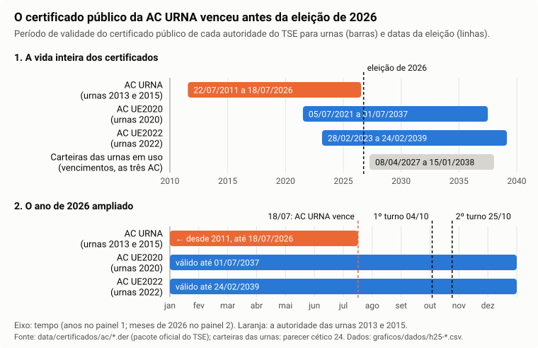
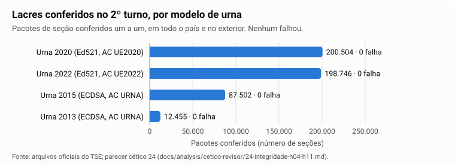
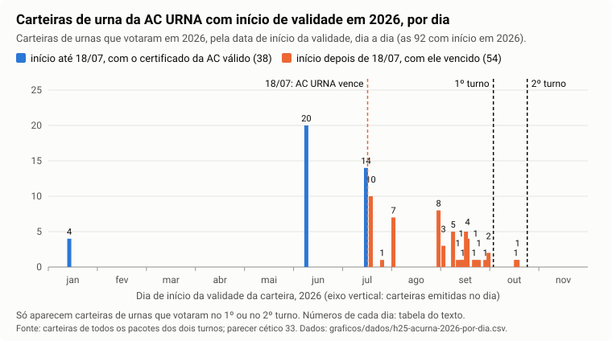
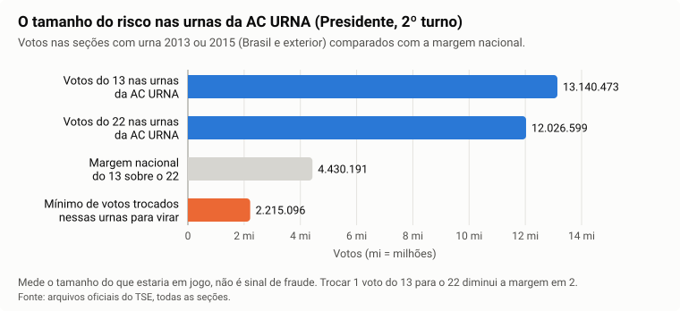

# O certificado vencido da AC URNA

> **Base (30/10/2026).** Todos os números deste relatório foram recalculados por uma segunda verificação independente, sobre todas as seções dos dois turnos. Hipóteses e pendências vêm rotuladas.

## Em poucas palavras

- **Fato.** O certificado público da AC URNA, o "cartório digital" do TSE que emitiu as carteiras de identidade das urnas antigas (modelos 2013 e 2015), valeu de 22/07/2011 a 18/07/2026. Venceu antes dos dois turnos (04/10 e 25/10/2026).
- **Fato.** Essas urnas assinaram 99.957 pacotes no 2º turno e 99.985 no 1º. Todas as assinaturas conferem com a chave dessa autoridade, e uma carteira alterada em um único bit é recusada.
- **Fato.** A chave da AC URNA continuou carimbando carteiras depois do vencimento: 54 carteiras de urna têm início de validade entre 20/07 e 19/10/2026, e todas apontam para o certificado vencido. Essas urnas votaram em 53 seções no 2º turno e em 45 no 1º; duas foram carimbadas entre os turnos. A ordem dos números de série indica que as datas são as reais (inferência forte, não prova).
- **Fato.** Os votos dessas seções estão no resultado oficial e variaram entre os turnos como os das seções vizinhas. Pela regra usual, um verificador com o certificado publicado recusaria as 99.957 seções do 2º turno; pelo "modelo de cadeia", recusaria as 53. Se e como o TSE confere, só ele pode dizer (**Hipótese** até a resposta).
- **Fato (tamanho do risco, não sinal de fraude).** No 2º turno, 20,28% dos votos válidos passaram por essas urnas: 13.140.473 do 13 e 12.026.599 do 22. A margem do 13 no país foi de 4.430.191; trocar 2.215.096 votos só nessas urnas mudaria o vencedor.
- O vencimento, sozinho, não permite forjar uma carteira. O que permitiria fraude: a chave secreta do cartório fora de controle, ou um programa alterado dentro de uma urna verdadeira. Os testes não acharam rastro de nenhum dos dois, e também não teriam como excluí-los.

## A pergunta

O auditor levantou quatro pontos:

1. o certificado da AC URNA venceu antes da eleição;
2. não há como comprovar quem emitiu as carteiras das urnas;
3. um sistema alterado poderia assinar dados com uma chave aceita;
4. a totalização aparentemente não confere a validade, senão não teria contado esses votos.

Este relatório responde cada ponto e separa o que está medido do que não dá para afirmar.

## O que é um certificado e uma autoridade certificadora

**A carteira de identidade da urna.** Cada urna tem um par de chaves:

- a **chave privada** fica guardada dentro da urna, e só ela consegue produzir a assinatura;
- a **chave pública** serve para qualquer pessoa conferir a assinatura, mas não para produzir uma.

O **certificado** é a carteira de identidade digital da urna. Ele diz "esta chave pública é da urna número tal" e traz um prazo de validade, como o "válido até" de um documento.

**O cartório.** Quem emite a carteira é uma **autoridade certificadora (AC)**, um cartório digital. O cartório "carimba" cada carteira com a chave privada dele. Quem confere usa a chave pública do cartório, que vem no certificado do próprio cartório. O TSE tem três cartórios para urnas:

| Cartório (AC) | Carteiras de quais urnas |
|---|---|
| AC URNA | modelos 2013 e 2015 |
| AC UE2020 | modelo 2020 |
| AC UE2022 | modelo 2022 |

Acima deles há cartórios "raiz" do TSE (AC RAIZ UE e AC RAIZ UE v2), que carimbam os certificados dos três. Essa fila, da urna até a raiz, se chama **cadeia de certificados**.

**O que a assinatura garante:**

- que o arquivo não mudou depois de assinado;
- que quem assinou tinha a chave privada correspondente à carteira;
- que a carteira foi carimbada por quem tem a chave privada do cartório.

**O que a assinatura não garante:**

- que a chave privada do cartório ficou só com o TSE. Quem tiver uma cópia dela carimba carteiras que passam em todas as conferências;
- que o programa da urna fez a coisa certa antes de assinar. A urna assina o que o programa dela produziu;
- a data. A conta da assinatura usa só o arquivo, a assinatura e a chave pública. A validade é uma regra à parte, que quem confere decide aplicar. Um carimbo feito com a chave verdadeira continua conferindo depois do vencimento; um carimbo feito sem essa chave continua não conferindo, antes ou depois.

**Para que serve a validade.** Ela limita o tempo em que se confia numa chave. Quanto mais tempo uma chave fica em uso, maior a chance de ela ter sido copiada ou de o equipamento que a guarda ter mudado de mãos. Por isso a regra mais usada para conferir certificados (a norma internacional RFC 5280) exige que **toda** a cadeia esteja dentro da validade na data da conferência. Existe uma segunda regra, usada em alguns sistemas de assinatura, o "modelo de cadeia": cada carteira é conferida na data em que foi emitida. Por ela, uma carteira emitida enquanto o cartório valia continua aceita depois que o cartório vence.

## O que está medido

### A validade dos três cartórios

**Fato.** Datas lidas nos arquivos dos certificados dos três cartórios, extraídos do pacote oficial de exemplos do TSE, por uma conta feita para este relatório. São iguais às registradas quando os certificados foram obtidos. A data da AC URNA aparece também na verificação dos lacres, que passou pela segunda verificação independente.

| Cartório (AC) | Urnas | Válido de | Válido até | Pacotes no 2º turno | Pacotes no 1º turno |
|---|---|---|---|---:|---:|
| AC URNA | 2013 e 2015 | 22/07/2011 | **18/07/2026** | 99.957 | 99.985 |
| AC UE2020 | 2020 | 05/07/2021 | 01/07/2037 | 200.504 | 200.463 |
| AC UE2022 | 2022 | 28/02/2023 | 24/02/2039 | 198.746 | 198.759 |
| **Total** | | | | **499.207** | **499.207** |

O número de pacotes por cartório vem da recontagem feita pela segunda verificação, nos dois turnos.

**Como ler:** cada barra é o período em que o certificado público de um cartório vale. A barra laranja é a AC URNA. No painel de cima, a linha tracejada marca a eleição de 2026; a barra cinza mostra a faixa em que vencem as carteiras das urnas em uso. No painel de baixo, o ano de 2026 aparece mês a mês: a barra laranja termina em 18/07, antes das linhas dos dois turnos. As barras azuis cobrem a eleição inteira.

### As carteiras das urnas estavam dentro da validade

**Fato (2º turno pela segunda verificação; 1º turno pela recontagem desse turno).** Nas 499.207 seções de cada turno, a carteira da urna que assinou estava dentro da validade na data da votação: 0 vencida, 0 ainda não válida. A mais antiga começa em 30/07/2013. Os vencimentos vão de 08/04/2027 a 15/01/2038.

**Fato (consequência das duas datas acima).** Toda carteira de urna em uso vence depois de 18/07/2026. Ou seja, as carteiras das urnas 2013 e 2015 valem por mais tempo que o certificado público do cartório que as carimbou. O que estava fora da validade na eleição não era a carteira da urna: era o certificado do cartório.

### Todas as assinaturas das urnas antigas conferem

**Fato (2º turno: segunda verificação; 1º turno: verificação de 30/10/2026, recontada com o programa da segunda verificação; [tópico 1](../01-integridade-e-estrutura-dos-arquivos.md)).** Os pacotes das urnas 2013 e 2015 foram conferidos um a um, nos dois turnos, com a chave pública do certificado publicado da AC URNA:

| | 2º turno | 1º turno |
|---|---:|---:|
| Pacotes de urna 2015 | 87.502 | 88.064 |
| Pacotes de urna 2013 | 12.455 | 11.921 |
| **Pacotes da AC URNA** | **99.957** | **99.985** |
| Carteira de urna sem o carimbo da AC URNA | 0 | 0 |
| Pacote com alguma falha de assinatura ou de impressão digital | 0 | 0 |
| Pacotes marcados "certificado publicado da AC URNA fora da validade na data da eleição" | 99.957 (todos) | 99.985 (todos) |

- O programa da auditoria confere a data, mas registra o vencimento do cartório como **observação**, não como falha. Por isso os pacotes aparecem ao mesmo tempo com "0 falha" e com a marca de fora da validade.
- No país inteiro, os pacotes do 2º turno somam 499.207 com 0 falha. As urnas novas (2020 e 2022) também foram conferidas, com outro método de assinatura (gráfico abaixo).
- A marca do 1º turno foi contada mais uma vez para este relatório, pacote a pacote, no resultado da verificação; o total bate com o da recontagem independente.

**Como ler:** cada barra é um modelo de urna; o comprimento é o número de seções cujo pacote foi conferido. As duas barras de baixo (urnas 2015 e 2013) são as da AC URNA. Nenhum pacote falhou, em nenhum modelo.

### Carteiras gravadas com zeros a mais

**Fato (conferido pela segunda verificação).** Em parte das urnas antigas, a carteira vem gravada num espaço de tamanho fixo, completado com zeros no fim. O programa da auditoria parava nesses zeros; depois de ignorá-los, todos os pacotes passaram em todas as conferências.

| | 2º turno | 1º turno |
|---|---:|---:|
| Pacotes com zeros a mais na carteira | 37.457 | 37.440 |
| com 1 zero a mais | 37.406 | 37.389 |
| com 3 zeros a mais | 51 | 51 |
| de urna 2015 / urna 2013 | 32.811 / 4.646 | 33.020 / 4.420 |
| O que sobra é só zero | 37.457 | 37.440 |
| Aprovados depois de ignorar os zeros | 37.457 | 37.440 |

- O corte muda só a forma de ler. A lista assinada e as assinaturas foram usadas sem alteração.
- A mesma urna mostra a mesma sobra nos dois turnos: a sobra é da carteira, não do pacote.
- Há também carteiras com 2 zeros a mais, que o leitor aceita sem avisar. A assinatura delas é conferida normalmente. O programa da verificação ainda não registra quantas são (**Pendente**, como no tópico 1); a proporção de cada tamanho de sobra está na seção "Por que algumas carteiras têm zeros a mais", adiante.

### Por UF

**Fato.** Pacotes de urnas da AC URNA (modelos 2013 e 2015) e, entre eles, os com zeros a mais na carteira. Nas quatro UFs com 0 (AC, AP, RO, RR) não há urna antiga.

| UF | Pacotes AC URNA, 2º turno | Com zeros a mais, 2º turno | Pacotes AC URNA, 1º turno | Com zeros a mais, 1º turno | Com falha (os dois turnos) |
|---|---:|---:|---:|---:|---:|
| AC | 0 | 0 | 0 | 0 | 0 |
| AL | 1.495 | 552 | 1.495 | 551 | 0 |
| AM | 2.174 | 804 | 2.174 | 802 | 0 |
| AP | 0 | 0 | 0 | 0 | 0 |
| BA | 7.989 | 2.942 | 7.989 | 2.952 | 0 |
| CE | 4.283 | 1.637 | 4.283 | 1.626 | 0 |
| DF | 1.373 | 511 | 1.373 | 514 | 0 |
| ES | 2.482 | 885 | 2.482 | 889 | 0 |
| GO | 2.780 | 1.021 | 2.780 | 1.020 | 0 |
| MA | 3.620 | 1.350 | 3.620 | 1.342 | 0 |
| MG | 9.081 | 3.415 | 9.081 | 3.421 | 0 |
| MS | 1.175 | 475 | 1.175 | 472 | 0 |
| MT | 1.422 | 558 | 1.422 | 560 | 0 |
| PA | 4.522 | 1.728 | 4.522 | 1.716 | 0 |
| PB | 2.556 | 943 | 2.556 | 940 | 0 |
| PE | 4.555 | 1.650 | 4.555 | 1.659 | 0 |
| PI | 2.040 | 736 | 2.040 | 736 | 0 |
| PR | 5.869 | 2.165 | 5.869 | 2.149 | 0 |
| RJ | 8.299 | 3.151 | 8.299 | 3.142 | 0 |
| RN | 1.477 | 547 | 1.477 | 547 | 0 |
| RO | 0 | 0 | 0 | 0 | 0 |
| RR | 0 | 0 | 0 | 0 | 0 |
| RS | 4.608 | 1.771 | 4.608 | 1.775 | 0 |
| SC | 4.069 | 1.501 | 4.069 | 1.497 | 0 |
| SE | 926 | 349 | 926 | 356 | 0 |
| SP | 21.843 | 8.307 | 21.871 | 8.321 | 0 |
| TO | 9 | 2 | 9 | 2 | 0 |
| exterior | 1.310 | 457 | 1.310 | 451 | 0 |
| **Total** | **99.957** | **37.457** | **99.985** | **37.440** | **0** |

De onde vem cada coluna. Uma conta feita para este relatório confere todas e para se algum número não bater:

- **Pacotes do 2º turno:** são a coluna "urnas 2013 e 2015" do tópico 1, recontada das linhas por pacote.
- **Zeros a mais:** recontados pacote a pacote na nova conferência desses pacotes e iguais, UF a UF, aos do resumo da verificação de cada turno.
- **Pacotes do 1º turno:** contados em duas extrações independentes do 1º turno, que dão o mesmo número em cada UF.
- **Totais:** são os da recontagem da segunda verificação.

### Os votos dessas seções estão no resultado oficial

**Fato ([tópico 5](../05-soma-dos-boletins.md)).** No 2º turno, das 99.957 seções com urna 2013 ou 2015, 99.955 têm voto para Presidente. Em todas as 99.955, o boletim é igual ao resultado oficial por seção publicado pelo TSE, candidato a candidato: 0 divergência. As 2 restantes são do exterior, com 0 eleitor votando. Os votos que essas urnas assinaram foram contados.

## Prova de que o teste funciona (contraprova)

**Fato.** A segunda verificação alterou de propósito **um único bit** em pacotes de cinco tipos, entre eles uma urna 2015 e uma urna 2013 da AC URNA e um pacote com zeros a mais na carteira. Em todos, o programa recusou a alteração:

| O que foi alterado | Falhas acusadas |
|---|---:|
| Assinatura da lista de arquivos | 1 |
| Conteúdo da carteira da urna (o carimbo da AC deixa de conferir) | 1 |
| Assinatura do boletim | 2 |

Uma carteira diferente da que o cartório carimbou não passa, mesmo com o certificado do cartório vencido. Portanto o "0 falha" não vem de um programa que aprova qualquer coisa.

**Fato.** A conferência de "para qual certificado de cartório a carteira aponta" também foi testada ao contrário: com um certificado de cartório de laboratório de outra série, ela recusa a carteira.

## As carteiras de cada urna e os votos

Os testes sobre as carteiras e os votos foram feitos em 30/10/2026 em duas frentes: as carteiras das urnas e os votos dessas urnas. Uma segunda verificação independente refez a conta das carteiras por outro caminho: outro programa de leitura, nos 998.414 pacotes dos dois turnos, com 0 erro de leitura e 0 pacote sem carteira. Também conferiu 5 carteiras direto no arquivo original, com um programa padrão de verificação de certificados (OpenSSL). Os votos foram refeitos com os mesmos resultados. O texto abaixo usa só as afirmações que resistiram a essa verificação.

### Carteiras de urna emitidas pela AC URNA depois do vencimento

**Fato.** A chave da AC URNA carimbou **54 carteiras de urna com início de validade entre 20/07 e 19/10/2026**, depois de o certificado publicado do cartório vencer (18/07/2026, às 18h59min57s de Brasília).

- As 54 são de 23 urnas 2013 e 31 urnas 2015.
- As urnas com essas carteiras votaram em **53 seções no 2º turno e em 45 no 1º**. 44 votaram nos dois turnos, 9 só no 2º e 1 só no 1º.
- **Duas foram carimbadas entre os turnos.** A de 18/10 foi a urna da seção SP 71072/0004/0114 no 2º turno; no 1º turno essa seção votou com outra urna. A de 19/10 foi a urna reserva da seção SP 62634/0214/0003 no 2º turno.
- A primeira carteira depois do vencimento começa a valer em 20/07, 44 horas e 26 minutos depois dele. Não há caso na fronteira.
- Todas as 54 passam na conferência de assinatura com a chave do certificado publicado da AC URNA.

**Os números de série crescem com saltos.** Cada carteira tem um número de série, como uma nota fiscal.

- **Fato:** os números crescem com a data, sem nenhuma inversão nas 92 carteiras de 2026. Mas há saltos: entre o primeiro (`34aea5`, 20/07) e o último (`34b256`, 19/10) depois do vencimento cabem 946 números, e só 54 deles estão em urnas que votaram. Antes do vencimento, em 2026, a proporção é parecida: 38 de 371 números.
- **Hipótese:** a AC URNA emitiu mais carteiras depois de vencer do que as 54 que aparecem nas urnas que votaram. Só a lista de emissões do TSE responde (pergunta 3, no fim deste relatório).

**A data de início é a data em que a carteira foi carimbada?** A data de início é escrita pelo relógio do sistema que emite. Por isso a afirmação "emitidas depois do vencimento" é **inferência forte, não prova**. O que a apoia (**Fato**, universo completo):

| Teste | Resultado |
|---|---|
| Ordem dos números de série × data, nas três autoridades em 2026 | 0 inversões (AC URNA 92 carteiras, AC UE2020 112, AC UE2022 319) |
| Ritmo dentro de cada sessão de emissão | 2 a 3 segundos por número de série, igual antes e depois do vencimento |
| Sessões junto com as outras autoridades | Em 13 dos 18 dias com emissão depois do vencimento, a AC UE2020 ou a AC UE2022 emitem na mesma sessão, minutos depois, como em 17/07 |
| Carteira usada numa votação antes da própria data de início | 0, nos dois turnos |
| Preparação da urna (carga, pelo relógio da própria urna, gravado no boletim) depois da data de início da carteira | 98 de 98 seções × turno. A menor folga é de 42 horas |

Em palavras simples: uma carteira com data "adiantada" teria de receber o número de série na ordem da data escrita, e não na ordem do carimbo, no mesmo ritmo das outras duas autoridades na mesma sessão. Isso só aconteceria com o relógio de todo o sistema emissor adiantado. E a preparação das urnas, feita com outro relógio, veio depois em todos os casos. Só o registro do cartório, que está com o TSE, prova a hora do carimbo.

**Como ler:** cada barra é um dia de 2026, e a altura é o número de carteiras de urna com início de validade naquele dia. Só entram carteiras de urnas que votaram no 1º ou no 2º turno. Azul: carteiras com início até 18/07, quando o certificado do cartório valia (38). Laranja: carteiras com início depois de 18/07, com o certificado vencido (54). A linha laranja tracejada marca o vencimento; as pretas, os dois turnos. As duas barras entre as linhas pretas são as carteiras carimbadas entre os turnos.

Carteiras com início de validade depois do vencimento, por dia (**Fato**):

| Dia (2026) | Carteiras | Dia (2026) | Carteiras |
|---|---:|---|---:|
| 20/07 | 10 | 17/09 | 5 |
| 27/07 | 1 | 18/09 | 4 |
| 03/08 | 7 | 22/09 | 1 |
| 31/08 | 8 | 23/09 | 1 |
| 03/09 | 3 | 25/09 | 1 |
| 09/09 | 5 | 29/09 | 1 |
| 12/09 | 1 | 01/10 | 2 |
| 14/09 | 1 | 18/10 | 1 |
| 15/09 | 1 | 19/10 | 1 |
| | | **Total (18 dias)** | **54** |

Antes do vencimento, em 2026: 4 em 14/01, 20 em 10/06 e 14 em 17/07. A contagem por dia foi refeita para este relatório, nas carteiras lidas pela verificação dos lacres. Ela é igual, dia a dia, à da primeira análise e, depois do vencimento, à lista da segunda verificação.

**Hipótese (a mais simples):** é a recertificação de rotina de urnas antigas, feita pelo mesmo sistema emissor das outras duas autoridades: mesmas sessões, mesmo ritmo. Não está provada. Só o registro do cartório prova quem emitiu e por quê.

### Para qual certificado de cartório as carteiras apontam

Cada carteira de urna traz um campo que diz qual chave e qual certificado de cartório a carimbaram. Ele é como o carimbo que diz "lavrado no cartório tal, livro tal".

- **Fato:** as carteiras de todos os pacotes da AC URNA, 99.957 no 2º turno e 99.985 no 1º, apontam para o certificado da AC URNA de número de série 03, emitido pela AC RAIZ UE. É o certificado publicado, o que venceu. As 54 carteiras de julho a outubro também apontam para ele.
- **Fato:** nenhuma carteira aponta para outro certificado da AC URNA.
- **O que isso diz sobre "o cartório foi renovado com a mesma chave".** Um certificado renovado teria outro número de série. O programa OpenSSL recusa um certificado renovado de série nova como emissor dessas carteiras (teste de laboratório). Mas a regra da norma RFC 5280 não usa esse campo, e há programas que não conferem a série. Então um certificado renovado ainda poderia ser aceito por alguns verificadores.
- **Hipótese forte:** as carteiras emitidas de julho a outubro ainda apontam para a série 03. Isso indica que o sistema emissor do TSE continuava configurado com o certificado vencido até 19/10.

### Repetições e coerência das carteiras

**Fato (universo completo dos dois turnos).**

| Teste | Resultado |
|---|---|
| Carteiras de urna distintas nos dois turnos | 503.525, das quais 101.756 da AC URNA |
| Mesma chave pública em carteiras diferentes | 0 |
| Mesmo número de série no mesmo cartório | 0 |
| Urna com duas carteiras | 0 |
| Carteira vencida ou ainda não válida na data do turno | 0 |
| Carteiras da AC URNA que vencem depois do próprio cartório | todas (o vencimento mais cedo é 08/04/2027) |

O número de carteiras da AC URNA (101.756) também foi contado à parte, na verificação dos lacres, e bate com o da segunda verificação.

Nada aqui mostra uma carteira fora do padrão das outras. Isso não exclui uma carteira emitida com a chave verdadeira para uma urna que não existe: ela seria igual às outras.

### A data vencida permite forjar uma carteira? (teste de laboratório)

**Fato:** não. Sem a chave privada do cartório, mudar um byte da data de uma carteira real, ou carimbá-la com outra chave, faz a conferência falhar. A data não entra na conta da assinatura. Isso é uma propriedade da assinatura digital: serve para explicar, não é um achado sobre a eleição.

**O que um verificador padrão faz com essas carteiras (Fato).** A segunda verificação conferiu 5 das 54 carteiras no arquivo original com o OpenSSL. Entre elas estão as duas carimbadas entre os turnos.

| Como o verificador confere | Resultado nas 5 |
|---|---|
| Sem conferir data | aceita: a assinatura do cartório confere |
| Na data do turno | recusa: o certificado do cartório está vencido |
| Em 17/07/2026, véspera do vencimento | recusa: a carteira ainda não era válida, porque ainda não existia |

**As duas regras de data, aplicadas ao 2º turno (Fato):**

| Regra | Pacotes da AC URNA aceitos no 2º turno | Recusados |
|---|---:|---:|
| Regra usual (norma RFC 5280, OpenSSL, navegadores): toda a cadeia válida na data da eleição | 0 | 99.957 |
| "Modelo de cadeia": o cartório conferido na data em que carimbou a carteira | 99.904 | 53 (as carteiras emitidas depois do vencimento) |
| Sem conferir data | 99.957 | 0 |

Só um verificador que não confere data, ou que confia em outro certificado da AC URNA, aceita todos.

### Por que algumas carteiras têm zeros a mais

**Fato.** A carteira é gravada num espaço de 946 bytes. A assinatura do cartório dentro dela muda de tamanho de uma carteira para outra, e o que falta é completado com zeros. A matemática dessa assinatura prevê com que frequência cada tamanho aparece, e o observado bate:

| Zeros a mais | Observado no 2º turno | Previsto pela matemática |
|---|---:|---:|
| 0 | 56,27% | 56,25% |
| 1 | 37,42% | 37,35% |
| 2 | 6,26% | 6,35% |
| 3 | 0,051% | 0,049% |

A diferença fica dentro do que o acaso produz (teste qui-quadrado). É formato, não adulteração. Ressalva: 98% das carteiras são as mesmas nos dois turnos, então o 1º turno não é uma segunda confirmação independente.

### Os votos das urnas antigas comparados com os das urnas novas

**Os votos das seções com carteira emitida depois do vencimento.** Cada seção foi comparada com ela mesma no outro turno e com as outras seções do mesmo local de votação. A referência é a mesma conta em todas as seções do país com pelo menos 2 vizinhas no local.

| Grupo | Seções | Mudança na parcela do 13 entre os turnos, contra as vizinhas (ponto percentual) | p | O teste enxerga a partir de |
|---|---:|---:|---:|---:|
| Carteira tardia, 2º turno | 53 | +0,13 | 0,65 | 0,82 |
| Carteira tardia, 1º turno | 45 | +0,06 | 0,84 | 0,87 |
| Controle: urnas recertificadas em 2026 antes do vencimento | 37 | −0,05 | 0,89 | 1,03 |

O **p** é a chance de o acaso, sozinho, produzir uma diferença daquele tamanho. Valores altos, como estes, querem dizer que a diferença não se separa do acaso.

- **Fato:** nenhum grupo se afasta das vizinhas. Em votos, a diferença das 53 seções do 2º turno soma **13 votos a mais para o 13**, num total de 13.458 votos no 13 e no 22. As seções dos dois lados da data de vencimento votam igual.
- **Fato:** no 2º turno, a parcela do 13 nessas seções fica 0,57 ponto acima da do local (p = 0,31, dentro do acaso), e já ficava 0,44 acima no 1º turno. É o perfil do lugar das urnas antigas.
- **Fato:** 3 das 53 seções ficam a 3 desvios ou mais das vizinhas em alguma das medidas, contra 1,0 esperada (p = 0,08, sem correção para muitos testes). Uma vai a favor do 13 e duas contra. Em duas, o desvio já existia no 1º turno.
- **Fato:** na seção SP 71072/0004/0114 (urna carimbada em 18/10), a parcela do 13 subiu 4,7 pontos a mais que a das 16 vizinhas do local (z = 2,4), depois de um 1º turno 7,4 pontos abaixo delas, com outra urna. Não passa o limite de 3 desvios. **Hipótese:** volta à média depois de um 1º turno fora do padrão. Na seção SP 62634/0214/0003 (urna reserva carimbada em 19/10): −1,6 ponto (z = −0,8).
- **Limite:** com 53 seções, o teste não vê um desvio médio menor que 0,82 ponto. Também não vê nada que aja igual nas urnas vizinhas.

**Os votos de todas as urnas antigas contra os das urnas novas.**

- **Fato:** a análise registrou 12 testes antes de olhar os votos (3 medidas × 4 comparações). Nenhum passa a correção para muitos testes. O maior valor é z = +2,55, abaixo do limite de 2,87. A segunda verificação rodou de novo o programa e obteve o mesmo resultado.
- **Fato:** as urnas antigas e as novas ficam, em geral, em zonas e municípios diferentes. Só 516 das 99.957 seções com urna antiga (0,5%) dividem o local de votação com urna nova, em 123 locais de 47 municípios. **Os 12 testes combinados antes cobrem só essas seções** (483 no teste de mudança entre turnos).
- **Fato, exploratório:** para cobrir as outras seções, a análise acrescentou depois comparações mais largas. Na mudança do 1º para o 2º turno, comparando dentro da UF, a parcela do 13 nas urnas antigas mudou −0,03 ponto em relação às novas (intervalo de 95% de −0,09 a +0,02). "Exploratório" quer dizer que a comparação foi escolhida depois de ver o primeiro resultado. Ela aponta no mesmo sentido, mas não é o teste combinado antes. O teste combinado antes dá −0,11 ponto (intervalo de −0,40 a +0,18).
- **Fato (aritmética):** para virar o resultado do 2º turno só com essas urnas, seria preciso trocar 2.215.096 votos de um candidato para o outro, 8,8% dos votos no 13 e no 22 dessas urnas. As comparações exploratórias excluem uma diferença de nível maior que 1,5 ponto. Essa comparação de 8,8 com 1,5 depende das camadas exploratórias.
- **Fato:** as seções com zeros a mais na carteira votam como as outras seções de urna antiga do mesmo local: −0,02 ponto na parcela do 13 (intervalo de −0,07 a +0,03). A sobra de zeros depende só do sorteio da assinatura, então essa comparação funciona como um sorteio natural.
- **Fato:** o nível de votos das urnas antigas não mudou entre os turnos. Um desvio igual nos dois turnos, abaixo de 1 a 2 pontos, não se separa do perfil do lugar.
- **Não verificável:** o registro dos testes e os resultados foram guardados juntos, no mesmo momento. Não há rastro técnico de que o registro veio antes. A segunda verificação não acusa nada; recomenda registrar os testes separadamente nas próximas hipóteses.

## O raciocínio do auditor, ponto por ponto

### "A totalização não confere a validade, senão não teria contado esses votos"

**Fato:**

1. a chave privada da AC URNA, a mesma do certificado publicado, carimbou as carteiras das 99.957 urnas antigas do 2º turno, inclusive as 54 de julho a outubro;
2. cada uma dessas urnas assinou o próprio pacote, e a assinatura confere;
3. os votos dessas seções estão no resultado oficial (99.955 com voto para Presidente, 0 divergência);
4. com o certificado publicado, um verificador que confere datas recusaria esses pacotes: todos pela regra usual, e os 53 de carteira tardia mesmo pelo "modelo de cadeia".

Daí sobra uma destas possibilidades (**Hipótese**, os arquivos públicos não permitem escolher):

1. o sistema do TSE não confere a data de validade do cartório, ou não confere a cadeia;
2. o sistema confere pelo "modelo de cadeia". Nesse caso, ainda recusaria os 53 pacotes com carteira emitida depois do vencimento, que foram contados;
3. o sistema confia em outro certificado da AC URNA, renovado, que não foi publicado. O dado limita essa explicação: as carteiras de julho a outubro ainda apontam para o certificado vencido (seção "Para qual certificado de cartório as carteiras apontam");
4. a conferência é feita em outro ponto do caminho, ou não é feita, e a totalização confia no canal de transmissão.

O auditor tem razão num ponto que não depende de qual seja o caso: em todas as possibilidades falta informação pública. **Quem está de fora não sabe qual conferência o TSE faz e não consegue reproduzi-la com o que foi publicado.**

- Nas possibilidades 1 e 4, o vencimento do cartório não funciona como barreira.
- A possibilidade 2 não explica, sozinha, os 53 pacotes contados.
- Na 3, falta publicar o certificado usado.

A explicação "o cartório foi renovado com a mesma chave" é uma afirmação sobre o que o TSE fez, sem documento público. Pela regra desta auditoria (procedimento de pessoas não é controle), ela fica como **risco** até o TSE publicar o certificado e a data de emissão.

Não se pode escrever que "a totalização aceitou certificado vencido". Não se sabe se ela confere certificados, nem com qual certificado de cartório, nem em que ponto do caminho. As perguntas exatas estão no fim.

### "Se a validade não é conferida, qualquer carteira passaria, e um cartão de resultado adulterado com uma carteira qualquer seria contado"

Este ponto foi analisado de forma independente por quatro revisores, cada um com uma especialidade (lógica e método, segurança de certificados, prática eleitoral e a coordenação da auditoria). As quatro análises chegaram à mesma resposta.

- **A primeira parte procede.** Há sinal de que a validade de datas da cadeia não foi exigida: as carteiras das urnas antigas foram contadas, e uma conferência que exigisse datas, com o certificado publicado, as recusaria.
- **O resto não decorre disso.** Conferir a data e conferir a assinatura são passos separados. Um sistema pode deixar de conferir a data e continuar conferindo se a carteira da urna foi carimbada pela chave do cartório e se o boletim foi assinado pela chave da urna. O mais comum em sistemas fechados é confiar diretamente na chave do cartório; nesse caso, a data do certificado do cartório deixa de importar, mas uma carteira feita com outra chave continua recusada.
- **Fato: nenhum pacote com carteira "qualquer" foi contado nesta eleição.** As 503.525 carteiras de urna distintas dos dois turnos foram carimbadas pelas três chaves de cartório do TSE, sem nenhuma exceção. Um cartão adulterado com uma carteira qualquer deixaria no pacote publicado uma carteira que não confere com a chave do cartório, e isso não aparece em nenhum dos 499.207 pacotes de cada turno. Como o TSE publica o que recebeu, e o resultado oficial é exatamente a soma desses boletins publicados, todos os boletins contados têm carteira legítima.
- **O que esse fato não prova:** que o sistema do TSE recusaria um pacote com carteira qualquer. Prova só que nenhum entrou. Saber se a recusa existe exige o programa de totalização ou um teste do próprio TSE.
- **O risco real é outro.** Quem tivesse a chave do cartório AC URNA poderia carimbar uma carteira de urna e assinar um boletim adulterado que passaria em qualquer conferência, e, se a data não é conferida, com qualquer data de emissão. As 54 carteiras de julho a outubro mostram que essa chave continuou em uso depois do vencimento. Não há sinal de que tenha sido usada para fraude: as 54 são urnas comuns, sem chave repetida, e votaram como as vizinhas. Mas o controle que deveria limitar o uso dessa chave (vencimento e lista de revogação) não está visível.
- **O teste que decidiria:** pedir ao TSE a lista de todas as carteiras que a AC URNA emitiu em 2026 e comparar com as 54 que aparecem nas urnas. Uma carteira emitida que não aparece em nenhuma urna seria o rastro de uma emissão fora do processo.

### "Não há como comprovar quem emitiu"

Isso vale pela metade.

- **Fato ([tópico 1](../01-integridade-e-estrutura-dos-arquivos.md)):** cada carteira das urnas 2013 e 2015 tem o carimbo conferido com a chave pública do certificado publicado da AC URNA: 0 sem carimbo, nos dois turnos. Uma carteira alterada é recusada (contraprova acima). Então quem emitiu essas carteiras, inclusive as 54 de julho a outubro, tinha a chave privada da AC URNA. Uma carteira inventada por quem não tem essa chave não passa. "Pode ser qualquer certificado" não se sustenta.
- **Fato:** nenhuma carteira aponta para outro cartório ou para outro certificado de cartório. Não há sinal de um emissor diferente.
- **Limite:** os arquivos provam que quem carimbou tinha a chave. Não provam quem, dentro do TSE, operou a chave, nem se a emissão foi autorizada, nem que a chave ficou só com o TSE.
- **Limite ([tópico 1](../01-integridade-e-estrutura-dos-arquivos.md), limite 2):** o certificado da AC URNA não pôde ser conferido até o cartório raiz. O certificado da AC RAIZ UE não está disponível para download automático no site do TSE.

### "Um sistema alterado poderia assinar dados com chave aceita"

Isso é verdade, mas não depende do vencimento. Há dois caminhos, e os dois valeriam também com um certificado dentro da validade.

| O que permitiria a fraude | O que o atacante precisa | O que apareceria nos arquivos públicos |
|---|---|---|
| Chave privada da AC URNA fora do controle do TSE | Uma cópia da chave do cartório | Uma carteira para uma "urna" que não existe passaria em todas as conferências. O rastro possível seria uma carteira fora do padrão das outras |
| Programa alterado dentro de uma urna verdadeira | Acesso à instalação do programa na urna | Nada nas assinaturas: a urna assina com a chave verdadeira o que o programa produziu. O rastro possível estaria no diário da urna, na versão do programa e nos votos |

O que foi procurado e revisado:

- **Fato:** nenhuma chave, número de série ou urna repetida entre as 503.525 carteiras; todas as carteiras da AC URNA apontam para o mesmo certificado de cartório; as 54 carteiras de julho a outubro seguem a mesma ordem, o mesmo ritmo e as mesmas sessões das outras autoridades.
- **Fato:** o número da urna é o mesmo na carteira, no pacote e no boletim em 499.204 de 499.207 seções do 2º turno. As 3 diferenças são boletins regravados no cartório por outra urna, o Recuperador de Dados ([tópico 2](../02-coerencia-entre-arquivos.md)).
- **Fato:** todas as urnas do 2º turno registram a mesma versão de programa, 10.23.0.0 ([tópico 1](../01-integridade-e-estrutura-dos-arquivos.md)).
- **Fato:** os votos das seções com carteira tardia variaram como os das vizinhas, e nenhum dos 12 testes combinados antes acha diferença entre urnas antigas e novas.

Nenhum desses testes mostra uma chave copiada ou um programa trocado. Mas nenhum deles prova que isso não aconteceu: uma cópia da chave, ou um programa alterado que registre a versão certa e aja igual em urnas antigas e novas, produz arquivos iguais aos legítimos.

### "O certificado venceu antes da eleição"

**Fato**, como medido acima: 18/07/2026, antes de 04/10 e de 25/10/2026. A carteira de cada urna estava dentro da validade nos dois turnos. O vencido era o certificado público do cartório, e a chave dele continuou carimbando carteiras depois do vencimento (as 54).

## O tamanho do risco: o que estaria em jogo se essas urnas tivessem sido fraudadas

Esta seção não diz que houve fraude. Ela mede **o tamanho da porta**: quantos votos passaram pelas urnas que dependem do certificado vencido, e quanto deles teria de estar errado para mudar o resultado. As contas usam o resultado oficial de Presidente, seção por seção, em todas as seções. As seções do exterior estão incluídas (1.310 seções, todas com urna da AC URNA).

### O país, 2º turno

**Fato.**

| | Votos |
|---|---:|
| Votos do 13 no país | 64.256.232 |
| Votos do 22 no país | 59.826.041 |
| **Margem do 13 sobre o 22** | **4.430.191** |
| Votos do 13 nas seções com urna da AC URNA | 13.140.473 |
| Votos do 22 nas seções com urna da AC URNA | 12.026.599 |
| Votos no 13 e no 22 nessas seções | 25.167.072 |
| Parte dos votos válidos do país que passou por essas urnas | 20,28% |
| **Mínimo de votos trocados do 13 para o 22, só nessas urnas, para virar a eleição** | **2.215.096** |
| Esse mínimo, como parte dos votos no 13 e no 22 dessas urnas | 8,80% |
| Esse mínimo, como parte dos votos do 13 nessas urnas | 16,86% |

- **Como sai o mínimo.** Cada voto que sai do 13 e vai para o 22 diminui a margem em 2: um a menos de um lado, um a mais do outro. Com 2.215.095 votos trocados, o 13 ainda venceria por 1 voto. Com 2.215.096, o 22 venceria por 1 voto. Por isso o mínimo é a metade da margem, arredondada para cima.
- No 2º turno de Presidente só há dois candidatos, então os votos válidos são os votos no 13 e no 22 (brancos e nulos não entram).
- **Sem o exterior**, as seções com urna da AC URNA somam 12.940.319 votos no 13 e 11.855.102 no 22.
- **Em números redondos:** a cada 100 votos no 13 e no 22 nessas urnas, 52 foram para o 13 e 48 para o 22. Para virar a eleição só com essas urnas, seria preciso que 9 desses 100 tivessem mudado de lado, em média, em todas as urnas antigas do país. Seria como mudar o placar de 52 a 48 para 43 a 57.

**Como ler:** as duas barras azuis são os votos que passaram pelas urnas da AC URNA no 2º turno. A barra cinza é a diferença entre o 13 e o 22 no país. A barra laranja é o menor número de votos que, trocados do 13 para o 22 só nessas urnas, mudaria o vencedor. A laranja cabe muitas vezes nas azuis: o volume de votos nessas urnas é grande o bastante para decidir a eleição. É o tamanho do risco, não um sinal de que algo foi trocado.

### Por estado, 2º turno

**Fato.** Em cada UF, o "pior caso" é este: todos os votos do candidato que venceu na UF, dentro das urnas da AC URNA daquela UF, teriam sido, na verdade, do outro. "Dá para virar" quer dizer que, nesse pior caso, o vencedor de Presidente **naquela UF** mudaria. O "mínimo para virar" é a metade da margem da UF, arredondada para cima, pela mesma conta do país.

| UF | Votos do 13 | Votos do 22 | Vencedor na UF | Margem | Votos do 13 nas urnas AC URNA | Votos do 22 nas urnas AC URNA | Mínimo para virar | Dá para virar só com essas urnas? |
|---|---:|---:|---|---:|---:|---:|---:|---|
| AC | 144.513 | 287.715 | 22 | 143.202 | 0 | 0 | 71.602 | não |
| AL | 1.152.621 | 744.140 | 13 | 408.481 | 274.171 | 82.668 | 204.241 | **sim** |
| AM | 1.145.783 | 975.245 | 13 | 170.538 | 281.994 | 358.709 | 85.270 | **sim** |
| AP | 222.968 | 198.674 | 13 | 24.294 | 0 | 0 | 12.148 | não |
| BA | 6.485.258 | 2.608.761 | 13 | 3.876.497 | 1.550.423 | 560.039 | 1.938.249 | não |
| CE | 4.036.124 | 1.819.478 | 13 | 2.216.646 | 717.627 | 266.319 | 1.108.324 | não |
| DF | 825.224 | 979.542 | 22 | 154.318 | 164.304 | 207.552 | 77.160 | **sim** |
| ES | 1.001.965 | 1.294.504 | 22 | 292.539 | 278.560 | 335.494 | 146.270 | **sim** |
| GO | 1.585.555 | 2.345.334 | 22 | 759.779 | 274.992 | 356.466 | 379.890 | não |
| MA | 2.808.231 | 1.229.971 | 13 | 1.578.260 | 610.369 | 332.284 | 789.131 | não |
| MG | 6.351.099 | 6.241.786 | 13 | 109.313 | 1.076.549 | 1.039.869 | 54.657 | **sim** |
| MS | 628.973 | 927.892 | 22 | 298.919 | 97.535 | 136.292 | 149.460 | não |
| MT | 694.167 | 1.351.099 | 22 | 656.932 | 158.411 | 230.093 | 328.467 | não |
| PA | 2.690.449 | 2.199.940 | 13 | 490.509 | 524.406 | 459.233 | 245.255 | **sim** |
| PB | 1.794.059 | 865.210 | 13 | 928.849 | 398.157 | 310.830 | 464.425 | não |
| PE | 4.117.513 | 1.832.554 | 13 | 2.284.959 | 872.029 | 333.179 | 1.142.480 | não |
| PI | 1.653.989 | 525.859 | 13 | 1.128.130 | 340.048 | 89.537 | 564.066 | não |
| PR | 2.566.504 | 4.291.444 | 22 | 1.724.940 | 505.522 | 903.962 | 862.471 | **sim** |
| RJ | 4.565.393 | 5.169.033 | 22 | 603.640 | 1.243.390 | 1.136.953 | 301.821 | **sim** |
| RN | 1.413.596 | 737.409 | 13 | 676.187 | 258.155 | 202.844 | 338.094 | não |
| RO | 294.446 | 674.382 | 22 | 379.936 | 0 | 0 | 189.969 | não |
| RR | 83.505 | 219.675 | 22 | 136.170 | 0 | 0 | 68.086 | não |
| RS | 2.824.552 | 3.874.378 | 22 | 1.049.826 | 406.558 | 716.500 | 524.914 | **sim** |
| SC | 1.418.314 | 3.220.071 | 22 | 1.801.757 | 289.690 | 764.852 | 900.879 | não |
| SE | 989.041 | 433.354 | 13 | 555.687 | 143.851 | 89.836 | 277.844 | não |
| SP | 12.119.274 | 14.139.178 | 22 | 2.019.904 | 2.472.700 | 2.940.517 | 1.009.953 | **sim** |
| TO | 442.962 | 467.916 | 22 | 24.954 | 878 | 1.074 | 12.478 | não |
| exterior | 200.154 | 171.497 | 13 | 28.657 | 200.154 | 171.497 | 14.329 | **sim** |
| **Brasil e exterior** | **64.256.232** | **59.826.041** | 13 | **4.430.191** | **13.140.473** | **12.026.599** | **2.215.096** | **sim** |

- No pior caso, o vencedor de Presidente mudaria em **10 UFs e no exterior**: AL, AM, DF, ES, MG, PA, PR, RJ, RS e SP.
- Em AC, AP, RO e RR não há urna da AC URNA. No TO há 9 seções, com 1.952 votos.
- A virada de uma UF não decide a eleição de Presidente, que é contada no país inteiro. A tabela mostra onde essas urnas pesam mais.

### As seções das 54 carteiras emitidas depois do vencimento

**Fato.**

| Turno | Seções | Votos do 13 | Votos do 22 | Votos no 13 e no 22 |
|---|---:|---:|---:|---:|
| 2º turno | 53 | 7.878 | 5.580 | 13.458 |
| 1º turno | 45 | 5.800 | 4.179 | 9.979 |

- **2º turno:** mesmo que todos os 13.458 votos dessas seções tivessem sido trocados, o resultado do país não mudaria: o mínimo para virar é 2.215.096. Em nenhuma das 11 UFs com essas seções o total delas chega ao mínimo para virar a UF. O maior peso é em SP: 2.706 votos, para um mínimo de 1.009.953.
- **1º turno:** os 9.979 votos dessas seções também não mudam a ordem dos dois primeiros no país, separados por 2.224.965 votos (22: 56.104.503; 13: 53.879.538).

### O 1º turno

**Pendente.** A mesma conta para o conjunto das urnas da AC URNA no 1º turno (99.985 seções) ainda não foi conferida em separado. No 1º turno há mais candidatos, e "virar" pode querer dizer mudar quem vai ao 2º turno ou se alguém vence logo no 1º. A conta só entra quando for conferida.

### O que os testes de votos mostraram

As urnas da AC URNA votaram como as urnas novas do mesmo lugar, e as seções com carteira emitida depois do vencimento votaram como as suas vizinhas (seção "Os votos das urnas antigas comparados com os das urnas novas"). Uma troca do tamanho necessário para virar a eleição apareceria como uma diferença de 8,8 pontos entre urnas antigas e novas; nenhuma das comparações mostra diferença desse tamanho.

**Limite:** os testes comparam urnas antigas com urnas novas e cada seção com as vizinhas. Eles não enxergam uma adulteração igual em todas as urnas, antigas e novas, nem uma que imite o padrão de votos de cada lugar.

## O que não dá para afirmar

- **Que a totalização confere, ou não, a validade.** Os arquivos públicos não mostram o programa de totalização nem o certificado que ele usa (possibilidades acima, **Hipótese**). Também não dá para afirmar que ela "aceitou certificado vencido".
- **Que o cartório foi renovado com a mesma chave.** Não há certificado renovado nos arquivos usados, e as carteiras de julho a outubro ainda apontam para o vencido. Até o TSE publicar um certificado renovado, é **risco**.
- **Quantas carteiras a AC URNA emitiu depois de vencer.** As 54 são as das urnas que votaram; a faixa de números de série comporta 946 (**Hipótese**: foram mais).
- **Quem operou a chave do cartório e se as emissões foram autorizadas.** Só o registro do cartório, com o TSE, responde.
- **Que a chave privada da AC URNA ficou só com o TSE**, antes ou depois do vencimento. Uma cópia dela produz carteiras indistinguíveis das legítimas.
- **Que o programa dentro das urnas era o lacrado.** A assinatura prova que o arquivo não mudou depois de assinado, não o que o programa fez antes.
- **Que houve fraude.** Uma carteira emitida depois do vencimento não é carteira falsa: ela tem o carimbo da chave verdadeira do cartório. O certificado vencido, sem um certificado renovado publicado, e o uso da chave depois do vencimento são uma lacuna de controle e de transparência, não um rastro de adulteração. Nenhuma assinatura falhou, nenhuma carteira alterada passou e os votos dessas seções não se afastam dos das vizinhas.
- **Que não houve fraude.** Os testes acima não enxergam uma chave copiada, nem um programa alterado que registre a versão certa, nem um desvio menor que o tamanho que cada teste enxerga.

## Perguntas ao TSE

Para enviar pela Lei de Acesso à Informação (LAI) ou por entidade fiscalizadora. Texto pronto:

1. "Ao receber cada boletim de urna das eleições de 2026 (pleitos 3220 e 3221), o sistema de totalização, ou o receptor que o precede, verifica a assinatura digital do boletim e a cadeia de certificação do certificado da urna até a AC RAIZ UE ou a AC RAIZ UE v2? Em caso positivo, qual programa e qual biblioteca fazem essa verificação, e ela confere a data de validade do certificado da urna e de cada AC da cadeia? Em que data de referência: a data da verificação, a da emissão do boletim, a da emissão do certificado ou nenhuma?"
2. "Qual certificado da AC URNA estava cadastrado como confiável nesse sistema em 04/10/2026 e em 25/10/2026? Solicito o arquivo do certificado (DER), o número de série, o período de validade e o SHA-256. O certificado da AC URNA publicado no pacote 'formato-arquivos-bu-rdv-ass-digital-v2' tem número de série 03 e validade até 18/07/2026. Se houve renovação desse certificado, solicito o certificado renovado, a data e a ata da cerimônia de emissão."
3. "A AC URNA emitiu certificados de urna depois de 18/07/2026? Nos arquivos públicos das eleições de 2026 há 54 certificados de urna emitidos pela AC URNA com início de validade entre 20/07/2026 e 19/10/2026, com números de série de 34aea5 a 34b256, faixa que comporta 946 números. Solicito a relação de todos os certificados emitidos pela AC URNA em 2026 (número de série, urna, data e motivo), com o registro de cada emissão, e a informação de quais foram revogados."
4. "Solicito a lista de certificados revogados (LCR) vigente da AC URNA e da AC RAIZ UE, a Declaração de Práticas de Certificação da AC URNA e os certificados da AC RAIZ UE, da AC RAIZ UE v2 e da AC URNA v2."
5. "Onde fica guardada a chave privada da AC URNA, quem tem acesso a ela, e há registro de uso dessa chave entre 18/07/2026 e 25/10/2026?"

## Limites

1. **A cadeia foi conferida até o cartório intermediário.** Os certificados das raízes (AC RAIZ UE, AC RAIZ UE v2) e da AC URNA v2 não estão nos arquivos usados ([tópico 1](../01-integridade-e-estrutura-dos-arquivos.md), limite 2).
2. **A lista de revogados e a política da AC URNA não foram vistas.** A auditoria tentou baixá-las em 30/10/2026; o site do TSE respondeu com recusa de acesso (HTTP 403) e nada foi usado. Sem elas, não se sabe se alguma carteira foi revogada nem o que a política diz sobre emitir perto do vencimento.
3. **A hora da emissão vem do relógio do sistema emissor.** A ordem dos números de série e a preparação das urnas indicam que as datas são as reais, mas só o registro do cartório prova.
4. **Os certificados dos cartórios vieram de uma cópia pública** do pacote oficial de exemplos do TSE. A impressão digital é igual à registrada por outro projeto de auditoria. Falta baixar o pacote direto do site do TSE, pelo navegador, e comparar ([tópico 1](../01-integridade-e-estrutura-dos-arquivos.md), limite 4).
5. **O que acontece dentro da urna antes da assinatura** não aparece nas assinaturas ([tópico 1](../01-integridade-e-estrutura-dos-arquivos.md), limite 6).
6. **O caminho do boletim até a totalização** não é público. Os arquivos mostram o que a urna assinou e que o boletim é igual ao resultado oficial, não o que o sistema de totalização conferiu.
7. **Os testes de votos têm tamanho mínimo.** Cada um diz a partir de que desvio enxerga. Um desvio menor, ou igual nas urnas antigas e novas, não aparece.

## Próximos passos

- [x] Conferir as assinaturas das urnas 2013 e 2015 nos dois turnos: 99.957 e 99.985 pacotes, 0 falha.
- [x] Explicar as carteiras com zeros a mais: 37.457 e 37.440 pacotes, todos aprovados; proporção igual à prevista.
- [x] Segunda verificação independente das carteiras de cada urna e dos votos.
- [ ] **Pendente.** Enviar as cinco perguntas ao TSE.
- [ ] **Pendente.** Baixar pelo navegador a lista de revogação e a política da AC URNA e da AC RAIZ UE, e procurar um certificado renovado da AC URNA.
- [ ] **Pendente.** Segunda conferência, independente, do carimbo das carteiras das urnas novas (2020 e 2022) do 2º turno. Hoje ela vem só da verificação de lacres.
- [ ] **Pendente.** Registrar no leitor a quantidade de carteiras com 2 zeros a mais.
- [ ] **Pendente.** Conferir o tamanho do risco no 1º turno (urnas da AC URNA do 1º turno × resultado de Presidente do 1º turno).

## Conclusão

**O que está provado.** O certificado público do cartório digital das urnas antigas (AC URNA) venceu em 18/07/2026, antes dos dois turnos. Mesmo assim, a chave desse cartório continuou carimbando carteiras de urna: 54 carteiras têm início de validade entre 20/07 e 19/10/2026, e as urnas com elas votaram em 53 seções no 2º turno e em 45 no 1º. Todas as assinaturas das urnas antigas conferem com a chave verdadeira do cartório, nos dois turnos, e uma carteira alterada é recusada.

**O que isso significa como controle.** A data de validade, que deveria limitar o tempo de uso da chave do cartório, não limitou: a chave seguiu em uso depois do vencimento. E quem está de fora não consegue refazer a conferência que o TSE faz. Não se sabe se o sistema que soma os votos confere a validade, nem com qual certificado. O único certificado publicado está vencido. É uma lacuna de controle e de transparência.

**O tamanho do que estaria em jogo.** No 2º turno, 20,28% dos votos válidos do país passaram por essas urnas: 13.140.473 votos do 13 e 12.026.599 do 22. A margem do 13 foi de 4.430.191. Trocar 2.215.096 votos só nessas urnas, 9 em cada 100, mudaria o vencedor. É uma porta grande o bastante para decidir a eleição, e por isso a lacuna importa.

**O que os dados não mostram.** Nenhum sinal de que alguém tenha passado por essa porta. Nenhuma assinatura falhou e nenhuma carteira inventada passou. As carteiras emitidas depois do vencimento têm o carimbo da chave verdadeira e seguem a mesma ordem e o mesmo ritmo das outras. Essas urnas votaram como as urnas novas do mesmo lugar, e as seções com carteira tardia votaram como as vizinhas. O que os testes não alcançam: uma cópia da chave do cartório, ou um programa alterado que aja igual em todas as urnas.

**O que precisa acontecer.** O TSE precisa responder às cinco perguntas deste relatório: qual conferência o sistema de totalização faz e com qual certificado; se há certificado renovado da AC URNA; a lista de todas as carteiras que o cartório emitiu em 2026; a lista de revogados; e quem guarda e usou a chave do cartório depois do vencimento. Sem essas respostas, a garantia de que essas carteiras vêm de um uso autorizado da chave depende só da palavra de quem a controla.

## Anexo — As urnas com certificado da AC URNA

### As 54 carteiras emitidas depois do vencimento

**Fato.** Uma linha por carteira. Cada carteira foi usada por uma só urna, numa só seção. A mesma urna pode ter votado nos dois turnos, na mesma seção.

- "Papel da urna": urna da seção ou urna reserva, que substitui a da seção.
- O início da validade está no horário de Brasília.
- O número de série está escrito como o cartório o escreve, em base 16 (algarismos de 0 a 9 e letras de a até f).

Totais: 54 carteiras; 53 seções no 2º turno e 45 no 1º; 44 urnas votaram nos dois turnos, 9 só no 2º e 1 só no 1º; 23 urnas 2013 e 31 urnas 2015; 8 carteiras de urna reserva.

| # | UF | Município | Zona | Seção | Turno em que a urna votou | Papel da urna | Modelo | Número da urna | Início da validade (Brasília) | Número de série |
|---:|---|---|---|---|---|---|---|---:|---|---|
| 1 | SP | SÃO PAULO | 0254 | 0024 | 1º e 2º | urna da seção | 2013 | 1682534 | 20/07/2026 15:25 | `34aea5` |
| 2 | ES | SERRA | 0026 | 0355 | 1º e 2º | urna da seção | 2013 | 1682925 | 20/07/2026 15:26 | `34aeb4` |
| 3 | SP | BATATAIS | 0022 | 0119 | 1º e 2º | urna da seção | 2013 | 1682927 | 20/07/2026 15:26 | `34aeb5` |
| 4 | ES | SERRA | 0026 | 0040 | 1º e 2º | urna da seção | 2013 | 1682953 | 20/07/2026 15:26 | `34aeb6` |
| 5 | ES | SERRA | 0026 | 0005 | 1º e 2º | urna da seção | 2013 | 1682957 | 20/07/2026 15:26 | `34aeb7` |
| 6 | ES | SERRA | 0026 | 0318 | 1º e 2º | urna da seção | 2013 | 1682962 | 20/07/2026 15:26 | `34aeb8` |
| 7 | BA | VERA CRUZ | 0141 | 0103 | 1º e 2º | urna da seção | 2015 | 1844118 | 20/07/2026 15:32 | `34af3d` |
| 8 | GO | SÃO MIGUEL DO ARAGUAIA | 0094 | 0109 | 1º e 2º | urna da seção | 2015 | 1847655 | 20/07/2026 15:32 | `34af3f` |
| 9 | BA | NILO PEÇANHA | 0032 | 0150 | 1º e 2º | urna da seção | 2015 | 1847990 | 20/07/2026 15:32 | `34af40` |
| 10 | GO | CAMPINAÇU | 0125 | 0088 | 1º e 2º | urna da seção | 2015 | 1848317 | 20/07/2026 15:32 | `34af42` |
| 11 | MA | SÃO LUÍS | 0089 | 0282 | 1º e 2º | urna da seção | 2015 | 1844126 | 27/07/2026 12:33 | `34af60` |
| 12 | SP | MARÍLIA | 0400 | 0141 | 1º e 2º | urna da seção | 2013 | 1682645 | 03/08/2026 15:10 | `34af68` |
| 13 | MA | SÃO JOSÉ DE RIBAMAR | 0047 | 0460 | 1º e 2º | urna da seção | 2013 | 1682741 | 03/08/2026 15:10 | `34af69` |
| 14 | PA | MEDICILÂNDIA | 0085 | 0040 | 2º | urna reserva | 2015 | 1847529 | 03/08/2026 15:12 | `34af87` |
| 15 | PA | MEDICILÂNDIA | 0085 | 0055 | 1º e 2º | urna reserva | 2015 | 1847646 | 03/08/2026 15:12 | `34af8a` |
| 16 | PA | MEDICILÂNDIA | 0085 | 0076 | 1º e 2º | urna da seção | 2015 | 1847690 | 03/08/2026 15:12 | `34af8e` |
| 17 | PA | CASTANHAL | 0050 | 0193 | 1º e 2º | urna da seção | 2015 | 1847746 | 03/08/2026 15:12 | `34af91` |
| 18 | SP | SANTOS | 0273 | 0082 | 1º e 2º | urna da seção | 2015 | 1848224 | 03/08/2026 15:12 | `34af94` |
| 19 | MT | CUIABÁ | 0039 | 0531 | 1º e 2º | urna da seção | 2013 | 1681706 | 31/08/2026 12:56 | `34afdd` |
| 20 | PE | BREJO DA MADRE DE DEUS | 0054 | 0192 | 2º | urna da seção | 2013 | 1682260 | 31/08/2026 12:56 | `34afe1` |
| 21 | SP | GUARULHOS | 0394 | 0197 | 1º e 2º | urna da seção | 2013 | 1682724 | 31/08/2026 12:56 | `34afe3` |
| 22 | SP | MOGI DAS CRUZES | 0074 | 0076 | 1º e 2º | urna da seção | 2015 | 1842388 | 31/08/2026 12:59 | `34b022` |
| 23 | BA | BOM JESUS DA LAPA | 0071 | 0150 | 2º | urna da seção | 2015 | 1843885 | 31/08/2026 12:59 | `34b024` |
| 24 | MT | VÁRZEA GRANDE | 0020 | 0485 | 1º e 2º | urna da seção | 2015 | 1847378 | 31/08/2026 12:59 | `34b026` |
| 25 | PE | GARANHUNS | 0056 | 0102 | 1º | urna da seção | 2015 | 1848058 | 31/08/2026 12:59 | `34b029` |
| 26 | PE | SÃO JOÃO | 0116 | 0020 | 1º e 2º | urna da seção | 2015 | 1848139 | 31/08/2026 12:59 | `34b02a` |
| 27 | SP | SÃO PAULO | 0280 | 0564 | 1º e 2º | urna da seção | 2013 | 1682525 | 03/09/2026 14:43 | `34b055` |
| 28 | ES | SERRA | 0053 | 0384 | 1º e 2º | urna da seção | 2013 | 1682614 | 03/09/2026 14:43 | `34b056` |
| 29 | PE | RIACHO DAS ALMAS | 0041 | 0173 | 2º | urna reserva | 2013 | 1682785 | 03/09/2026 14:43 | `34b057` |
| 30 | AL | CRAÍBAS | 0031 | 0159 | 1º e 2º | urna da seção | 2013 | 1679245 | 09/09/2026 11:02 | `34b079` |
| 31 | AL | INHAPI | 0039 | 0092 | 1º e 2º | urna da seção | 2015 | 1844078 | 09/09/2026 11:04 | `34b098` |
| 32 | AL | DELMIRO GOUVEIA | 0040 | 0031 | 1º e 2º | urna da seção | 2015 | 1847874 | 09/09/2026 11:04 | `34b09c` |
| 33 | AL | SÃO JOSÉ DA TAPERA | 0051 | 0121 | 1º e 2º | urna da seção | 2013 | 1682873 | 09/09/2026 14:29 | `34b0c1` |
| 34 | AL | PARICONHA | 0039 | 0128 | 1º e 2º | urna da seção | 2013 | 1682879 | 09/09/2026 14:29 | `34b0c2` |
| 35 | SP | CUBATÃO | 0119 | 0173 | 1º e 2º | urna reserva | 2013 | 1682105 | 12/09/2026 14:59 | `34b0ec` |
| 36 | PB | JOÃO PESSOA | 0064 | 0355 | 1º e 2º | urna da seção | 2013 | 1682134 | 14/09/2026 17:27 | `34b0f6` |
| 37 | BA | CAMAÇARI | 0171 | 0171 | 1º e 2º | urna da seção | 2015 | 1844121 | 15/09/2026 14:46 | `34b105` |
| 38 | MA | PAÇO DO LUMIAR | 0093 | 0405 | 1º e 2º | urna da seção | 2015 | 1844130 | 17/09/2026 10:04 | `34b11a` |
| 39 | MA | ITAPECURU MIRIM | 0016 | 0032 | 1º e 2º | urna da seção | 2015 | 1844165 | 17/09/2026 10:04 | `34b11b` |
| 40 | MA | SÃO JOSÉ DE RIBAMAR | 0047 | 0458 | 1º e 2º | urna da seção | 2015 | 1844173 | 17/09/2026 10:04 | `34b11c` |
| 41 | MT | CUIABÁ | 0001 | 1108 | 1º e 2º | urna da seção | 2015 | 1847523 | 17/09/2026 10:04 | `34b11d` |
| 42 | SP | ITAPETININGA | 0052 | 0047 | 1º e 2º | urna da seção | 2015 | 1843888 | 17/09/2026 16:40 | `34b135` |
| 43 | PE | GARANHUNS | 0056 | 0386 | 1º e 2º | urna da seção | 2015 | 1844163 | 18/09/2026 16:25 | `34b13f` |
| 44 | PE | BOM CONSELHO | 0061 | 0105 | 1º e 2º | urna da seção | 2015 | 1847549 | 18/09/2026 16:25 | `34b141` |
| 45 | PE | GARANHUNS | 0056 | 0422 | 1º e 2º | urna da seção | 2015 | 1847748 | 18/09/2026 16:25 | `34b142` |
| 46 | PE | CAMOCIM DE SÃO FÉLIX | 0132 | 0024 | 1º e 2º | urna da seção | 2015 | 1848222 | 18/09/2026 16:25 | `34b143` |
| 47 | PR | ÂNGULO | 0150 | 0144 | 2º | urna reserva | 2013 | 1681993 | 22/09/2026 18:14 | `34b159` |
| 48 | AL | PALMEIRA DOS ÍNDIOS | 0010 | 0271 | 1º e 2º | urna da seção | 2015 | 1848297 | 23/09/2026 13:14 | `34b191` |
| 49 | PB | CABEDELO | 0057 | 0157 | 1º e 2º | urna da seção | 2013 | 1682759 | 25/09/2026 10:02 | `34b19e` |
| 50 | PA | CASTANHAL | 0004 | 0378 | 2º | urna da seção | 2013 | 1682885 | 29/09/2026 14:33 | `34b1c9` |
| 51 | MA | SÃO LUÍS | 0076 | 0643 | 2º | urna reserva | 2015 | 1844177 | 01/10/2026 15:57 | `34b231` |
| 52 | MA | SÃO LUÍS | 0076 | 0636 | 1º e 2º | urna reserva | 2015 | 1848205 | 01/10/2026 15:57 | `34b233` |
| 53 | SP | SÃO PAULO | 0004 | 0114 | 2º | urna da seção | 2015 | 1847509 | 18/10/2026 14:55 | `34b24a` |
| 54 | SP | BURITAMA | 0214 | 0003 | 2º | urna reserva | 2013 | 1682541 | 19/10/2026 15:04 | `34b256` |

### Quadro por UF

O número de seções com urna da AC URNA em cada UF, nos dois turnos, está na tabela da seção "Por UF", no começo deste relatório. Ela é a mesma que entraria aqui.

### A lista completa

A lista completa das seções com urna da AC URNA vai anexada ao próprio PDF deste relatório, como planilha: 99.957 seções no 2º turno e 99.985 no 1º, uma linha por seção. Cada linha traz UF, município, zona, seção, modelo e número da urna, a validade da carteira e se ela foi emitida depois do vencimento do cartório. As planilhas aparecem no painel de anexos do leitor de PDF (o ícone de clipe) e abrem no Excel ou em qualquer programa de planilha. Elas ficam dentro do arquivo protegido pela assinatura digital do relatório: qualquer alteração nelas invalida a assinatura.
